<p align="center">
  
</p>

**Automated exploratory data analysis and data-quality profiling for pandas DataFrames.**

One function call (`elessar.see(df)`, or `elessar.see("sales.parquet")`) or one command (`elessar data.csv`) gives you the semantic type of every column, full descriptive statistics, the best-fitting distribution, associations between all columns with significance tests, target and leakage analysis, data-quality alerts with the code to fix them, and report-ready charts.

*In Tolkien's legend, the Elessar is the green Elfstone through which whatever is seen is made whole again.*

<p align="center">
  
</p>

Pass a `DataFrame`, a file or almost anything tabular to `see()`, or a file to the `elessar` command, and get in your terminal and in an HTML report:

- the **semantic type** of every column (not just the dtype): id, boolean in disguise, numbers stored as text, dates stored as text, emails, URLs, phones, postal codes, IPs, JSON, free text, ordinal scales (low/medium/high, months, weekdays, 1-5 ratings), counts, mixed types…
- **full descriptive statistics** adapted to each type, with confidence intervals
- the **best-fitting statistical distribution** (MLE, ranked by AIC) and four normality tests
- **associations of every kind with statistical significance**: Pearson, Spearman, Kendall, Cramér's V, correlation ratio, mutual information, AUC, with p-values, Benjamini-Hochberg correction and confidence intervals
- **target analysis**: feature ranking, **leakage detection**, informative missingness
- **feature selection** by embedded methods (decision tree, random forest, lasso, ridge) and a filter, cross-validated, with a vote per feature
- **multivariate statistics**: whether **PCA** or **factor analysis** is worth it (Bartlett, KMO, parallel analysis), redundant groups of columns, rows that are outliers on several columns at once
- **outliers** found three ways (3 sigma, boxplot, modified z) and listed point by point, with whether to remove or reassign them
- **time series** recognised on their own (single series, panel, event log): trend, stationarity, seasonality, decomposition, windows, validation folds on the real dates, augmentation recipes
- a **preparation plan**: every cleaning step (invalid values, wrong formats, misspellings, duplicates, consistency, missing data, outliers) and transformation (bucketing, decomposition, aggregation, combination, rescaling, normalisation, transformation, encoding, dimensionality reduction), each with its reason and its code
- **data quality** checks and **actionable alerts** (with the code to fix them): placeholders, duplicates, multicollinearity, values missing not at random, sorted rows…
- a set of **plots that actually carry information**, saved as PNG files, and **one HTML page** with everything
- **any input, any size**: CSV, Parquet, Excel, JSON, SQLite, SAS, Stata… or polars, pyarrow, dask, NumPy objects;
  files bigger than memory are **streamed in parallel**, with exact counts over every row

It is built for scripts and the terminal: plain-text output that fits your terminal width, files on disk, no display needed (except to click the target, if you ask for it). One `pip install` brings everything: pandas, NumPy, SciPy, Matplotlib, scikit-learn, dask, pyarrow (Parquet) and openpyxl / python-calamine (Excel).

> **Big files and dask.** [dask](https://www.dask.org) is installed with elessar and used automatically for files
> too big to load whole: dask splits the file into blocks that are read and summarised on every core. Nothing to
> configure. `engine="pandas"` / `--engine pandas` streams in a single process instead.

## Install

```bash
pip install git+https://github.com/thibautdqb/elessar
```

Everything comes with it (Parquet, Excel, dask, scikit-learn). Requires Python ≥ 3.10.

## Quickstart

```python
import pandas as pd
import elessar

df = pd.read_csv("titanic.csv")

report = elessar.see(df, target="Survived")  # prints the report, writes the charts and the recap,
                                             # then opens the recap in your browser
report.alerts                                # [{severity, column, message}, ...]
report.summary                               # one row per column, one column per metric
report.correlations["target"]                # features ranked, with tests, p-values, AUC, MI, leakage flag
report.recap                                 # {"md": .../report.md, "html": .../report.html}

elessar.see("data/*.parquet", target="ask")  # any file, glob or folder; pick the target in a window
elessar.see(polars_df), elessar.see(arrow_table), elessar.see(dask_df), elessar.see(numpy_array)
src = elessar.load("export.xlsx", sheet="2024")  # just the loader: src.df, src.full (exact figures), src.origin
```

### The report page

When the analysis finishes, elessar writes **`report.html`** next to the charts (and the same content as
**`report.md`**, which renders on GitHub, in VS Code, Obsidian…), and opens it in your browser. Everything is in it:

- **Key findings** first: the features most associated with the target, then every high and medium alert
- **overall statistics**: the dataset overview, numeric and categorical columns at a glance (and, for a sampled
  big table, the **exact figures over every row**)
- **target analysis**: ranking with tests, AUC and mutual information, informative missingness, target charts
- **feature selection**: every method's importance per feature, the vote, the cross-validated score of each
  model, the lasso path
- **time series** (when the table is one): structure, trend, stationarity, seasonality, decomposition and
  autocorrelation charts, the treatment and the validation folds
- **distributions**: for every numeric column the normality tests, the best fit with its parameters, Akaike
  weight, ΔAIC to the runner-up and the size of the misfit (KS D), next to histogram + fit + Q-Q charts
- **outliers**: the three methods per column, a chart of every flagged point, the most extreme points by row,
  the rows that are outliers on several columns (`outliers.csv` lists every flagged point)
- **data quality**
- **multivariate statistics**: PCA and factor analysis (with the verdict, the loadings and the code), groups of
  redundant columns, then the associations (heatmaps with significance, strongest pairs, linear
  dependencies, VIF)
- the **preparation plan**: cleaning then transformation steps, each with why and the code
- **attribute statistics**: one collapsible section per column with every statistic laid out in cards
  (center, spread, quantiles, shape, outliers, row order, labels, time, text), its normality tests, its top
  fits, its top values, its alerts with the fix, and its charts
- **run** details: source, how it was read, processes used, time per step, versions

`StoneConfig(single_file_report=True)` / `--single-file` also writes `report_single.html` with every chart inlined:
one file to send or attach.

**Where it is written.** Each run gets its own folder, `elessar_report/<name>_<YYYY-MM-DD>/`, named after the file
(`trans.asc` → `elessar_report/trans_2026-10-28/`) or after the variable holding the DataFrame
(`elessar.see(sales)` → `elessar_report/sales_2026-10-28/`), so reports of different tables never overwrite each
other; running the same table again on the same day refreshes that day's report. `out_dir=...` / `-o FOLDER`
writes to exactly that folder instead. `report.out_dir` tells where a run went.

It opens automatically only when you run from a terminal, never in CI, tests or pipelines. Use
`open_report="md"` / `--open md` to open the Markdown file instead, or `open_report=False` / `--open none` to
never open it. `report.to_markdown(path)` and `report.to_html(path)` write it anywhere.

Or straight from the shell:

```bash
elessar titanic.csv --target Survived
```

Run `python examples/demo.py` to see it on a deliberately messy synthetic dataset.

### Choosing the target

The target is the column the others should explain (a label, a price, churn…). elessar never guesses it
silently. Give it with `target="Survived"` / `--target Survived`, or let a person pick: `target="ask"` opens a
small window listing every column, with the likely targets first (★, ranked by `suggest_targets(df)`: names such
as `target`, `label`, `churn`, `price`, few classes, last column; identifiers and free text last). Double-click a
row or press Enter. Without a display it asks in the terminal. From the command line the picker opens by itself
when you run `elessar data.csv` interactively without `--target` (`--no-target` skips it).

### Any input, any size

`see()` and `elessar` accept a pandas `DataFrame` / `Series`, a dict, a list of records, a NumPy array, a polars
DataFrame or LazyFrame, a pyarrow Table, a dask DataFrame, any object with the DataFrame interchange protocol,
and paths: a file, a URL, a glob pattern (`logs/2024-*.csv`) or a folder.

| Format | Extensions | Notes |
|---|---|---|
| delimited text | `.csv .tsv .tab .txt .dat .psv` | delimiter (`,` `;` tab `\|`) and encoding (UTF-8, cp1252, Latin-1) sniffed |
| JSON | `.json .jsonl .ndjson` | records, columns or lines |
| Parquet, Feather / Arrow, ORC | `.parquet .pq .feather .arrow .orc` | |
| Excel, OpenDocument | `.xlsx .xlsm .xls .xlsb .ods` | first sheet with data, or `sheet=` |
| SQLite | `.sqlite .db` | biggest table, or `table=` |
| SAS, Stata, SPSS, HDF5, pickle, XML | `.sas7bdat .xpt .dta .sav .h5 .pkl .xml` | |

Compressed files (`.gz .bz2 .zip .xz .zst`) are read directly; a file without a known extension is recognised by
its content.

**Big tables.** A table with more than `max_rows` rows (default 1,000,000), or larger than half of the free
memory, is never loaded whole. It goes through three steps.

1. **Progressive typing.** The types are decided before the full read, on as few rows as the evidence allows:
   - a first look at the head plus blocks from the middle and the end (the head alone is often misleading);
   - every column goes down the typing decision tree (below), which says whether its decision is *certain*,
     *probable* or *uncertain*;
   - only the uncertain columns are typed again on twice as many rows, round after round, until every decision
     is settled, stops changing, or `probe_max_rows` (200,000) is reached.

   Rows are reached directly (byte offsets in a text file, row groups in Parquet) and never read twice. The
   lines drawn from a text file are parsed together, so types come out as in a full read. **When the first look
   finds a time axis, the extra rows are contiguous blocks, so series are never cut into scattered rows.**
2. **One full pass guided by those types**, in chunks, on every core; every chunk is reduced to a small summary:

- **exact over every row**: row count, missing values per column, min / max / mean / standard deviation (Chan's
  parallel algorithm) on the values the types say they are (numbers written as text parsed, dates read with
  their format), zeros, negatives, infinities, frequencies of low-cardinality columns, **duplicate rows**
  (64-bit row hashes), also ignoring the identifier columns;
- **type checks over every row**: values that do not fit their column's type, with their row numbers, and the
  uniqueness of every identifier, which no sample can prove. A decision that does not survive is corrected
  (an "identifier" that repeats becomes a grouping key) and reported;
- for a time-indexed table, the **series aggregated per period over every row** (counts, means), and for a
  panel the active entities per period and **whole entities drawn at random** (Bernoulli sampling on a hash of
  the entity key), so temporal statistics never rest on a thinned sample;
- **distinct counts**: exact below 4,096 values, estimated above (k-minimum-values sketch, ~1.6 % error);
- a **uniform random sample** of `max_rows` rows without replacement (the rows with the smallest random keys),
  in the original order and indexed by original row number, on which the row-level profile runs.

3. **The profile**, on the sample for row-level statistics and on the exact series for time.

Chunks are independent, so they are reduced on every core: CSV files are split into byte ranges by **dask**
(used automatically when it is installed), Parquet files by row group, in-memory frames by slice. Without dask,
CSV files are streamed in one process. The report says the profile is sampled and shows the exact table.

**Parallelism.** The heavy steps (per-column statistics and distribution fits, every association test, every chart)
run as independent tasks on forked processes, one per core: the DataFrame is inherited, never copied or
pickled. Results are identical to a single-process run (a test checks it). Small tables stay in one process;
`StoneConfig(n_jobs=1)` / `-j 1` disables it, `n_jobs=k` caps it. On Windows everything runs in one process.

| Table | Time (14 cores) |
|---|---|
| Titanic, 891 rows × 12 | 2.3 s |
| 500,000 rows × 20, synthetic | 11 s (39 s in one process) |
| 8,000,000 rows × 8, 480 MB CSV | 12.8 s, 0.95 GB of RAM (exact pass 4.5 s) |


## The see functions

| Function | Returns | What it does |
|---|---|---|
| `see(data, target=None, config=None, plots=True, out_dir=None, verbose=True, open_report=None, name=None, **load_options)` | `Vision` | Runs everything below, prints the terminal report, writes the charts and the report page, opens it. `data` is anything `load` reads; `target="ask"` opens the picker. |
| `load(source, config=None, *, sheet, table, sep, encoding, columns, nrows, engine)` | `Source` | Reads anything into `.df` (every row, or the sample of a big table), with `.full` (exact figures) and `.origin`. |
| `suggest_targets(df)`, `pick_target(df)` | `list`, label | Ranked target candidates; the window / terminal picker. |
| `parse_dates(series)` | `Series` | Dates in any of the formats below, as datetimes. |
| `see_column(series, config=None)` | `dict` | Everything about one column: type, stats, distribution, alerts. |
| `see_types(df)` | `DataFrame` | Semantic type, pandas dtype, confidence, reason, and conversion suggestions (should-be-numeric / datetime / boolean / category, with the code). |
| `see_stats(df)` | `DataFrame` | Descriptive statistics, one row per column. |
| `see_dist(df)` | `DataFrame` | Normality verdict and top-3 fitted distributions for every numeric column. |
| `see_corr(df, target=None)` | `dict[str, DataFrame]` | Every association matrix with its p-values, the ranked pairs, VIF, missingness tests, target analysis (keys below). |
| `see_quality(df)` | `dict` | Every data-quality check, plus `alerts`. |
| `see_plot(df, out_dir, target=None)` | `list[Path]` | Writes only the informative plots. |

Every function accepts a `StoneConfig` to change thresholds (alpha, missing %, correlation and VIF thresholds, rare-category %, sample sizes, candidate distributions, …).

### Command line

```
elessar SOURCE [-t TARGET | --no-target] [-o FOLDER] [--no-plots] [--single-file]
               [--sheet S] [--table T] [--sep SEP] [--encoding E] [--columns a,b] [--nrows N]
               [--max-rows N] [--engine {auto,dask,pandas}] [-j JOBS] [--sample N] [--alpha A]
               [--width W] [--json] [--markdown] [--csv] [-q] [--open {auto,html,md,none}]
```

`SOURCE` is a file, URL, glob pattern or folder in any format above. `-t ask` opens the target picker (it opens
anyway when you run interactively without `-t`). `python -m elessar` works too.

### `Vision`

| Attribute / method | Content |
|---|---|
| `.overview` | shape, memory, dtype counts, duplicates, overall missing % |
| `.summary` | `DataFrame`, one row per column, one column per key metric |
| `.columns` | column → full detail dict |
| `.correlations` | name → `DataFrame` |
| `.quality` | all quality checks |
| `.alerts` | list of `{severity, column, message}`, sorted high → medium → info |
| `.plots`, `.plot_index` | paths of the PNG files written; one `{column, other, kind, path}` record per chart |
| `.recap` | paths of `report.html` and `report.md` (and `report_single.html`) |
| `.out_dir` | the folder the run wrote to |
| `.full` | for a sampled big table: exact figures over every row, one row per column; else `None` |
| `.timings` | seconds per step: load, columns, associations, quality, advanced, charts, report |
| `.selection` | feature selection: `table` (importance per method, votes, decision), `keep`, `borderline`, `drop`, `scores` |
| `.multivariate` | `pca`, `factor` (verdict, reason, loadings, code), `groups` of redundant columns, multivariate `outliers` |
| `.outliers` | per numeric column the three methods and the action; `points`: every flagged point; `summary` |
| `.timeseries` | structure, per-series trend / stationarity / seasonality, `treatment`, `folds`; `None` if not a time series |
| `.preparation` | `steps` (kind, action, column, why, code), plus what the detectors found (misspellings, groups, bins...) |
| `.print()`, `.render(width)` | the terminal report |
| `.to_dict()`, `.to_json(path)`, `.to_csv(path)`, `.to_markdown(path)`, `.to_html(path)` | exports (CSV = the summary table) |

## What it computes

**Typing, an explicit decision tree**: each column is routed by its storage (empty, constant, bool, datetime,
category, numbers, text...), then goes down an ordered list of yes / no questions (numbers: *only 0 and 1? dates
written as numbers? an identifier? a small scale? integers? a handful of reals?*; text: *booleans? JSON? e-mails?
URLs? IPs? UUIDs? postal codes? compact dates? numbers? dates? phones? lists? identifiers? free text? an ordered
scale? labels?*) until one answers yes. The report shows every column's path and the certainty of its decision:

- *certain*: every value was seen, or, on a sample, each threshold test ("at least 90% of the values are
  dates") holds at 95% confidence (the Wilson interval of the observed share does not cross the threshold) and
  no label is likely unseen (Good-Turing estimate of the unseen probability mass, values seen once / values
  seen, below 1%);
- *probable*: an identifier, empty or constant column decided on a sample: only every row can prove it, and the
  full pass does;
- *uncertain*: a test whose interval crosses its threshold, a share of distinct values within 5 points of its
  threshold (not a proportion of independent draws, so no interval is claimed for it), few values, or an
  ambiguous day / month order.

**Semantic types**: `empty`, `constant`, `boolean` (including 0/1, yes/no, true/false, y/n, oui/non), `id` (unique or near-unique, consecutive ints, UUIDs), `numeric_continuous`, `numeric_discrete` (counts, few levels), `categorical` (labels and high-cardinality codes), `ordinal-candidate` (low/medium/high, sizes, Likert, months, weekdays, quarters, 1-5 integer scales, ordered categoricals), `datetime`, `datetime_string`, `numeric_string` (`"1 234,5"`, `"12%"`, `"$3.2"`), `text`, `multi_label` (lists of labels in a cell: `"Comedies, Dramas"`), `email`, `url`, `phone`, `postal_code`, `ip_address`, `json_like`, `mixed`. Numbers written with units (`"90 min"`, `"60 kg"`) are parsed, and mixed units in one column (`min` and `Seasons`, `kg` and `lbs`) are flagged.

**Dates, whatever the format**: ISO 8601 with or without time and zone; day-first or month-first with any separator (the order that parses every value wins, and a column where both work is reported as ambiguous); month names in English, French, German, Spanish, Italian, Portuguese, Dutch and Czech; compact digits as text or numbers (`YYYYMMDD`, `YYMMDD`, `DDMMYYYY`, `YYYYMM`, `YYYYMMDDHHMM(SS)`, Czech / Slovak birth numbers with month + 50); quarters (`2020Q1`) and ISO weeks (`2020-W05`); Unix timestamps in s / ms / µs / ns; Excel serial days when the column name says it is a date. Two-digit years never land in the future. The suggested conversion uses the exact format found, and `elessar.parse_dates(series)` does it in one call.

**Statistics**
- *all columns*: count, missing, unique, memory, modes, top-N values
- *numeric*: caps / floors (censoring: values piled up at the max or min), zero inflation, mean (95 % CI), median (95 % CI from order statistics), std, var, sem, CV, min/max/range/sum, quantiles 1–99 %, IQR, MAD, 10 % trimmed mean, geometric and harmonic means, skewness, excess kurtosis, zeros, negatives, infinities, outliers (1.5×IQR, |z| > 3, modified z > 3.5), decimals, heaping (excess of round values, mixed-precision aware), monotonicity, lag-1 autocorrelation in row order with its p-value, bimodality coefficient, number of KDE modes
- *categorical / boolean*: cardinality, entropy, normalized entropy, Gini impurity, imbalance ratio, chi-square test of equal frequencies, share of True with its Wilson CI, rare categories, labels that differ only by case / spaces / accents, string lengths
- *datetime*: range, span, inferred frequency, largest gaps, duplicated timestamps, future dates, trend in rows per period (Kendall tau + p), distribution by year / month / weekday / hour (only when not trivial)
- *text*: length and word counts, empty / whitespace-only strings, share of digits / uppercase / punctuation, most common tokens

**Distributions**: Shapiro-Wilk, D'Agostino K², Jarque-Bera and Anderson-Darling with a majority verdict; MLE fits of `norm, lognorm, expon, gamma, weibull_min, beta, uniform, logistic, t, laplace, pareto, chi2, cauchy` (continuous) or `poisson, nbinom, geom, binom` (discrete), with support handling (shifted / rescaled fits), ranked by AIC, with ΔAIC, Akaike weights, BIC and the KS statistic / p-value (KS p-values are optimistic when the parameters are estimated from the same data: that is reported too). Integer data get a proper goodness of fit (gap on the integer support, chi-square test) instead of KS, which ties inflate. A value holding 30 % or more of a continuous column (rain: 57 % exact zeros) is reported as a point mass and the candidates are fitted to the rest; fits that collapse onto repeated values are rejected. Each candidate has a timeout.

**Associations and significance** (`see_corr` keys)

| Key | Content |
|---|---|
| `pearson`, `spearman`, `kendall` + `*_p`, `n_numeric` | num-num matrices, their p-value matrices and pairwise-complete counts |
| `cramers_v` + `cramers_v_p` + `cramers_v_n` | bias-corrected Cramér's V with chi-square p-values |
| `eta` + `eta_p` + `eta_n` | correlation ratio (categorical rows × numeric columns) with Kruskal-Wallis p-values |
| `association`, `association_p` | one matrix over every column: Spearman, Cramér's V or eta depending on the pair |
| `pairs`, `top_pairs` | every pair tested (best method, n, test, p, **BH-adjusted p**, significant, **Fisher 95 % CI**), and those above `corr_threshold` |
| `vif` | variance inflation factor of each numeric feature (multicollinearity) |
| `linear_dependencies` | exact linear relations recovered as equations, e.g. `Total = 1·HP + 1·Attack + 1·Defense + …` |
| `missingness` | does a column go missing more for some values of another column? (Mann-Whitney / chi-square, BH-adjusted: evidence against MCAR) |
| `target` | each feature vs the target: association, test (Spearman / Kruskal-Wallis / Mann-Whitney / chi-square), p, BH-adjusted p, AUC (binary target), mutual information, leakage flag |
| `missing_target` | is the target different when a feature is missing? (informative missingness) |

**Feature selection** (with a target): the features (numeric, and categorical one-hot encoded but scored as one) go
through a **decision tree** (impurity importance, depth chosen by cross-validation), a **random forest** (permutation
importance on held-out rows, all the one-hot columns of a feature shuffled together, kept when the drop in score
exceeds twice its standard deviation), a **lasso** (L1; L1 logistic regression for classes; penalty by
cross-validation, kept when the coefficient is not zero), a **ridge** (L2; kept when the standardised coefficient
is at least 10 % of the largest) and the univariate **filter** (significant after BH correction). Kept by 3 methods
or more = keep, 2 = borderline, else drop. Features suspected of leakage are set aside first. Scores are R²,
ROC AUC (binary) or balanced accuracy, by 5-fold cross-validation, in time order for a time series.

**Multivariate statistics**: on the standardised numeric columns, Bartlett's test of sphericity (is there anything
to reduce?), the Kaiser-Meyer-Olkin adequacy, and the number of components by parallel analysis (Horn), Kaiser's
rule and 80 / 90 / 95 % of variance. **PCA** is *recommended* when Bartlett is significant, KMO ≥ 0.5 and it
keeps fewer than three quarters of the columns; **factor analysis** (varimax) when KMO ≥ 0.6, with the loadings,
communalities and the columns that define each factor. Groups of columns with mean |Spearman| ≥ 0.7 are proposed
for combination. **Multivariate outliers**: robust Mahalanobis distance (minimum covariance determinant on
Yeo-Johnson-normalised continuous columns, linear combinations removed) beyond the chi-square 99.9 % quantile,
confirmed by an isolation forest; flagged as indicative when more than 15 % of rows exceed it.

**Outliers**: per numeric column, 3 sigma (|x − mean| > 3 sd), the boxplot fences (Tukey, 1.5 IQR) and the modified
z-score (Hampel, |0.6745 (x − median) / MAD| > 3.5); 2 methods = consensus. Every flagged point is listed with its
row, value, z and robust z. Action: *remove* when a few values are more than 10 robust sd away (entry or unit
errors), *reassign* (cap at the fences) when the tail is real but influential.

**Time series**: a datetime column, dates as text, a datetime index, a `year` column, or `year` + `month` columns.
Structure: single series (unique, regular timestamps), panel (unique per time × entity, each entity covering
at least a fifth of the time steps), event log (irregular or repeated timestamps: aggregated per period, the
incomplete first and last periods left out because their counts are biased low). Per series:

- **trend**: Mann-Kendall test with the **Hamed-Rao correction for autocorrelation** (the uncorrected p-value of
  an autocorrelated series is far too small; the report shows both), Sen's slope;
- **seasonality**: a period natural to the frequency (7 / 30 / 365 days, 24 / 168 hours, 12 months, 4
  quarters…) is screened on the autocorrelation of the detrended series (a peak, a dip before it, two full
  cycles) and kept when its **seasonal strength** from a classical decomposition reaches 0.25. The decision rests
  on this effect size: a significance test would itself be invalidated by the autocorrelation;
- **stationarity**: ADF (H0 unit root) and KPSS (H0 stationary), with and without a linear trend, read together
  on the seasonally adjusted series: stationary, trend-stationary (detrend, do not difference), unit root
  (difference) or inconclusive (break, changing variance, long memory);
- for a **panel**, the same tests on each entity's own series (whole entities drawn at random), with the share of
  entities with a significant trend after a Benjamini-Hochberg correction: a mean across entities would mix their
  dynamics with the change in which entities are present.

Treatment: ordering, gaps, aggregation, panel-safe lags, differencing or detrending as the tests say, Fourier
terms, window and lag sizes, **expanding-window validation folds computed on the real dates**, augmentation for
the training folds (jittering, scaling, window slicing, magnitude warping). The autocorrelation chart draws
Bartlett's band.

**Preparation plan**: *cleaning*: invalid values (placeholders, impossible values, infinities), wrong formats
(numbers or dates as text, mixed types, stray spaces, a file without a header row), misspellings (case, accents,
spaces, and 1-2 typos found with a **BK-tree** on the edit distance), duplicates, consistency (mixed units, values on
two scales ~100× or 1000× apart), missing data (strategy by type and by missingness mechanism), outliers to remove
or reassign. *Transformation*: bucketing (numeric cut points from a decision tree on the target; labels merged by a
**binary tree that only splits where the target differs significantly**, Bonferroni-corrected), decomposition
(dates into calendar parts, lists into 0/1 columns, cells holding several data items such as `"Paris, France"` or
`"1920x1080"` split), aggregation (time series, panels), combination (redundant groups, exact linear relations),
rescaling, normalisation, transformation of skewed columns (Box-Cox / log / Yeo-Johnson, with the skewness before
and after), encoding (by cardinality and type), dimensionality reduction.

**Quality**: duplicate rows and columns, constant and quasi-constant columns, high missing, missing-value patterns (columns that go missing together, rows with many missing, most frequent patterns), mixed types, leading/trailing whitespace, placeholders used as missing (`""`, `"NA"`, `"null"`, `"?"`, `-999`, `99999`…), suspicious values (negative ages or prices, future birth dates, default dates like 1970-01-01), id-like columns, redundant columns, multicollinearity, sorted rows, imbalanced target, dtype optimizations with the estimated memory saving.

**Sampling inside the profile**: on top of `max_rows` (above), expensive steps (correlations, Kendall, KDE, pairwise tests) use at most `sample_size` rows (default 100 000); distribution fits and normality tests use at most `fit_sample_size` values (default 20 000). Sampling is deterministic (`random_state`).

**Robustness**: elessar runs on any DataFrame, whatever the column names (empty, `None`, `NaN`, numbers, tuples / MultiIndex, duplicates, slashes, newlines, emoji, pandas method names like `count`…) and whatever the content: empty frames, a single row, all-NaN columns, `inf` and 1e±300 values, huge cardinality, lists / dicts / bytes in cells, mixed types, sparse, nullable, categorical, period, interval, complex, Decimal, tz-aware datetimes, timedeltas, duplicated or MultiIndex row index. The target can be given by its original label (tuple, number, timestamp…). A randomized test suite generates hostile frames on every CI run. A failing step on one column is recorded as an error entry and an alert; it never stops the report.

**Real data**: tested on 43 public datasets (Titanic, adult census, California housing, diamonds, Pokémon, Vega movies, NYC taxis, penguins, wine quality, Netflix, Olympic athletes, Spotify, a 62-column MultiIndex brain-network table…) and on an 8-million-row file. Things it finds there unprompted: Pokémon `Total = 1·HP + 1·Attack + 1·Defense + 1·Sp. Atk + 1·Sp. Def + 1·Speed`; housing values capped at 500,001 and ages at 52; adult capital gain top-coded at 99,999 and 92 % zeros; Titanic survival 30 % vs 67 % depending on whether Cabin is missing; taxi tips always 0 when the payment type is missing; movie titles stored as numbers (*300*, *1776*); files sorted by price or year.

## Sample terminal output

The Kaggle Titanic training set (`elessar train.csv --target Survived`), excerpt:

```
════════════════════════════════════════════════════════════════════════════════════════════════════════════════
 elessar report  ·  891 rows x 12 columns
════════════════════════════════════════════════════════════════════════════════════════════════════════════════

OVERVIEW
────────
  rows            891
  columns         12
  memory          285.6 KB  (suggested dtypes save ~124.8 KB)
  pandas dtypes   int64=5, str=5, float64=2
  semantic types  categorical=4, numeric_continuous=2, numeric_discrete=2, id=1, boolean=1, ordinal-candidate=1,
                  text=1
  duplicate rows  0 (0.0%)
  missing cells   8.1%  (708 rows with at least one)
  target          Survived

ALERTS (15: 1 high, 3 medium, 11 info)
──────────────────────────────────────
  HIGH    Cabin        77.1% missing -> drop, or impute and add a missing-indicator
  MEDIUM  Age          missingness is informative about 'Survived': Survived=1: 29% when missing vs 41% when
                       present (p_adj=5.9e-03) -> add a missing-indicator feature
  MEDIUM  Cabin        missingness is informative about 'Survived': Survived=1: 30% when missing vs 67% when
                       present (p_adj=6.2e-21) -> add a missing-indicator feature
  MEDIUM  Name         2 values with leading/trailing whitespace -> .str.strip()
  info    -            dtype optimizations save ~124.8 KB: PassengerId -> uint16, Survived -> uint8, Pclass ->
                       uint8, Sex -> category, Age -> float32, SibSp -> uint8, Parch -> uint8, Fare -> float32
                       (+1 more) (see quality['dtype_optimizations'] for code)
  info    Age          missingness depends on 'Embarked' (+2 other columns): 64% missing when Embarked=Q vs 14%
                       when Embarked=S (p_adj=2.5e-23) -> not missing completely at random
  info    Cabin        high cardinality (147 categories) -> group rare levels or use target/frequency encoding
  info    Cabin        missingness depends on 'Pclass' (+4 other columns): median Pclass = 3 when missing vs 1
                       (p_adj=3.5e-91) -> not missing completely at random
  info    Fare         13.0% outliers by the 1.5xIQR rule (outside [-26.72, 65.63])
  info    Fare         heavily skewed (skewness 4.79)
  info    Parch        heavily skewed (skewness 2.75)
  info    PassengerId  identifier-like column -> exclude from modelling and statistics
  info    SibSp        5.2% outliers by the 1.5xIQR rule (outside [-1.5, 2.5])
  info    SibSp        heavily skewed (skewness 3.70)
  info    Ticket       high cardinality (681 categories) -> group rare levels or use target/frequency encoding

COLUMN SUMMARY
──────────────
  column       type                missing  unique            mean/top  std/top%   min    max   skew
  ───────────  ──────────────────  ───────  ──────  ──────────────────  ────────  ────  ─────  ─────
  PassengerId  id                     0.0%     891                   1      0.1%
  Survived     boolean                0.0%       2                   0     61.6%
  Pclass       ordinal-candidate      0.0%       3               2.309    0.8361     1      3  -0.63
  Name         text                   0.0%     891  Braund, Mr. Owen …      0.1%
  Sex          categorical            0.0%       2                male     64.8%
  Age          numeric_continuous    19.9%      88                29.7     14.53  0.42     80   0.39
  SibSp        numeric_discrete       0.0%       7               0.523     1.103     0      8   3.70
  Parch        numeric_discrete       0.0%       7              0.3816    0.8061     0      6   2.75
  Ticket       categorical            0.0%     681              347082      0.8%
  Fare         numeric_continuous     0.0%     248                32.2     49.69     0  512.3   4.79
  Cabin        categorical           77.1%     147                  G6      2.0%
  Embarked     categorical            0.2%       3                   S     72.4%

COLUMN DETAILS
──────────────
...
▸ Age  ·  numeric_continuous  ·  float64  ·  float64 dtype: 88 distinct real values
    missing 177 (19.9%) · unique 88 (12.3%) · memory 7.0 KB · mode 24.0 ×30
    mean 29.7 ± 14.53 · 95% CI [28.63, 30.77] · median 28 [27, 29] · trimmed 29.27 · IQR 17.88 · MAD 9
    CV 0.4891 · geo mean 24.43
    min 0.42 · p1 1 · p5 4 · p25 20.12 · p75 38 · p95 56 · p99 65.87 · max 80 · sum 21,205.2
    skew 0.389 · kurtosis 0.178 · outliers IQR 1.5% · |z|>3 0.3% · mod-z 0.1% · zeros 0 · negatives 0
    decimals 1 · heaping ×1.0 · KDE modes 1 · bimodality coef 0.36 · lag-1 autocorr 0.05 (p 0.19)
    normality: not normal · Shapiro p 7e-08 · D'Agostino p 1e-04 · Jarque-Bera p 8e-05 · Anderson p 0.01
    shape: roughly symmetric, best fit normal(loc=29.7, scale=14.5)
    #1 norm(loc=29.7, scale=14.5) AIC 5,850.5 KS p 0.005
    #2 t(df=22.9, loc=29.5, scale=13.9) AIC 5,851.3 KS p 0.016
    #3 logistic(loc=29.1, scale=8.15) AIC 5,851.4 KS p 0.046
...

CORRELATIONS
────────────
  28 pairs tested, 24 significant after Benjamini-Hochberg correction (alpha 0.05); strongest shown below
  column A  column B  method      value  95% CI              n   p_adj  sig
  ────────  ────────  ─────────  ──────  ────────────────  ───  ──────  ───
  Pclass    Fare      spearman   -0.688  [-0.725, -0.648]  891  2e-124  *
  Survived  Sex       cramers_v  +0.543                    891   5e-58  *

  multicollinearity (VIF): Pclass 1.7, Fare 1.6, Age 1.3, SibSp 1.3, Parch 1.2

  missingness that depends on other columns (evidence against MCAR):
    Cabin <- Pclass: median Pclass = 3 when missing vs 1 · p_adj 3e-91
    Age <- Embarked: 64% missing when Embarked=Q vs 14% when Embarked=S · p_adj 2e-23

TARGET ANALYSIS
───────────────
  target: Survived  (boolean)
  feature   type                method     association  test            n   p_adj  sig    AUC     MI  flag
  ────────  ──────────────────  ─────────  ───────────  ────────────  ───  ──────  ───  ─────  ─────  ────
  Sex       categorical         cramers_v       +0.543  chi-square    891   3e-58  *           0.218
  Pclass    ordinal-candidate   eta             +0.338  mann-whitney  891   1e-23  *    0.319  0.092
  Fare      numeric_continuous  eta             +0.257  mann-whitney  891   1e-21  *    0.692  0.100
  Embarked  categorical         cramers_v       +0.166  chi-square    889   3e-06  *           0.021
  Parch     numeric_discrete    eta             +0.082  mann-whitney  891   5e-05  *    0.561  0.024
  Age       numeric_continuous  eta             +0.077  mann-whitney  714    0.16       0.469  0.023
  SibSp     numeric_discrete    eta             +0.035  mann-whitney  891  0.0094  *    0.543  0.019
  6/7 features significantly associated (BH-adjusted p < 0.05)

  is the target different when a feature is missing?
    yes  Cabin (77.1% missing): Survived=1: 30% when missing vs 67% when present · p_adj 6e-21
    yes  Age (19.9% missing): Survived=1: 29% when missing vs 41% when present · p_adj 0.0059
```

## Plots

Report-quality PNGs (144 dpi), one consistent design: a header with the column or question as
title and the key numbers as subtitle, the chart, and a footer note explaining the method.
Compact axis labels (`12.5k`, `3.4M`), direct value labels instead of redundant axes, a
colorblind-validated palette, and log axes chosen automatically for heavily skewed data.
Only plots that bring information are drawn: nothing for empty, constant or id columns, no
missing-values matrix when nothing is missing, no heatmap with fewer than 3 columns. Files are
named `out_dir/<NN>_<column>_<kind>.png`.

- **dataset overview**: one row per column with its type, missing share, distinct count, a summary and a sparkline
- **numeric**: histogram in rows with the best fit drawn as expected counts, boxplot with mean and outliers, Q-Q plot against the best fit with a 95 % envelope (points outside it highlighted)
- **categorical / boolean**: top-N bars with shares and counts, sorted by frequency (or in scale order for ordinals), "other" and "missing" shown apart
- **datetime**: rows per period at an automatic resolution, rolling mean, peak annotated
- **text**: lengths in characters and words
- **dataset**: missing-values matrix, missingness correlation, Pearson / Spearman / Cramér's V / all-type association heatmaps (non-significant cells faded)
- **pairs**: joint plots with marginal distributions, hexbin density for large data, least-squares line and a median trend (honest for non-linear relations), levels jittered for discrete variables
- **target**: "what drives the target" ranking (non-significant greyed out), and per-feature plots: joint plot, boxplots sorted by median with individual points, or stacked shares with % labels
- **feature selection**: importance of every feature by every method with the selections boxed and the votes; the lasso path
- **PCA**: scree plot (variance per component, cumulative, parallel-analysis threshold, components kept) beside the loadings; **factor analysis**: varimax loadings grouped by factor
- **outliers**: every numeric column on one robust scale with its boxplot fences, the points flagged by 1 or 2-3 methods, the most extreme labelled by row; **multivariate outliers**: robust distance of every row against its cutoff
- **time series**: each series with its rolling mean and its trend / season / stationarity verdict, the autocorrelation with its significance band and seasonal lag, and the seasonal decomposition (observed, trend, seasonal, residual)

| | |
|---|---|
| 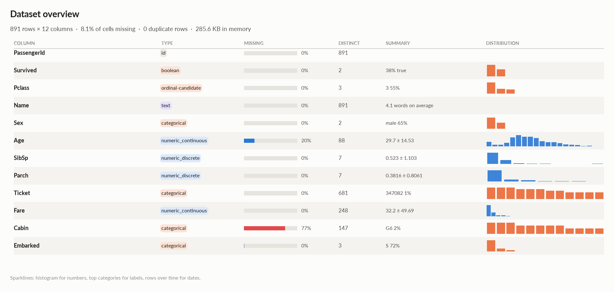 | 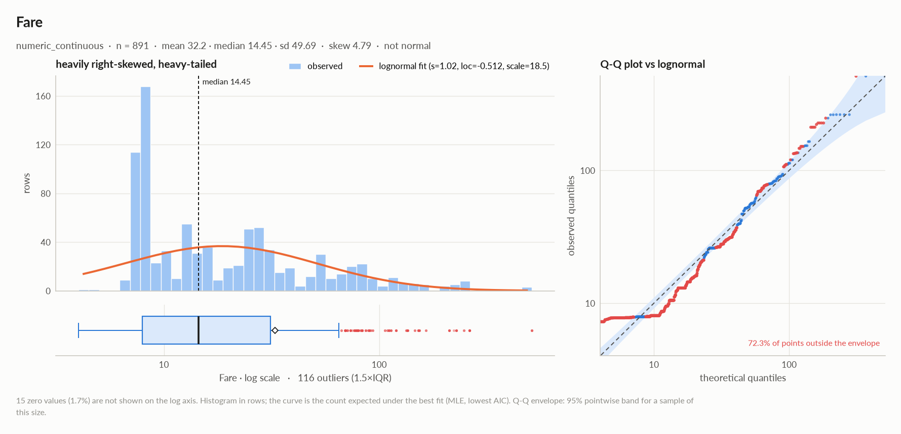 |
| 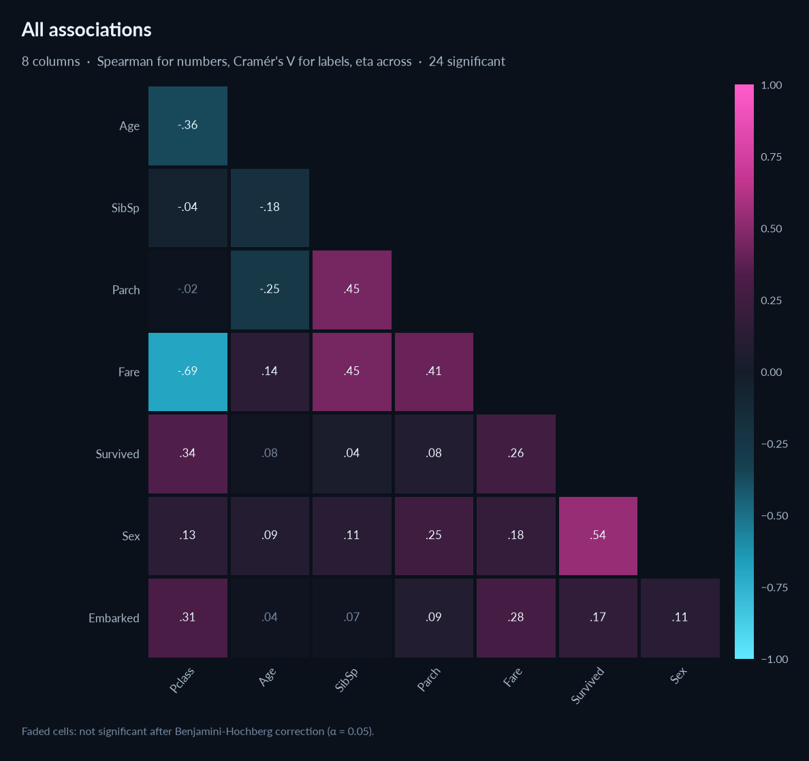 | 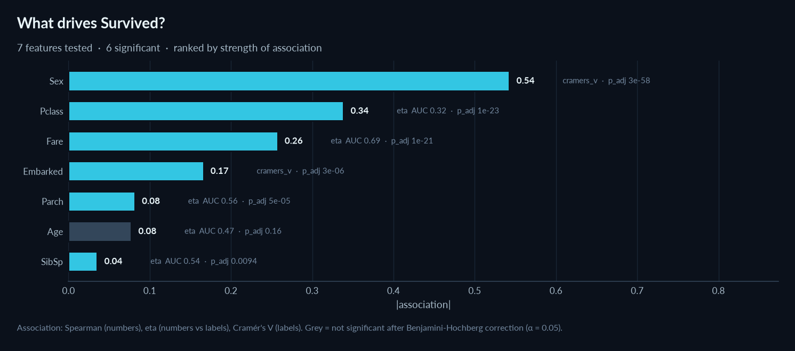 |
| 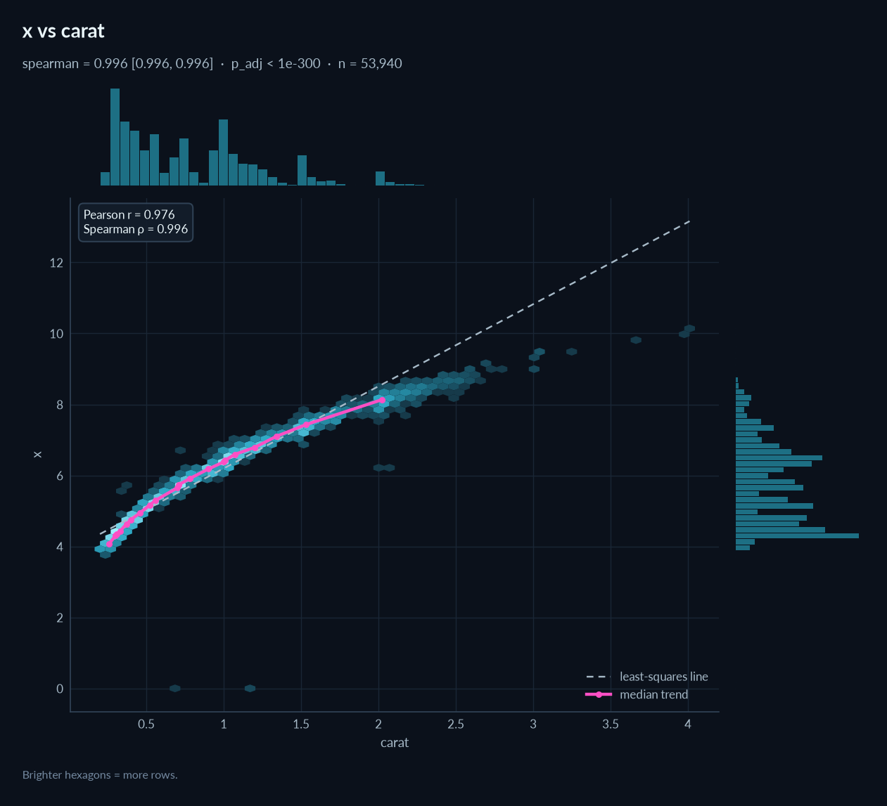 | 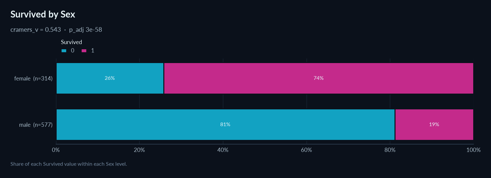 |
| 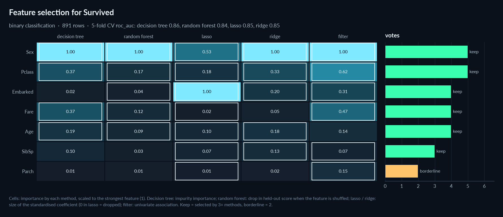 | 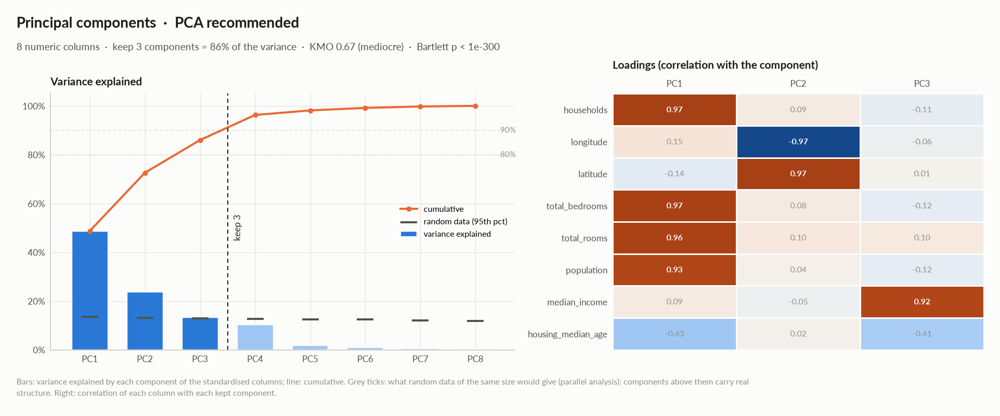 |
| 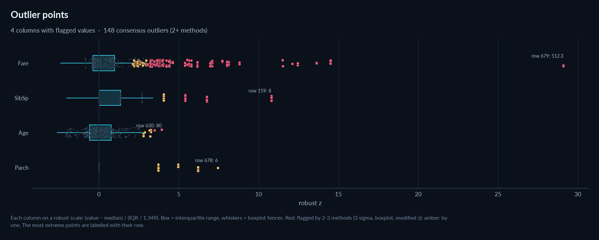 | 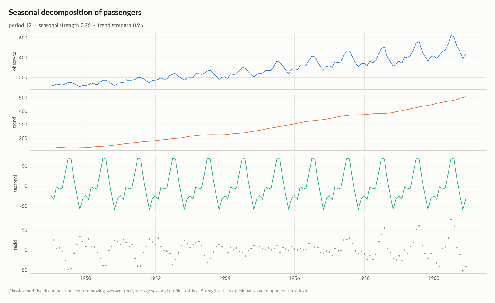 |

## Development

```bash
git clone https://github.com/thibautdqb/elessar && cd elessar
pip install -e ".[dev]"
pytest
python examples/demo.py
```

The animation at the top is generated from a real run of the command line and a screenshot of the report it
wrote (needs Chrome or Chromium): `python docs/make_terminal_svg.py train.csv Survived docs/terminal.svg`.

## License

MIT
