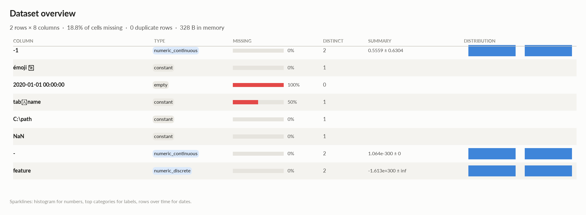
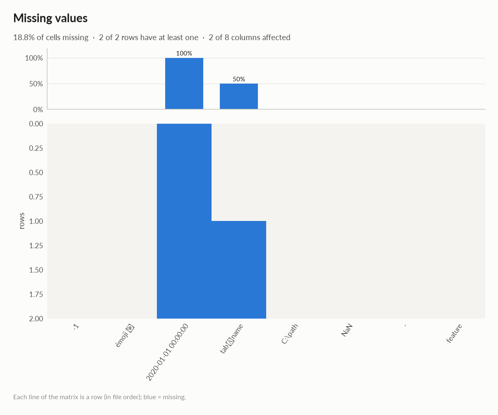
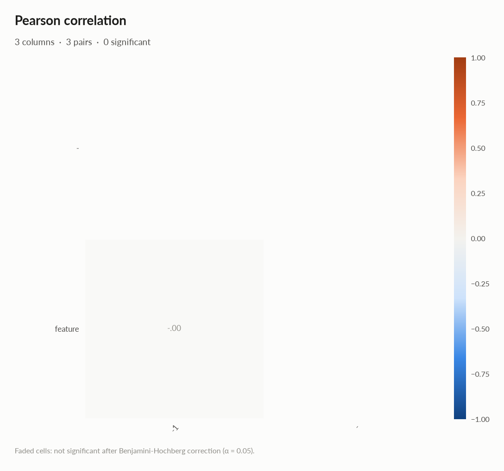
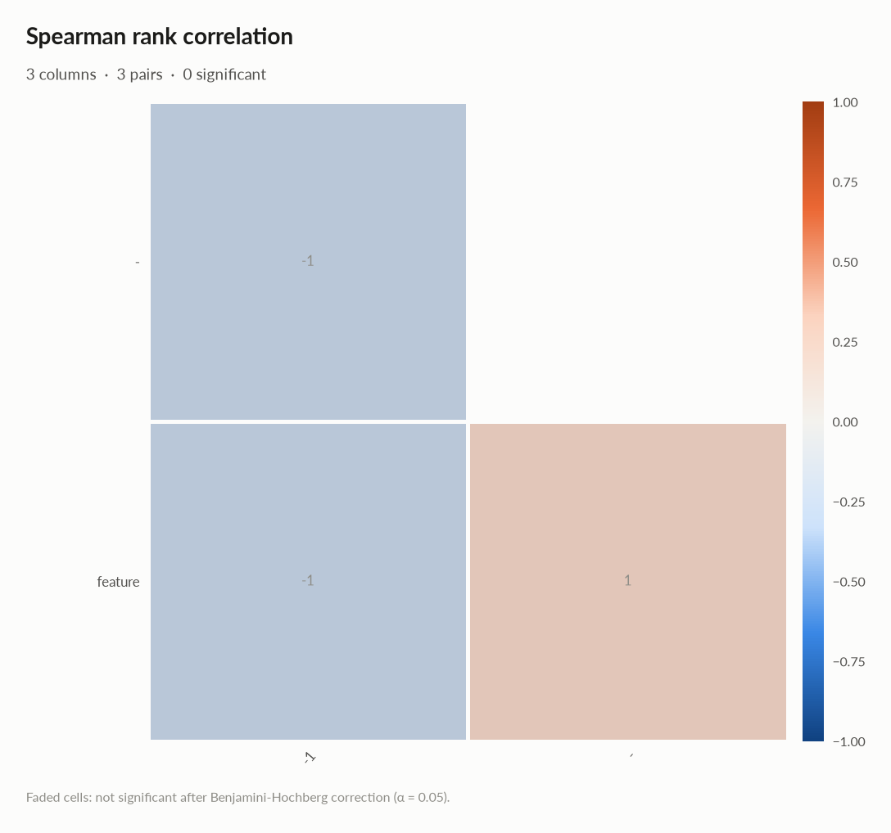

# elessar report

*2 rows × 8 columns · pandas.DataFrame · read in 0.0s · generated 2026-10-28 11:01 by elessar 0.3.0*

[Key findings](#key-findings) · [Overall statistics](#overall-statistics) · [Target analysis](#target-analysis) · [Distributions](#distributions) · [Data quality](#data-quality) · [Multivariate statistics](#multivariate-statistics) · [Preparation plan](#preparation-plan) · [Attribute statistics](#attribute-statistics) · [Run](#run)

## Key findings

- **HIGH** `2020-01-01 00:00:00`: column is entirely missing -\> drop it
- **HIGH** `tab	name`: 50.0% missing -\> drop, or impute and add a missing-indicator
- **MEDIUM** `-`: redundant with '-1' (spearman -1.000) -\> keep only one
- **MEDIUM** `-1`: should-be-numeric: df\['-1'\] = pd.to\_numeric(df\['-1'\], errors='coerce')
- **MEDIUM** `C:\path`: constant column carries no information -\> drop it
- **MEDIUM** `NaN`: identical to column 'émoji 🚀' -\> drop one of them
- **MEDIUM** `NaN`: constant column carries no information -\> drop it
- **MEDIUM** `feature`: redundant with '-1' (spearman -1.000), '-' (spearman +1.000) -\> keep only one
- **MEDIUM** `tab	name`: constant column carries no information -\> drop it
- **MEDIUM** `émoji 🚀`: constant column carries no information -\> drop it

## Overall statistics

|   |   |
|---|---|
| **Rows** | 2 |
| **Columns** | 8 |
| **Memory** | 328 B |
| **Potential saving** | 8 B |
| **Pandas dtypes** | float64=3, str=2, object=1, boolean=1, complex128=1 |
| **Semantic types** | constant=4, numeric\_continuous=2, empty=1, numeric\_discrete=1 |
| **Duplicate rows** | 0 (0.0%) |
| **Missing cells** | 18.8% |
| **Target** | émoji 🚀 |

### Numeric columns at a glance

| column | count | missing | mean | std | min | median | max | skew | kurtosis | outliers | best fit |
|---|---|---|---|---|---|---|---|---|---|---|---|
| `-1` | 2 | 0.0% | 0.5559 | 0.6304 | 0.1101 | 0.5559 | 1.002 | - | - | 0.0% | - |
| `-` | 2 | 0.0% | 1.064e-300 | 0 | 6.493e-302 | 1.064e-300 | 2.063e-300 | - | - | 0.0% | - |
| `feature` | 2 | 0.0% | -1.613e+300 | - | -1.681e+300 | -1.613e+300 | -1.545e+300 | - | - | 0.0% | - |

## Target analysis

Target: `émoji 🚀` (constant)

## Distributions

Normality is tested four ways (Shapiro-Wilk on up to 5,000 values, D'Agostino K², Jarque-Bera, Anderson-Darling); the verdict is 'not normal' when at least half of them reject at alpha 0.05. Every candidate distribution is fitted by maximum likelihood and ranked by AIC; the Akaike weight is its relative support among the candidates.

*With thousands of values every test rejects even a good fit, so read KS D (the largest gap between the fitted and the observed cumulative distribution) as the size of the misfit: below 0.03 close, below 0.08 fair, above poor. KS p-values are optimistic since the parameters come from the same data. For integer columns the gap is measured on the integer support and the p-value comes from a chi-square goodness-of-fit test.*

| column | n | normality | tests rejecting | best fit | parameters | weight | ΔAIC to 2nd | KS D | KS p | shape |
|---|---|---|---|---|---|---|---|---|---|---|
| `-1` | 2 | insufficient data |  | - |  |  |  |  |  | not enough distinct values to fit a distribution |
| `-` | 2 | insufficient data |  | - |  |  |  |  |  | not enough distinct values to fit a distribution |
| `feature` | 2 | insufficient data |  | - |  |  |  |  |  | not enough distinct values to fit a distribution |

## Data quality

| severity | column | message |
|---|---|---|
| high | `2020-01-01 00:00:00` | column is entirely missing -\> drop it |
| high | `tab	name` | 50.0% missing -\> drop, or impute and add a missing-indicator |
| medium | `-` | redundant with '-1' (spearman -1.000) -\> keep only one |
| medium | `-1` | should-be-numeric: df\['-1'\] = pd.to\_numeric(df\['-1'\], errors='coerce') |
| medium | `C:\path` | constant column carries no information -\> drop it |
| medium | `NaN` | identical to column 'émoji 🚀' -\> drop one of them |
| medium | `NaN` | constant column carries no information -\> drop it |
| medium | `feature` | redundant with '-1' (spearman -1.000), '-' (spearman +1.000) -\> keep only one |
| medium | `tab	name` | constant column carries no information -\> drop it |
| medium | `émoji 🚀` | constant column carries no information -\> drop it |
| info | - | dtype optimizations save ~8 B: - -\> float32 (see quality\['dtype\_optimizations'\] for code) |

### Memory: suggested dtypes save 8 B

| column | current | suggested | saving | code |
|---|---|---|---|---|
| `-` | float64 | float32 | 8 B (50%) | `df['-'] = df['-'].astype('float32')` |

## Multivariate statistics

### Dimensionality reduction

PCA not applicable: needs at least 3 numeric columns and enough rows (0 columns, 2 rows)

### Associations between columns

3 pairs tested, 0 significant after Benjamini-Hochberg correction (alpha 0.05).

### Strongest associations

| column A | column B | method | value | 95% CI | n | p\_adj | sig |
|---|---|---|---|---|---|---|---|
| -1 | - | spearman | -1.000 |  | 2 | n/a |  |
| -1 | feature | spearman | -1.000 |  | 2 | n/a |  |
| - | feature | spearman | +1.000 |  | 2 | n/a |  |

## Preparation plan

Cleaning: wrong formats 1, duplicates 1, missing data 2.  Transformation: rescale 1.

### Cleaning

| action | column | why | code |
|---|---|---|---|
| Wrong formats | `-1` | should-be-numeric | `df['-1'] = pd.to_numeric(df['-1'], errors='coerce')` |
| Duplicates | `NaN` | identical to 'émoji 🚀' | `df = df.drop(columns=['NaN'])` |
| Missing data | `2020-01-01 00:00:00` | 100.0% missing: mostly missing: drop it, or keep only a missing indicator | `df['2020-01-01 00:00:00' + '_missing'] = df['2020-01-01 00:00:00'].isna() df = df.drop(columns=['2020-01-01 00:00:00'])` |
| Missing data | `tab	name` | 50.0% missing: mostly missing: drop it, or keep only a missing indicator | `df['tab\tname' + '_missing'] = df['tab\tname'].isna() df = df.drop(columns=['tab\tname'])` |

### Transformation

| action | column | why | code |
|---|---|---|---|
| Rescale | - | numeric scales differ by xinf (feature vs -): distance-based models, regularised models and neural nets need common scales | `from sklearn.preprocessing import RobustScaler, StandardScaler df[[]] = RobustScaler().fit_transform(df[[]])  # outliers others = ['-1', '-', 'feature'] df[others] = StandardScaler().fit_transform(df[others])` |

## Attribute statistics

| column | type | missing | distinct | alerts |
|---|---|---|---|---|
| `-1` | numeric\_continuous | 0.0% | 2 | 0 |
| `émoji 🚀` | constant | 0.0% | 1 | 0 |
| `2020-01-01 00:00:00` | empty | 100.0% | 0 | 0 |
| `tab	name` | constant | 50.0% | 1 | 0 |
| `C:\path` | constant | 0.0% | 1 | 0 |
| `NaN` | constant | 0.0% | 1 | 0 |
| `-` | numeric\_continuous | 0.0% | 2 | 0 |
| `feature` | numeric\_discrete | 0.0% | 2 | 0 |

<code>-1</code> · numeric_continuous

*object · numbers in object column: 2 distinct real values*

**Profile**

| | |
|---|---|
| type | numeric\_continuous |
| dtype | object |
| values | 2 |
| missing | 0 (0.0%) |
| distinct | 2 (100.0%) |
| memory | 64 B |

**Center**

| | |
|---|---|
| mean | 0.5559 |
| 95% CI of mean | \[-5.108, 6.22\] |
| median | 0.5559 |
| 95% CI of median | - |
| trimmed mean | 0.5559 |
| geometric mean | 0.3321 |
| harmonic mean | 0.1984 |

**Spread**

| | |
|---|---|
| std | 0.6304 |
| variance | 0.3975 |
| sem | 0.4458 |
| IQR | 0.4458 |
| MAD | 0.4458 |
| CV | 1.134 |
| range | 0.8916 |

**Quantiles**

| | |
|---|---|
| min | 0.1101 |
| p1 | 0.119 |
| p5 | 0.1547 |
| p25 | 0.333 |
| p50 | 0.5559 |
| p75 | 0.7788 |
| p95 | 0.9571 |
| p99 | 0.9928 |
| max | 1.002 |
| sum | 1.112 |

**Shape**

| | |
|---|---|
| skewness | - |
| excess kurtosis | - |
| KDE modes | - |
| bimodality coef. | - |

**Outliers & counts**

| | |
|---|---|
| IQR fences | \[-0.3357, 1.447\] |
| outside fences | 0 (0.0%) |
| \|z\| \> 3 | 0 (0.0%) |
| modified z \> 3.5 | 0 (0.0%) |
| zeros | 0 |
| negatives | 0 |
| infinite | 0 |

**Row order**

| | |
|---|---|
| monotonic | decreasing |

- **should-be-numeric**: `df['-1'] = pd.to_numeric(df['-1'], errors='coerce')`

<code>émoji 🚀</code> · constant

*str · single value: 'same'*

**Profile**

| | |
|---|---|
| type | constant |
| dtype | str |
| values | 2 |
| missing | 0 (0.0%) |
| distinct | 1 (50.0%) |
| memory | 24 B |
| mode | same ×2 |

#### Most frequent values

| value | count | share |
|---|---|---|
| `same` | 2 | 100.0% |

<code>2020-01-01 00:00:00</code> · empty

*float64 · no non-missing values*

**Profile**

| | |
|---|---|
| type | empty |
| dtype | float64 |
| values | 0 |
| missing | 2 (100.0%) |
| distinct | 0 (0.0%) |
| memory | 16 B |

<code>tab	name</code> · constant

*boolean · single value: 'True'*

**Profile**

| | |
|---|---|
| type | constant |
| dtype | boolean |
| values | 1 |
| missing | 1 (50.0%) |
| distinct | 1 (100.0%) |
| memory | 4 B |

<code>C:\path</code> · constant

*complex128 · single value: '(1+2j)'*

**Profile**

| | |
|---|---|
| type | constant |
| dtype | complex128 |
| values | 2 |
| missing | 0 (0.0%) |
| distinct | 1 (50.0%) |
| memory | 32 B |
| mode | (1+2j) ×2 |

#### Most frequent values

| value | count | share |
|---|---|---|
| `(1+2j)` | 2 | 100.0% |

<code>NaN</code> · constant

*str · single value: 'same'*

**Profile**

| | |
|---|---|
| type | constant |
| dtype | str |
| values | 2 |
| missing | 0 (0.0%) |
| distinct | 1 (50.0%) |
| memory | 24 B |
| mode | same ×2 |

#### Most frequent values

| value | count | share |
|---|---|---|
| `same` | 2 | 100.0% |

<code>-</code> · numeric_continuous

*float64 · float64 dtype: 2 distinct real values*

**Profile**

| | |
|---|---|
| type | numeric\_continuous |
| dtype | float64 |
| values | 2 |
| missing | 0 (0.0%) |
| distinct | 2 (100.0%) |
| memory | 16 B |

**Center**

| | |
|---|---|
| mean | 1.064e-300 |
| 95% CI of mean | \[1.064e-300, 1.064e-300\] |
| median | 1.064e-300 |
| 95% CI of median | - |
| trimmed mean | 1.064e-300 |
| geometric mean | 3.660e-301 |
| harmonic mean | 1.259e-301 |

**Spread**

| | |
|---|---|
| std | 0 |
| variance | 0 |
| sem | 0 |
| IQR | 9.988e-301 |
| MAD | 9.988e-301 |
| CV | 0 |
| range | 1.998e-300 |

**Quantiles**

| | |
|---|---|
| min | 6.493e-302 |
| p1 | 8.491e-302 |
| p5 | 1.648e-301 |
| p25 | 5.643e-301 |
| p50 | 1.064e-300 |
| p75 | 1.563e-300 |
| p95 | 1.963e-300 |
| p99 | 2.043e-300 |
| max | 2.063e-300 |
| sum | 2.128e-300 |

**Shape**

| | |
|---|---|
| skewness | - |
| excess kurtosis | - |
| KDE modes | - |
| bimodality coef. | - |
| decimals | 0 |

**Outliers & counts**

| | |
|---|---|
| IQR fences | \[-9.339e-301, 3.061e-300\] |
| outside fences | 0 (0.0%) |
| \|z\| \> 3 | 0 (0.0%) |
| modified z \> 3.5 | 0 (0.0%) |
| zeros | 0 |
| negatives | 0 |
| infinite | 0 |

**Row order**

| | |
|---|---|
| monotonic | increasing |

<code>feature</code> · numeric_discrete

*float64 · float64 dtype: integer values (2 distinct)*

**Profile**

| | |
|---|---|
| type | numeric\_discrete |
| dtype | float64 |
| values | 2 |
| missing | 0 (0.0%) |
| distinct | 2 (100.0%) |
| memory | 16 B |

**Center**

| | |
|---|---|
| mean | -1.613e+300 |
| 95% CI of mean | \[-, -\] |
| median | -1.613e+300 |
| 95% CI of median | - |
| trimmed mean | -1.613e+300 |
| geometric mean | - |
| harmonic mean | - |

**Spread**

| | |
|---|---|
| std | - |
| variance | - |
| sem | - |
| IQR | 6.813e+298 |
| MAD | 6.813e+298 |
| CV | - |
| range | 1.363e+299 |

**Quantiles**

| | |
|---|---|
| min | -1.681e+300 |
| p1 | -1.680e+300 |
| p5 | -1.674e+300 |
| p25 | -1.647e+300 |
| p50 | -1.613e+300 |
| p75 | -1.579e+300 |
| p95 | -1.552e+300 |
| p99 | -1.546e+300 |
| max | -1.545e+300 |
| sum | -3.226e+300 |

**Shape**

| | |
|---|---|
| skewness | - |
| excess kurtosis | - |
| KDE modes | - |
| bimodality coef. | - |
| decimals | 0 |

**Outliers & counts**

| | |
|---|---|
| IQR fences | \[-1.749e+300, -1.477e+300\] |
| outside fences | 0 (0.0%) |
| \|z\| \> 3 | 0 (0.0%) |
| modified z \> 3.5 | 0 (0.0%) |
| zeros | 0 |
| negatives | 2 |
| infinite | 0 |

**Row order**

| | |
|---|---|
| monotonic | increasing |

## Run

|   |   |
|---|---|
| **Source** | pandas.DataFrame · read in 0.0s |
| **Processes** | 3 for the analysis, 3 for the charts (14 cores available) |
| **Time** | 1.1s (load 0.0s, columns 0.1s, associations 0.1s, quality 0.0s, charts 0.4s) |
| **Significance** | alpha 0.05, Benjamini-Hochberg false discovery rate per family of tests |
| **Versions** | elessar 0.3.0 · Python 3.12.14 · pandas 3.1.0 · numpy 2.5.4 · scipy 1.18.1 |
