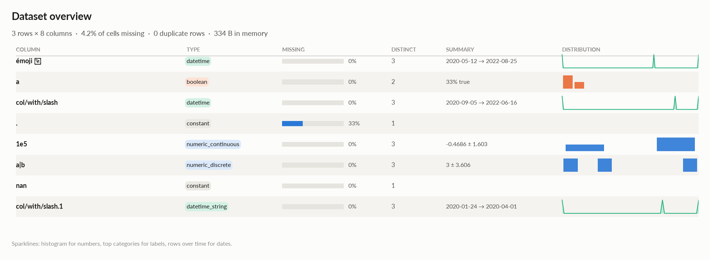
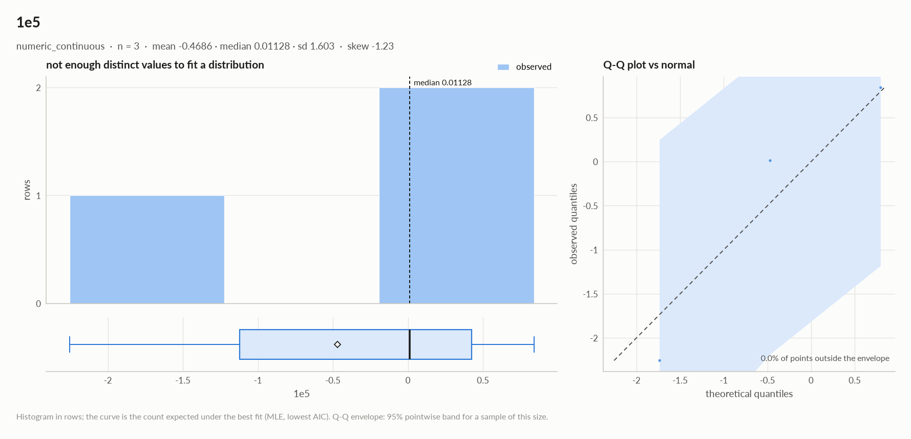
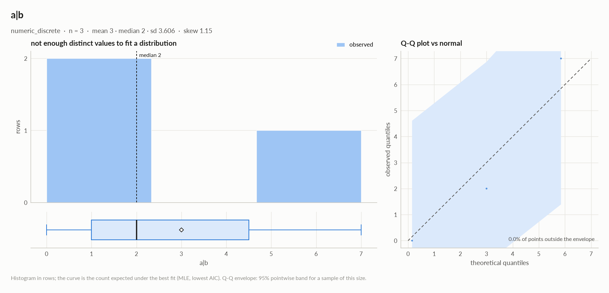
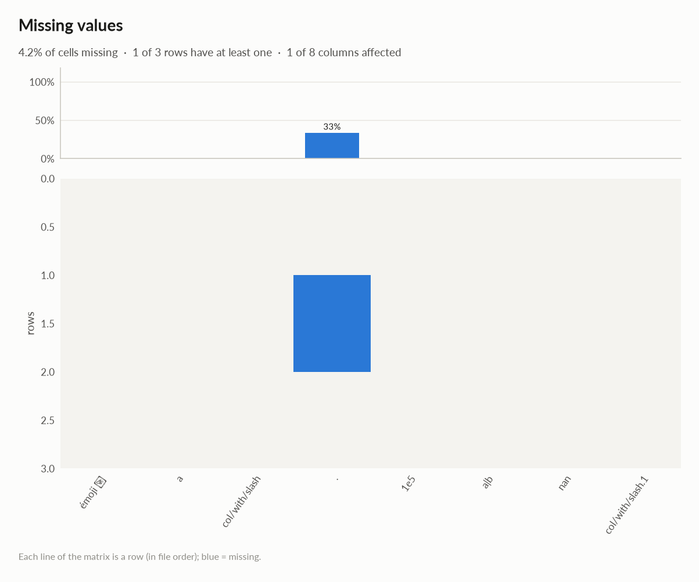
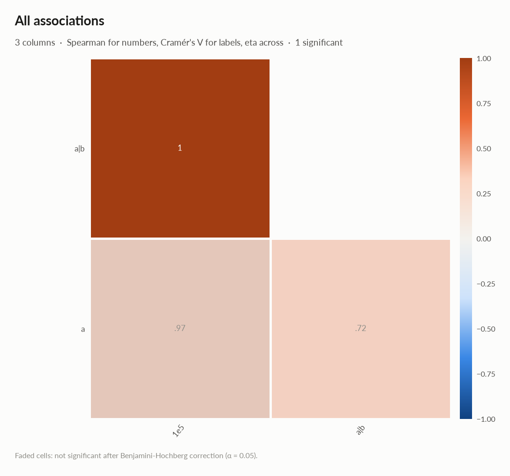
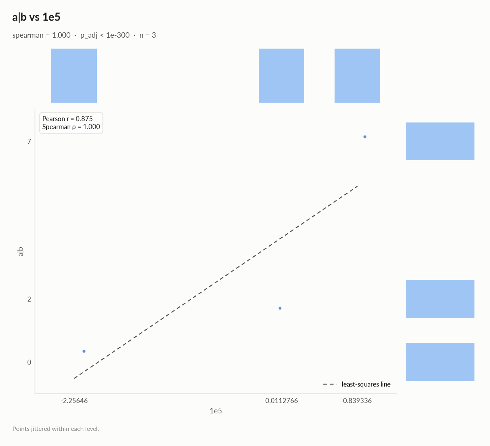
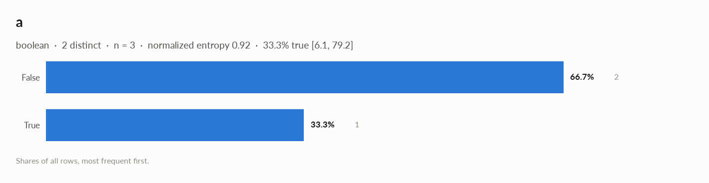
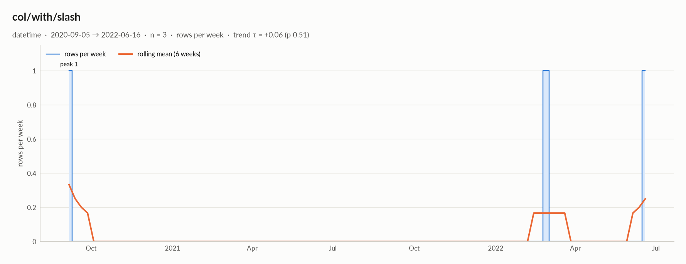
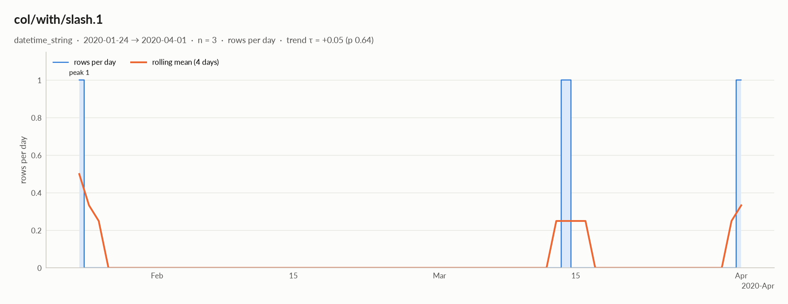

# elessar report

*3 rows × 8 columns · pandas.DataFrame · read in 0.0s · generated 2026-10-28 11:01 by elessar 0.3.0*

[Key findings](#key-findings) · [Overall statistics](#overall-statistics) · [Distributions](#distributions) · [Data quality](#data-quality) · [Multivariate statistics](#multivariate-statistics) · [Preparation plan](#preparation-plan) · [Attribute statistics](#attribute-statistics) · [Run](#run)

## Key findings

- **MEDIUM** duplicate or non-string column names were renamed (a, a.1, ...)
- **MEDIUM** `.`: constant column carries no information -\> drop it
- **MEDIUM** `.`: 33.3% missing -\> drop, or impute and add a missing-indicator
- **MEDIUM** `1e5`: redundant with 'a' (eta +0.966) -\> keep only one
- **MEDIUM** `a|b`: redundant with '1e5' (spearman +1.000) -\> keep only one
- **MEDIUM** `col/with/slash.1`: should-be-datetime: df\['col/with/slash.1'\] = pd.to\_datetime(df\['col/with/slash.1'\], errors='coerce', format='mixed')
- **MEDIUM** `nan`: constant column carries no information -\> drop it

## Overall statistics

|   |   |
|---|---|
| **Rows** | 3 |
| **Columns** | 8 |
| **Memory** | 334 B |
| **Potential saving** | 63 B |
| **Pandas dtypes** | datetime64\[us\]=2, float64=2, boolean=1, Int64=1, category=1, str=1 |
| **Semantic types** | datetime=2, constant=2, boolean=1, numeric\_continuous=1, numeric\_discrete=1, datetime\_string=1 |
| **Duplicate rows** | 0 (0.0%) |
| **Missing cells** | 4.2% |

### Numeric columns at a glance

| column | count | missing | mean | std | min | median | max | skew | kurtosis | outliers | best fit |
|---|---|---|---|---|---|---|---|---|---|---|---|
| `1e5` | 3 | 0.0% | -0.4686 | 1.603 | -2.256 | 0.01128 | 0.8393 | -1.23 | - | 0.0% | - |
| `a\|b` | 3 | 0.0% | 3 | 3.606 | 0 | 2 | 7 | 1.15 | - | 0.0% | - |

### Categorical columns at a glance

| column | type | count | missing | distinct | most frequent | share | entropy |
|---|---|---|---|---|---|---|---|
| `a` | boolean | 3 | 0.0% | 2 | False | 66.7% | 0.918 |

## Distributions

Normality is tested four ways (Shapiro-Wilk on up to 5,000 values, D'Agostino K², Jarque-Bera, Anderson-Darling); the verdict is 'not normal' when at least half of them reject at alpha 0.05. Every candidate distribution is fitted by maximum likelihood and ranked by AIC; the Akaike weight is its relative support among the candidates.

*With thousands of values every test rejects even a good fit, so read KS D (the largest gap between the fitted and the observed cumulative distribution) as the size of the misfit: below 0.03 close, below 0.08 fair, above poor. KS p-values are optimistic since the parameters come from the same data. For integer columns the gap is measured on the integer support and the p-value comes from a chi-square goodness-of-fit test.*

| column | n | normality | tests rejecting | best fit | parameters | weight | ΔAIC to 2nd | KS D | KS p | shape |
|---|---|---|---|---|---|---|---|---|---|---|
| `1e5` | 3 | insufficient data |  | - |  |  |  |  |  | not enough distinct values to fit a distribution |
| `a\|b` | 3 | insufficient data |  | - |  |  |  |  |  | not enough distinct values to fit a distribution |

## Data quality

| severity | column | message |
|---|---|---|
| medium | - | duplicate or non-string column names were renamed (a, a.1, ...) |
| medium | `.` | constant column carries no information -\> drop it |
| medium | `.` | 33.3% missing -\> drop, or impute and add a missing-indicator |
| medium | `1e5` | redundant with 'a' (eta +0.966) -\> keep only one |
| medium | `a\|b` | redundant with '1e5' (spearman +1.000) -\> keep only one |
| medium | `col/with/slash.1` | should-be-datetime: df\['col/with/slash.1'\] = pd.to\_datetime(df\['col/with/slash.1'\], errors='coerce', format='mixed') |
| medium | `nan` | constant column carries no information -\> drop it |
| info | - | dtype optimizations save ~63 B: 1e5 -\> float32, a\|b -\> UInt8, col/with/slash.1 -\> datetime64 (see quality\['dtype\_optimizations'\] for code) |

### Memory: suggested dtypes save 63 B

| column | current | suggested | saving | code |
|---|---|---|---|---|
| `1e5` | float64 | float32 | 12 B (50%) | `df['1e5'] = df['1e5'].astype('float32')` |
| `a\|b` | Int64 | UInt8 | 21 B (78%) | `df['a\|b'] = pd.to_numeric(df['a\|b'], downcast='unsigned')` |
| `col/with/slash.1` | str | datetime64 | 30 B (56%) | `df['col/with/slash.1'] = pd.to_datetime(df['col/with/slash.1'], errors='coerce', format='mixed')` |

## Multivariate statistics

### Dimensionality reduction

PCA not applicable: needs at least 3 numeric columns and enough rows (2 columns, 3 rows)

### Groups of redundant columns

| columns | mean \|Spearman\| | keep |
|---|---|---|
| 1e5, a\|b | 1.00 | `1e5` |

### Associations between columns

3 pairs tested, 1 significant after Benjamini-Hochberg correction (alpha 0.05).

### Strongest associations

| column A | column B | method | value | 95% CI | n | p\_adj | sig |
|---|---|---|---|---|---|---|---|
| 1e5 | a\|b | spearman | +1.000 |  | 3 | \< 1e-300 | \* |
| a | 1e5 | eta | +0.966 |  | 3 | 0.22 |  |
| a | a\|b | eta | +0.721 |  | 3 | 0.22 |  |

## Preparation plan

Cleaning: wrong formats 1, missing data 1.  Transformation: decomposition 3, combination 1, encode 1.

### Cleaning

| action | column | why | code |
|---|---|---|---|
| Wrong formats | `col/with/slash.1` | should-be-datetime | `df['col/with/slash.1'] = pd.to_datetime(df['col/with/slash.1'], errors='coerce', format='mixed')` |
| Missing data | `.` | 33.3% missing: use an explicit 'missing' category | `df['.'] = df['.'].fillna('missing')` |

### Transformation

| action | column | why | code |
|---|---|---|---|
| Decomposition | `émoji 🚀` | a date is not a feature: decompose into calendar parts | `d = pd.to_datetime(df['émoji 🚀'], errors='coerce') df['émoji 🚀' + '_year'], df['émoji 🚀' + '_month'] = d.dt.year, d.dt.month df['émoji 🚀' + '_dow'], df['émoji 🚀' + '_hour'] = d.dt.dayofweek, d.dt.hour` |
| Decomposition | `col/with/slash` | a date is not a feature: decompose into calendar parts | `d = pd.to_datetime(df['col/with/slash'], errors='coerce') df['col/with/slash' + '_year'], df['col/with/slash' + '_month'] = d.dt.year, d.dt.month df['col/with/slash' + '_dow'], df['col/with/slash' + '_hour'] = d.dt.dayofweek, d.dt.hour` |
| Decomposition | `col/with/slash.1` | a date is not a feature: decompose into calendar parts | `d = pd.to_datetime(df['col/with/slash.1'], errors='coerce') df['col/with/slash.1' + '_year'], df['col/with/slash.1' + '_month'] = d.dt.year, d.dt.month df['col/with/slash.1' + '_dow'], df['col/with/slash.1' + '_hour'] = d.dt.dayofweek, d.dt.hour` |
| Combination | `1e5, a\|b` | 2 columns move together (mean \|Spearman\| 1.00): keep '1e5', or combine them into one score | `cols = ['1e5', 'a\|b'] df['combined'] = ((df[cols] - df[cols].mean()) / df[cols].std()).mean(axis=1) # or: df = df.drop(columns=['a\|b'])` |
| Encode | `a` | boolean: 0/1 | `df['a'] = df['a'].astype(bool).astype(int)` |

## Attribute statistics

| column | type | missing | distinct | alerts |
|---|---|---|---|---|
| `émoji 🚀` | datetime | 0.0% | 3 | 0 |
| `a` | boolean | 0.0% | 2 | 0 |
| `col/with/slash` | datetime | 0.0% | 3 | 0 |
| `.` | constant | 33.3% | 1 | 0 |
| `1e5` | numeric\_continuous | 0.0% | 3 | 0 |
| `a\|b` | numeric\_discrete | 0.0% | 3 | 0 |
| `nan` | constant | 0.0% | 1 | 0 |
| `col/with/slash.1` | datetime\_string | 0.0% | 3 | 0 |

<code>émoji 🚀</code> · datetime

*datetime64\[us\] · datetime dtype*

**Profile**

| | |
|---|---|
| type | datetime |
| dtype | datetime64\[us\] |
| values | 3 |
| missing | 0 (0.0%) |
| distinct | 3 (100.0%) |
| memory | 24 B |

**Time**

| | |
|---|---|
| first | 2020-05-12 |
| last | 2022-08-25 |
| span | 835 days 00:00:00 |
| frequency | ~417 days 12:00:00 (irregular) |
| duplicated timestamps | 0 |
| in the future | 0 |
| before 1900 | 0 |
| largest gap | 565 days 00:00:00 (2020-05-12 → 2021-11-28) |
| trend of rows per week | tau +0.03 (p 0.73) |

- Rows by weekday: Tue 1, Thu 1, Sun 1
- Rows by month: May 1, Aug 1, Nov 1

<code>a</code> · boolean

*boolean · bool dtype*

**Profile**

| | |
|---|---|
| type | boolean |
| dtype | boolean |
| values | 3 |
| missing | 0 (0.0%) |
| distinct | 2 (66.7%) |
| memory | 6 B |
| mode | False ×2 |

**Labels**

| | |
|---|---|
| cardinality | 2 |
| entropy | 0.92 bits (0.92 of max) |
| Gini impurity | 0.444 |
| imbalance | ×2 |
| rare labels | 0 (0.0% of rows) |
| uniform? chi² | p 0.56 |
| true | 33.3% \[6.1, 79.2\] |

#### Most frequent values

| value | count | share |
|---|---|---|
| `False` | 2 | 66.7% |
| `True` | 1 | 33.3% |

<code>col/with/slash</code> · datetime

*datetime64\[us\] · datetime dtype*

**Profile**

| | |
|---|---|
| type | datetime |
| dtype | datetime64\[us\] |
| values | 3 |
| missing | 0 (0.0%) |
| distinct | 3 (100.0%) |
| memory | 24 B |

**Time**

| | |
|---|---|
| first | 2020-09-05 |
| last | 2022-06-16 |
| span | 649 days 00:00:00 |
| frequency | ~324 days 12:00:00 (irregular) |
| duplicated timestamps | 0 |
| in the future | 0 |
| before 1900 | 0 |
| largest gap | 539 days 00:00:00 (2020-09-05 → 2022-02-26) |
| trend of rows per week | tau +0.06 (p 0.51) |

- Rows by weekday: Thu 1, Sat 2
- Rows by month: Feb 1, Jun 1, Sep 1

<code>.</code> · constant

*float64 · single value: '2.5'*

**Profile**

| | |
|---|---|
| type | constant |
| dtype | float64 |
| values | 2 |
| missing | 1 (33.3%) |
| distinct | 1 (50.0%) |
| memory | 24 B |
| mode | 2.5 ×2 |

#### Most frequent values

| value | count | share |
|---|---|---|
| `2.5` | 2 | 100.0% |

<code>1e5</code> · numeric_continuous

*float64 · float64 dtype: 3 distinct real values*

**Profile**

| | |
|---|---|
| type | numeric\_continuous |
| dtype | float64 |
| values | 3 |
| missing | 0 (0.0%) |
| distinct | 3 (100.0%) |
| memory | 24 B |

**Center**

| | |
|---|---|
| mean | -0.4686 |
| 95% CI of mean | \[-4.45, 3.513\] |
| median | 0.01128 |
| 95% CI of median | - |
| trimmed mean | -0.4686 |
| geometric mean | - |
| harmonic mean | - |

**Spread**

| | |
|---|---|
| std | 1.603 |
| variance | 2.569 |
| sem | 0.9253 |
| IQR | 1.548 |
| MAD | 0.8281 |
| CV | 3.42 |
| range | 3.096 |

**Quantiles**

| | |
|---|---|
| min | -2.256 |
| p1 | -2.211 |
| p5 | -2.03 |
| p25 | -1.123 |
| p50 | 0.01128 |
| p75 | 0.4253 |
| p95 | 0.7565 |
| p99 | 0.8228 |
| max | 0.8393 |
| sum | -1.406 |

**Shape**

| | |
|---|---|
| skewness | -1.23 |
| excess kurtosis | - |
| KDE modes | - |
| bimodality coef. | - |

**Outliers & counts**

| | |
|---|---|
| IQR fences | \[-3.444, 2.747\] |
| outside fences | 0 (0.0%) |
| \|z\| \> 3 | 0 (0.0%) |
| modified z \> 3.5 | 0 (0.0%) |
| zeros | 0 |
| negatives | 1 |
| infinite | 0 |

**Row order**

| | |
|---|---|
| monotonic | decreasing |

<code>a|b</code> · numeric_discrete

*Int64 · Int64 dtype: integer values (3 distinct)*

**Profile**

| | |
|---|---|
| type | numeric\_discrete |
| dtype | Int64 |
| values | 3 |
| missing | 0 (0.0%) |
| distinct | 3 (100.0%) |
| memory | 27 B |

**Center**

| | |
|---|---|
| mean | 3 |
| 95% CI of mean | \[-5.957, 11.96\] |
| median | 2 |
| 95% CI of median | - |
| trimmed mean | 3 |
| geometric mean | - |
| harmonic mean | - |

**Spread**

| | |
|---|---|
| std | 3.606 |
| variance | 13 |
| sem | 2.082 |
| IQR | 3.5 |
| MAD | 2 |
| CV | 1.202 |
| range | 7 |

**Quantiles**

| | |
|---|---|
| min | 0 |
| p1 | 0.04 |
| p5 | 0.2 |
| p25 | 1 |
| p50 | 2 |
| p75 | 4.5 |
| p95 | 6.5 |
| p99 | 6.9 |
| max | 7 |
| sum | 9 |

**Shape**

| | |
|---|---|
| skewness | 1.15 |
| excess kurtosis | - |
| KDE modes | - |
| bimodality coef. | - |
| decimals | 0 |

**Outliers & counts**

| | |
|---|---|
| IQR fences | \[-4.25, 9.75\] |
| outside fences | 0 (0.0%) |
| \|z\| \> 3 | 0 (0.0%) |
| modified z \> 3.5 | 0 (0.0%) |
| zeros | 1 |
| negatives | 0 |
| infinite | 0 |

**Row order**

| | |
|---|---|
| monotonic | decreasing |

<code>nan</code> · constant

*category · single value: 'x'*

**Profile**

| | |
|---|---|
| type | constant |
| dtype | category |
| values | 3 |
| missing | 0 (0.0%) |
| distinct | 1 (33.3%) |
| memory | 121 B |
| mode | x ×3 |

#### Most frequent values

| value | count | share |
|---|---|---|
| `x` | 3 | 100.0% |

<code>col/with/slash.1</code> · datetime_string

*str · 100% of values parse as dates*

**Profile**

| | |
|---|---|
| type | datetime\_string |
| dtype | str |
| values | 3 |
| missing | 0 (0.0%) |
| distinct | 3 (100.0%) |
| memory | 54 B |

**Time**

| | |
|---|---|
| first | 2020-01-24 |
| last | 2020-04-01 |
| span | 68 days 00:00:00 |
| frequency | ~34 days 00:00:00 (irregular) |
| duplicated timestamps | 0 |
| in the future | 0 |
| before 1900 | 0 |
| largest gap | 50 days 00:00:00 (2020-01-24 → 2020-03-14) |
| trend of rows per day | tau +0.05 (p 0.64) |

- Rows by weekday: Wed 1, Fri 1, Sat 1
- Rows by month: Jan 1, Mar 1, Apr 1
- **should-be-datetime**: `df['col/with/slash.1'] = pd.to_datetime(df['col/with/slash.1'], errors='coerce', format='mixed')`

## Run

|   |   |
|---|---|
| **Source** | pandas.DataFrame · read in 0.0s |
| **Processes** | 3 for the analysis, 3 for the charts (14 cores available) |
| **Time** | 1.5s (load 0.0s, columns 0.2s, associations 0.1s, quality 0.0s, charts 1.1s) |
| **Significance** | alpha 0.05, Benjamini-Hochberg false discovery rate per family of tests |
| **Versions** | elessar 0.3.0 · Python 3.12.14 · pandas 3.1.0 · numpy 2.5.4 · scipy 1.18.1 |
