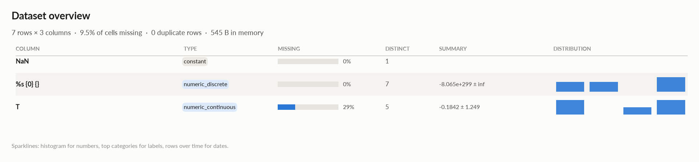
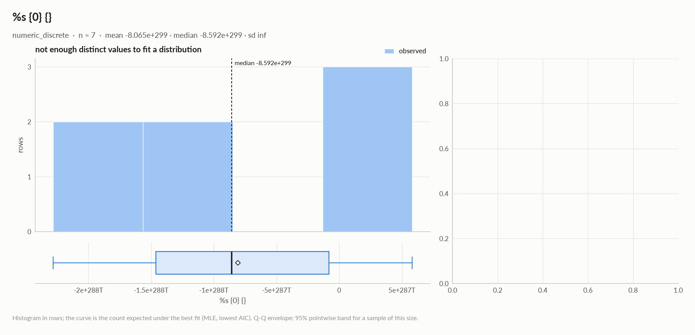
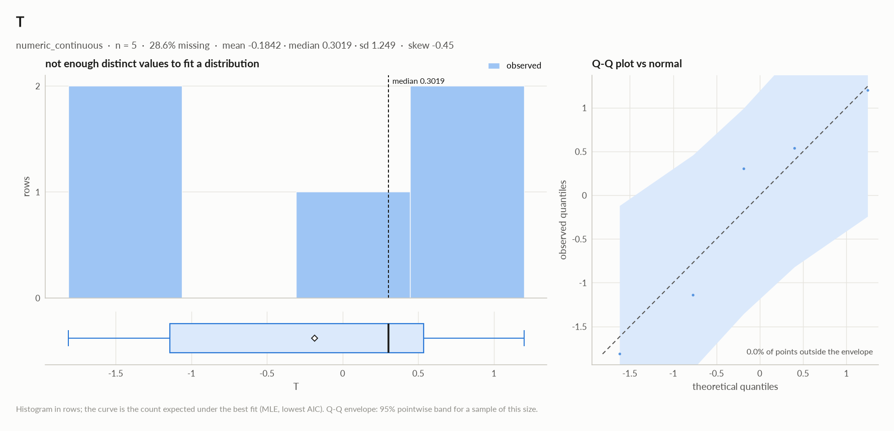
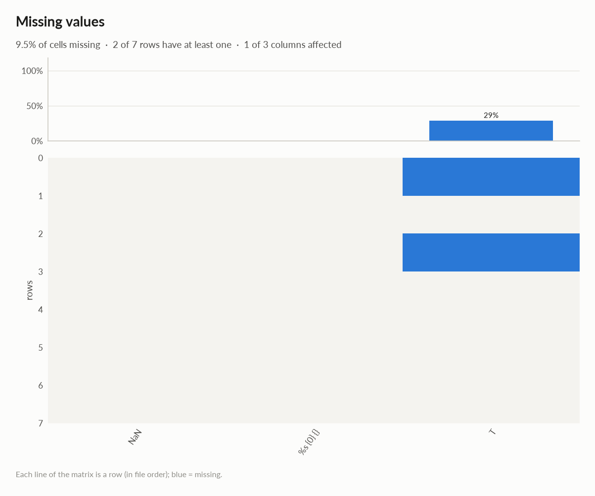

# elessar report

*7 rows × 3 columns · pandas.DataFrame · read in 0.0s · generated 2026-10-28 11:01 by elessar 0.3.0*

[Key findings](#key-findings) · [Overall statistics](#overall-statistics) · [Distributions](#distributions) · [Data quality](#data-quality) · [Multivariate statistics](#multivariate-statistics) · [Preparation plan](#preparation-plan) · [Attribute statistics](#attribute-statistics) · [Run](#run)

## Key findings

- **MEDIUM** `NaN`: constant column carries no information -\> drop it
- **MEDIUM** `T`: 28.6% missing -\> drop, or impute and add a missing-indicator

## Overall statistics

|   |   |
|---|---|
| **Rows** | 7 |
| **Columns** | 3 |
| **Memory** | 545 B |
| **Potential saving** | 28 B |
| **Pandas dtypes** | float64=2, object=1 |
| **Semantic types** | constant=1, numeric\_discrete=1, numeric\_continuous=1 |
| **Duplicate rows** | 0 (0.0%) |
| **Missing cells** | 9.5% |

### Numeric columns at a glance

| column | count | missing | mean | std | min | median | max | skew | kurtosis | outliers | best fit |
|---|---|---|---|---|---|---|---|---|---|---|---|
| `%s {0} {}` | 7 | 0.0% | -8.065e+299 | - | -2.281e+300 | -8.592e+299 | 5.830e+299 | - | - | 0.0% | - |
| `T` | 5 | 28.6% | -0.1842 | 1.249 | -1.815 | 0.3019 | 1.198 | -0.446 | -1.9 | 0.0% | - |

## Distributions

Normality is tested four ways (Shapiro-Wilk on up to 5,000 values, D'Agostino K², Jarque-Bera, Anderson-Darling); the verdict is 'not normal' when at least half of them reject at alpha 0.05. Every candidate distribution is fitted by maximum likelihood and ranked by AIC; the Akaike weight is its relative support among the candidates.

*With thousands of values every test rejects even a good fit, so read KS D (the largest gap between the fitted and the observed cumulative distribution) as the size of the misfit: below 0.03 close, below 0.08 fair, above poor. KS p-values are optimistic since the parameters come from the same data. For integer columns the gap is measured on the integer support and the p-value comes from a chi-square goodness-of-fit test.*

| column | n | normality | tests rejecting | best fit | parameters | weight | ΔAIC to 2nd | KS D | KS p | shape |
|---|---|---|---|---|---|---|---|---|---|---|
| `%s {0} {}` | 7 | insufficient data |  | - |  |  |  |  |  | not enough distinct values to fit a distribution |
| `T` | 5 | insufficient data |  | - |  |  |  |  |  | not enough distinct values to fit a distribution |

## Data quality

| severity | column | message |
|---|---|---|
| medium | `NaN` | constant column carries no information -\> drop it |
| medium | `T` | 28.6% missing -\> drop, or impute and add a missing-indicator |
| info | - | dtype optimizations save ~28 B: T -\> float32 (see quality\['dtype\_optimizations'\] for code) |

### Memory: suggested dtypes save 28 B

| column | current | suggested | saving | code |
|---|---|---|---|---|
| `T` | float64 | float32 | 28 B (50%) | `df['T'] = df['T'].astype('float32')` |

## Multivariate statistics

### Dimensionality reduction

PCA not applicable: needs at least 3 numeric columns and enough rows (2 columns, 7 rows)

### Associations between columns

1 pairs tested, 0 significant after Benjamini-Hochberg correction (alpha 0.05).

### Multicollinearity (VIF)

| column | VIF |
|---|---|
| `T` | 1.00 |
| `%s {0} {}` | nan |

## Preparation plan

Cleaning: missing data 1.  Transformation: rescale 1.

### Cleaning

| action | column | why | code |
|---|---|---|---|
| Missing data | `T` | 28.6% missing: impute with the mean | `df['T'] = df['T'].fillna(df['T'].mean())` |

### Transformation

| action | column | why | code |
|---|---|---|---|
| Rescale | - | numeric scales differ by x823,110,841,199,633,954,436,045,074,609,603,730,456,240,763,036,110,233,023,139,817,800,534,193,717,673,043,598,785,310,448,940,817,303,489,768,997,867,838,829,111,945,325,049,846,124,171,371,513,818,099,210,092,006,685,606,964,892,605,106,253,575,217,868,967,093,431,805,629,332,734,190,797,766,033,555,795,465,870,465,763,996,021,678,540,959,145,836,347,046,039,409,752,559,995,988,366,566,883,328 (%s {0} {} vs T): distance-based models, regularised models and neural nets need common scales | `from sklearn.preprocessing import RobustScaler, StandardScaler df[[]] = RobustScaler().fit_transform(df[[]])  # outliers others = ['%s {0} {}', 'T'] df[others] = StandardScaler().fit_transform(df[others])` |

## Attribute statistics

| column | type | missing | distinct | alerts |
|---|---|---|---|---|
| `NaN` | constant | 0.0% | 1 | 0 |
| `%s {0} {}` | numeric\_discrete | 0.0% | 7 | 0 |
| `T` | numeric\_continuous | 28.6% | 5 | 0 |

<code>NaN</code> · constant

*object · single value: "b'\\\\x00\\\\xff'"*

**Profile**

| | |
|---|---|
| type | constant |
| dtype | object |
| values | 7 |
| missing | 0 (0.0%) |
| distinct | 1 (14.3%) |
| memory | 301 B |
| mode | b'\\x00\\xff' ×7 |

#### Most frequent values

| value | count | share |
|---|---|---|
| `b'\x00\xff'` | 7 | 100.0% |

<code>%s {0} {}</code> · numeric_discrete

*float64 · float64 dtype: integer values (7 distinct)*

**Profile**

| | |
|---|---|
| type | numeric\_discrete |
| dtype | float64 |
| values | 7 |
| missing | 0 (0.0%) |
| distinct | 7 (100.0%) |
| memory | 56 B |

**Center**

| | |
|---|---|
| mean | -8.065e+299 |
| 95% CI of mean | \[-, -\] |
| median | -8.592e+299 |
| 95% CI of median | \[-2.281e+300, 5.830e+299\] |
| trimmed mean | -8.065e+299 |
| geometric mean | - |
| harmonic mean | - |

**Spread**

| | |
|---|---|
| std | - |
| variance | - |
| sem | - |
| IQR | 1.381e+300 |
| MAD | 7.923e+299 |
| CV | - |
| range | 2.864e+300 |

**Quantiles**

| | |
|---|---|
| min | -2.281e+300 |
| p1 | -2.245e+300 |
| p5 | -2.098e+300 |
| p25 | -1.463e+300 |
| p50 | -8.592e+299 |
| p75 | -8.156e+298 |
| p95 | 3.880e+299 |
| p99 | 5.440e+299 |
| max | 5.830e+299 |
| sum | -5.646e+300 |

**Shape**

| | |
|---|---|
| skewness | - |
| excess kurtosis | - |
| KDE modes | - |
| bimodality coef. | - |
| decimals | 0 |

**Outliers & counts**

| | |
|---|---|
| IQR fences | \[-3.534e+300, 1.990e+300\] |
| outside fences | 0 (0.0%) |
| \|z\| \> 3 | 0 (0.0%) |
| modified z \> 3.5 | 0 (0.0%) |
| zeros | 0 |
| negatives | 6 |
| infinite | 0 |

**Row order**

| | |
|---|---|
| monotonic | no |

<code>T</code> · numeric_continuous

*float64 · float64 dtype: 5 distinct real values*

**Profile**

| | |
|---|---|
| type | numeric\_continuous |
| dtype | float64 |
| values | 5 |
| missing | 2 (28.6%) |
| distinct | 5 (100.0%) |
| memory | 56 B |

**Center**

| | |
|---|---|
| mean | -0.1842 |
| 95% CI of mean | \[-1.735, 1.367\] |
| median | 0.3019 |
| 95% CI of median | - |
| trimmed mean | -0.1842 |
| geometric mean | - |
| harmonic mean | - |

**Spread**

| | |
|---|---|
| std | 1.249 |
| variance | 1.56 |
| sem | 0.5586 |
| IQR | 1.678 |
| MAD | 0.8962 |
| CV | 6.782 |
| range | 3.013 |

**Quantiles**

| | |
|---|---|
| min | -1.815 |
| p1 | -1.788 |
| p5 | -1.68 |
| p25 | -1.142 |
| p50 | 0.3019 |
| p75 | 0.5358 |
| p95 | 1.066 |
| p99 | 1.172 |
| max | 1.198 |
| sum | -0.9209 |

**Shape**

| | |
|---|---|
| skewness | -0.446 |
| excess kurtosis | -1.9 |
| KDE modes | - |
| bimodality coef. | 0.196 |

**Outliers & counts**

| | |
|---|---|
| IQR fences | \[-3.659, 3.052\] |
| outside fences | 0 (0.0%) |
| \|z\| \> 3 | 0 (0.0%) |
| modified z \> 3.5 | 0 (0.0%) |
| zeros | 0 |
| negatives | 2 |
| infinite | 0 |

**Row order**

| | |
|---|---|
| monotonic | no |

## Run

|   |   |
|---|---|
| **Source** | pandas.DataFrame · read in 0.0s |
| **Processes** | 3 for the analysis, 3 for the charts (14 cores available) |
| **Time** | 1.0s (load 0.0s, columns 0.1s, associations 0.1s, quality 0.0s, charts 0.7s) |
| **Significance** | alpha 0.05, Benjamini-Hochberg false discovery rate per family of tests |
| **Versions** | elessar 0.3.0 · Python 3.12.14 · pandas 3.1.0 · numpy 2.5.4 · scipy 1.18.1 |
