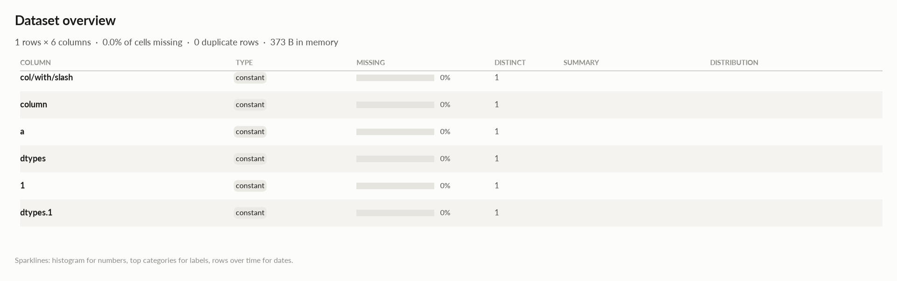

# elessar report

*1 rows × 6 columns · pandas.DataFrame · read in 0.0s · generated 2026-10-28 11:01 by elessar 0.3.0*

[Key findings](#key-findings) · [Overall statistics](#overall-statistics) · [Target analysis](#target-analysis) · [Data quality](#data-quality) · [Multivariate statistics](#multivariate-statistics) · [Preparation plan](#preparation-plan) · [Attribute statistics](#attribute-statistics) · [Run](#run)

## Key findings

- **MEDIUM** duplicate or non-string column names were renamed (a, a.1, ...)
- **MEDIUM** `1`: constant column carries no information -\> drop it
- **MEDIUM** `a`: constant column carries no information -\> drop it
- **MEDIUM** `col/with/slash`: constant column carries no information -\> drop it
- **MEDIUM** `column`: constant column carries no information -\> drop it
- **MEDIUM** `dtypes`: constant column carries no information -\> drop it
- **MEDIUM** `dtypes.1`: constant column carries no information -\> drop it

## Overall statistics

|   |   |
|---|---|
| **Rows** | 1 |
| **Columns** | 6 |
| **Memory** | 373 B |
| **Potential saving** | 0 B |
| **Pandas dtypes** | object=3, period\[M\]=1, str=1, datetime64\[us, UTC\]=1 |
| **Semantic types** | constant=6 |
| **Duplicate rows** | 0 (0.0%) |
| **Missing cells** | 0.0% |
| **Target** | dtypes |

## Target analysis

Target: `dtypes` (constant)

## Data quality

| severity | column | message |
|---|---|---|
| medium | - | duplicate or non-string column names were renamed (a, a.1, ...) |
| medium | `1` | constant column carries no information -\> drop it |
| medium | `a` | constant column carries no information -\> drop it |
| medium | `col/with/slash` | constant column carries no information -\> drop it |
| medium | `column` | constant column carries no information -\> drop it |
| medium | `dtypes` | constant column carries no information -\> drop it |
| medium | `dtypes.1` | constant column carries no information -\> drop it |

## Multivariate statistics

### Dimensionality reduction

PCA not applicable: needs at least 3 numeric columns and enough rows (0 columns, 1 rows)

### Associations between columns

## Preparation plan

Nothing to clean or transform.

## Attribute statistics

| column | type | missing | distinct | alerts |
|---|---|---|---|---|
| `col/with/slash` | constant | 0.0% | 1 | 0 |
| `column` | constant | 0.0% | 1 | 0 |
| `a` | constant | 0.0% | 1 | 0 |
| `dtypes` | constant | 0.0% | 1 | 0 |
| `1` | constant | 0.0% | 1 | 0 |
| `dtypes.1` | constant | 0.0% | 1 | 0 |

<code>col/with/slash</code> · constant

*period\[M\] · single value: '2020-01'*

**Profile**

| | |
|---|---|
| type | constant |
| dtype | period\[M\] |
| values | 1 |
| missing | 0 (0.0%) |
| distinct | 1 (100.0%) |
| memory | 8 B |

<code>column</code> · constant

*str · single value: '8.60%'*

**Profile**

| | |
|---|---|
| type | constant |
| dtype | str |
| values | 1 |
| missing | 0 (0.0%) |
| distinct | 1 (100.0%) |
| memory | 13 B |

<code>a</code> · constant

*datetime64\[us, UTC\] · single value: '2021-01-01 00:00:00+00:00'*

**Profile**

| | |
|---|---|
| type | constant |
| dtype | datetime64\[us, UTC\] |
| values | 1 |
| missing | 0 (0.0%) |
| distinct | 1 (100.0%) |
| memory | 8 B |

<code>dtypes</code> · constant

*object · single value: '0.15387148157914748'*

**Profile**

| | |
|---|---|
| type | constant |
| dtype | object |
| values | 1 |
| missing | 0 (0.0%) |
| distinct | 1 (100.0%) |
| memory | 32 B |

<code>1</code> · constant

*object · single value: "{'k': 0}"*

**Profile**

| | |
|---|---|
| type | constant |
| dtype | object |
| values | 1 |
| missing | 0 (0.0%) |
| distinct | 1 (100.0%) |
| memory | 192 B |

<code>dtypes.1</code> · constant

*object · single value: '2.25'*

**Profile**

| | |
|---|---|
| type | constant |
| dtype | object |
| values | 1 |
| missing | 0 (0.0%) |
| distinct | 1 (100.0%) |
| memory | 112 B |

## Run

|   |   |
|---|---|
| **Source** | pandas.DataFrame · read in 0.0s |
| **Processes** | 3 for the analysis, 3 for the charts (14 cores available) |
| **Time** | 0.8s (load 0.0s, columns 0.1s, associations 0.1s, quality 0.0s, charts 0.3s) |
| **Significance** | alpha 0.05, Benjamini-Hochberg false discovery rate per family of tests |
| **Versions** | elessar 0.3.0 · Python 3.12.14 · pandas 3.1.0 · numpy 2.5.4 · scipy 1.18.1 |
