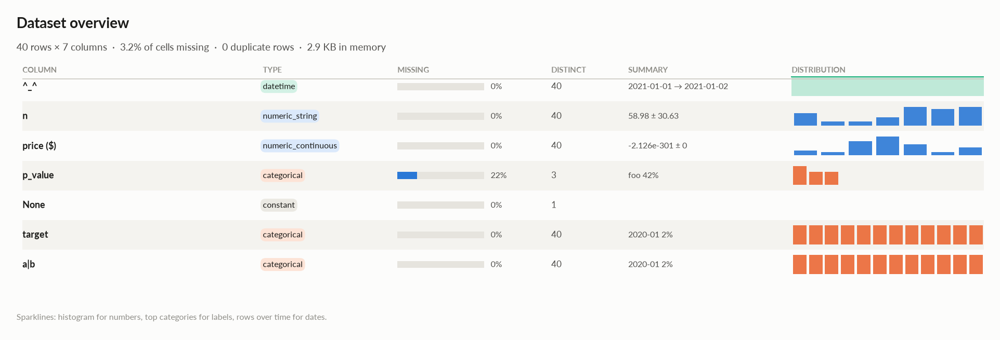
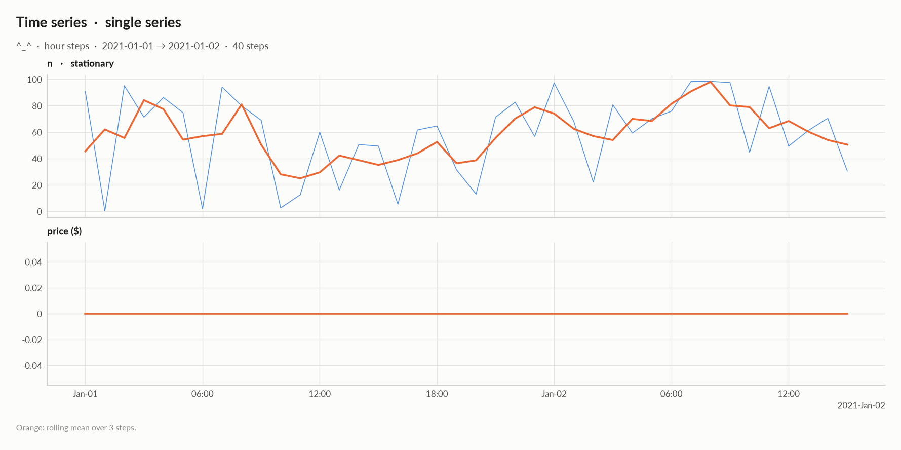
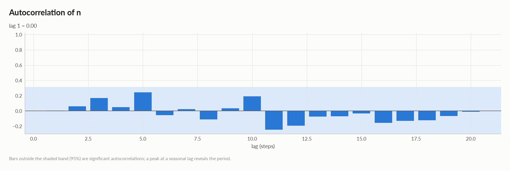
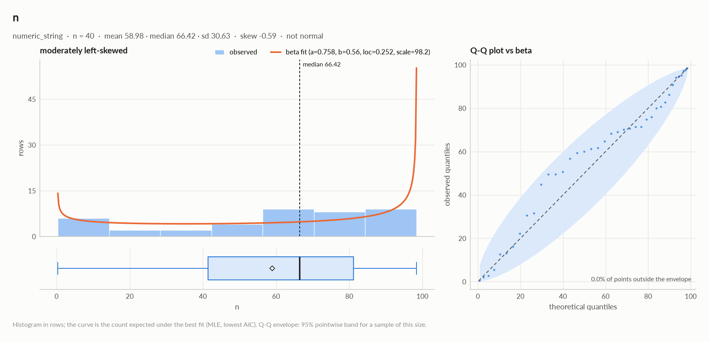
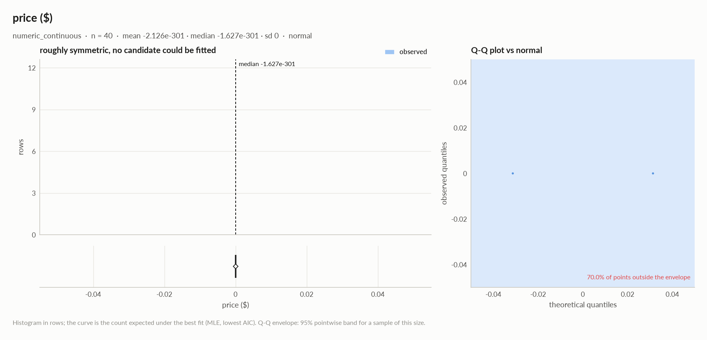
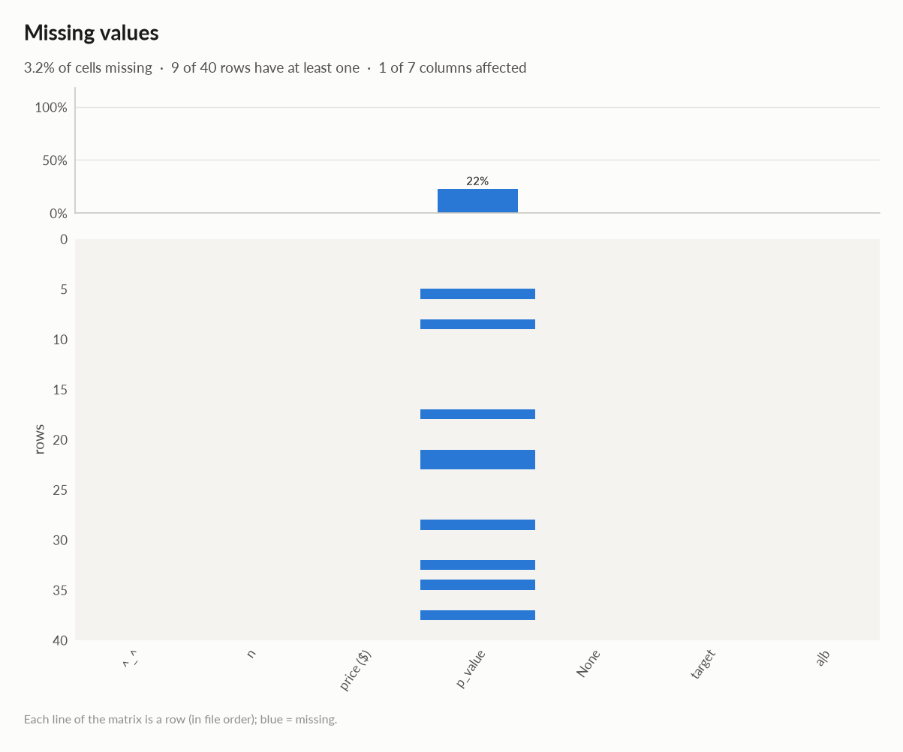
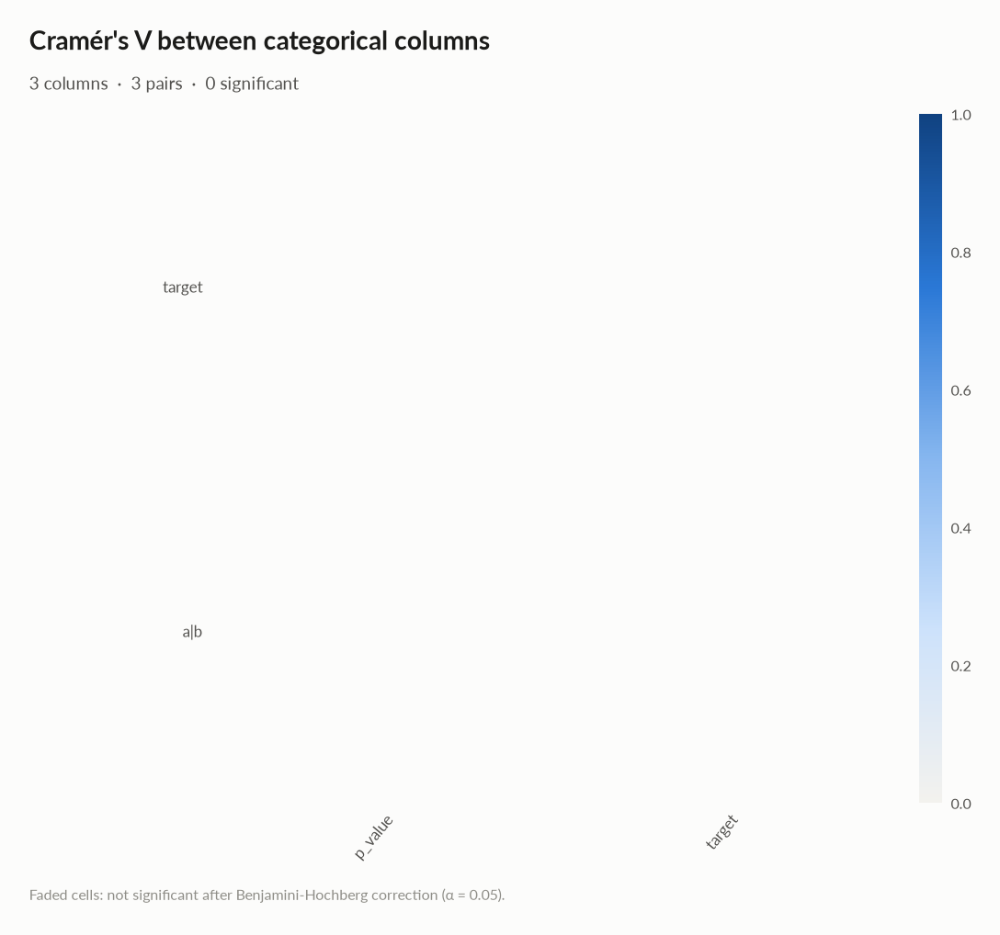
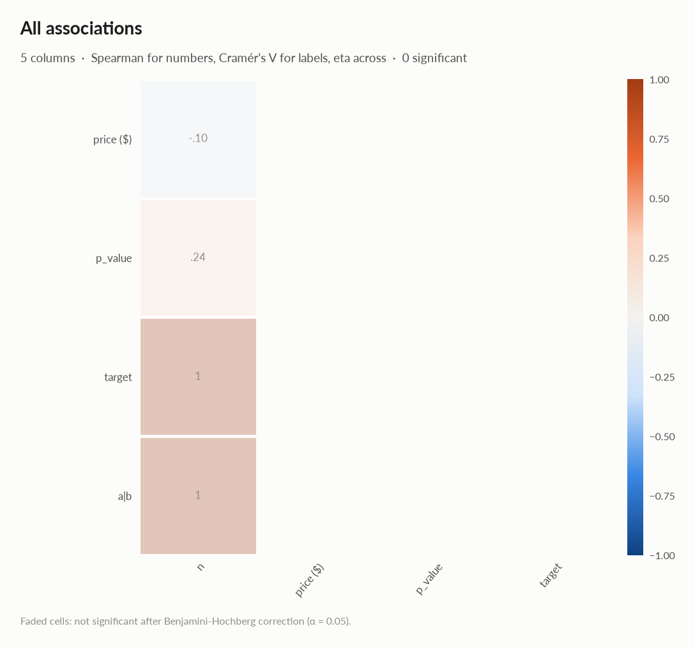
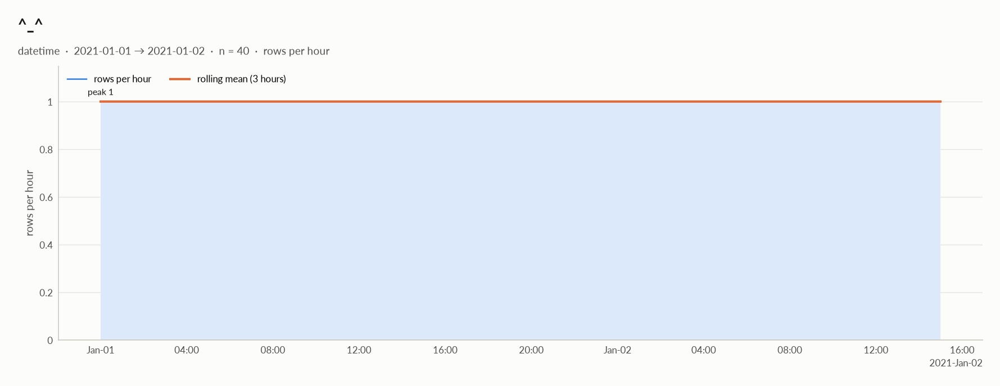
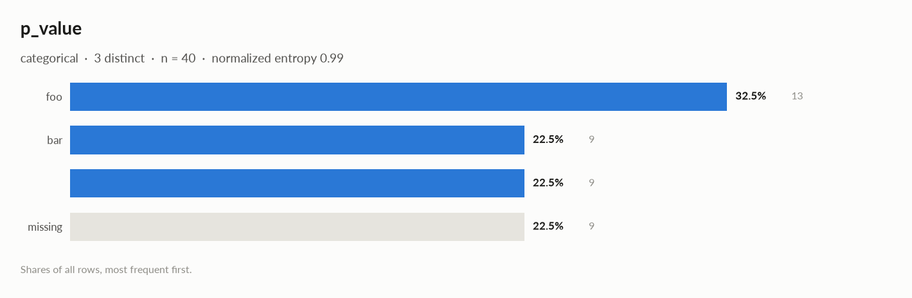

# elessar report

*40 rows × 7 columns · pandas.DataFrame · read in 0.0s · generated 2026-10-28 11:01 by elessar 0.3.0*

[Key findings](#key-findings) · [Overall statistics](#overall-statistics) · [Time series](#time-series) · [Distributions](#distributions) · [Outliers](#outliers) · [Data quality](#data-quality) · [Multivariate statistics](#multivariate-statistics) · [Preparation plan](#preparation-plan) · [Attribute statistics](#attribute-statistics) · [Run](#run)

## Key findings

- **HIGH** `price ($)`: suspicious: 26 negative values in a quantity that should be \>= 0
- **MEDIUM** duplicate or non-string column names were renamed (a, a.1, ...)
- **MEDIUM** `None`: constant column carries no information -\> drop it
- **MEDIUM** `a|b`: identical to column 'target' -\> drop one of them
- **MEDIUM** `n`: redundant with 'a|b' (eta +1.000), 'target' (eta +1.000) -\> keep only one
- **MEDIUM** `n`: should-be-numeric: df\['n'\] = elessar.types.parse\_numeric(df\['n'\])
- **MEDIUM** `p_value`: 22.5% missing -\> drop, or impute and add a missing-indicator
- **MEDIUM** `p_value`: placeholder values used as missing: '' (9) -\> replace with NaN

## Overall statistics

|   |   |
|---|---|
| **Rows** | 40 |
| **Columns** | 7 |
| **Memory** | 2.9 KB |
| **Potential saving** | 716 B |
| **Pandas dtypes** | period\[M\]=2, datetime64\[us, UTC\]=1, str=1, float64=1, string=1, complex128=1 |
| **Semantic types** | categorical=3, datetime=1, numeric\_string=1, numeric\_continuous=1, constant=1 |
| **Duplicate rows** | 0 (0.0%) |
| **Missing cells** | 3.2% |

### Numeric columns at a glance

| column | count | missing | mean | std | min | median | max | skew | kurtosis | outliers | best fit |
|---|---|---|---|---|---|---|---|---|---|---|---|
| `n` | 40 | 0.0% | 58.98 | 30.63 | 0.35 | 66.42 | 98.37 | -0.586 | -0.773 | 0.0% | beta(a=0.758, b=0.56, loc=0.252, scale=98.2) |
| `price ($)` | 40 | 0.0% | -2.126e-301 | 0 | -2.094e-300 | -1.627e-301 | 1.516e-300 | - | - | 0.0% | - |

### Categorical columns at a glance

| column | type | count | missing | distinct | most frequent | share | entropy |
|---|---|---|---|---|---|---|---|
| `p_value` | categorical | 31 | 22.5% | 3 | foo | 41.9% | 0.985 |
| `target` | categorical | 40 | 0.0% | 40 | 2020-01 | 2.5% | 1 |
| `a\|b` | categorical | 40 | 0.0% | 40 | 2020-01 | 2.5% | 1 |

## Time series

The table is **a single time series (one row per timestamp)**, indexed by `^_^`: hour steps, 100% regular, 2021-01-01 → 2021-01-02, 40 steps.

| series | steps | trend | stationarity | lag-1 autocorr. | seasonality |
|---|---|---|---|---|---|
| `n` | 40 | none (tau +0.09, p 0.4) | stationary (ADF -4.26, 5% crit -2.94) | 0.00 | none detected |
| `price ($)` | 40 | - | - | - | - |

### Treatment

| step | what to do | code |
|---|---|---|
| Windows | rolling windows of 3 steps and lags 1, 2 as features, shifted by one step so they only see the past | `df['lag_1'] = df['<value>'].shift(1) df['lag_2'] = df['<value>'].shift(2) df['roll_mean_3'] = df['<value>'].shift(1).rolling(3).mean()` |
| Validation | never shuffle: use expanding-window folds (below), with a gap equal to the forecast horizon | `from sklearn.model_selection import TimeSeriesSplit cv = TimeSeriesSplit(n_splits=5, test_size=4, gap=0)` |
| Augmentation | on the training folds only: jittering (noise at 3-5% of the std), scaling, window slicing, magnitude warping | `rng = np.random.default_rng(0) jittered = y + rng.normal(0, 0.03 * y.std(), len(y)) scaled = y * rng.normal(1, 0.1) start = rng.integers(0, len(y) // 10); sliced = y[start:start + int(0.9 * len(y))] warp = np.interp(np.arange(len(y)), np.linspace(0, len(y) - 1, 6), rng.normal(1, 0.1, 6)) warped = y * warp` |

### Validation folds (expanding window, on the real dates)

| fold | train | validate | train steps | validation steps |
|---|---|---|---|---|
| 1 | 2021-01-01 → 2021-01-01 19:00 | 2021-01-01 20:00 → 2021-01-01 23:00 | 20 | 4 |
| 2 | 2021-01-01 → 2021-01-01 23:00 | 2021-01-02 → 2021-01-02 03:00 | 24 | 4 |
| 3 | 2021-01-01 → 2021-01-02 03:00 | 2021-01-02 04:00 → 2021-01-02 07:00 | 28 | 4 |
| 4 | 2021-01-01 → 2021-01-02 07:00 | 2021-01-02 08:00 → 2021-01-02 11:00 | 32 | 4 |
| 5 | 2021-01-01 → 2021-01-02 11:00 | 2021-01-02 12:00 → 2021-01-02 15:00 | 36 | 4 |

## Distributions

Normality is tested four ways (Shapiro-Wilk on up to 5,000 values, D'Agostino K², Jarque-Bera, Anderson-Darling); the verdict is 'not normal' when at least half of them reject at alpha 0.05. Every candidate distribution is fitted by maximum likelihood and ranked by AIC; the Akaike weight is its relative support among the candidates.

*With thousands of values every test rejects even a good fit, so read KS D (the largest gap between the fitted and the observed cumulative distribution) as the size of the misfit: below 0.03 close, below 0.08 fair, above poor. KS p-values are optimistic since the parameters come from the same data. For integer columns the gap is measured on the integer support and the p-value comes from a chi-square goodness-of-fit test.*

| column | n | normality | tests rejecting | best fit | parameters | weight | ΔAIC to 2nd | KS D | KS p | shape |
|---|---|---|---|---|---|---|---|---|---|---|
| `n` | 40 | not normal | 2 of 4 | beta | a=0.758, b=0.56, loc=0.252, scale=98.2 | 0.96 | 6.5 (uniform) | 0.133 (poor) | 0.44 | moderately left-skewed |
| `price ($)` | 40 | normal | 1 of 4 | - |  |  |  |  |  | roughly symmetric, no candidate could be fitted |

## Outliers

Three methods per numeric column: 3 sigma (|value - mean| \> 3 standard deviations), boxplot (outside the Tukey fences Q1 - 1.5 IQR, Q3 + 1.5 IQR) and modified z (Hampel: |0.6745 (value - median) / MAD| \> 3.5). A consensus outlier is flagged by at least two.

| column | 3 sigma | boxplot | modified z | consensus | fences | action |
|---|---|---|---|---|---|---|
| `n` | 0 | 0 | 0 | 0 (0.0%) | \[-18.12, 140.7\] | keep |
| `price ($)` | 0 | 0 | 0 | 0 (0.0%) | \[-2.331e-300, 1.750e-300\] | keep |

## Data quality

| severity | column | message |
|---|---|---|
| high | `price ($)` | suspicious: 26 negative values in a quantity that should be \>= 0 |
| medium | - | duplicate or non-string column names were renamed (a, a.1, ...) |
| medium | `None` | constant column carries no information -\> drop it |
| medium | `a\|b` | identical to column 'target' -\> drop one of them |
| medium | `n` | redundant with 'a\|b' (eta +1.000), 'target' (eta +1.000) -\> keep only one |
| medium | `n` | should-be-numeric: df\['n'\] = elessar.types.parse\_numeric(df\['n'\]) |
| medium | `p_value` | 22.5% missing -\> drop, or impute and add a missing-indicator |
| medium | `p_value` | placeholder values used as missing: '' (9) -\> replace with NaN |
| info | - | dtype optimizations save ~716 B: n -\> float64, price ($) -\> float32, p\_value -\> category (see quality\['dtype\_optimizations'\] for code) |
| info | `^_^` | a time series, hour steps -\> time-ordered validation, lags and windows (see Time series) |
| info | `a\|b` | 2 data items per cell joined by '-' (e.g. '2021-11') -\> split into 2 columns |
| info | `target` | 2 data items per cell joined by '-' (e.g. '2021-11') -\> split into 2 columns |

### Memory: suggested dtypes save 716 B

| column | current | suggested | saving | code |
|---|---|---|---|---|
| `n` | str | float64 | 236 B (42%) | `df['n'] = elessar.types.parse_numeric(df['n'])` |
| `price ($)` | float64 | float32 | 160 B (50%) | `df['price ($)'] = df['price ($)'].astype('float32')` |
| `p_value` | string | category | 320 B (82%) | `df['p_value'] = df['p_value'].astype('category')` |

## Multivariate statistics

### Dimensionality reduction

PCA not applicable: needs at least 3 numeric columns and enough rows (1 columns, 40 rows)

### Associations between columns

4 pairs tested, 0 significant after Benjamini-Hochberg correction (alpha 0.05).

### Strongest associations

| column A | column B | method | value | 95% CI | n | p\_adj | sig |
|---|---|---|---|---|---|---|---|
| a\|b | n | eta | +1.000 |  | 40 | 0.55 |  |
| target | n | eta | +1.000 |  | 40 | 0.55 |  |

## Preparation plan

Cleaning: invalid values 2, wrong formats 2, duplicates 1, missing data 1.  Transformation: decomposition 3, encode 3.

### Cleaning

| action | column | why | code |
|---|---|---|---|
| Invalid values | `p_value` | placeholders used as missing: '' ×9 | `df['p_value'] = df['p_value'].replace([''], np.nan)` |
| Invalid values | `price ($)` | impossible values: \['26 negative values in a quantity that should be \>= 0'\] | `df.loc[<invalid condition on 'price ($)'>, 'price ($)'] = np.nan` |
| Wrong formats | `n` | should-be-numeric | `df['n'] = elessar.types.parse_numeric(df['n'])` |
| Wrong formats | `p_value` | should-be-category | `df['p_value'] = df['p_value'].astype('category')` |
| Duplicates | `a\|b` | identical to 'target' | `df = df.drop(columns=['a\|b'])` |
| Missing data | `p_value` | 22.5% missing: use an explicit 'missing' category | `df['p_value'] = df['p_value'].fillna('missing')` |

### Transformation

| action | column | why | code |
|---|---|---|---|
| Decomposition | `^_^` | a date is not a feature: decompose into calendar parts | `d = pd.to_datetime(df['^_^'], errors='coerce') df['^_^' + '_year'], df['^_^' + '_month'] = d.dt.year, d.dt.month df['^_^' + '_dow'], df['^_^' + '_hour'] = d.dt.dayofweek, d.dt.hour` |
| Decomposition | `target` | several data items in one cell (2 parts joined by '-', e.g. '2021-11'): split them | `df[['target_1', 'target_2']] = df['target'].str.split('-', n=1, expand=True)` |
| Decomposition | `a\|b` | several data items in one cell (2 parts joined by '-', e.g. '2021-11'): split them | `df[['a\|b_1', 'a\|b_2']] = df['a\|b'].str.split('-', n=1, expand=True)` |
| Encode | `p_value` | 3 labels: one-hot | `df = pd.get_dummies(df, columns=['p_value'], dummy_na=True)` |
| Encode | `target` | 40 labels: too many for one-hot; target encoding (cross-fitted) or frequency encoding | `df['target'] = df['target'].map(df['target'].value_counts(normalize=True))` |
| Encode | `a\|b` | 40 labels: too many for one-hot; target encoding (cross-fitted) or frequency encoding | `df['a\|b'] = df['a\|b'].map(df['a\|b'].value_counts(normalize=True))` |

## Attribute statistics

| column | type | missing | distinct | alerts |
|---|---|---|---|---|
| `^_^` | datetime | 0.0% | 40 | 0 |
| `n` | numeric\_string | 0.0% | 40 | 0 |
| `price ($)` | numeric\_continuous | 0.0% | 40 | 0 |
| `p_value` | categorical | 22.5% | 3 | 0 |
| `None` | constant | 0.0% | 1 | 0 |
| `target` | categorical | 0.0% | 40 | 0 |
| `a\|b` | categorical | 0.0% | 40 | 0 |

<code>^_^</code> · datetime

*datetime64\[us, UTC\] · datetime dtype*

**Profile**

| | |
|---|---|
| type | datetime |
| dtype | datetime64\[us, UTC\] |
| values | 40 |
| missing | 0 (0.0%) |
| distinct | 40 (100.0%) |
| memory | 320 B |

**Time**

| | |
|---|---|
| first | 2021-01-01 |
| last | 2021-01-02 15:00:00 |
| span | 1 days 15:00:00 |
| frequency | h |
| duplicated timestamps | 0 |
| in the future | 0 |
| before 1900 | 0 |
| largest gap | 0 days 01:00:00 (2021-01-01 → 2021-01-01 01:00:00) |

- Rows by weekday: Fri 24, Sat 16
- Rows by hour: 0 2, 1 2, 2 2, 3 2, 4 2, 5 2, 6 2, 7 2, 8 2, 9 2, 10 2, 11 2, 12 2, 13 2, 14 2, 15 2, 16 1, 17 1, 18 1, 19 1, 20 1, 21 1, 22 1, 23 1

<code>n</code> · numeric_string

*str · 100% of values are numbers stored as text*

**Profile**

| | |
|---|---|
| type | numeric\_string |
| dtype | str |
| values | 40 |
| missing | 0 (0.0%) |
| distinct | 40 (100.0%) |
| memory | 556 B |

**Center**

| | |
|---|---|
| mean | 58.98 |
| 95% CI of mean | \[49.19, 68.78\] |
| median | 66.42 |
| 95% CI of median | \[49.45, 74.71\] |
| trimmed mean | 61.18 |
| geometric mean | 40.99 |
| harmonic mean | 8.551 |

**Spread**

| | |
|---|---|
| std | 30.63 |
| variance | 938 |
| sem | 4.843 |
| IQR | 39.7 |
| MAD | 18.37 |
| CV | 0.5193 |
| range | 98.02 |

**Quantiles**

| | |
|---|---|
| min | 0.35 |
| p1 | 0.9935 |
| p5 | 2.599 |
| p25 | 41.43 |
| p50 | 66.42 |
| p75 | 81.12 |
| p95 | 97.48 |
| p99 | 98.33 |
| max | 98.37 |
| sum | 2,359.3 |

**Shape**

| | |
|---|---|
| skewness | -0.586 |
| excess kurtosis | -0.773 |
| KDE modes | 1 |
| bimodality coef. | 0.543 |
| decimals | 2 |
| heaping | ×0.9 |

**Outliers & counts**

| | |
|---|---|
| IQR fences | \[-18.12, 140.7\] |
| outside fences | 0 (0.0%) |
| \|z\| \> 3 | 0 (0.0%) |
| modified z \> 3.5 | 0 (0.0%) |
| zeros | 0 |
| negatives | 0 |
| infinite | 0 |

**Row order**

| | |
|---|---|
| monotonic | no |
| lag-1 autocorrelation | 0.006 (p 0.97) |

#### Normality: not normal (n = 40)

| test | statistic | p-value | at alpha 0.05 |
|---|---|---|---|
| Shapiro-Wilk | 0.9145 | 0.0052 | rejects normality |
| D'Agostino K² | 4.283 | 0.12 | consistent with normal |
| Jarque-Bera | 3.256 | 0.2 | consistent with normal |
| Anderson-Darling | 1.038 | 0.01 | rejects normality |

#### Best fits (continuous, 13 candidates fitted on 40 values)

| \# | distribution | parameters | AIC | ΔAIC | weight | BIC | KS D | KS p |
|---|---|---|---|---|---|---|---|---|
| 1 | beta | a=0.758, b=0.56, loc=0.252, scale=98.2 | 364.345 | 0.0 | 0.96 | 371.1 | 0.133 (poor) | 0.44 |
| 2 | uniform | loc=0.35, scale=98 | 370.814 | 6.5 | 0.04 | 374.191 | 0.226 (poor) | 0.028 |
| 3 | normal | loc=59, scale=30.2 | 390.254 | 25.9 | 0.00 | 393.632 | 0.129 (poor) | 0.48 |

- **should-be-numeric**: `df['n'] = elessar.types.parse_numeric(df['n'])`

<code>price ($)</code> · numeric_continuous

*float64 · float64 dtype: 40 distinct real values*

**Profile**

| | |
|---|---|
| type | numeric\_continuous |
| dtype | float64 |
| values | 40 |
| missing | 0 (0.0%) |
| distinct | 40 (100.0%) |
| memory | 320 B |

**Center**

| | |
|---|---|
| mean | -2.126e-301 |
| 95% CI of mean | \[-2.126e-301, -2.126e-301\] |
| median | -1.627e-301 |
| 95% CI of median | \[-6.240e-301, 2.440e-302\] |
| trimmed mean | -2.025e-301 |
| geometric mean | - |
| harmonic mean | - |

**Spread**

| | |
|---|---|
| std | 0 |
| variance | 0 |
| sem | 0 |
| IQR | 1.020e-300 |
| MAD | 5.451e-301 |
| CV | 0 |
| range | 3.609e-300 |

**Quantiles**

| | |
|---|---|
| min | -2.094e-300 |
| p1 | -2.067e-300 |
| p5 | -1.636e-300 |
| p25 | -8.004e-301 |
| p50 | -1.627e-301 |
| p75 | 2.199e-301 |
| p95 | 1.145e-300 |
| p99 | 1.416e-300 |
| max | 1.516e-300 |
| sum | -8.503e-300 |

**Shape**

| | |
|---|---|
| skewness | - |
| excess kurtosis | - |
| KDE modes | 1 |
| bimodality coef. | - |
| decimals | 0 |

**Outliers & counts**

| | |
|---|---|
| IQR fences | \[-2.331e-300, 1.750e-300\] |
| outside fences | 0 (0.0%) |
| \|z\| \> 3 | 0 (0.0%) |
| modified z \> 3.5 | 0 (0.0%) |
| zeros | 0 |
| negatives | 26 |
| infinite | 0 |

**Row order**

| | |
|---|---|
| monotonic | no |

#### Normality: normal (n = 40)

| test | statistic | p-value | at alpha 0.05 |
|---|---|---|---|
| Shapiro-Wilk | - | n/a | consistent with normal |
| D'Agostino K² | - | n/a | consistent with normal |
| Jarque-Bera | - | n/a | consistent with normal |
| Anderson-Darling | - | 0.01 | rejects normality |

<code>p_value</code> · categorical

*string · 3 distinct labels*

**Profile**

| | |
|---|---|
| type | categorical |
| dtype | string |
| values | 31 |
| missing | 9 (22.5%) |
| distinct | 3 (9.7%) |
| memory | 391 B |
| mode | foo ×13 |

**Labels**

| | |
|---|---|
| cardinality | 3 |
| entropy | 1.56 bits (0.99 of max) |
| Gini impurity | 0.656 |
| imbalance | ×1.444 |
| rare labels | 0 (0.0% of rows) |
| uniform? chi² | p 0.6 |

#### Most frequent values

| value | count | share |
|---|---|---|
| `foo` | 13 | 41.9% |
| `bar` | 9 | 29.0% |
| `  ` | 9 | 29.0% |

- **should-be-category**: `df['p_value'] = df['p_value'].astype('category')`

<code>None</code> · constant

*complex128 · single value: '(1+2j)'*

**Profile**

| | |
|---|---|
| type | constant |
| dtype | complex128 |
| values | 40 |
| missing | 0 (0.0%) |
| distinct | 1 (2.5%) |
| memory | 640 B |
| mode | (1+2j) ×40 |

#### Most frequent values

| value | count | share |
|---|---|---|
| `(1+2j)` | 40 | 100.0% |

<code>target</code> · categorical

*period\[M\] · unrecognised dtype period\[M\], treated as labels*

**Profile**

| | |
|---|---|
| type | categorical |
| dtype | period\[M\] |
| values | 40 |
| missing | 0 (0.0%) |
| distinct | 40 (100.0%) |
| memory | 320 B |

**Labels**

| | |
|---|---|
| cardinality | 40 |
| entropy | 5.32 bits (1.00 of max) |
| Gini impurity | 0.975 |
| imbalance | ×1 |
| rare labels | 0 (0.0% of rows) |
| uniform? chi² | p 1 |

<code>a|b</code> · categorical

*period\[M\] · unrecognised dtype period\[M\], treated as labels*

**Profile**

| | |
|---|---|
| type | categorical |
| dtype | period\[M\] |
| values | 40 |
| missing | 0 (0.0%) |
| distinct | 40 (100.0%) |
| memory | 320 B |

**Labels**

| | |
|---|---|
| cardinality | 40 |
| entropy | 5.32 bits (1.00 of max) |
| Gini impurity | 0.975 |
| imbalance | ×1 |
| rare labels | 0 (0.0% of rows) |
| uniform? chi² | p 1 |

## Run

|   |   |
|---|---|
| **Source** | pandas.DataFrame · read in 0.0s |
| **Processes** | 3 for the analysis, 3 for the charts (14 cores available) |
| **Time** | 1.6s (load 0.0s, columns 0.2s, associations 0.2s, quality 0.0s, charts 0.9s) |
| **Significance** | alpha 0.05, Benjamini-Hochberg false discovery rate per family of tests |
| **Versions** | elessar 0.3.0 · Python 3.12.14 · pandas 3.1.0 · numpy 2.5.4 · scipy 1.18.1 |
