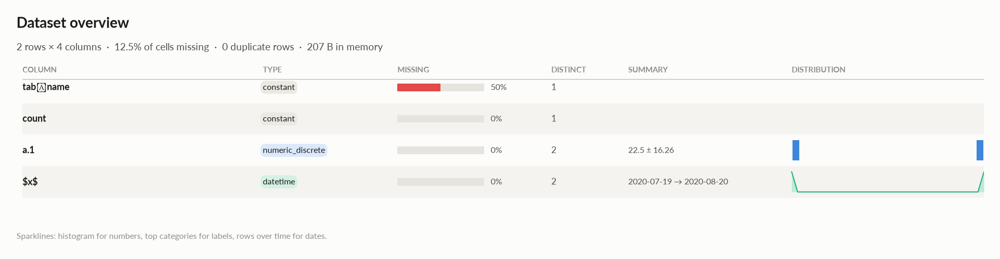
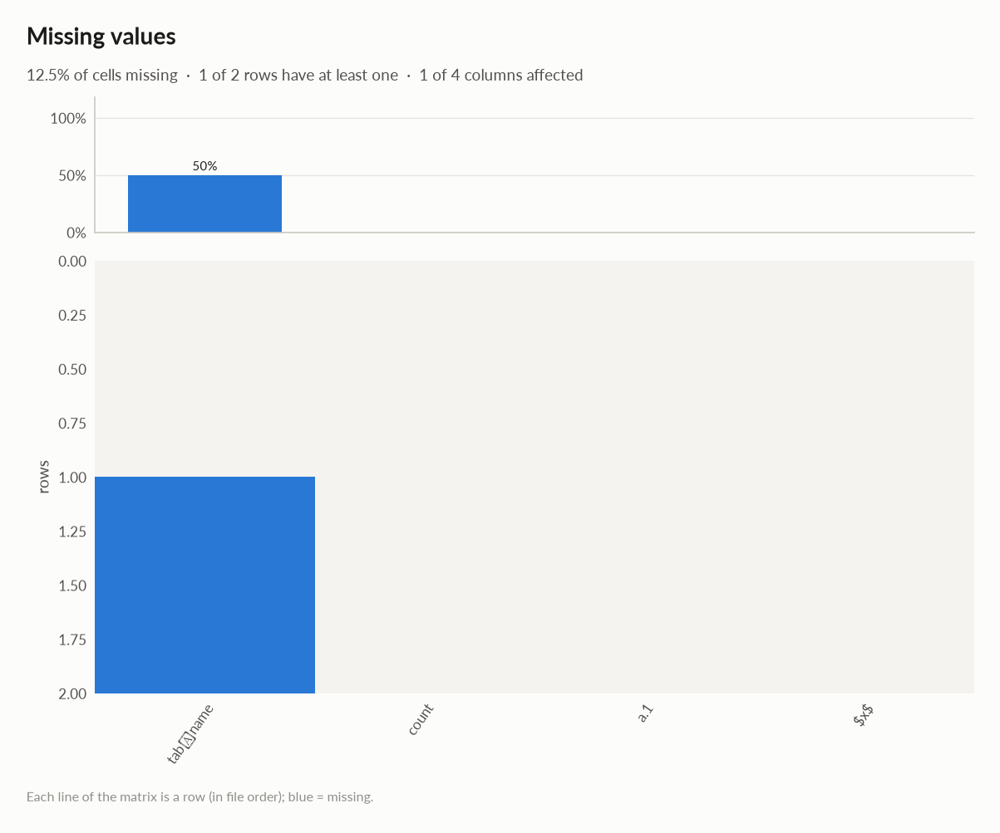
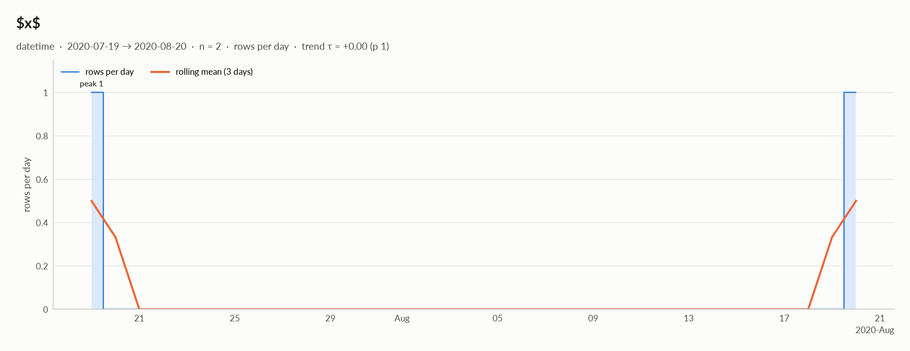

# elessar report

*2 rows × 4 columns · pandas.DataFrame · read in 0.0s · generated 2026-10-28 11:01 by elessar 0.3.0*

[Key findings](#key-findings) · [Overall statistics](#overall-statistics) · [Distributions](#distributions) · [Data quality](#data-quality) · [Multivariate statistics](#multivariate-statistics) · [Preparation plan](#preparation-plan) · [Attribute statistics](#attribute-statistics) · [Run](#run)

## Key findings

- **HIGH** `tab	name`: 50.0% missing -\> drop, or impute and add a missing-indicator
- **MEDIUM** `count`: constant column carries no information -\> drop it
- **MEDIUM** `tab	name`: constant column carries no information -\> drop it

## Overall statistics

|   |   |
|---|---|
| **Rows** | 2 |
| **Columns** | 4 |
| **Memory** | 207 B |
| **Potential saving** | 14 B |
| **Pandas dtypes** | object=1, complex128=1, int64=1, datetime64\[us\]=1 |
| **Semantic types** | constant=2, numeric\_discrete=1, datetime=1 |
| **Duplicate rows** | 0 (0.0%) |
| **Missing cells** | 12.5% |

### Numeric columns at a glance

| column | count | missing | mean | std | min | median | max | skew | kurtosis | outliers | best fit |
|---|---|---|---|---|---|---|---|---|---|---|---|
| `a.1` | 2 | 0.0% | 22.5 | 16.26 | 11 | 22.5 | 34 | - | - | 0.0% | - |

## Distributions

Normality is tested four ways (Shapiro-Wilk on up to 5,000 values, D'Agostino K², Jarque-Bera, Anderson-Darling); the verdict is 'not normal' when at least half of them reject at alpha 0.05. Every candidate distribution is fitted by maximum likelihood and ranked by AIC; the Akaike weight is its relative support among the candidates.

*With thousands of values every test rejects even a good fit, so read KS D (the largest gap between the fitted and the observed cumulative distribution) as the size of the misfit: below 0.03 close, below 0.08 fair, above poor. KS p-values are optimistic since the parameters come from the same data. For integer columns the gap is measured on the integer support and the p-value comes from a chi-square goodness-of-fit test.*

| column | n | normality | tests rejecting | best fit | parameters | weight | ΔAIC to 2nd | KS D | KS p | shape |
|---|---|---|---|---|---|---|---|---|---|---|
| `a.1` | 2 | insufficient data |  | - |  |  |  |  |  | not enough distinct values to fit a distribution |

## Data quality

| severity | column | message |
|---|---|---|
| high | `tab	name` | 50.0% missing -\> drop, or impute and add a missing-indicator |
| medium | `count` | constant column carries no information -\> drop it |
| medium | `tab	name` | constant column carries no information -\> drop it |
| info | - | dtype optimizations save ~14 B: a.1 -\> uint8 (see quality\['dtype\_optimizations'\] for code) |

### Memory: suggested dtypes save 14 B

| column | current | suggested | saving | code |
|---|---|---|---|---|
| `a.1` | int64 | uint8 | 14 B (88%) | `df['a.1'] = pd.to_numeric(df['a.1'], downcast='unsigned')` |

## Multivariate statistics

### Dimensionality reduction

PCA not applicable: needs at least 3 numeric columns and enough rows (0 columns, 2 rows)

### Associations between columns

## Preparation plan

Cleaning: missing data 1.  Transformation: decomposition 1.

### Cleaning

| action | column | why | code |
|---|---|---|---|
| Missing data | `tab	name` | 50.0% missing: mostly missing: drop it, or keep only a missing indicator | `df['tab\tname' + '_missing'] = df['tab\tname'].isna() df = df.drop(columns=['tab\tname'])` |

### Transformation

| action | column | why | code |
|---|---|---|---|
| Decomposition | `$x$` | a date is not a feature: decompose into calendar parts | `d = pd.to_datetime(df['$x$'], errors='coerce') df['$x$' + '_year'], df['$x$' + '_month'] = d.dt.year, d.dt.month df['$x$' + '_dow'], df['$x$' + '_hour'] = d.dt.dayofweek, d.dt.hour` |

## Attribute statistics

| column | type | missing | distinct | alerts |
|---|---|---|---|---|
| `tab	name` | constant | 50.0% | 1 | 0 |
| `count` | constant | 0.0% | 1 | 0 |
| `a.1` | numeric\_discrete | 0.0% | 2 | 0 |
| `$x$` | datetime | 0.0% | 2 | 0 |

<code>tab	name</code> · constant

*object · single value: '$5'*

**Profile**

| | |
|---|---|
| type | constant |
| dtype | object |
| values | 1 |
| missing | 1 (50.0%) |
| distinct | 1 (100.0%) |
| memory | 75 B |

<code>count</code> · constant

*complex128 · single value: '(1+2j)'*

**Profile**

| | |
|---|---|
| type | constant |
| dtype | complex128 |
| values | 2 |
| missing | 0 (0.0%) |
| distinct | 1 (50.0%) |
| memory | 32 B |
| mode | (1+2j) ×2 |

#### Most frequent values

| value | count | share |
|---|---|---|
| `(1+2j)` | 2 | 100.0% |

<code>a.1</code> · numeric_discrete

*int64 · int64 dtype: integer values (2 distinct)*

**Profile**

| | |
|---|---|
| type | numeric\_discrete |
| dtype | int64 |
| values | 2 |
| missing | 0 (0.0%) |
| distinct | 2 (100.0%) |
| memory | 16 B |

**Center**

| | |
|---|---|
| mean | 22.5 |
| 95% CI of mean | \[-123.6, 168.6\] |
| median | 22.5 |
| 95% CI of median | - |
| trimmed mean | 22.5 |
| geometric mean | 19.34 |
| harmonic mean | 16.62 |

**Spread**

| | |
|---|---|
| std | 16.26 |
| variance | 264.5 |
| sem | 11.5 |
| IQR | 11.5 |
| MAD | 11.5 |
| CV | 0.7228 |
| range | 23 |

**Quantiles**

| | |
|---|---|
| min | 11 |
| p1 | 11.23 |
| p5 | 12.15 |
| p25 | 16.75 |
| p50 | 22.5 |
| p75 | 28.25 |
| p95 | 32.85 |
| p99 | 33.77 |
| max | 34 |
| sum | 45 |

**Shape**

| | |
|---|---|
| skewness | - |
| excess kurtosis | - |
| KDE modes | - |
| bimodality coef. | - |
| decimals | 0 |

**Outliers & counts**

| | |
|---|---|
| IQR fences | \[-0.5, 45.5\] |
| outside fences | 0 (0.0%) |
| \|z\| \> 3 | 0 (0.0%) |
| modified z \> 3.5 | 0 (0.0%) |
| zeros | 0 |
| negatives | 0 |
| infinite | 0 |

**Row order**

| | |
|---|---|
| monotonic | decreasing |

<code>$x$</code> · datetime

*datetime64\[us\] · datetime dtype*

**Profile**

| | |
|---|---|
| type | datetime |
| dtype | datetime64\[us\] |
| values | 2 |
| missing | 0 (0.0%) |
| distinct | 2 (100.0%) |
| memory | 16 B |

**Time**

| | |
|---|---|
| first | 2020-07-19 |
| last | 2020-08-20 |
| span | 32 days 00:00:00 |
| frequency | irregular |
| duplicated timestamps | 0 |
| in the future | 0 |
| before 1900 | 0 |
| largest gap | 32 days 00:00:00 (2020-07-19 → 2020-08-20) |
| trend of rows per day | tau +0.00 (p 1) |

- Rows by weekday: Thu 1, Sun 1

## Run

|   |   |
|---|---|
| **Source** | pandas.DataFrame · read in 0.0s |
| **Processes** | 3 for the analysis, 3 for the charts (14 cores available) |
| **Time** | 0.7s (load 0.0s, columns 0.1s, associations 0.1s, quality 0.0s, charts 0.3s) |
| **Significance** | alpha 0.05, Benjamini-Hochberg false discovery rate per family of tests |
| **Versions** | elessar 0.3.0 · Python 3.12.14 · pandas 3.1.0 · numpy 2.5.4 · scipy 1.18.1 |
