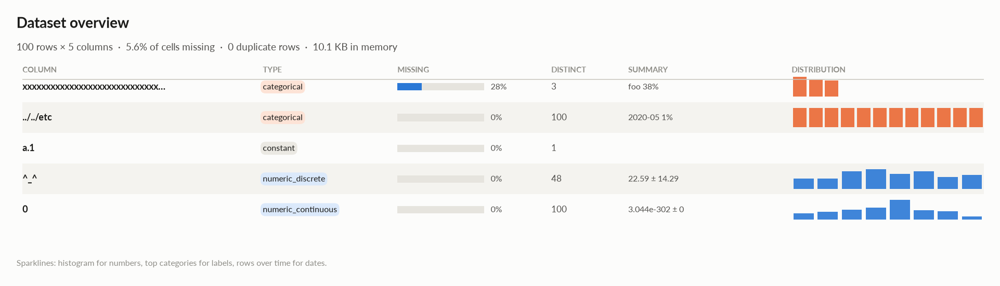
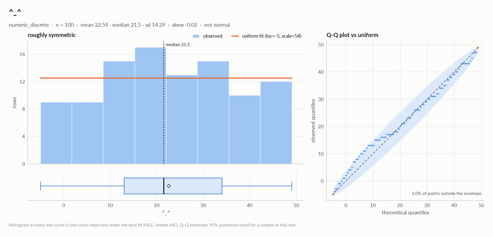
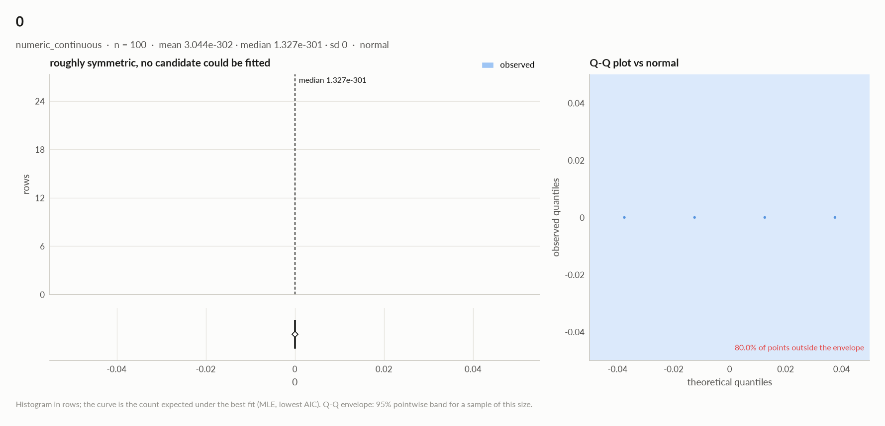
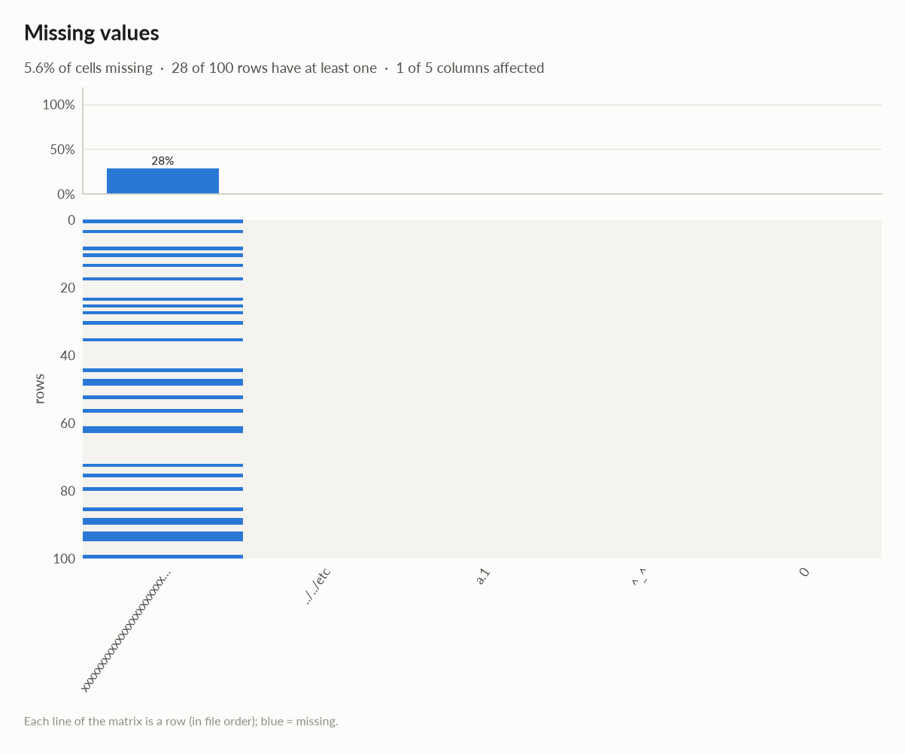
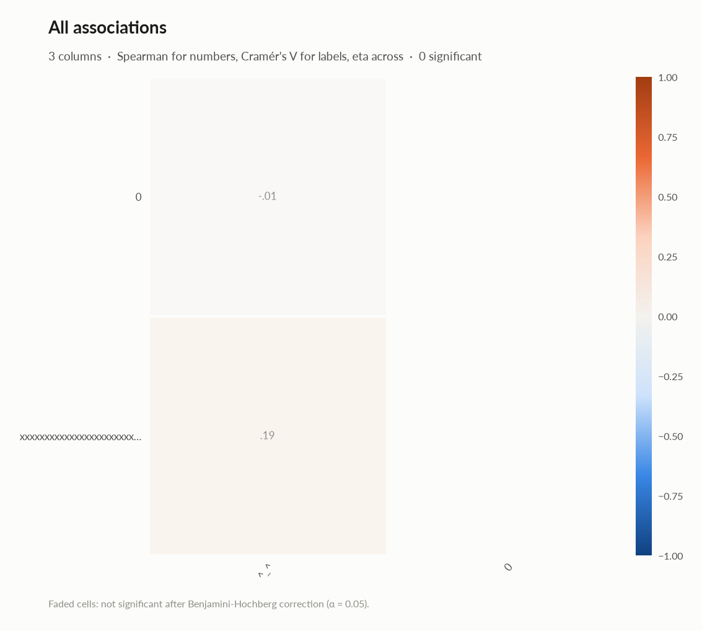

# elessar report

*300 rows × 5 columns · pandas.DataFrame · streamed in 5 chunks (in memory, 3 processes) · read in 0.2s · generated 2026-10-28 11:01 by elessar 0.3.0*

> **Sampled profile. **The table has 300 rows: statistics, tests and charts use a uniform random sample of 100 rows (33.3%). Row counts, missing values, min / max / mean / std, distinct counts and duplicate rows are exact over every row (exact figures).

[Key findings](#key-findings) · [Overall statistics](#overall-statistics) · [Target analysis](#target-analysis) · [Feature selection](#feature-selection) · [Distributions](#distributions) · [Outliers](#outliers) · [Data quality](#data-quality) · [Multivariate statistics](#multivariate-statistics) · [Preparation plan](#preparation-plan) · [Attribute statistics](#attribute-statistics) · [Run](#run)

## Key findings

- 1 feature shows no significant link with `xxxxxxxxxxxxxxxxxxxxxxxxxxxxxxxxxxxxxxxxxxxxxxxxxxxxxxxxxxxxxxxxxxxxxxxxxxxxxxxxxxxxxxxxxxxxxxxxxxxxxxxxxxxxxxxxxxxxxxxxxxxxxxxxxxxxxxxxxxxxxxxxxxxxxxxxxxxxxxxxxxxxxxxxxxxxxxxxxxxxxxxxxxxxxxxxxxxxxxxxxxxxxxxxxxxxxxxxxxxxxxxxxxxxxxxxxxxxxxxxxxxxxxxxxxxxxxxxxxxxxxxxxxxxxxxxxxxxxxxxxxxxxxxxxxxxxxxxxxxx`: ^\_^
- **MEDIUM** `a.1`: constant column carries no information -\> drop it
- **MEDIUM** `xxxxxxxxxxxxxxxxxxxxxxxxxxxxxxxxxxxxxxxxxxxxxxxxxxxxxxxxxxxxxxxxxxxxxxxxxxxxxxxxxxxxxxxxxxxxxxxxxxxxxxxxxxxxxxxxxxxxxxxxxxxxxxxxxxxxxxxxxxxxxxxxxxxxxxxxxxxxxxxxxxxxxxxxxxxxxxxxxxxxxxxxxxxxxxxxxxxxxxxxxxxxxxxxxxxxxxxxxxxxxxxxxxxxxxxxxxxxxxxxxxxxxxxxxxxxxxxxxxxxxxxxxxxxxxxxxxxxxxxxxxxxxxxxxxxxxxxxxxxx`: 28.0% missing -\> drop, or impute and add a missing-indicator
- **MEDIUM** `xxxxxxxxxxxxxxxxxxxxxxxxxxxxxxxxxxxxxxxxxxxxxxxxxxxxxxxxxxxxxxxxxxxxxxxxxxxxxxxxxxxxxxxxxxxxxxxxxxxxxxxxxxxxxxxxxxxxxxxxxxxxxxxxxxxxxxxxxxxxxxxxxxxxxxxxxxxxxxxxxxxxxxxxxxxxxxxxxxxxxxxxxxxxxxxxxxxxxxxxxxxxxxxxxxxxxxxxxxxxxxxxxxxxxxxxxxxxxxxxxxxxxxxxxxxxxxxxxxxxxxxxxxxxxxxxxxxxxxxxxxxxxxxxxxxxxxxxxxxx`: placeholder values used as missing: '' (22) -\> replace with NaN

## Overall statistics

|   |   |
|---|---|
| **Rows** | 300 (100 profiled, uniform random sample) |
| **Columns** | 5 |
| **Memory** | 10.1 KB |
| **Potential saving** | 1.9 KB |
| **Pandas dtypes** | string=1, period\[M\]=1, complex128=1, int64=1, float64=1 |
| **Semantic types** | categorical=2, constant=1, numeric\_discrete=1, numeric\_continuous=1 |
| **Duplicate rows** | 0 (0.0%) |
| **Missing cells** | 4.7% |
| **Target** | xxxxxxxxxxxxxxxxxxxxxxxxxxxxxxxxxxxxxxxxxxxxxxxxxxxxxxxxxxxxxxxxxxxxxxxxxxxxxxxxxxxxxxxxxxxxxxxxxxxxxxxxxxxxxxxxxxxxxxxxxxxxxxxxxxxxxxxxxxxxxxxxxxxxxxxxxxxxxxxxxxxxxxxxxxxxxxxxxxxxxxxxxxxxxxxxxxxxxxxxxxxxxxxxxxxxxxxxxxxxxxxxxxxxxxxxxxxxxxxxxxxxxxxxxxxxxxxxxxxxxxxxxxxxxxxxxxxxxxxxxxxxxxxxxxxxxxxxxxxx |

### Exact figures over all 300 rows

| column | count | missing | distinct | mean | std | min | max | zeros | negatives | most frequent |
|---|---|---|---|---|---|---|---|---|---|---|
| `xxxxxxxxxxxxxxxxxxxxxxxxxxxxxxxxxxxxxxxxxxxxxxxxxxxxxxxxxxxxxxxxxxxxxxxxxxxxxxxxxxxxxxxxxxxxxxxxxxxxxxxxxxxxxxxxxxxxxxxxxxxxxxxxxxxxxxxxxxxxxxxxxxxxxxxxxxxxxxxxxxxxxxxxxxxxxxxxxxxxxxxxxxxxxxxxxxxxxxxxxxxxxxxxxxxxxxxxxxxxxxxxxxxxxxxxxxxxxxxxxxxxxxxxxxxxxxxxxxxxxxxxxxxxxxxxxxxxxxxxxxxxxxxxxxxxxxxxxxxx` | 230 | 70 (23.3%) | 3 | - | - | - | - | - | - | foo (27.0%) |
| `../../etc` | 300 | 0 (0.0%) | 300 | - | - | - | - | - | - | 2020-01 (0.3%) |
| `a.1` | 300 | 0 (0.0%) | 1 | 1 | 0 | 1 | 1 | 0 | 0 | (1+2j) (100.0%) |
| `^_^` | 300 | 0 (0.0%) | 55 | 21.6 | 16.01 | -5 | 49 | 4 | 33 | 1 (4.0%) |
| `0` | 300 | 0 (0.0%) | 300 | -7.743e-303 | 0 | -2.524e-300 | 2.746e-300 | 0 | 145 | -2.5235298205595674e-300 (0.3%) |

*Distinct counts marked ≈ are estimated (k-minimum-values sketch, about 1.6% relative error); every other figure is exact. Means and standard deviations are combined across chunks with Chan's parallel algorithm.*

### Numeric columns at a glance

| column | count | missing | mean | std | min | median | max | skew | kurtosis | outliers | best fit |
|---|---|---|---|---|---|---|---|---|---|---|---|
| `^_^` | 100 | 0.0% | 22.59 | 14.29 | -5 | 21.5 | 49 | -0.0151 | -0.956 | 0.0% | uniform(loc=-5, scale=54) |
| `0` | 100 | 0.0% | 3.044e-302 | 0 | -2.113e-300 | 1.327e-301 | 2.280e-300 | - | - | 0.0% | - |

### Categorical columns at a glance

| column | type | count | missing | distinct | most frequent | share | entropy |
|---|---|---|---|---|---|---|---|
| `xxxxxxxxxxxxxxxxxxxxxxxxxxxxxxxxxxxxxxxxxxxxxxxxxxxxxxxxxxxxxxxxxxxxxxxxxxxxxxxxxxxxxxxxxxxxxxxxxxxxxxxxxxxxxxxxxxxxxxxxxxxxxxxxxxxxxxxxxxxxxxxxxxxxxxxxxxxxxxxxxxxxxxxxxxxxxxxxxxxxxxxxxxxxxxxxxxxxxxxxxxxxxxxxxxxxxxxxxxxxxxxxxxxxxxxxxxxxxxxxxxxxxxxxxxxxxxxxxxxxxxxxxxxxxxxxxxxxxxxxxxxxxxxxxxxxxxxxxxxx` | categorical | 72 | 28.0% | 3 | foo | 37.5% | 0.996 |
| `../../etc` | categorical | 100 | 0.0% | 100 | 2020-05 | 1.0% | 1 |

## Target analysis

Target: `xxxxxxxxxxxxxxxxxxxxxxxxxxxxxxxxxxxxxxxxxxxxxxxxxxxxxxxxxxxxxxxxxxxxxxxxxxxxxxxxxxxxxxxxxxxxxxxxxxxxxxxxxxxxxxxxxxxxxxxxxxxxxxxxxxxxxxxxxxxxxxxxxxxxxxxxxxxxxxxxxxxxxxxxxxxxxxxxxxxxxxxxxxxxxxxxxxxxxxxxxxxxxxxxxxxxxxxxxxxxxxxxxxxxxxxxxxxxxxxxxxxxxxxxxxxxxxxxxxxxxxxxxxxxxxxxxxxxxxxxxxxxxxxxxxxxxxxxxxxx` (categorical)

| feature | type | method | association | test | n | p\_adj | sig | AUC | MI | flag |
|---|---|---|---|---|---|---|---|---|---|---|
| ^\_^ | numeric\_discrete | eta | +0.194 | kruskal-wallis | 72 | 0.2 |  |  | 0.328 |  |

## Feature selection

3-class classification of xxxxxxxxxxxxxxxxxxxxxxxxxxxxxxxxxxxxxxxxxxxxxxxxxxxxxxxxxxxxxxxxxxxxxxxxxxxxxxxxxxxxxxxxxxxxxxxxxxxxxxxxxxxxxxxxxxxxxxxxxxxxxxxxxxxxxxxxxxxxxxxxxxxxxxxxxxxxxxxxxxxxxxxxxxxxxxxxxxxxxxxxxxxxxxxxxxxxxxxxxxxxxxxxxxxxxxxxxxxxxxxxxxxxxxxxxxxxxxxxxxxxxxxxxxxxxxxxxxxxxxxxxxxxxxxxxxxxxxxxxxxxxxxxxxxxxxxxxxxx on 72 rows and 2 features (2 model columns after one-hot encoding). Cross-validated balanced\_accuracy (5-fold): decision tree 0.459, random forest 0.359, lasso 0.333, ridge 0.333.

**Keep: **-  ·  **Borderline: **^\_^  ·  **Drop: **0

| feature | decision tree | random forest | lasso | ridge | filter | votes | decision |
|---|---|---|---|---|---|---|---|
| `^_^` | 1.00 ✓ | 1.00 | 0.00 | 1.00 ✓ | 1.00 | 2 | borderline |
| `0` | 0.00 | 0.00 | 0.00 | 0.00 | 0.00 | 0 | drop |

*Importances scaled to the strongest feature (1); ✓ = selected by that method. Decision tree depth 3 chosen by cross-validation; random forest: permutation importance on held-out rows (all one-hot columns of a feature shuffled together); lasso: non-zero coefficient at the penalty chosen by cross-validation; ridge: |coefficient| at least 10% of the largest; filter: significant univariate association.*

## Distributions

Normality is tested four ways (Shapiro-Wilk on up to 5,000 values, D'Agostino K², Jarque-Bera, Anderson-Darling); the verdict is 'not normal' when at least half of them reject at alpha 0.05. Every candidate distribution is fitted by maximum likelihood and ranked by AIC; the Akaike weight is its relative support among the candidates.

*With thousands of values every test rejects even a good fit, so read KS D (the largest gap between the fitted and the observed cumulative distribution) as the size of the misfit: below 0.03 close, below 0.08 fair, above poor. KS p-values are optimistic since the parameters come from the same data. For integer columns the gap is measured on the integer support and the p-value comes from a chi-square goodness-of-fit test.*

| column | n | normality | tests rejecting | best fit | parameters | weight | ΔAIC to 2nd | KS D | KS p | shape |
|---|---|---|---|---|---|---|---|---|---|---|
| `^_^` | 100 | not normal | 2 of 4 | uniform | loc=-5, scale=54 | 0.80 | 2.7 (beta) | 0.093 (poor) | 0.33 | roughly symmetric |
| `0` | 100 | normal | 1 of 4 | - |  |  |  |  |  | roughly symmetric, no candidate could be fitted |

## Outliers

Three methods per numeric column: 3 sigma (|value - mean| \> 3 standard deviations), boxplot (outside the Tukey fences Q1 - 1.5 IQR, Q3 + 1.5 IQR) and modified z (Hampel: |0.6745 (value - median) / MAD| \> 3.5). A consensus outlier is flagged by at least two.

| column | 3 sigma | boxplot | modified z | consensus | fences | action |
|---|---|---|---|---|---|---|
| `^_^` | 0 | 0 | 0 | 0 (0.0%) | \[-18.5, 65.5\] | keep |
| `0` | 0 | 0 | 0 | 0 (0.0%) | \[-2.653e-300, 2.708e-300\] | keep |

## Data quality

| severity | column | message |
|---|---|---|
| medium | `a.1` | constant column carries no information -\> drop it |
| medium | `xxxxxxxxxxxxxxxxxxxxxxxxxxxxxxxxxxxxxxxxxxxxxxxxxxxxxxxxxxxxxxxxxxxxxxxxxxxxxxxxxxxxxxxxxxxxxxxxxxxxxxxxxxxxxxxxxxxxxxxxxxxxxxxxxxxxxxxxxxxxxxxxxxxxxxxxxxxxxxxxxxxxxxxxxxxxxxxxxxxxxxxxxxxxxxxxxxxxxxxxxxxxxxxxxxxxxxxxxxxxxxxxxxxxxxxxxxxxxxxxxxxxxxxxxxxxxxxxxxxxxxxxxxxxxxxxxxxxxxxxxxxxxxxxxxxxxxxxxxxx` | 28.0% missing -\> drop, or impute and add a missing-indicator |
| medium | `xxxxxxxxxxxxxxxxxxxxxxxxxxxxxxxxxxxxxxxxxxxxxxxxxxxxxxxxxxxxxxxxxxxxxxxxxxxxxxxxxxxxxxxxxxxxxxxxxxxxxxxxxxxxxxxxxxxxxxxxxxxxxxxxxxxxxxxxxxxxxxxxxxxxxxxxxxxxxxxxxxxxxxxxxxxxxxxxxxxxxxxxxxxxxxxxxxxxxxxxxxxxxxxxxxxxxxxxxxxxxxxxxxxxxxxxxxxxxxxxxxxxxxxxxxxxxxxxxxxxxxxxxxxxxxxxxxxxxxxxxxxxxxxxxxxxxxxxxxxx` | placeholder values used as missing: '' (22) -\> replace with NaN |
| info | - | dtype optimizations save ~1.9 KB: xxxxxxxxxxxxxxxxxxxxxxxxxxxxxxxxxxxxxxxxxxxxxxxxxxxxxxxxxxxxxxxxxxxxxxxxxxxxxxxxxxxxxxxxxxxxxxxxxxxxxxxxxxxxxxxxxxxxxxxxxxxxxxxxxxxxxxxxxxxxxxxxxxxxxxxxxxxxxxxxxxxxxxxxxxxxxxxxxxxxxxxxxxxxxxxxxxxxxxxxxxxxxxxxxxxxxxxxxxxxxxxxxxxxxxxxxxxxxxxxxxxxxxxxxxxxxxxxxxxxxxxxxxxxxxxxxxxxxxxxxxxxxxxxxxxxxxxxxxxx -\> category, ^\_^ -\> int8, 0 -\> float32 (see quality\['dtype\_optimizations'\] for code) |
| info | - | profiled on a uniform random sample of 100 of 300 rows (33.3%); row counts, missing values, min/max/mean/std, distinct counts and duplicate rows are exact over every row |
| info | `../../etc` | high cardinality (100 categories) -\> group rare levels or use target/frequency encoding |
| info | `../../etc` | 2 data items per cell joined by '-' (e.g. '2028-07') -\> split into 2 columns |
| info | `xxxxxxxxxxxxxxxxxxxxxxxxxxxxxxxxxxxxxxxxxxxxxxxxxxxxxxxxxxxxxxxxxxxxxxxxxxxxxxxxxxxxxxxxxxxxxxxxxxxxxxxxxxxxxxxxxxxxxxxxxxxxxxxxxxxxxxxxxxxxxxxxxxxxxxxxxxxxxxxxxxxxxxxxxxxxxxxxxxxxxxxxxxxxxxxxxxxxxxxxxxxxxxxxxxxxxxxxxxxxxxxxxxxxxxxxxxxxxxxxxxxxxxxxxxxxxxxxxxxxxxxxxxxxxxxxxxxxxxxxxxxxxxxxxxxxxxxxxxxx` | feature selection (5 methods): drop 0; keep 0 |

### Memory: suggested dtypes save 1.9 KB

| column | current | suggested | saving | code |
|---|---|---|---|---|
| `xxxxxxxxxxxxxxxxxxxxxxxxxxxxxxxxxxxxxxxxxxxxxxxxxxxxxxxxxxxxxxxxxxxxxxxxxxxxxxxxxxxxxxxxxxxxxxxxxxxxxxxxxxxxxxxxxxxxxxxxxxxxxxxxxxxxxxxxxxxxxxxxxxxxxxxxxxxxxxxxxxxxxxxxxxxxxxxxxxxxxxxxxxxxxxxxxxxxxxxxxxxxxxxxxxxxxxxxxxxxxxxxxxxxxxxxxxxxxxxxxxxxxxxxxxxxxxxxxxxxxxxxxxxxxxxxxxxxxxxxxxxxxxxxxxxxxxxxxxxx` | string | category | 832 B (86%) | `df['xxxxxxxxxxxxxxxxxxxxxxxxxxxxxxxxxxxxxxxxxxxxxxxxxxxxxxxxxxxxxxxxxxxxxxxxxxxxxxxxxxxxxxxxxxxxxxxxxxxxxxxxxxxxxxxxxxxxxxxxxxxxxxxxxxxxxxxxxxxxxxxxxxxxxxxxxxxxxxxxxxxxxxxxxxxxxxxxxxxxxxxxxxxxxxxxxxxxxxxxxxxxxxxxxxxxxxxxxxxxxxxxxxxxxxxxxxxxxxxxxxxxxxxxxxxxxxxxxxxxxxxxxxxxxxxxxxxxxxxxxxxxxxxxxxxxxxxxxxxx'] = df['xxxxxxxxxxxxxxxxxxxxxxxxxxxxxxxxxxxxxxxxxxxxxxxxxxxxxxxxxxxxxxxxxxxxxxxxxxxxxxxxxxxxxxxxxxxxxxxxxxxxxxxxxxxxxxxxxxxxxxxxxxxxxxxxxxxxxxxxxxxxxxxxxxxxxxxxxxxxxxxxxxxxxxxxxxxxxxxxxxxxxxxxxxxxxxxxxxxxxxxxxxxxxxxxxxxxxxxxxxxxxxxxxxxxxxxxxxxxxxxxxxxxxxxxxxxxxxxxxxxxxxxxxxxxxxxxxxxxxxxxxxxxxxxxxxxxxxxxxxxx'].astype('category')` |
| `^_^` | int64 | int8 | 700 B (88%) | `df['^_^'] = pd.to_numeric(df['^_^'], downcast='integer')` |
| `0` | float64 | float32 | 400 B (50%) | `df['0'] = df['0'].astype('float32')` |

## Multivariate statistics

### Dimensionality reduction

PCA not applicable: needs at least 3 numeric columns and enough rows (1 columns, 100 rows)

### Associations between columns

2 pairs tested, 0 significant after Benjamini-Hochberg correction (alpha 0.05).

## Preparation plan

Cleaning: invalid values 1, wrong formats 1.  Transformation: bucketing 1, decomposition 1, rescale 1, encode 1.

### Cleaning

| action | column | why | code |
|---|---|---|---|
| Invalid values | `xxxxxxxxxxxxxxxxxxxxxxxxxxxxxxxxxxxxxxxxxxxxxxxxxxxxxxxxxxxxxxxxxxxxxxxxxxxxxxxxxxxxxxxxxxxxxxxxxxxxxxxxxxxxxxxxxxxxxxxxxxxxxxxxxxxxxxxxxxxxxxxxxxxxxxxxxxxxxxxxxxxxxxxxxxxxxxxxxxxxxxxxxxxxxxxxxxxxxxxxxxxxxxxxxxxxxxxxxxxxxxxxxxxxxxxxxxxxxxxxxxxxxxxxxxxxxxxxxxxxxxxxxxxxxxxxxxxxxxxxxxxxxxxxxxxxxxxxxxxx` | placeholders used as missing: '' ×22 | `df['xxxxxxxxxxxxxxxxxxxxxxxxxxxxxxxxxxxxxxxxxxxxxxxxxxxxxxxxxxxxxxxxxxxxxxxxxxxxxxxxxxxxxxxxxxxxxxxxxxxxxxxxxxxxxxxxxxxxxxxxxxxxxxxxxxxxxxxxxxxxxxxxxxxxxxxxxxxxxxxxxxxxxxxxxxxxxxxxxxxxxxxxxxxxxxxxxxxxxxxxxxxxxxxxxxxxxxxxxxxxxxxxxxxxxxxxxxxxxxxxxxxxxxxxxxxxxxxxxxxxxxxxxxxxxxxxxxxxxxxxxxxxxxxxxxxxxxxxxxxx'] = df['xxxxxxxxxxxxxxxxxxxxxxxxxxxxxxxxxxxxxxxxxxxxxxxxxxxxxxxxxxxxxxxxxxxxxxxxxxxxxxxxxxxxxxxxxxxxxxxxxxxxxxxxxxxxxxxxxxxxxxxxxxxxxxxxxxxxxxxxxxxxxxxxxxxxxxxxxxxxxxxxxxxxxxxxxxxxxxxxxxxxxxxxxxxxxxxxxxxxxxxxxxxxxxxxxxxxxxxxxxxxxxxxxxxxxxxxxxxxxxxxxxxxxxxxxxxxxxxxxxxxxxxxxxxxxxxxxxxxxxxxxxxxxxxxxxxxxxxxxxxx'].replace([''], np.nan)` |
| Wrong formats | `xxxxxxxxxxxxxxxxxxxxxxxxxxxxxxxxxxxxxxxxxxxxxxxxxxxxxxxxxxxxxxxxxxxxxxxxxxxxxxxxxxxxxxxxxxxxxxxxxxxxxxxxxxxxxxxxxxxxxxxxxxxxxxxxxxxxxxxxxxxxxxxxxxxxxxxxxxxxxxxxxxxxxxxxxxxxxxxxxxxxxxxxxxxxxxxxxxxxxxxxxxxxxxxxxxxxxxxxxxxxxxxxxxxxxxxxxxxxxxxxxxxxxxxxxxxxxxxxxxxxxxxxxxxxxxxxxxxxxxxxxxxxxxxxxxxxxxxxxxxx` | should-be-category | `df['xxxxxxxxxxxxxxxxxxxxxxxxxxxxxxxxxxxxxxxxxxxxxxxxxxxxxxxxxxxxxxxxxxxxxxxxxxxxxxxxxxxxxxxxxxxxxxxxxxxxxxxxxxxxxxxxxxxxxxxxxxxxxxxxxxxxxxxxxxxxxxxxxxxxxxxxxxxxxxxxxxxxxxxxxxxxxxxxxxxxxxxxxxxxxxxxxxxxxxxxxxxxxxxxxxxxxxxxxxxxxxxxxxxxxxxxxxxxxxxxxxxxxxxxxxxxxxxxxxxxxxxxxxxxxxxxxxxxxxxxxxxxxxxxxxxxxxxxxxxx'] = df['xxxxxxxxxxxxxxxxxxxxxxxxxxxxxxxxxxxxxxxxxxxxxxxxxxxxxxxxxxxxxxxxxxxxxxxxxxxxxxxxxxxxxxxxxxxxxxxxxxxxxxxxxxxxxxxxxxxxxxxxxxxxxxxxxxxxxxxxxxxxxxxxxxxxxxxxxxxxxxxxxxxxxxxxxxxxxxxxxxxxxxxxxxxxxxxxxxxxxxxxxxxxxxxxxxxxxxxxxxxxxxxxxxxxxxxxxxxxxxxxxxxxxxxxxxxxxxxxxxxxxxxxxxxxxxxxxxxxxxxxxxxxxxxxxxxxxxxxxxxx'].astype('category')` |

### Transformation

| action | column | why | code |
|---|---|---|---|
| Bucketing | `^_^` | irregular shape (modes, heaping or heavy skew): 2 bins chosen by a decision tree on 'xxxxxxxxxxxxxxxxxxxxxxxxxxxxxxxxxxxxxxxxxxxxxxxxxxxxxxxxxxxxxxxxxxxxxxxxxxxxxxxxxxxxxxxxxxxxxxxxxxxxxxxxxxxxxxxxxxxxxxxxxxxxxxxxxxxxxxxxxxxxxxxxxxxxxxxxxxxxxxxxxxxxxxxxxxxxxxxxxxxxxxxxxxxxxxxxxxxxxxxxxxxxxxxxxxxxxxxxxxxxxxxxxxxxxxxxxxxxxxxxxxxxxxxxxxxxxxxxxxxxxxxxxxxxxxxxxxxxxxxxxxxxxxxxxxxxxxxxxxxx' | `df['^_^' + '_bin'] = pd.cut(df['^_^'], [-inf, 23.5, inf])` |
| Decomposition | `../../etc` | several data items in one cell (2 parts joined by '-', e.g. '2028-07'): split them | `df[['../../etc_1', '../../etc_2']] = df['../../etc'].str.split('-', n=1, expand=True)` |
| Rescale | - | numeric scales differ by x15,668,086,939,725,467,392,703,951,987,945,581,978,343,446,889,619,389,035,711,451,280,080,615,943,631,555,091,862,805,418,380,112,644,907,223,128,354,691,883,640,130,908,404,139,518,868,371,385,554,119,131,568,961,730,775,354,204,994,591,294,700,614,203,608,221,915,075,681,811,218,024,214,037,890,666,518,432,625,444,610,782,555,562,476,395,697,497,376,768,146,735,677,363,297,479,777,528,460,607,488 (^\_^ vs 0): distance-based models, regularised models and neural nets need common scales | `from sklearn.preprocessing import RobustScaler, StandardScaler df[[]] = RobustScaler().fit_transform(df[[]])  # outliers others = ['^_^', '0'] df[others] = StandardScaler().fit_transform(df[others])` |
| Encode | `../../etc` | 100 labels: too many for one-hot; target encoding (cross-fitted) or frequency encoding | `from sklearn.preprocessing import TargetEncoder df[['../../etc']] = TargetEncoder().fit_transform(df[['../../etc']], df['xxxxxxxxxxxxxxxxxxxxxxxxxxxxxxxxxxxxxxxxxxxxxxxxxxxxxxxxxxxxxxxxxxxxxxxxxxxxxxxxxxxxxxxxxxxxxxxxxxxxxxxxxxxxxxxxxxxxxxxxxxxxxxxxxxxxxxxxxxxxxxxxxxxxxxxxxxxxxxxxxxxxxxxxxxxxxxxxxxxxxxxxxxxxxxxxxxxxxxxxxxxxxxxxxxxxxxxxxxxxxxxxxxxxxxxxxxxxxxxxxxxxxxxxxxxxxxxxxxxxxxxxxxxxxxxxxxxxxxxxxxxxxxxxxxxxxxxxxxxx'])` |

## Attribute statistics

| column | type | missing | distinct | alerts |
|---|---|---|---|---|
| `xxxxxxxxxxxxxxxxxxxxxxxxxxxxxxxxxxxxxxxxxxxxxxxxxxxxxxxxxxxxxxxxxxxxxxxxxxxxxxxxxxxxxxxxxxxxxxxxxxxxxxxxxxxxxxxxxxxxxxxxxxxxxxxxxxxxxxxxxxxxxxxxxxxxxxxxxxxxxxxxxxxxxxxxxxxxxxxxxxxxxxxxxxxxxxxxxxxxxxxxxxxxxxxxxxxxxxxxxxxxxxxxxxxxxxxxxxxxxxxxxxxxxxxxxxxxxxxxxxxxxxxxxxxxxxxxxxxxxxxxxxxxxxxxxxxxxxxxxxxx` | categorical | 28.0% | 3 | 0 |
| `../../etc` | categorical | 0.0% | 100 | 1 |
| `a.1` | constant | 0.0% | 1 | 0 |
| `^_^` | numeric\_discrete | 0.0% | 48 | 0 |
| `0` | numeric\_continuous | 0.0% | 100 | 0 |

<code>xxxxxxxxxxxxxxxxxxxxxxxxxxxxxxxxxxxxxxxxxxxxxxxxxxxxxxxxxxxxxxxxxxxxxxxxxxxxxxxxxxxxxxxxxxxxxxxxxxxxxxxxxxxxxxxxxxxxxxxxxxxxxxxxxxxxxxxxxxxxxxxxxxxxxxxxxxxxxxxxxxxxxxxxxxxxxxxxxxxxxxxxxxxxxxxxxxxxxxxxxxxxxxxxxxxxxxxxxxxxxxxxxxxxxxxxxxxxxxxxxxxxxxxxxxxxxxxxxxxxxxxxxxxxxxxxxxxxxxxxxxxxxxxxxxxxxxxxxxxx</code> · categorical

*string · 3 distinct labels*

**Profile**

| | |
|---|---|
| type | categorical |
| dtype | string |
| values | 72 |
| missing | 28 (28.0%) |
| distinct | 3 (4.2%) |
| memory | 963 B |
| mode | foo ×27 |

**Labels**

| | |
|---|---|
| cardinality | 3 |
| entropy | 1.58 bits (1.00 of max) |
| Gini impurity | 0.664 |
| imbalance | ×1.227 |
| rare labels | 0 (0.0% of rows) |
| uniform? chi² | p 0.75 |

#### Most frequent values

| value | count | share |
|---|---|---|
| `foo` | 27 | 37.5% |
| `bar` | 23 | 31.9% |
| `  ` | 22 | 30.6% |

- **should-be-category**: `df['xxxxxxxxxxxxxxxxxxxxxxxxxxxxxxxxxxxxxxxxxxxxxxxxxxxxxxxxxxxxxxxxxxxxxxxxxxxxxxxxxxxxxxxxxxxxxxxxxxxxxxxxxxxxxxxxxxxxxxxxxxxxxxxxxxxxxxxxxxxxxxxxxxxxxxxxxxxxxxxxxxxxxxxxxxxxxxxxxxxxxxxxxxxxxxxxxxxxxxxxxxxxxxxxxxxxxxxxxxxxxxxxxxxxxxxxxxxxxxxxxxxxxxxxxxxxxxxxxxxxxxxxxxxxxxxxxxxxxxxxxxxxxxxxxxxxxxxxxxxx'] = df['xxxxxxxxxxxxxxxxxxxxxxxxxxxxxxxxxxxxxxxxxxxxxxxxxxxxxxxxxxxxxxxxxxxxxxxxxxxxxxxxxxxxxxxxxxxxxxxxxxxxxxxxxxxxxxxxxxxxxxxxxxxxxxxxxxxxxxxxxxxxxxxxxxxxxxxxxxxxxxxxxxxxxxxxxxxxxxxxxxxxxxxxxxxxxxxxxxxxxxxxxxxxxxxxxxxxxxxxxxxxxxxxxxxxxxxxxxxxxxxxxxxxxxxxxxxxxxxxxxxxxxxxxxxxxxxxxxxxxxxxxxxxxxxxxxxxxxxxxxxx'].astype('category')`

![xxxxxxxxxxxxxxxxxxxxxxxxxxxxxxxxxxxxxxxxxxxxxxxxxxxxxxxxxxxxxxxxxxxxxxxxxxxxxxxxxxxxxxxxxxxxxxxxxxxxxxxxxxxxxxxxxxxxxxxxxxxxxxxxxxxxxxxxxxxxxxxxxxxxxxxxxxxxxxxxxxxxxxxxxxxxxxxxxxxxxxxxxxxxxxxxxxxxxxxxxxxxxxxxxxxxxxxxxxxxxxxxxxxxxxxxxxxxxxxxxxxxxxxxxxxxxxxxxxxxxxxxxxxxxxxxxxxxxxxxxxxxxxxxxxxxxxxxxxxx: xxxxxxxxxxxxxxxxxxxxxxxxxxxxxxxxxxxxxxxxxxxxxxxxxxxxxxxxxxxxxxxxxxxxxxxxxxxxxxxxxxxxxxxxxxxxxxxxxxxxxxxxxxxxxxxxxxxxxxxxxxxxxxxxxxxxxxxxxxxxxxxxxxxxxxxxxxxxxxxxxxxxxxxxxxxxxxxxxxxxxxxxxxxxxxxxxxxxxxxxxxxxxxxxxxxxxxxxxxxxxxxxxxxxxxxxxxxxxxxxxxxxxxxxxxxxxxxxxxxxxxxxxxxxxxxxxxxxxxxxxxxxxxxxxxxxxxxxxxxx](03_xxxxxxxxxxxxxxxxxxxxxxxxxxxxxxxxxxxxxxxx_bar.png)

<code>../../etc</code> · categorical · 1 alert

*period\[M\] · unrecognised dtype period\[M\], treated as labels*

- **INFO** high cardinality (100 categories) -\> group rare levels or use target/frequency encoding

**Profile**

| | |
|---|---|
| type | categorical |
| dtype | period\[M\] |
| values | 100 |
| missing | 0 (0.0%) |
| distinct | 100 (100.0%) |
| memory | 800 B |

**Labels**

| | |
|---|---|
| cardinality | 100 |
| entropy | 6.64 bits (1.00 of max) |
| Gini impurity | 0.990 |
| imbalance | ×1 |
| rare labels | 0 (0.0% of rows) |
| uniform? chi² | p 1 |

<code>a.1</code> · constant

*complex128 · single value: '(1+2j)'*

**Profile**

| | |
|---|---|
| type | constant |
| dtype | complex128 |
| values | 100 |
| missing | 0 (0.0%) |
| distinct | 1 (1.0%) |
| memory | 1.6 KB |
| mode | (1+2j) ×100 |

#### Most frequent values

| value | count | share |
|---|---|---|
| `(1+2j)` | 100 | 100.0% |

<code>^_^</code> · numeric_discrete

*int64 · int64 dtype: integer values (48 distinct)*

**Profile**

| | |
|---|---|
| type | numeric\_discrete |
| dtype | int64 |
| values | 100 |
| missing | 0 (0.0%) |
| distinct | 48 (48.0%) |
| memory | 800 B |
| mode | 43 ×6 |

**Center**

| | |
|---|---|
| mean | 22.59 |
| 95% CI of mean | \[19.75, 25.43\] |
| median | 21.5 |
| 95% CI of median | \[17, 26\] |
| trimmed mean | 22.76 |
| geometric mean | - |
| harmonic mean | - |

**Spread**

| | |
|---|---|
| std | 14.29 |
| variance | 204.3 |
| sem | 1.429 |
| IQR | 21 |
| MAD | 10.5 |
| CV | 0.6327 |
| range | 54 |

**Quantiles**

| | |
|---|---|
| min | -5 |
| p1 | -4.01 |
| p5 | -1 |
| p25 | 13 |
| p50 | 21.5 |
| p75 | 34 |
| p95 | 44.05 |
| p99 | 47.02 |
| max | 49 |
| sum | 2,259 |

**Shape**

| | |
|---|---|
| skewness | -0.0151 |
| excess kurtosis | -0.956 |
| KDE modes | 1 |
| bimodality coef. | 0.468 |
| decimals | 0 |
| heaping | ×0.9 |

**Outliers & counts**

| | |
|---|---|
| IQR fences | \[-18.5, 65.5\] |
| outside fences | 0 (0.0%) |
| \|z\| \> 3 | 0 (0.0%) |
| modified z \> 3.5 | 0 (0.0%) |
| zeros | 1 |
| negatives | 6 |
| infinite | 0 |

**Row order**

| | |
|---|---|
| monotonic | no |
| lag-1 autocorrelation | -0.241 (p 0.016) |

#### Normality: not normal (n = 100)

| test | statistic | p-value | at alpha 0.05 |
|---|---|---|---|
| Shapiro-Wilk | 0.9706 | 0.024 | rejects normality |
| D'Agostino K² | 12.21 | 0.0022 | rejects normality |
| Jarque-Bera | 3.914 | 0.14 | consistent with normal |
| Anderson-Darling | 0.6699 | 0.082 | consistent with normal |

#### Best fits (continuous, 13 candidates fitted on 100 values)

| \# | distribution | parameters | AIC | ΔAIC | weight | BIC | KS D | KS p |
|---|---|---|---|---|---|---|---|---|
| 1 | uniform | loc=-5, scale=54 | 801.797 | 0.0 | 0.80 | 807.007 | 0.093 (poor) | 0.33 |
| 2 | beta | a=1.19, b=1.15, loc=-5.05, scale=54.1 | 804.527 | 2.7 | 0.20 | 814.948 | 0.067 (fair) | 0.73 |
| 3 | normal | loc=22.6, scale=14.2 | 818.744 | 16.9 | 0.00 | 823.954 | 0.077 (fair) | 0.57 |

#### Most frequent values

| value | count | share |
|---|---|---|
| `43` | 6 | 6.0% |
| `17` | 5 | 5.0% |
| `13` | 5 | 5.0% |
| `15` | 4 | 4.0% |
| `26` | 4 | 4.0% |
| `31` | 4 | 4.0% |
| `16` | 4 | 4.0% |
| `21` | 3 | 3.0% |
| `34` | 3 | 3.0% |
| `47` | 3 | 3.0% |

<code>0</code> · numeric_continuous

*float64 · float64 dtype: 100 distinct real values*

**Profile**

| | |
|---|---|
| type | numeric\_continuous |
| dtype | float64 |
| values | 100 |
| missing | 0 (0.0%) |
| distinct | 100 (100.0%) |
| memory | 800 B |

**Center**

| | |
|---|---|
| mean | 3.044e-302 |
| 95% CI of mean | \[3.044e-302, 3.044e-302\] |
| median | 1.327e-301 |
| 95% CI of median | \[-1.534e-301, 2.618e-301\] |
| trimmed mean | 3.040e-302 |
| geometric mean | - |
| harmonic mean | - |

**Spread**

| | |
|---|---|
| std | 0 |
| variance | 0 |
| sem | 0 |
| IQR | 1.340e-300 |
| MAD | 6.858e-301 |
| CV | 0 |
| range | 4.393e-300 |

**Quantiles**

| | |
|---|---|
| min | -2.113e-300 |
| p1 | -1.972e-300 |
| p5 | -1.656e-300 |
| p25 | -6.430e-301 |
| p50 | 1.327e-301 |
| p75 | 6.973e-301 |
| p95 | 1.639e-300 |
| p99 | 2.052e-300 |
| max | 2.280e-300 |
| sum | 3.044e-300 |

**Shape**

| | |
|---|---|
| skewness | - |
| excess kurtosis | - |
| KDE modes | 1 |
| bimodality coef. | - |
| decimals | 0 |

**Outliers & counts**

| | |
|---|---|
| IQR fences | \[-2.653e-300, 2.708e-300\] |
| outside fences | 0 (0.0%) |
| \|z\| \> 3 | 0 (0.0%) |
| modified z \> 3.5 | 0 (0.0%) |
| zeros | 0 |
| negatives | 44 |
| infinite | 0 |

**Row order**

| | |
|---|---|
| monotonic | no |

#### Normality: normal (n = 100)

| test | statistic | p-value | at alpha 0.05 |
|---|---|---|---|
| Shapiro-Wilk | - | n/a | consistent with normal |
| D'Agostino K² | - | n/a | consistent with normal |
| Jarque-Bera | - | n/a | consistent with normal |
| Anderson-Darling | - | 0.01 | rejects normality |

## Run

|   |   |
|---|---|
| **Source** | pandas.DataFrame · streamed in 5 chunks (in memory, 3 processes) · read in 0.2s |
| **Rows profiled** | 100 of 300 (uniform random sample) |
| **Processes** | 3 for the analysis, 3 for the charts (14 cores available) |
| **Time** | 2.1s (load 0.2s, columns 0.2s, associations 0.2s, quality 0.0s, charts 1.0s) |
| **Significance** | alpha 0.05, Benjamini-Hochberg false discovery rate per family of tests |
| **Versions** | elessar 0.3.0 · Python 3.12.14 · pandas 3.1.0 · numpy 2.5.4 · scipy 1.18.1 |
