# elessar report

*3 rows × 8 columns · pandas.DataFrame · read in 0.0s · generated 2026-10-28 11:01 by elessar 0.3.0*

[Key findings](#key-findings) · [Overall statistics](#overall-statistics) · [Distributions](#distributions) · [Data quality](#data-quality) · [Multivariate statistics](#multivariate-statistics) · [Preparation plan](#preparation-plan) · [Attribute statistics](#attribute-statistics) · [Run](#run)

## Key findings

- **MEDIUM** constant column carries no information -\> drop it
- **MEDIUM** duplicate or non-string column names were renamed (a, a.1, ...)
- **MEDIUM** `$x$`: should-be-numeric: df\['$x$'\] = elessar.types.parse\_numeric(df\['$x$'\])
- **MEDIUM** `../../etc`: constant column carries no information -\> drop it
- **MEDIUM** `.1`: constant column carries no information -\> drop it
- **MEDIUM** `None`: should-be-numeric: df\['None'\] = elessar.types.parse\_numeric(df\['None'\])
- **MEDIUM** `col/with/slash`: redundant with '$x$' (spearman -1.000) -\> keep only one
- **MEDIUM** `shape`: should-be-numeric: df\['shape'\] = pd.to\_numeric(df\['shape'\], errors='coerce')

## Overall statistics

|   |   |
|---|---|
| **Rows** | 3 |
| **Columns** | 8 |
| **Memory** | 418 B |
| **Potential saving** | 36 B |
| **Pandas dtypes** | object=2, str=2, category=1, float64=1, datetime64\[us, UTC\]=1, timedelta64\[us\]=1 |
| **Semantic types** | constant=3, numeric\_string=2, numeric\_continuous=1, datetime=1, numeric\_discrete=1 |
| **Duplicate rows** | 0 (0.0%) |
| **Missing cells** | 0.0% |

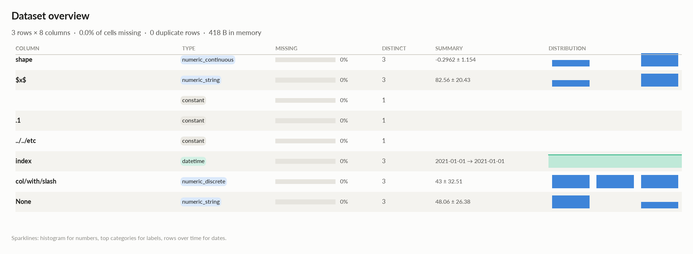

### Numeric columns at a glance

| column | count | missing | mean | std | min | median | max | skew | kurtosis | outliers | best fit |
|---|---|---|---|---|---|---|---|---|---|---|---|
| `shape` | 3 | 0.0% | -0.2962 | 1.154 | -1.619 | 0.2245 | 0.5059 | -1.62 | - | 0.0% | - |
| `$x$` | 3 | 0.0% | 82.56 | 20.43 | 58.97 | 94.04 | 94.66 | -1.73 | - | 0.0% | - |
| `col/with/slash` | 3 | 0.0% | 43 | 32.51 | 11 | 42 | 76 | 0.138 | - | 0.0% | - |
| `None` | 3 | 0.0% | 48.06 | 26.38 | 32.3 | 33.36 | 78.51 | 1.73 | - | 0.0% | - |

## Distributions

Normality is tested four ways (Shapiro-Wilk on up to 5,000 values, D'Agostino K², Jarque-Bera, Anderson-Darling); the verdict is 'not normal' when at least half of them reject at alpha 0.05. Every candidate distribution is fitted by maximum likelihood and ranked by AIC; the Akaike weight is its relative support among the candidates.

*With thousands of values every test rejects even a good fit, so read KS D (the largest gap between the fitted and the observed cumulative distribution) as the size of the misfit: below 0.03 close, below 0.08 fair, above poor. KS p-values are optimistic since the parameters come from the same data. For integer columns the gap is measured on the integer support and the p-value comes from a chi-square goodness-of-fit test.*

| column | n | normality | tests rejecting | best fit | parameters | weight | ΔAIC to 2nd | KS D | KS p | shape |
|---|---|---|---|---|---|---|---|---|---|---|
| `shape` | 3 | insufficient data |  | - |  |  |  |  |  | not enough distinct values to fit a distribution |
| `$x$` | 3 | insufficient data |  | - |  |  |  |  |  | not enough distinct values to fit a distribution |
| `col/with/slash` | 3 | insufficient data |  | - |  |  |  |  |  | not enough distinct values to fit a distribution |
| `None` | 3 | insufficient data |  | - |  |  |  |  |  | not enough distinct values to fit a distribution |

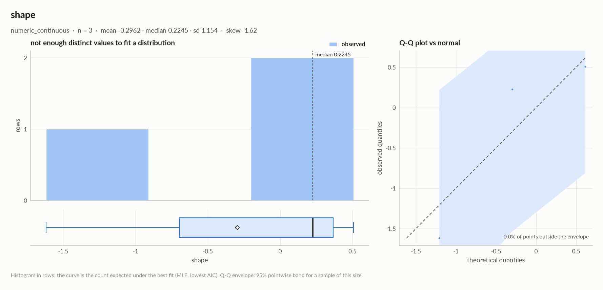

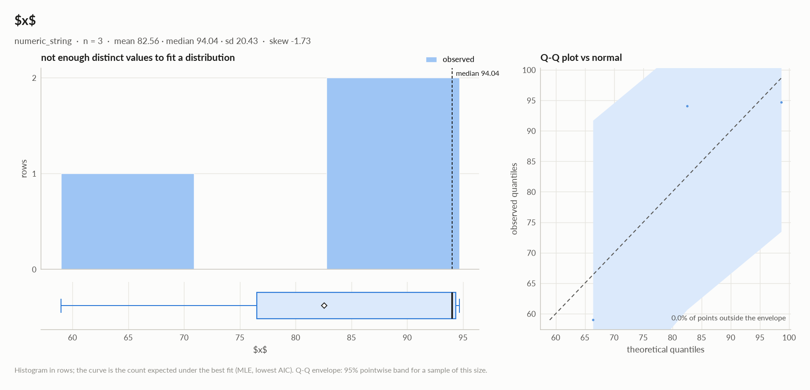

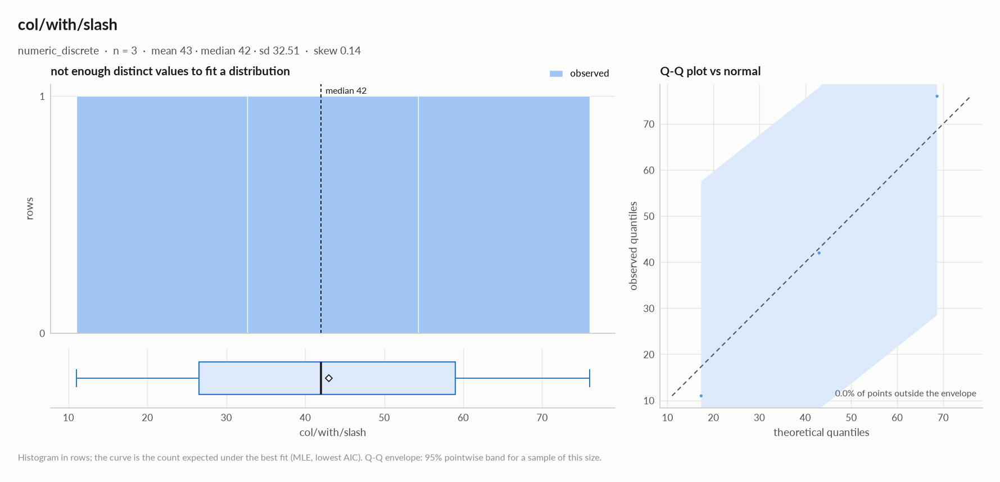

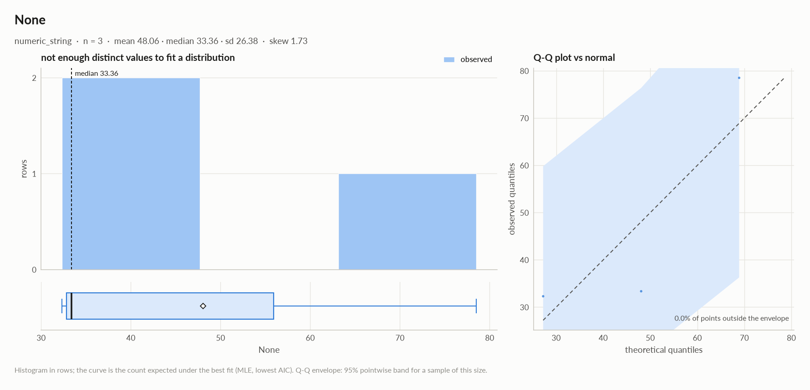

## Data quality

| severity | column | message |
|---|---|---|
| medium | - | constant column carries no information -\> drop it |
| medium | - | duplicate or non-string column names were renamed (a, a.1, ...) |
| medium | `$x$` | should-be-numeric: df\['$x$'\] = elessar.types.parse\_numeric(df\['$x$'\]) |
| medium | `../../etc` | constant column carries no information -\> drop it |
| medium | `.1` | constant column carries no information -\> drop it |
| medium | `None` | should-be-numeric: df\['None'\] = elessar.types.parse\_numeric(df\['None'\]) |
| medium | `col/with/slash` | redundant with '$x$' (spearman -1.000) -\> keep only one |
| medium | `shape` | should-be-numeric: df\['shape'\] = pd.to\_numeric(df\['shape'\], errors='coerce') |
| info | - | dtype optimizations save ~36 B: $x$ -\> float64, None -\> float64 (see quality\['dtype\_optimizations'\] for code) |

### Memory: suggested dtypes save 36 B

| column | current | suggested | saving | code |
|---|---|---|---|---|
| `$x$` | str | float64 | 18 B (43%) | `df['$x$'] = elessar.types.parse_numeric(df['$x$'])` |
| `None` | str | float64 | 18 B (43%) | `df['None'] = elessar.types.parse_numeric(df['None'])` |

## Multivariate statistics

### Dimensionality reduction

PCA not applicable: needs at least 3 numeric columns and enough rows (4 columns, 3 rows)

### Groups of redundant columns

| columns | mean \|Spearman\| | keep |
|---|---|---|
| $x$, col/with/slash | 1.00 | `$x$` |

### Associations between columns

6 pairs tested, 1 significant after Benjamini-Hochberg correction (alpha 0.05).

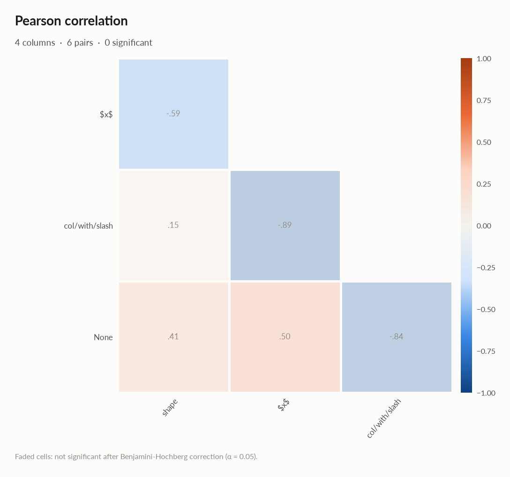

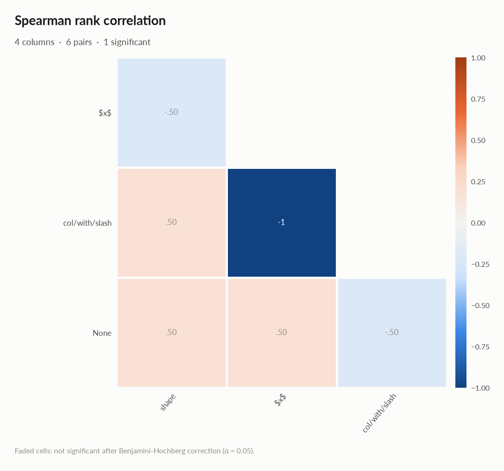

### Strongest associations

| column A | column B | method | value | 95% CI | n | p\_adj | sig |
|---|---|---|---|---|---|---|---|
| $x$ | col/with/slash | spearman | -1.000 |  | 3 | \< 1e-300 | \* |
| col/with/slash | None | pearson | -0.842 |  | 3 | 0.67 |  |
| shape | $x$ | pearson | -0.590 |  | 3 | 0.67 |  |
| shape | col/with/slash | spearman | +0.500 |  | 3 | 0.67 |  |
| shape | None | spearman | +0.500 |  | 3 | 0.67 |  |
| $x$ | None | spearman | +0.500 |  | 3 | 0.67 |  |

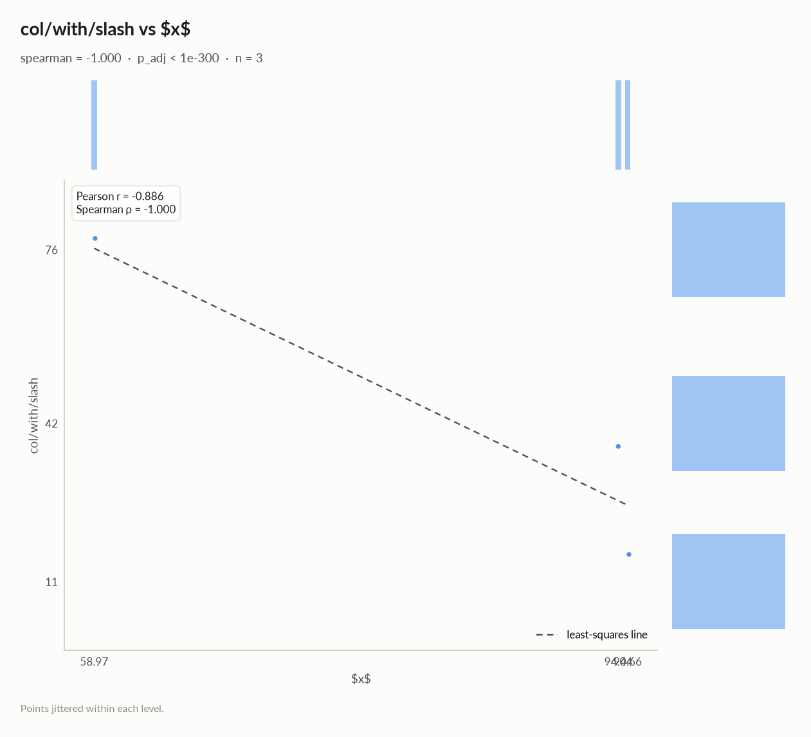

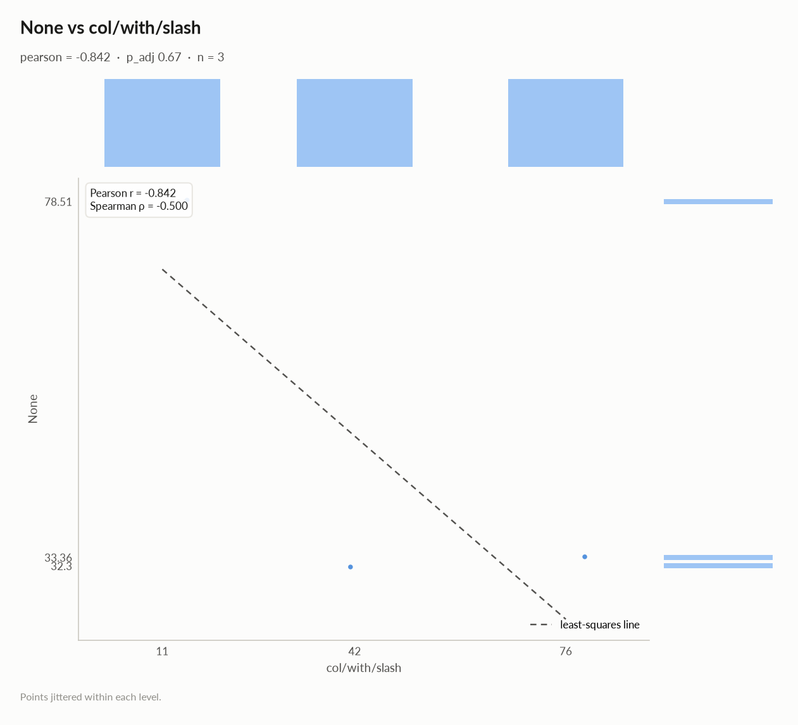

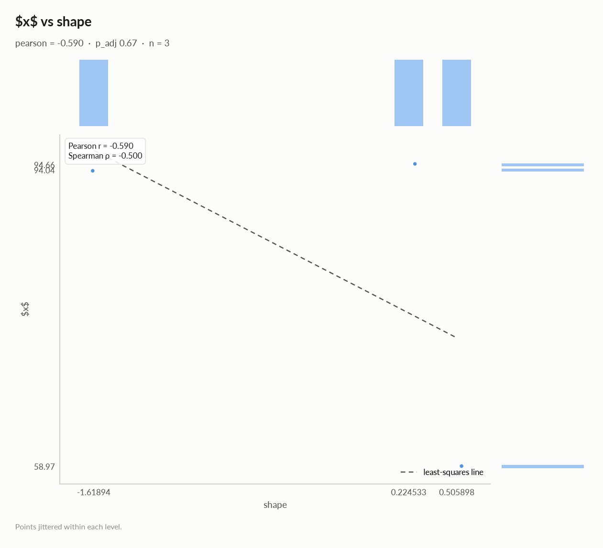

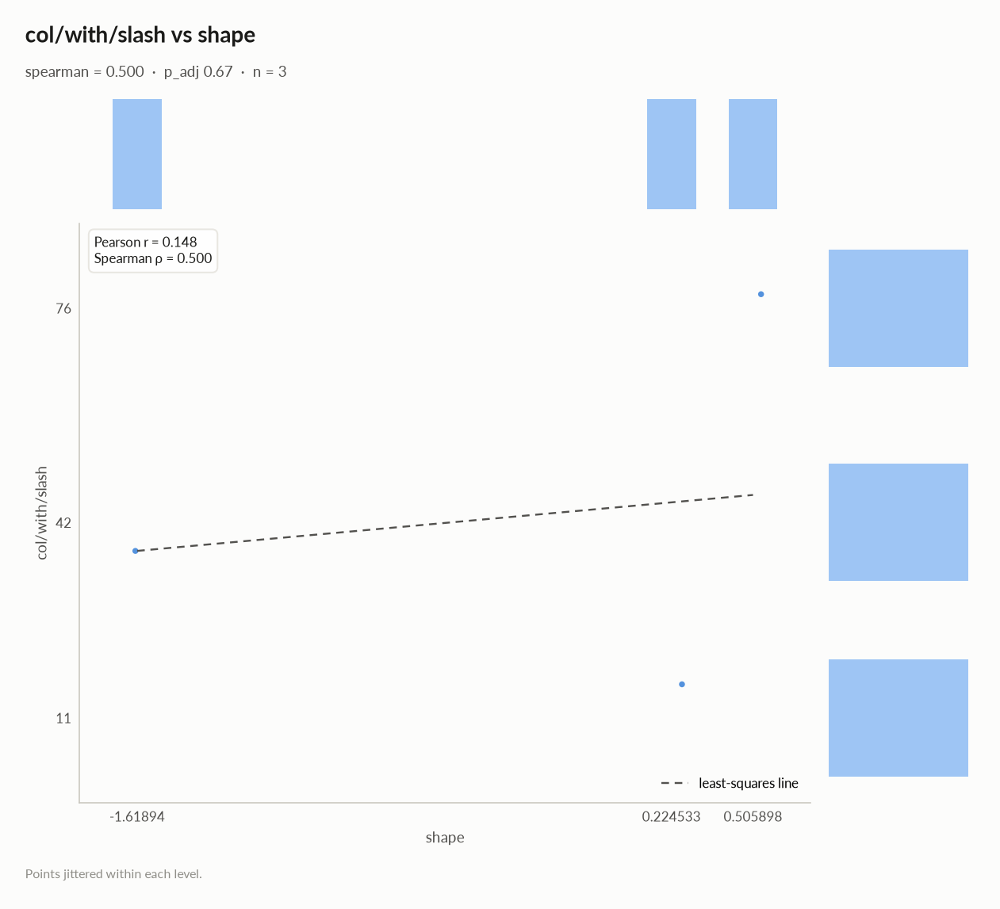

## Preparation plan

Cleaning: wrong formats 3.  Transformation: decomposition 1, combination 1, rescale 1.

### Cleaning

| action | column | why | code |
|---|---|---|---|
| Wrong formats | `shape` | should-be-numeric | `df['shape'] = pd.to_numeric(df['shape'], errors='coerce')` |
| Wrong formats | `$x$` | should-be-numeric | `df['$x$'] = elessar.types.parse_numeric(df['$x$'])` |
| Wrong formats | `None` | should-be-numeric | `df['None'] = elessar.types.parse_numeric(df['None'])` |

### Transformation

| action | column | why | code |
|---|---|---|---|
| Decomposition | `index` | a date is not a feature: decompose into calendar parts | `d = pd.to_datetime(df['index'], errors='coerce') df['index' + '_year'], df['index' + '_month'] = d.dt.year, d.dt.month df['index' + '_dow'], df['index' + '_hour'] = d.dt.dayofweek, d.dt.hour` |
| Combination | `$x$, col/with/slash` | 2 columns move together (mean \|Spearman\| 1.00): keep '$x$', or combine them into one score | `cols = ['$x$', 'col/with/slash'] df['combined'] = ((df[cols] - df[cols].mean()) / df[cols].std()).mean(axis=1) # or: df = df.drop(columns=['col/with/slash'])` |
| Rescale | - | numeric scales differ by x31 (col/with/slash vs shape): distance-based models, regularised models and neural nets need common scales | `from sklearn.preprocessing import RobustScaler, StandardScaler df[[]] = RobustScaler().fit_transform(df[[]])  # outliers others = ['shape', 'col/with/slash'] df[others] = StandardScaler().fit_transform(df[others])` |

## Attribute statistics

| column | type | missing | distinct | alerts |
|---|---|---|---|---|
| `shape` | numeric\_continuous | 0.0% | 3 | 0 |
| `$x$` | numeric\_string | 0.0% | 3 | 0 |
| `  ` | constant | 0.0% | 1 | 0 |
| `.1` | constant | 0.0% | 1 | 0 |
| `../../etc` | constant | 0.0% | 1 | 0 |
| `index` | datetime | 0.0% | 3 | 0 |
| `col/with/slash` | numeric\_discrete | 0.0% | 3 | 0 |
| `None` | numeric\_string | 0.0% | 3 | 0 |

<code>shape</code> · numeric_continuous

*object · numbers in object column: 3 distinct real values*

**Profile**

| | |
|---|---|
| type | numeric\_continuous |
| dtype | object |
| values | 3 |
| missing | 0 (0.0%) |
| distinct | 3 (100.0%) |
| memory | 96 B |

**Center**

| | |
|---|---|
| mean | -0.2962 |
| 95% CI of mean | \[-3.163, 2.571\] |
| median | 0.2245 |
| 95% CI of median | - |
| trimmed mean | -0.2962 |
| geometric mean | - |
| harmonic mean | - |

**Spread**

| | |
|---|---|
| std | 1.154 |
| variance | 1.332 |
| sem | 0.6664 |
| IQR | 1.062 |
| MAD | 0.2814 |
| CV | 3.897 |
| range | 2.125 |

**Quantiles**

| | |
|---|---|
| min | -1.619 |
| p1 | -1.582 |
| p5 | -1.435 |
| p25 | -0.6972 |
| p50 | 0.2245 |
| p75 | 0.3652 |
| p95 | 0.4778 |
| p99 | 0.5003 |
| max | 0.5059 |
| sum | -0.8885 |

**Shape**

| | |
|---|---|
| skewness | -1.62 |
| excess kurtosis | - |
| KDE modes | - |
| bimodality coef. | - |

**Outliers & counts**

| | |
|---|---|
| IQR fences | \[-2.291, 1.959\] |
| outside fences | 0 (0.0%) |
| \|z\| \> 3 | 0 (0.0%) |
| modified z \> 3.5 | 1 (33.3%) |
| zeros | 0 |
| negatives | 1 |
| infinite | 0 |

**Row order**

| | |
|---|---|
| monotonic | no |

- **should-be-numeric**: `df['shape'] = pd.to_numeric(df['shape'], errors='coerce')`

<code>$x$</code> · numeric_string

*str · 100% of values are numbers stored as text*

**Profile**

| | |
|---|---|
| type | numeric\_string |
| dtype | str |
| values | 3 |
| missing | 0 (0.0%) |
| distinct | 3 (100.0%) |
| memory | 42 B |

**Center**

| | |
|---|---|
| mean | 82.56 |
| 95% CI of mean | \[31.81, 133.3\] |
| median | 94.04 |
| 95% CI of median | - |
| trimmed mean | 82.56 |
| geometric mean | 80.67 |
| harmonic mean | 78.63 |

**Spread**

| | |
|---|---|
| std | 20.43 |
| variance | 417.3 |
| sem | 11.79 |
| IQR | 17.84 |
| MAD | 0.62 |
| CV | 0.2475 |
| range | 35.69 |

**Quantiles**

| | |
|---|---|
| min | 58.97 |
| p1 | 59.67 |
| p5 | 62.48 |
| p25 | 76.5 |
| p50 | 94.04 |
| p75 | 94.35 |
| p95 | 94.6 |
| p99 | 94.65 |
| max | 94.66 |
| sum | 247.7 |

**Shape**

| | |
|---|---|
| skewness | -1.73 |
| excess kurtosis | - |
| KDE modes | - |
| bimodality coef. | - |
| decimals | 2 |

**Outliers & counts**

| | |
|---|---|
| IQR fences | \[49.74, 121.1\] |
| outside fences | 0 (0.0%) |
| \|z\| \> 3 | 0 (0.0%) |
| modified z \> 3.5 | 1 (33.3%) |
| zeros | 0 |
| negatives | 0 |
| infinite | 0 |

**Row order**

| | |
|---|---|
| monotonic | increasing |

- **should-be-numeric**: `df['$x$'] = elessar.types.parse_numeric(df['$x$'])`

<code></code> · constant

*category · single value: 'x'*

**Profile**

| | |
|---|---|
| type | constant |
| dtype | category |
| values | 3 |
| missing | 0 (0.0%) |
| distinct | 1 (33.3%) |
| memory | 121 B |
| mode | x ×3 |

#### Most frequent values

| value | count | share |
|---|---|---|
| `x` | 3 | 100.0% |

<code>.1</code> · constant

*object · single value: "b'\\\\x00\\\\xff'"*

**Profile**

| | |
|---|---|
| type | constant |
| dtype | object |
| values | 3 |
| missing | 0 (0.0%) |
| distinct | 1 (33.3%) |
| memory | 129 B |
| mode | b'\\x00\\xff' ×3 |

#### Most frequent values

| value | count | share |
|---|---|---|
| `b'\x00\xff'` | 3 | 100.0% |

<code>../../etc</code> · constant

*float64 · single value: '0.0'*

**Profile**

| | |
|---|---|
| type | constant |
| dtype | float64 |
| values | 3 |
| missing | 0 (0.0%) |
| distinct | 1 (33.3%) |
| memory | 24 B |
| mode | 0.0 ×3 |

#### Most frequent values

| value | count | share |
|---|---|---|
| `0.0` | 3 | 100.0% |

<code>index</code> · datetime

*datetime64\[us, UTC\] · datetime dtype*

**Profile**

| | |
|---|---|
| type | datetime |
| dtype | datetime64\[us, UTC\] |
| values | 3 |
| missing | 0 (0.0%) |
| distinct | 3 (100.0%) |
| memory | 24 B |

**Time**

| | |
|---|---|
| first | 2021-01-01 |
| last | 2021-01-01 02:00:00 |
| span | 0 days 02:00:00 |
| frequency | h |
| duplicated timestamps | 0 |
| in the future | 0 |
| before 1900 | 0 |
| largest gap | 0 days 01:00:00 (2021-01-01 → 2021-01-01 01:00:00) |

- Rows by hour: 0 1, 1 1, 2 1

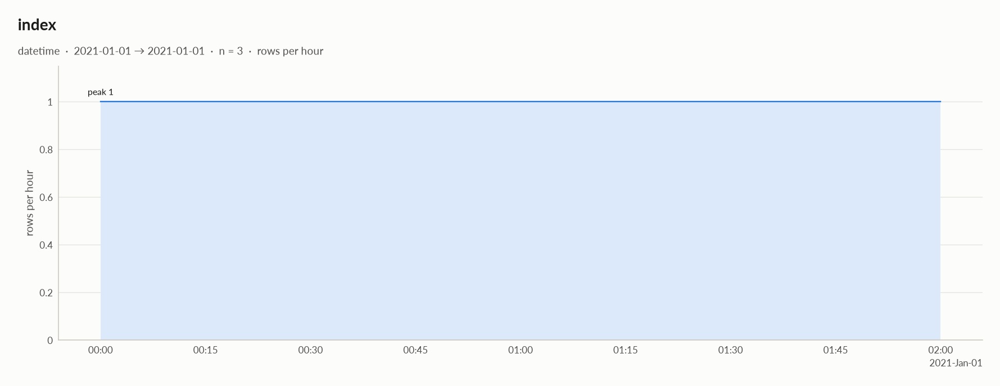

<code>col/with/slash</code> · numeric_discrete

*timedelta64\[us\] · timedelta (seconds): integer values (3 distinct)*

**Profile**

| | |
|---|---|
| type | numeric\_discrete |
| dtype | timedelta64\[us\] |
| values | 3 |
| missing | 0 (0.0%) |
| distinct | 3 (100.0%) |
| memory | 24 B |

**Center**

| | |
|---|---|
| mean | 43 |
| 95% CI of mean | \[-37.76, 123.8\] |
| median | 42 |
| 95% CI of median | - |
| trimmed mean | 43 |
| geometric mean | 32.75 |
| harmonic mean | 23.46 |

**Spread**

| | |
|---|---|
| std | 32.51 |
| variance | 1,057.0 |
| sem | 18.77 |
| IQR | 32.5 |
| MAD | 31 |
| CV | 0.7561 |
| range | 65 |

**Quantiles**

| | |
|---|---|
| min | 11 |
| p1 | 11.62 |
| p5 | 14.1 |
| p25 | 26.5 |
| p50 | 42 |
| p75 | 59 |
| p95 | 72.6 |
| p99 | 75.32 |
| max | 76 |
| sum | 129 |

**Shape**

| | |
|---|---|
| skewness | 0.138 |
| excess kurtosis | - |
| KDE modes | - |
| bimodality coef. | - |
| decimals | 0 |

**Outliers & counts**

| | |
|---|---|
| IQR fences | \[-22.25, 107.8\] |
| outside fences | 0 (0.0%) |
| \|z\| \> 3 | 0 (0.0%) |
| modified z \> 3.5 | 0 (0.0%) |
| zeros | 0 |
| negatives | 0 |
| infinite | 0 |

**Row order**

| | |
|---|---|
| monotonic | decreasing |

<code>None</code> · numeric_string

*str · 100% of values are numbers stored as text*

**Profile**

| | |
|---|---|
| type | numeric\_string |
| dtype | str |
| values | 3 |
| missing | 0 (0.0%) |
| distinct | 3 (100.0%) |
| memory | 42 B |

**Center**

| | |
|---|---|
| mean | 48.06 |
| 95% CI of mean | \[-17.47, 113.6\] |
| median | 33.36 |
| 95% CI of median | - |
| trimmed mean | 48.06 |
| geometric mean | 43.9 |
| harmonic mean | 40.72 |

**Spread**

| | |
|---|---|
| std | 26.38 |
| variance | 695.8 |
| sem | 15.23 |
| IQR | 23.11 |
| MAD | 1.06 |
| CV | 0.5489 |
| range | 46.21 |

**Quantiles**

| | |
|---|---|
| min | 32.3 |
| p1 | 32.32 |
| p5 | 32.41 |
| p25 | 32.83 |
| p50 | 33.36 |
| p75 | 55.94 |
| p95 | 74 |
| p99 | 77.61 |
| max | 78.51 |
| sum | 144.2 |

**Shape**

| | |
|---|---|
| skewness | 1.73 |
| excess kurtosis | - |
| KDE modes | - |
| bimodality coef. | - |
| decimals | 2 |

**Outliers & counts**

| | |
|---|---|
| IQR fences | \[-1.828, 90.59\] |
| outside fences | 0 (0.0%) |
| \|z\| \> 3 | 0 (0.0%) |
| modified z \> 3.5 | 1 (33.3%) |
| zeros | 0 |
| negatives | 0 |
| infinite | 0 |

**Row order**

| | |
|---|---|
| monotonic | no |

- **should-be-numeric**: `df['None'] = elessar.types.parse_numeric(df['None'])`

## Run

|   |   |
|---|---|
| **Source** | pandas.DataFrame · read in 0.0s |
| **Processes** | 3 for the analysis, 3 for the charts (14 cores available) |
| **Time** | 1.8s (load 0.0s, columns 0.2s, associations 0.1s, quality 0.0s, charts 1.3s) |
| **Significance** | alpha 0.05, Benjamini-Hochberg false discovery rate per family of tests |
| **Versions** | elessar 0.3.0 · Python 3.12.14 · pandas 3.1.0 · numpy 2.5.4 · scipy 1.18.1 |
