# elessar report

*40 rows × 4 columns · pandas.DataFrame · read in 0.0s · generated 2026-10-28 11:01 by elessar 0.3.0*

[Key findings](#key-findings) · [Overall statistics](#overall-statistics) · [Target analysis](#target-analysis) · [Distributions](#distributions) · [Outliers](#outliers) · [Data quality](#data-quality) · [Multivariate statistics](#multivariate-statistics) · [Preparation plan](#preparation-plan) · [Attribute statistics](#attribute-statistics) · [Run](#run)

## Key findings

- 2 features show no significant link with `0`: a, a.1
- **MEDIUM** duplicate or non-string column names were renamed (a, a.1, ...)
- **MEDIUM** `$x$`: should-be-datetime: df\['$x$'\] = pd.to\_datetime(df\['$x$'\], errors='coerce', format='mixed')
- **MEDIUM** `0`: imbalanced target: '1.0' is only 7.5% of rows -\> stratify splits, use PR-AUC / class weights
- **MEDIUM** `a.1`: should-be-numeric: df\['a.1'\] = pd.to\_numeric(df\['a.1'\], errors='coerce')

## Overall statistics

|   |   |
|---|---|
| **Rows** | 40 |
| **Columns** | 4 |
| **Memory** | 2.7 KB |
| **Potential saving** | 720 B |
| **Pandas dtypes** | float64=2, str=1, object=1 |
| **Semantic types** | numeric\_continuous=2, boolean=1, datetime\_string=1 |
| **Duplicate rows** | 0 (0.0%) |
| **Missing cells** | 3.1% |
| **Target** | 0 |

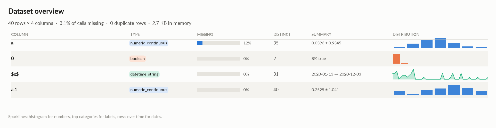

### Numeric columns at a glance

| column | count | missing | mean | std | min | median | max | skew | kurtosis | outliers | best fit |
|---|---|---|---|---|---|---|---|---|---|---|---|
| `a` | 35 | 12.5% | 0.0396 | 0.9345 | -2.134 | -0.07635 | 2.549 | 0.288 | 0.718 | 2.9% | logistic(loc=0.0171, scale=0.515) |
| `a.1` | 40 | 0.0% | 0.2525 | 1.041 | -2.214 | 0.407 | 2.15 | -0.515 | -0.125 | 0.0% | norm(loc=0.253, scale=1.03) |

### Categorical columns at a glance

| column | type | count | missing | distinct | most frequent | share | entropy |
|---|---|---|---|---|---|---|---|
| `0` | boolean | 40 | 0.0% | 2 | 0.0 | 92.5% | 0.384 |

## Target analysis

Target: `0` (boolean)

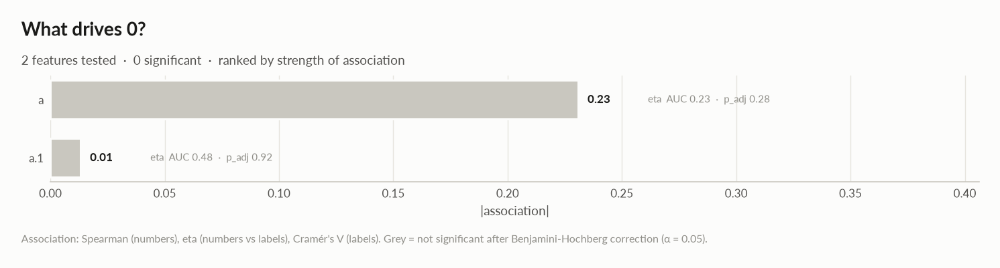

| feature | type | method | association | test | n | p\_adj | sig | AUC | MI | flag |
|---|---|---|---|---|---|---|---|---|---|---|
| a | numeric\_continuous | eta | +0.231 | mann-whitney | 35 | 0.28 |  | 0.229 | 0.251 |  |
| a.1 | numeric\_continuous | eta | +0.013 | mann-whitney | 40 | 0.92 |  | 0.477 | 0.141 |  |

### Is the target different when a feature is missing?

| feature | % missing | significant | p\_adj | detail |
|---|---|---|---|---|
| `a` | 12.5 | no | 0.5 | 0=1.0: 0% when missing vs 9% when present |

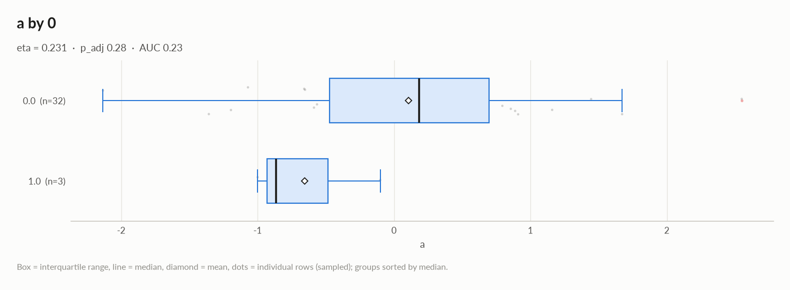

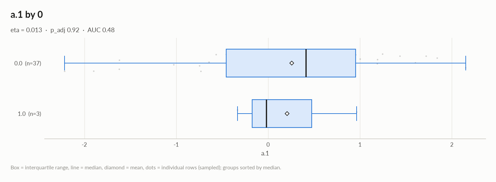

## Distributions

Normality is tested four ways (Shapiro-Wilk on up to 5,000 values, D'Agostino K², Jarque-Bera, Anderson-Darling); the verdict is 'not normal' when at least half of them reject at alpha 0.05. Every candidate distribution is fitted by maximum likelihood and ranked by AIC; the Akaike weight is its relative support among the candidates.

*With thousands of values every test rejects even a good fit, so read KS D (the largest gap between the fitted and the observed cumulative distribution) as the size of the misfit: below 0.03 close, below 0.08 fair, above poor. KS p-values are optimistic since the parameters come from the same data. For integer columns the gap is measured on the integer support and the p-value comes from a chi-square goodness-of-fit test.*

| column | n | normality | tests rejecting | best fit | parameters | weight | ΔAIC to 2nd | KS D | KS p | shape |
|---|---|---|---|---|---|---|---|---|---|---|
| `a` | 35 | normal | 0 of 4 | logistic | loc=0.0171, scale=0.515 | 0.39 | 0.3 (normal) | 0.066 (fair) | 1 | roughly symmetric |
| `a.1` | 40 | normal | 0 of 4 | normal | loc=0.253, scale=1.03 | 0.39 | 1.0 (logistic) | 0.110 (poor) | 0.67 | moderately left-skewed |

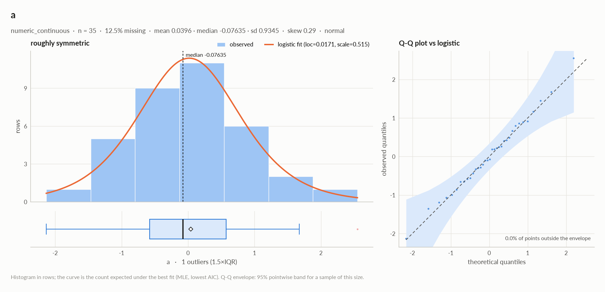

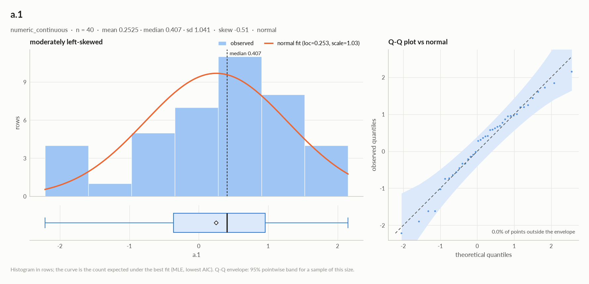

## Outliers

Three methods per numeric column: 3 sigma (|value - mean| \> 3 standard deviations), boxplot (outside the Tukey fences Q1 - 1.5 IQR, Q3 + 1.5 IQR) and modified z (Hampel: |0.6745 (value - median) / MAD| \> 3.5). A consensus outlier is flagged by at least two.

| column | 3 sigma | boxplot | modified z | consensus | fences | action |
|---|---|---|---|---|---|---|
| `a` | 0 | 1 | 0 | 0 (0.0%) | \[-2.3, 2.297\] | keep |
| `a.1` | 0 | 0 | 0 | 0 (0.0%) | \[-2.348, 2.94\] | keep |

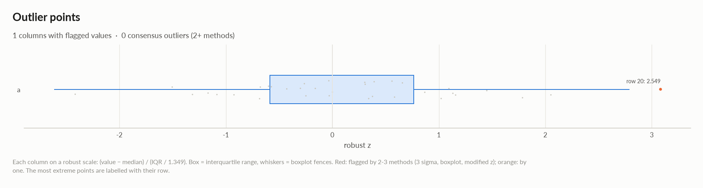

## Data quality

| severity | column | message |
|---|---|---|
| medium | - | duplicate or non-string column names were renamed (a, a.1, ...) |
| medium | `$x$` | should-be-datetime: df\['$x$'\] = pd.to\_datetime(df\['$x$'\], errors='coerce', format='mixed') |
| medium | `0` | imbalanced target: '1.0' is only 7.5% of rows -\> stratify splits, use PR-AUC / class weights |
| medium | `a.1` | should-be-numeric: df\['a.1'\] = pd.to\_numeric(df\['a.1'\], errors='coerce') |
| info | - | dtype optimizations save ~720 B: a -\> float32, 0 -\> float32, $x$ -\> datetime64 (see quality\['dtype\_optimizations'\] for code) |
| info | `$x$` | rows per week decrease over time (Kendall tau -0.30, p=0.0078) |

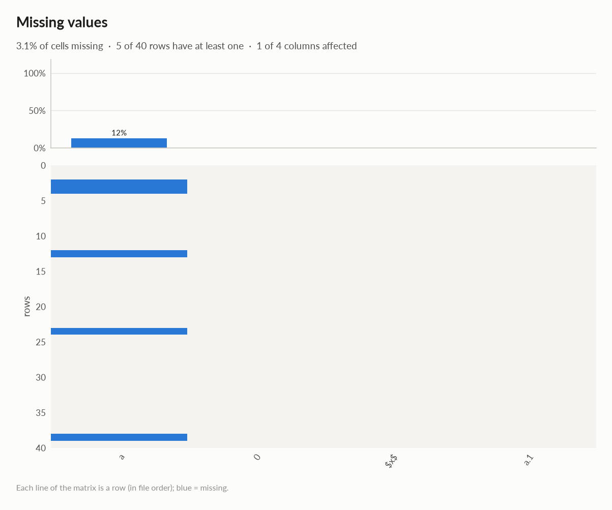

### Memory: suggested dtypes save 720 B

| column | current | suggested | saving | code |
|---|---|---|---|---|
| `a` | float64 | float32 | 160 B (50%) | `df['a'] = df['a'].astype('float32')` |
| `0` | float64 | float32 | 160 B (50%) | `df['0'] = df['0'].astype('float32')` |
| `$x$` | str | datetime64 | 400 B (56%) | `df['$x$'] = pd.to_datetime(df['$x$'], errors='coerce', format='mixed')` |

## Multivariate statistics

### Dimensionality reduction

PCA not applicable: needs at least 3 numeric columns and enough rows (2 columns, 40 rows)

### Associations between columns

3 pairs tested, 0 significant after Benjamini-Hochberg correction (alpha 0.05).

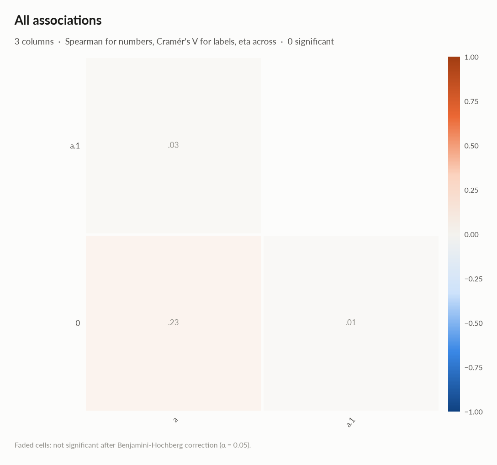

### Multicollinearity (VIF)

| column | VIF |
|---|---|
| `a.1` | 1.00 |
| `a` | 1.00 |

## Preparation plan

Cleaning: wrong formats 2, missing data 1.  Transformation: decomposition 1, normalization 1.

### Cleaning

| action | column | why | code |
|---|---|---|---|
| Wrong formats | `$x$` | should-be-datetime | `df['$x$'] = pd.to_datetime(df['$x$'], errors='coerce', format='mixed')` |
| Wrong formats | `a.1` | should-be-numeric | `df['a.1'] = pd.to_numeric(df['a.1'], errors='coerce')` |
| Missing data | `a` | 12.5% missing: impute with the mean | `df['a'] = df['a'].fillna(df['a'].mean())` |

### Transformation

| action | column | why | code |
|---|---|---|---|
| Decomposition | `$x$` | a date is not a feature: decompose into calendar parts | `d = pd.to_datetime(df['$x$'], errors='coerce') df['$x$' + '_year'], df['$x$' + '_month'] = d.dt.year, d.dt.month df['$x$' + '_dow'], df['$x$' + '_hour'] = d.dt.dayofweek, d.dt.hour` |
| Normalization | - | 2 roughly symmetric columns: z-score them (mean 0, sd 1) for linear and distance models | `cols = ['a', 'a.1'] df[cols] = (df[cols] - df[cols].mean()) / df[cols].std()` |

## Attribute statistics

| column | type | missing | distinct | alerts |
|---|---|---|---|---|
| `a` | numeric\_continuous | 12.5% | 35 | 0 |
| `0` | boolean | 0.0% | 2 | 1 |
| `$x$` | datetime\_string | 0.0% | 31 | 1 |
| `a.1` | numeric\_continuous | 0.0% | 40 | 0 |

<code>a</code> · numeric_continuous

*float64 · float64 dtype: 35 distinct real values*

**Profile**

| | |
|---|---|
| type | numeric\_continuous |
| dtype | float64 |
| values | 35 |
| missing | 5 (12.5%) |
| distinct | 35 (100.0%) |
| memory | 320 B |

**Center**

| | |
|---|---|
| mean | 0.0396 |
| 95% CI of mean | \[-0.2814, 0.3606\] |
| median | -0.07635 |
| 95% CI of median | \[-0.4412, 0.4005\] |
| trimmed mean | 0.01405 |
| geometric mean | - |
| harmonic mean | - |

**Spread**

| | |
|---|---|
| std | 0.9345 |
| variance | 0.8732 |
| sem | 0.158 |
| IQR | 1.149 |
| MAD | 0.5603 |
| CV | 23.6 |
| range | 4.683 |

**Quantiles**

| | |
|---|---|
| min | -2.134 |
| p1 | -1.87 |
| p5 | -1.244 |
| p25 | -0.5757 |
| p50 | -0.07635 |
| p75 | 0.5735 |
| p95 | 1.513 |
| p99 | 2.251 |
| max | 2.549 |
| sum | 1.386 |

**Shape**

| | |
|---|---|
| skewness | 0.288 |
| excess kurtosis | 0.718 |
| KDE modes | 1 |
| bimodality coef. | 0.271 |

**Outliers & counts**

| | |
|---|---|
| IQR fences | \[-2.3, 2.297\] |
| outside fences | 1 (2.9%) |
| \|z\| \> 3 | 0 (0.0%) |
| modified z \> 3.5 | 0 (0.0%) |
| zeros | 0 |
| negatives | 18 |
| infinite | 0 |

**Row order**

| | |
|---|---|
| monotonic | no |
| lag-1 autocorrelation | 0.188 (p 0.27) |

#### Normality: normal (n = 35)

| test | statistic | p-value | at alpha 0.05 |
|---|---|---|---|
| Shapiro-Wilk | 0.9894 | 0.98 | consistent with normal |
| D'Agostino K² | 1.681 | 0.43 | consistent with normal |
| Jarque-Bera | 0.7411 | 0.69 | consistent with normal |
| Anderson-Darling | 0.1638 | 0.15 | consistent with normal |

#### Best fits (continuous, 13 candidates fitted on 35 values)

| \# | distribution | parameters | AIC | ΔAIC | weight | BIC | KS D | KS p |
|---|---|---|---|---|---|---|---|---|
| 1 | logistic | loc=0.0171, scale=0.515 | 97.2358 | 0.0 | 0.39 | 100.346 | 0.066 (fair) | 1 |
| 2 | normal | loc=0.0396, scale=0.921 | 97.5674 | 0.3 | 0.33 | 100.678 | 0.064 (fair) | 1 |
| 3 | Student t | df=10.9, loc=0.0226, scale=0.835 | 99.2249 | 2.0 | 0.15 | 103.891 | 0.060 (fair) | 1 |

<code>0</code> · boolean · 1 alert

*float64 · float64 dtype: only 0/1 values*

- **INFO** imbalanced: '0.0' is 92.5% of values

**Profile**

| | |
|---|---|
| type | boolean |
| dtype | float64 |
| values | 40 |
| missing | 0 (0.0%) |
| distinct | 2 (5.0%) |
| memory | 320 B |
| mode | 0.0 ×37 |

**Labels**

| | |
|---|---|
| cardinality | 2 |
| entropy | 0.38 bits (0.38 of max) |
| Gini impurity | 0.139 |
| imbalance | ×12.33 |
| rare labels | 0 (0.0% of rows) |
| uniform? chi² | p 8e-08 |
| true | 7.5% \[2.6, 19.9\] |

#### Most frequent values

| value | count | share |
|---|---|---|
| `0.0` | 37 | 92.5% |
| `1.0` | 3 | 7.5% |

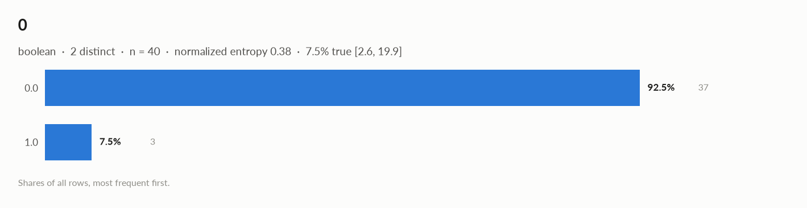

<code>$x$</code> · datetime_string · 1 alert

*str · 100% of values parse as dates*

- **INFO** rows per week decrease over time (Kendall tau -0.30, p=0.0078)

**Profile**

| | |
|---|---|
| type | datetime\_string |
| dtype | str |
| values | 40 |
| missing | 0 (0.0%) |
| distinct | 31 (77.5%) |
| memory | 720 B |
| mode | 08/04/2020 ×3 |

**Time**

| | |
|---|---|
| first | 2020-01-13 |
| last | 2020-12-03 |
| span | 325 days 00:00:00 |
| frequency | ~3 days 00:00:00 (irregular) |
| duplicated timestamps | 9 |
| in the future | 0 |
| before 1900 | 0 |
| largest gap | 63 days 00:00:00 (2020-05-01 → 2020-07-03) |
| trend of rows per week | tau -0.30 (p 0.0078) |

#### Most frequent values

| value | count | share |
|---|---|---|
| `08/04/2020` | 3 | 7.5% |
| `16/01/2020` | 2 | 5.0% |
| `15/03/2020` | 2 | 5.0% |
| `09/03/2020` | 2 | 5.0% |
| `24/03/2020` | 2 | 5.0% |
| `20/03/2020` | 2 | 5.0% |
| `07/04/2020` | 2 | 5.0% |
| `02/01/2020` | 2 | 5.0% |
| `09/01/2020` | 1 | 2.5% |
| `13/01/2020` | 1 | 2.5% |

- Rows by weekday: Mon 4, Tue 7, Wed 3, Thu 8, Fri 6, Sat 7, Sun 5
- Rows by month: Jan 8, Feb 6, Mar 12, May 1, Jul 3, Aug 4, Sep 3, Oct 1, Nov 1, Dec 1
- **should-be-datetime**: `df['$x$'] = pd.to_datetime(df['$x$'], errors='coerce', format='mixed')`

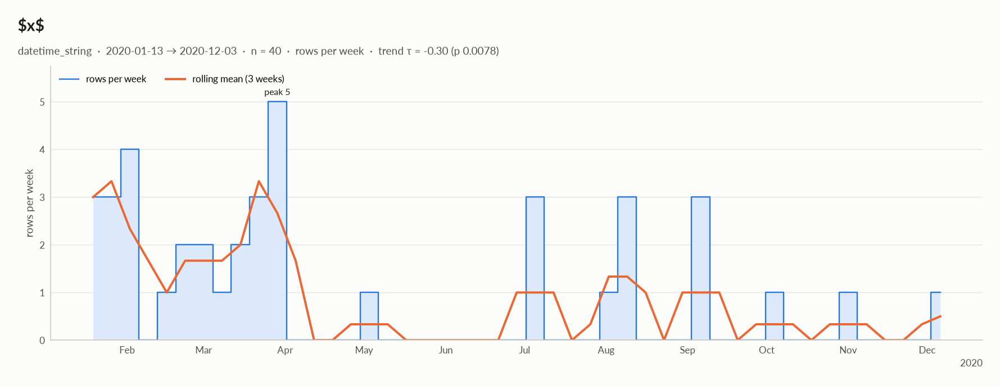

<code>a.1</code> · numeric_continuous

*object · numbers in object column: 40 distinct real values*

**Profile**

| | |
|---|---|
| type | numeric\_continuous |
| dtype | object |
| values | 40 |
| missing | 0 (0.0%) |
| distinct | 40 (100.0%) |
| memory | 1.2 KB |

**Center**

| | |
|---|---|
| mean | 0.2525 |
| 95% CI of mean | \[-0.08026, 0.5853\] |
| median | 0.407 |
| 95% CI of median | \[-0.2149, 0.7703\] |
| trimmed mean | 0.3168 |
| geometric mean | - |
| harmonic mean | - |

**Spread**

| | |
|---|---|
| std | 1.041 |
| variance | 1.083 |
| sem | 0.1645 |
| IQR | 1.322 |
| MAD | 0.681 |
| CV | 4.121 |
| range | 4.365 |

**Quantiles**

| | |
|---|---|
| min | -2.214 |
| p1 | -2.091 |
| p5 | -1.633 |
| p25 | -0.365 |
| p50 | 0.407 |
| p75 | 0.9568 |
| p95 | 1.726 |
| p99 | 2.029 |
| max | 2.15 |
| sum | 10.1 |

**Shape**

| | |
|---|---|
| skewness | -0.515 |
| excess kurtosis | -0.125 |
| KDE modes | 1 |
| bimodality coef. | 0.405 |

**Outliers & counts**

| | |
|---|---|
| IQR fences | \[-2.348, 2.94\] |
| outside fences | 0 (0.0%) |
| \|z\| \> 3 | 0 (0.0%) |
| modified z \> 3.5 | 0 (0.0%) |
| zeros | 0 |
| negatives | 16 |
| infinite | 0 |

**Row order**

| | |
|---|---|
| monotonic | no |
| lag-1 autocorrelation | 0.044 (p 0.78) |

#### Normality: normal (n = 40)

| test | statistic | p-value | at alpha 0.05 |
|---|---|---|---|
| Shapiro-Wilk | 0.9712 | 0.39 | consistent with normal |
| D'Agostino K² | 1.973 | 0.37 | consistent with normal |
| Jarque-Bera | 1.745 | 0.42 | consistent with normal |
| Anderson-Darling | 0.3807 | 0.15 | consistent with normal |

#### Best fits (continuous, 13 candidates fitted on 40 values)

| \# | distribution | parameters | AIC | ΔAIC | weight | BIC | KS D | KS p |
|---|---|---|---|---|---|---|---|---|
| 1 | normal | loc=0.253, scale=1.03 | 119.686 | 0.0 | 0.39 | 123.064 | 0.110 (poor) | 0.67 |
| 2 | logistic | loc=0.315, scale=0.589 | 120.655 | 1.0 | 0.24 | 124.033 | 0.085 (poor) | 0.91 |
| 3 | Student t | df=7.22e+10, loc=0.253, scale=1.03 | 121.686 | 2.0 | 0.14 | 126.753 | 0.110 (poor) | 0.67 |

- **should-be-numeric**: `df['a.1'] = pd.to_numeric(df['a.1'], errors='coerce')`

## Run

|   |   |
|---|---|
| **Source** | pandas.DataFrame · read in 0.0s |
| **Processes** | 3 for the analysis, 3 for the charts (14 cores available) |
| **Time** | 1.9s (load 0.0s, columns 0.2s, associations 0.2s, quality 0.0s, charts 1.3s) |
| **Significance** | alpha 0.05, Benjamini-Hochberg false discovery rate per family of tests |
| **Versions** | elessar 0.3.0 · Python 3.12.14 · pandas 3.1.0 · numpy 2.5.4 · scipy 1.18.1 |
