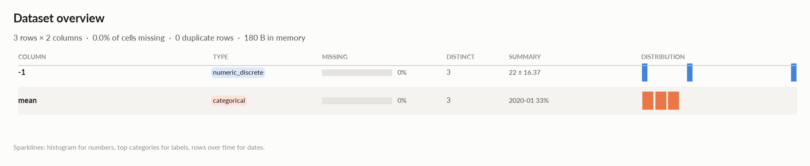
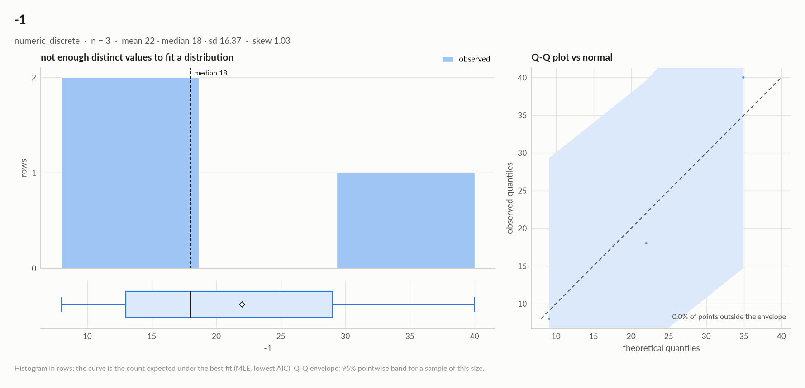

# elessar report

*3 rows × 2 columns · pandas.DataFrame · read in 0.0s · generated 2026-10-28 11:01 by elessar 0.3.0*

[Key findings](#key-findings) · [Overall statistics](#overall-statistics) · [Distributions](#distributions) · [Data quality](#data-quality) · [Multivariate statistics](#multivariate-statistics) · [Preparation plan](#preparation-plan) · [Attribute statistics](#attribute-statistics) · [Run](#run)

## Key findings

- **MEDIUM** `-1`: redundant with 'mean' (eta +1.000) -\> keep only one

## Overall statistics

|   |   |
|---|---|
| **Rows** | 3 |
| **Columns** | 2 |
| **Memory** | 180 B |
| **Potential saving** | 21 B |
| **Pandas dtypes** | int64=1, period\[M\]=1 |
| **Semantic types** | numeric\_discrete=1, categorical=1 |
| **Duplicate rows** | 0 (0.0%) |
| **Missing cells** | 0.0% |

### Numeric columns at a glance

| column | count | missing | mean | std | min | median | max | skew | kurtosis | outliers | best fit |
|---|---|---|---|---|---|---|---|---|---|---|---|
| `-1` | 3 | 0.0% | 22 | 16.37 | 8 | 18 | 40 | 1.03 | - | 0.0% | - |

### Categorical columns at a glance

| column | type | count | missing | distinct | most frequent | share | entropy |
|---|---|---|---|---|---|---|---|
| `mean` | categorical | 3 | 0.0% | 3 | 2020-01 | 33.3% | 1 |

## Distributions

Normality is tested four ways (Shapiro-Wilk on up to 5,000 values, D'Agostino K², Jarque-Bera, Anderson-Darling); the verdict is 'not normal' when at least half of them reject at alpha 0.05. Every candidate distribution is fitted by maximum likelihood and ranked by AIC; the Akaike weight is its relative support among the candidates.

*With thousands of values every test rejects even a good fit, so read KS D (the largest gap between the fitted and the observed cumulative distribution) as the size of the misfit: below 0.03 close, below 0.08 fair, above poor. KS p-values are optimistic since the parameters come from the same data. For integer columns the gap is measured on the integer support and the p-value comes from a chi-square goodness-of-fit test.*

| column | n | normality | tests rejecting | best fit | parameters | weight | ΔAIC to 2nd | KS D | KS p | shape |
|---|---|---|---|---|---|---|---|---|---|---|
| `-1` | 3 | insufficient data |  | - |  |  |  |  |  | not enough distinct values to fit a distribution |

## Data quality

| severity | column | message |
|---|---|---|
| medium | `-1` | redundant with 'mean' (eta +1.000) -\> keep only one |
| info | - | dtype optimizations save ~21 B: -1 -\> uint8 (see quality\['dtype\_optimizations'\] for code) |

### Memory: suggested dtypes save 21 B

| column | current | suggested | saving | code |
|---|---|---|---|---|
| `-1` | int64 | uint8 | 21 B (88%) | `df['-1'] = pd.to_numeric(df['-1'], downcast='unsigned')` |

## Multivariate statistics

### Dimensionality reduction

PCA not applicable: needs at least 3 numeric columns and enough rows (1 columns, 3 rows)

### Associations between columns

1 pairs tested, 0 significant after Benjamini-Hochberg correction (alpha 0.05).

### Strongest associations

| column A | column B | method | value | 95% CI | n | p\_adj | sig |
|---|---|---|---|---|---|---|---|
| mean | -1 | eta | +1.000 |  | 3 | 0.37 |  |

## Preparation plan

Cleaning: .  Transformation: encode 1.

### Transformation

| action | column | why | code |
|---|---|---|---|
| Encode | `mean` | 3 labels: one-hot | `df = pd.get_dummies(df, columns=['mean'], dummy_na=True)` |

## Attribute statistics

| column | type | missing | distinct | alerts |
|---|---|---|---|---|
| `-1` | numeric\_discrete | 0.0% | 3 | 0 |
| `mean` | categorical | 0.0% | 3 | 0 |

<code>-1</code> · numeric_discrete

*int64 · int64 dtype: integer values (3 distinct)*

**Profile**

| | |
|---|---|
| type | numeric\_discrete |
| dtype | int64 |
| values | 3 |
| missing | 0 (0.0%) |
| distinct | 3 (100.0%) |
| memory | 24 B |

**Center**

| | |
|---|---|
| mean | 22 |
| 95% CI of mean | \[-18.67, 62.67\] |
| median | 18 |
| 95% CI of median | - |
| trimmed mean | 22 |
| geometric mean | 17.93 |
| harmonic mean | 14.59 |

**Spread**

| | |
|---|---|
| std | 16.37 |
| variance | 268 |
| sem | 9.452 |
| IQR | 16 |
| MAD | 10 |
| CV | 0.7441 |
| range | 32 |

**Quantiles**

| | |
|---|---|
| min | 8 |
| p1 | 8.2 |
| p5 | 9 |
| p25 | 13 |
| p50 | 18 |
| p75 | 29 |
| p95 | 37.8 |
| p99 | 39.56 |
| max | 40 |
| sum | 66 |

**Shape**

| | |
|---|---|
| skewness | 1.03 |
| excess kurtosis | - |
| KDE modes | - |
| bimodality coef. | - |
| decimals | 0 |

**Outliers & counts**

| | |
|---|---|
| IQR fences | \[-11, 53\] |
| outside fences | 0 (0.0%) |
| \|z\| \> 3 | 0 (0.0%) |
| modified z \> 3.5 | 0 (0.0%) |
| zeros | 0 |
| negatives | 0 |
| infinite | 0 |

**Row order**

| | |
|---|---|
| monotonic | increasing |

<code>mean</code> · categorical

*period\[M\] · unrecognised dtype period\[M\], treated as labels*

**Profile**

| | |
|---|---|
| type | categorical |
| dtype | period\[M\] |
| values | 3 |
| missing | 0 (0.0%) |
| distinct | 3 (100.0%) |
| memory | 24 B |

**Labels**

| | |
|---|---|
| cardinality | 3 |
| entropy | 1.58 bits (1.00 of max) |
| Gini impurity | 0.667 |
| imbalance | ×1 |
| rare labels | 0 (0.0% of rows) |
| uniform? chi² | p 1 |

## Run

|   |   |
|---|---|
| **Source** | pandas.DataFrame · read in 0.0s |
| **Processes** | 2 for the analysis, 3 for the charts (14 cores available) |
| **Time** | 1.1s (load 0.0s, columns 0.1s, associations 0.1s, quality 0.0s, charts 0.7s) |
| **Significance** | alpha 0.05, Benjamini-Hochberg false discovery rate per family of tests |
| **Versions** | elessar 0.3.0 · Python 3.12.14 · pandas 3.1.0 · numpy 2.5.4 · scipy 1.18.1 |
