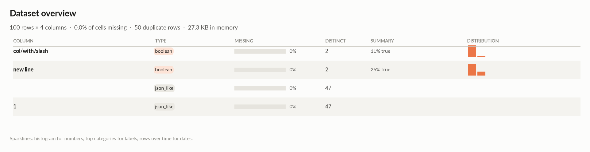
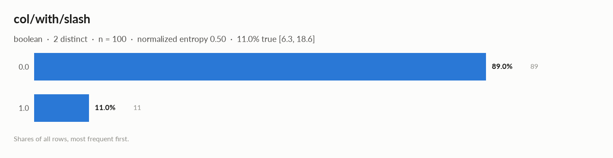

# elessar report

*300 rows × 4 columns · pandas.DataFrame · streamed in 5 chunks (in memory, 3 processes) · read in 0.2s · generated 2026-10-28 11:01 by elessar 0.3.0*

> **Sampled profile. **The table has 300 rows: statistics, tests and charts use a uniform random sample of 100 rows (33.3%). Row counts, missing values, min / max / mean / std, distinct counts and duplicate rows are exact over every row (exact figures).

[Key findings](#key-findings) · [Overall statistics](#overall-statistics) · [Data quality](#data-quality) · [Multivariate statistics](#multivariate-statistics) · [Preparation plan](#preparation-plan) · [Attribute statistics](#attribute-statistics) · [Run](#run)

## Key findings

- **MEDIUM** 146 duplicate rows (48.7%), e.g. index \['2020-01-28 00:00:00', '2020-02-05 00:00:00', '2020-02-13 00:00:00'\] -\> df.drop\_duplicates()
- **MEDIUM** `1`: identical to column ' ' -\> drop one of them

## Overall statistics

|   |   |
|---|---|
| **Rows** | 300 (100 profiled, uniform random sample) |
| **Columns** | 4 |
| **Memory** | 27.3 KB |
| **Potential saving** | 400 B |
| **Pandas dtypes** | object=2, float64=1, bool=1 |
| **Semantic types** | boolean=2, json\_like=2 |
| **Duplicate rows** | 146 (48.7%) |
| **Missing cells** | 0.0% |

### Exact figures over all 300 rows

| column | count | missing | distinct | mean | std | min | max | zeros | negatives | most frequent |
|---|---|---|---|---|---|---|---|---|---|---|
| `col/with/slash` | 300 | 0 (0.0%) | 2 | 0.07667 | 0.2665 | 0 | 1 | 277 | 0 | 0.0 (92.3%) |
| `new line` | 300 | 0 (0.0%) | 2 | 0.31 | 0.4633 | 0 | 1 | 207 | 0 | False (69.0%) |
| `   ` | 300 | 0 (0.0%) | 151 | - | - | - | - | - | - | \[1, 2\] (50.0%) |
| `1` | 300 | 0 (0.0%) | 151 | - | - | - | - | - | - | \[1, 2\] (50.0%) |

*Distinct counts marked ≈ are estimated (k-minimum-values sketch, about 1.6% relative error); every other figure is exact. Means and standard deviations are combined across chunks with Chan's parallel algorithm.*

### Categorical columns at a glance

| column | type | count | missing | distinct | most frequent | share | entropy |
|---|---|---|---|---|---|---|---|
| `col/with/slash` | boolean | 100 | 0.0% | 2 | 0.0 | 89.0% | 0.5 |
| `new line` | boolean | 100 | 0.0% | 2 | False | 74.0% | 0.827 |

## Data quality

| severity | column | message |
|---|---|---|
| medium | - | 146 duplicate rows (48.7%), e.g. index \['2020-01-28 00:00:00', '2020-02-05 00:00:00', '2020-02-13 00:00:00'\] -\> df.drop\_duplicates() |
| medium | `1` | identical to column ' ' -\> drop one of them |
| info | - | dtype optimizations save ~400 B: col/with/slash -\> float32 (see quality\['dtype\_optimizations'\] for code) |
| info | - | profiled on a uniform random sample of 100 of 300 rows (33.3%); row counts, missing values, min/max/mean/std, distinct counts and duplicate rows are exact over every row |

### Memory: suggested dtypes save 400 B

| column | current | suggested | saving | code |
|---|---|---|---|---|
| `col/with/slash` | float64 | float32 | 400 B (50%) | `df['col/with/slash'] = df['col/with/slash'].astype('float32')` |

## Multivariate statistics

### Dimensionality reduction

PCA not applicable: needs at least 3 numeric columns and enough rows (0 columns, 100 rows)

### Associations between columns

1 pairs tested, 0 significant after Benjamini-Hochberg correction (alpha 0.05).

## Preparation plan

Cleaning: duplicates 2.  Transformation: encode 2.

### Cleaning

| action | column | why | code |
|---|---|---|---|
| Duplicates | - | 146 duplicate rows (48.7%) | `df = df.drop_duplicates()` |
| Duplicates | `1` | identical to ' ' | `df = df.drop(columns=['1'])` |

### Transformation

| action | column | why | code |
|---|---|---|---|
| Encode | `col/with/slash` | boolean: 0/1 | `df['col/with/slash'] = df['col/with/slash'].astype(bool).astype(int)` |
| Encode | `new line` | boolean: 0/1 | `df['new\nline'] = df['new\nline'].astype(bool).astype(int)` |

## Attribute statistics

| column | type | missing | distinct | alerts |
|---|---|---|---|---|
| `col/with/slash` | boolean | 0.0% | 2 | 0 |
| `new line` | boolean | 0.0% | 2 | 0 |
| `   ` | json\_like | 0.0% | 47 | 0 |
| `1` | json\_like | 0.0% | 47 | 0 |

<code>col/with/slash</code> · boolean

*float64 · float64 dtype: only 0/1 values*

**Profile**

| | |
|---|---|
| type | boolean |
| dtype | float64 |
| values | 100 |
| missing | 0 (0.0%) |
| distinct | 2 (2.0%) |
| memory | 800 B |
| mode | 0.0 ×89 |

**Labels**

| | |
|---|---|
| cardinality | 2 |
| entropy | 0.50 bits (0.50 of max) |
| Gini impurity | 0.196 |
| imbalance | ×8.091 |
| rare labels | 0 (0.0% of rows) |
| uniform? chi² | p 6e-15 |
| true | 11.0% \[6.3, 18.6\] |

#### Most frequent values

| value | count | share |
|---|---|---|
| `0.0` | 89 | 89.0% |
| `1.0` | 11 | 11.0% |

<code>new
line</code> · boolean

*bool · bool dtype*

**Profile**

| | |
|---|---|
| type | boolean |
| dtype | bool |
| values | 100 |
| missing | 0 (0.0%) |
| distinct | 2 (2.0%) |
| memory | 100 B |
| mode | False ×74 |

**Labels**

| | |
|---|---|
| cardinality | 2 |
| entropy | 0.83 bits (0.83 of max) |
| Gini impurity | 0.385 |
| imbalance | ×2.846 |
| rare labels | 0 (0.0% of rows) |
| uniform? chi² | p 2e-06 |
| true | 26.0% \[18.4, 35.4\] |

#### Most frequent values

| value | count | share |
|---|---|---|
| `False` | 74 | 74.0% |
| `True` | 26 | 26.0% |

<code> </code> · json_like

*object · cells contain Python dict/list objects*

**Profile**

| | |
|---|---|
| type | json\_like |
| dtype | object |
| values | 100 |
| missing | 0 (0.0%) |
| distinct | 47 (47.0%) |
| memory | 12.8 KB |
| mode | \[1, 2\] ×54 |

#### Most frequent values

| value | count | share |
|---|---|---|
| `[1, 2]` | 54 | 54.0% |
| `{'k': 4}` | 1 | 1.0% |
| `{'k': 8}` | 1 | 1.0% |
| `{'k': 28}` | 1 | 1.0% |
| `{'k': 36}` | 1 | 1.0% |
| `{'k': 38}` | 1 | 1.0% |
| `{'k': 50}` | 1 | 1.0% |
| `{'k': 58}` | 1 | 1.0% |
| `{'k': 70}` | 1 | 1.0% |
| `{'k': 86}` | 1 | 1.0% |

- Python types: list 54, dict 46
- Top keys: k (46)

<code>1</code> · json_like

*object · cells contain Python dict/list objects*

**Profile**

| | |
|---|---|
| type | json\_like |
| dtype | object |
| values | 100 |
| missing | 0 (0.0%) |
| distinct | 47 (47.0%) |
| memory | 12.8 KB |
| mode | \[1, 2\] ×54 |

#### Most frequent values

| value | count | share |
|---|---|---|
| `[1, 2]` | 54 | 54.0% |
| `{'k': 4}` | 1 | 1.0% |
| `{'k': 8}` | 1 | 1.0% |
| `{'k': 28}` | 1 | 1.0% |
| `{'k': 36}` | 1 | 1.0% |
| `{'k': 38}` | 1 | 1.0% |
| `{'k': 50}` | 1 | 1.0% |
| `{'k': 58}` | 1 | 1.0% |
| `{'k': 70}` | 1 | 1.0% |
| `{'k': 86}` | 1 | 1.0% |

- Python types: list 54, dict 46
- Top keys: k (46)

## Run

|   |   |
|---|---|
| **Source** | pandas.DataFrame · streamed in 5 chunks (in memory, 3 processes) · read in 0.2s |
| **Rows profiled** | 100 of 300 (uniform random sample) |
| **Processes** | 3 for the analysis, 3 for the charts (14 cores available) |
| **Time** | 1.0s (load 0.2s, columns 0.1s, associations 0.1s, quality 0.0s, charts 0.3s) |
| **Significance** | alpha 0.05, Benjamini-Hochberg false discovery rate per family of tests |
| **Versions** | elessar 0.3.0 · Python 3.12.14 · pandas 3.1.0 · numpy 2.5.4 · scipy 1.18.1 |
