# elessar report

*7 rows × 8 columns · pandas.DataFrame · read in 0.0s · generated 2026-10-28 11:02 by elessar 0.3.0*

[Key findings](#key-findings) · [Overall statistics](#overall-statistics) · [Target analysis](#target-analysis) · [Distributions](#distributions) · [Data quality](#data-quality) · [Multivariate statistics](#multivariate-statistics) · [Preparation plan](#preparation-plan) · [Attribute statistics](#attribute-statistics) · [Run](#run)

## Key findings

- 5 features show no significant link with `^_^`: True, 1e5, \\frac{1}{2}, price ($), ^\_^.1
- **HIGH** `True`: possible target leakage: eta = 1.000 with '^\_^'
- **HIGH** `price ($)`: suspicious: 3 negative values in a quantity that should be \>= 0
- **MEDIUM** duplicate or non-string column names were renamed (a, a.1, ...)
- **MEDIUM** `1e5`: 42.9% missing -\> drop, or impute and add a missing-indicator
- **MEDIUM** `\frac{1}{2}`: 28.6% missing -\> drop, or impute and add a missing-indicator
- **MEDIUM** `\frac{1}{2}`: redundant with '1e5' (eta +1.000), 'True' (eta +1.000) -\> keep only one
- **MEDIUM** `price ($)`: redundant with 'True' (eta +1.000) -\> keep only one

## Overall statistics

|   |   |
|---|---|
| **Rows** | 7 |
| **Columns** | 8 |
| **Memory** | 1.7 KB |
| **Potential saving** | 105 B |
| **Pandas dtypes** | float64=2, object=2, int64=1, Int64=1, datetime64\[us, UTC\]=1, interval\[int64, right\]=1 |
| **Semantic types** | numeric\_discrete=2, numeric\_continuous=2, categorical=2, json\_like=1, datetime=1 |
| **Duplicate rows** | 0 (0.0%) |
| **Missing cells** | 8.9% |
| **Target** | ^\_^ |

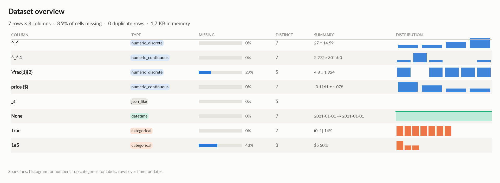

### Numeric columns at a glance

| column | count | missing | mean | std | min | median | max | skew | kurtosis | outliers | best fit |
|---|---|---|---|---|---|---|---|---|---|---|---|
| `^_^` | 7 | 0.0% | 27 | 14.59 | -1 | 30 | 41 | -1.3 | 1.61 | 0.0% | - |
| `^_^.1` | 7 | 0.0% | 2.272e-301 | 0 | -7.400e-301 | 6.093e-302 | 2.017e-300 | - | - | 28.6% | - |
| `\frac{1}{2}` | 5 | 28.6% | 4.8 | 1.924 | 2 | 5 | 7 | -0.59 | -0.0219 | 0.0% | - |
| `price ($)` | 7 | 0.0% | -0.1161 | 1.078 | -1.269 | 0.02745 | 1.831 | 0.873 | 0.597 | 0.0% | - |

### Categorical columns at a glance

| column | type | count | missing | distinct | most frequent | share | entropy |
|---|---|---|---|---|---|---|---|
| `True` | categorical | 7 | 0.0% | 7 | (0, 1\] | 14.3% | 1 |
| `1e5` | categorical | 4 | 42.9% | 3 | $5 | 50.0% | 0.946 |

## Target analysis

Target: `^_^` (numeric\_discrete)

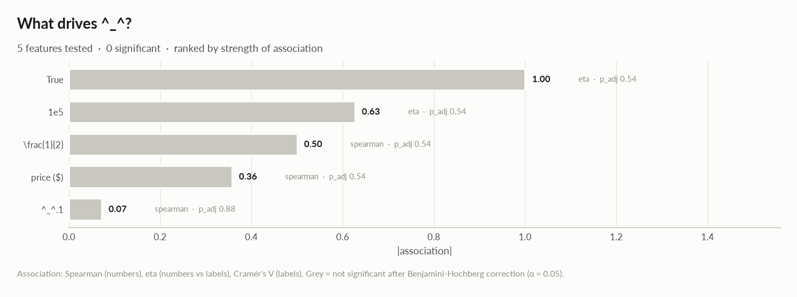

| feature | type | method | association | test | n | p\_adj | sig | AUC | MI | flag |
|---|---|---|---|---|---|---|---|---|---|---|
| True | categorical | eta | +1.000 | kruskal-wallis | 7 | 0.54 |  |  | 2.807 | LEAKAGE? |
| 1e5 | categorical | eta | +0.627 | kruskal-wallis | 4 | 0.54 |  |  | 1.500 |  |
| \\frac{1}{2} | numeric\_discrete | spearman | +0.500 | spearman t-test | 5 | 0.54 |  |  | 2.322 |  |
| price ($) | numeric\_continuous | spearman | -0.357 | spearman t-test | 7 | 0.54 |  |  | 2.807 |  |
| ^\_^.1 | numeric\_continuous | spearman | +0.071 | spearman t-test | 7 | 0.88 |  |  | 2.807 |  |

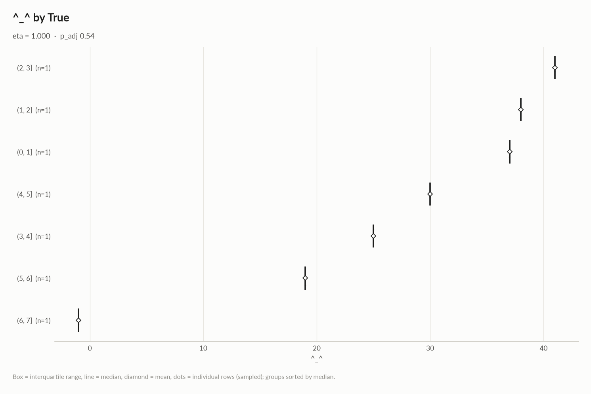

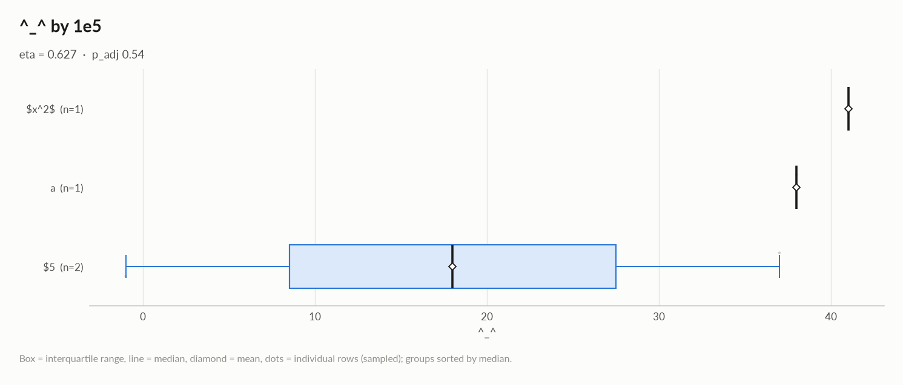

## Distributions

Normality is tested four ways (Shapiro-Wilk on up to 5,000 values, D'Agostino K², Jarque-Bera, Anderson-Darling); the verdict is 'not normal' when at least half of them reject at alpha 0.05. Every candidate distribution is fitted by maximum likelihood and ranked by AIC; the Akaike weight is its relative support among the candidates.

*With thousands of values every test rejects even a good fit, so read KS D (the largest gap between the fitted and the observed cumulative distribution) as the size of the misfit: below 0.03 close, below 0.08 fair, above poor. KS p-values are optimistic since the parameters come from the same data. For integer columns the gap is measured on the integer support and the p-value comes from a chi-square goodness-of-fit test.*

| column | n | normality | tests rejecting | best fit | parameters | weight | ΔAIC to 2nd | KS D | KS p | shape |
|---|---|---|---|---|---|---|---|---|---|---|
| `^_^` | 7 | insufficient data |  | - |  |  |  |  |  | not enough distinct values to fit a distribution |
| `^_^.1` | 7 | insufficient data |  | - |  |  |  |  |  | not enough distinct values to fit a distribution |
| `\frac{1}{2}` | 5 | insufficient data |  | - |  |  |  |  |  | not enough distinct values to fit a distribution |
| `price ($)` | 7 | insufficient data |  | - |  |  |  |  |  | not enough distinct values to fit a distribution |

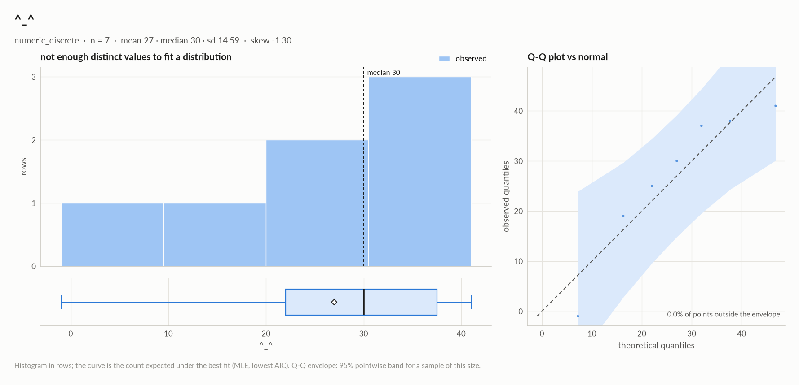

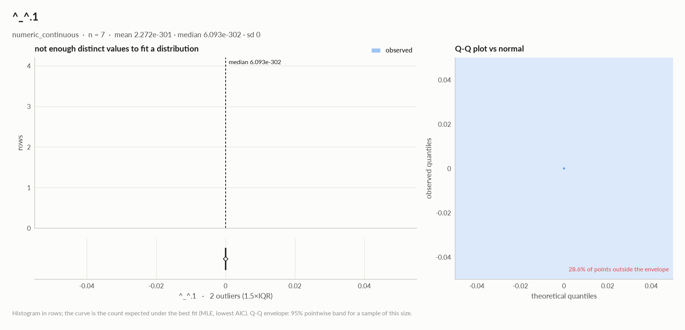

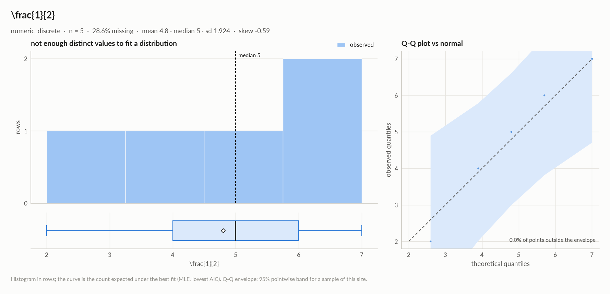

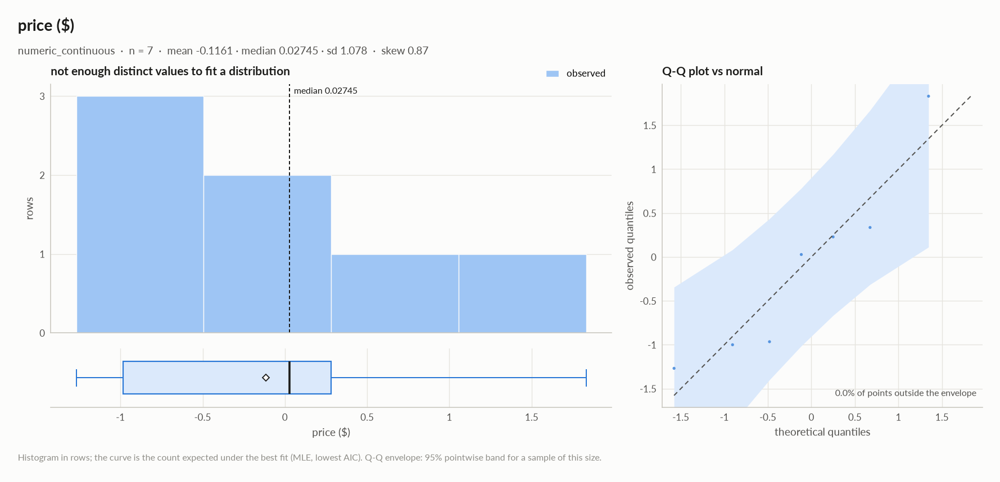

## Data quality

| severity | column | message |
|---|---|---|
| high | `True` | possible target leakage: eta = 1.000 with '^\_^' |
| high | `price ($)` | suspicious: 3 negative values in a quantity that should be \>= 0 |
| medium | - | duplicate or non-string column names were renamed (a, a.1, ...) |
| medium | `1e5` | 42.9% missing -\> drop, or impute and add a missing-indicator |
| medium | `\frac{1}{2}` | 28.6% missing -\> drop, or impute and add a missing-indicator |
| medium | `\frac{1}{2}` | redundant with '1e5' (eta +1.000), 'True' (eta +1.000) -\> keep only one |
| medium | `price ($)` | redundant with 'True' (eta +1.000) -\> keep only one |
| info | - | dtype optimizations save ~105 B: ^\_^ -\> int8, ^\_^.1 -\> float32, price ($) -\> float32 (see quality\['dtype\_optimizations'\] for code) |
| info | `^_^.1` | 28.6% outliers by the 1.5xIQR rule (outside \[-7.341e-301, 8.605e-301\]) |

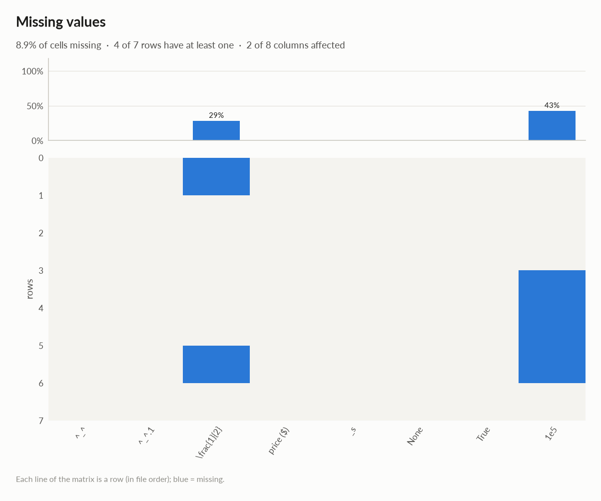

### Memory: suggested dtypes save 105 B

| column | current | suggested | saving | code |
|---|---|---|---|---|
| `^_^` | int64 | int8 | 49 B (88%) | `df['^_^'] = pd.to_numeric(df['^_^'], downcast='integer')` |
| `^_^.1` | float64 | float32 | 28 B (50%) | `df['^_^.1'] = df['^_^.1'].astype('float32')` |
| `price ($)` | float64 | float32 | 28 B (50%) | `df['price ($)'] = df['price ($)'].astype('float32')` |

## Multivariate statistics

### Dimensionality reduction

PCA not applicable: needs at least 3 numeric columns and enough rows (2 columns, 7 rows)

### Associations between columns

12 pairs tested, 0 significant after Benjamini-Hochberg correction (alpha 0.05).

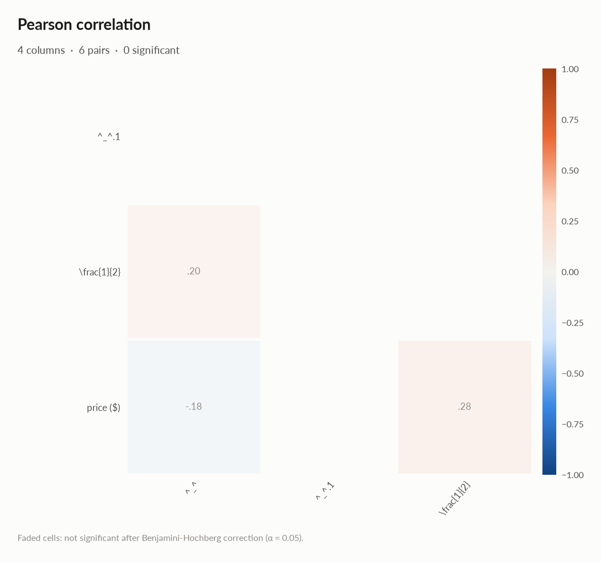

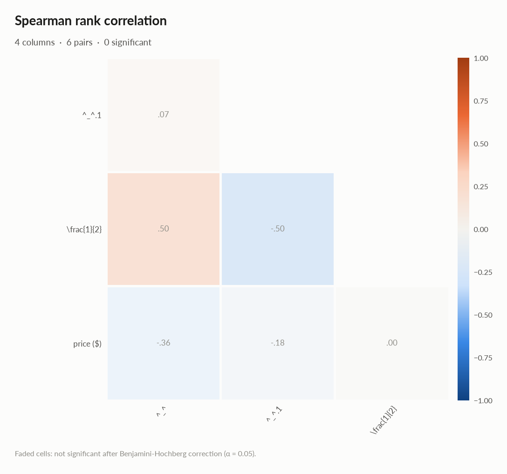

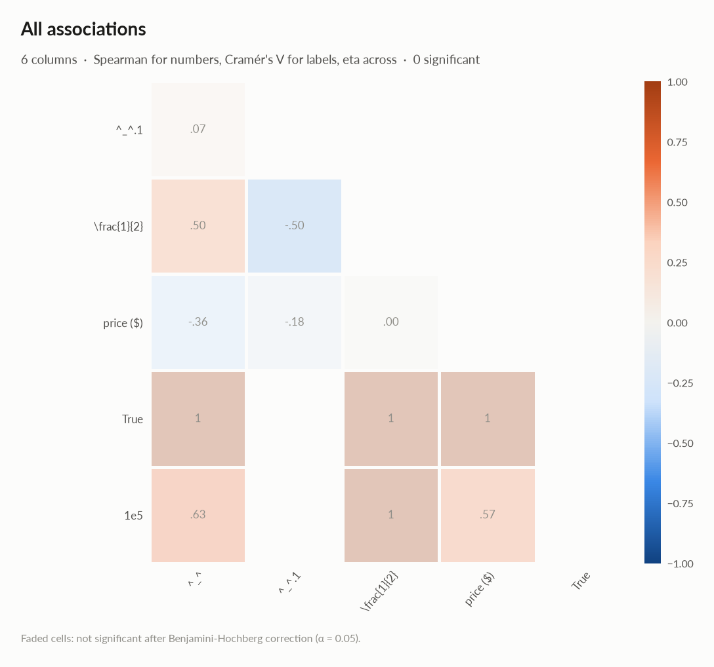

### Strongest associations

| column A | column B | method | value | 95% CI | n | p\_adj | sig |
|---|---|---|---|---|---|---|---|
| True | price ($) | eta | +1.000 |  | 7 | 0.65 |  |
| 1e5 | \\frac{1}{2} | eta | +1.000 |  | 3 | 0.65 |  |
| True | ^\_^ | eta | +1.000 |  | 7 | 0.65 |  |
| True | \\frac{1}{2} | eta | +1.000 |  | 5 | 0.65 |  |
| 1e5 | ^\_^ | eta | +0.627 |  | 4 | 0.65 |  |
| 1e5 | price ($) | eta | +0.566 |  | 4 | 0.88 |  |
| ^\_^.1 | \\frac{1}{2} | spearman | -0.500 | \[-0.965, +0.726\] | 5 | 0.65 |  |
| ^\_^ | \\frac{1}{2} | spearman | +0.500 | \[-0.726, +0.965\] | 5 | 0.65 |  |

### Multicollinearity (VIF)

| column | VIF |
|---|---|
| `price ($)` | 1.08 |
| `\frac{1}{2}` | 1.08 |

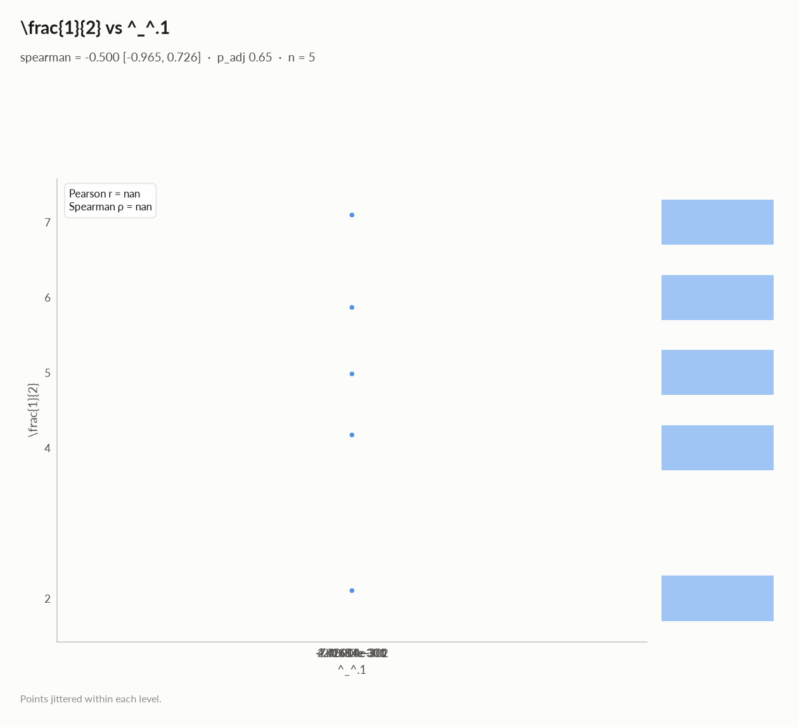

## Preparation plan

Cleaning: invalid values 1, missing data 2.  Transformation: decomposition 1, rescale 1, normalization 1, encode 2.

### Cleaning

| action | column | why | code |
|---|---|---|---|
| Invalid values | `price ($)` | impossible values: \['3 negative values in a quantity that should be \>= 0'\] | `df.loc[<invalid condition on 'price ($)'>, 'price ($)'] = np.nan` |
| Missing data | `\frac{1}{2}` | 28.6% missing: impute with the mean | `df['\\frac{1}{2}'] = df['\\frac{1}{2}'].fillna(df['\\frac{1}{2}'].mean())` |
| Missing data | `1e5` | 42.9% missing: use an explicit 'missing' category | `df['1e5'] = df['1e5'].fillna('missing')` |

### Transformation

| action | column | why | code |
|---|---|---|---|
| Decomposition | `None` | a date is not a feature: decompose into calendar parts | `d = pd.to_datetime(df['None'], errors='coerce') df['None' + '_year'], df['None' + '_month'] = d.dt.year, d.dt.month df['None' + '_dow'], df['None' + '_hour'] = d.dt.dayofweek, d.dt.hour` |
| Rescale | - | numeric scales differ by x5,016,975,858,419,497,553,459,841,526,237,699,448,729,402,737,465,563,231,208,009,217,343,989,116,077,405,392,051,133,399,113,477,088,467,776,305,757,500,401,939,036,383,893,560,750,331,585,238,434,109,242,630,163,234,554,074,116,552,418,978,118,403,423,202,271,217,872,878,403,675,344,496,501,435,006,969,233,999,670,809,584,649,056,895,694,740,780,072,923,648,871,109,222,683,795,092,259,119,038,464 (\\frac{1}{2} vs ^\_^.1): distance-based models, regularised models and neural nets need common scales | `from sklearn.preprocessing import RobustScaler, StandardScaler df[[]] = RobustScaler().fit_transform(df[[]])  # outliers others = ['^_^.1', '\\frac{1}{2}', 'price ($)'] df[others] = StandardScaler().fit_transform(df[others])` |
| Normalization | - | 2 roughly symmetric columns: z-score them (mean 0, sd 1) for linear and distance models | `cols = ['\\frac{1}{2}', 'price ($)'] df[cols] = (df[cols] - df[cols].mean()) / df[cols].std()` |
| Encode | `True` | 7 labels: one-hot | `df = pd.get_dummies(df, columns=['True'], dummy_na=True)` |
| Encode | `1e5` | 3 labels: one-hot | `df = pd.get_dummies(df, columns=['1e5'], dummy_na=True)` |

## Attribute statistics

| column | type | missing | distinct | alerts |
|---|---|---|---|---|
| `^_^` | numeric\_discrete | 0.0% | 7 | 0 |
| `^_^.1` | numeric\_continuous | 0.0% | 7 | 1 |
| `\frac{1}{2}` | numeric\_discrete | 28.6% | 5 | 0 |
| `price ($)` | numeric\_continuous | 0.0% | 7 | 0 |
| `_s` | json\_like | 0.0% | 5 | 0 |
| `None` | datetime | 0.0% | 7 | 0 |
| `True` | categorical | 0.0% | 7 | 0 |
| `1e5` | categorical | 42.9% | 3 | 0 |

<code>^_^</code> · numeric_discrete

*int64 · int64 dtype: integer values (7 distinct)*

**Profile**

| | |
|---|---|
| type | numeric\_discrete |
| dtype | int64 |
| values | 7 |
| missing | 0 (0.0%) |
| distinct | 7 (100.0%) |
| memory | 56 B |

**Center**

| | |
|---|---|
| mean | 27 |
| 95% CI of mean | \[13.5, 40.5\] |
| median | 30 |
| 95% CI of median | \[-1, 41\] |
| trimmed mean | 27 |
| geometric mean | - |
| harmonic mean | - |

**Spread**

| | |
|---|---|
| std | 14.59 |
| variance | 213 |
| sem | 5.516 |
| IQR | 15.5 |
| MAD | 8 |
| CV | 0.5405 |
| range | 42 |

**Quantiles**

| | |
|---|---|
| min | -1 |
| p1 | 0.2 |
| p5 | 5 |
| p25 | 22 |
| p50 | 30 |
| p75 | 37.5 |
| p95 | 40.1 |
| p99 | 40.82 |
| max | 41 |
| sum | 189 |

**Shape**

| | |
|---|---|
| skewness | -1.3 |
| excess kurtosis | 1.61 |
| KDE modes | - |
| bimodality coef. | 0.385 |
| decimals | 0 |

**Outliers & counts**

| | |
|---|---|
| IQR fences | \[-1.25, 60.75\] |
| outside fences | 0 (0.0%) |
| \|z\| \> 3 | 0 (0.0%) |
| modified z \> 3.5 | 0 (0.0%) |
| zeros | 0 |
| negatives | 1 |
| infinite | 0 |

**Row order**

| | |
|---|---|
| monotonic | no |

<code>^_^.1</code> · numeric_continuous · 1 alert

*float64 · float64 dtype: 7 distinct real values*

- **INFO** 28.6% outliers by the 1.5xIQR rule (outside \[-7.341e-301, 8.605e-301\])

**Profile**

| | |
|---|---|
| type | numeric\_continuous |
| dtype | float64 |
| values | 7 |
| missing | 0 (0.0%) |
| distinct | 7 (100.0%) |
| memory | 56 B |

**Center**

| | |
|---|---|
| mean | 2.272e-301 |
| 95% CI of mean | \[2.272e-301, 2.272e-301\] |
| median | 6.093e-302 |
| 95% CI of median | \[-7.400e-301, 2.017e-300\] |
| trimmed mean | 2.272e-301 |
| geometric mean | - |
| harmonic mean | - |

**Spread**

| | |
|---|---|
| std | 0 |
| variance | 0 |
| sem | 0 |
| IQR | 3.986e-301 |
| MAD | 2.623e-301 |
| CV | 0 |
| range | 2.757e-300 |

**Quantiles**

| | |
|---|---|
| min | -7.400e-301 |
| p1 | -7.077e-301 |
| p5 | -5.784e-301 |
| p25 | -1.361e-301 |
| p50 | 6.093e-302 |
| p75 | 2.625e-301 |
| p95 | 1.545e-300 |
| p99 | 1.922e-300 |
| max | 2.017e-300 |
| sum | 1.591e-300 |

**Shape**

| | |
|---|---|
| skewness | - |
| excess kurtosis | - |
| KDE modes | - |
| bimodality coef. | - |
| decimals | 0 |

**Outliers & counts**

| | |
|---|---|
| IQR fences | \[-7.341e-301, 8.605e-301\] |
| outside fences | 2 (28.6%) |
| \|z\| \> 3 | 0 (0.0%) |
| modified z \> 3.5 | 1 (14.3%) |
| zeros | 0 |
| negatives | 3 |
| infinite | 0 |

**Row order**

| | |
|---|---|
| monotonic | no |

<code>\frac{1}{2}</code> · numeric_discrete

*Int64 · Int64 dtype: integer values (5 distinct)*

**Profile**

| | |
|---|---|
| type | numeric\_discrete |
| dtype | Int64 |
| values | 5 |
| missing | 2 (28.6%) |
| distinct | 5 (100.0%) |
| memory | 63 B |

**Center**

| | |
|---|---|
| mean | 4.8 |
| 95% CI of mean | \[2.412, 7.188\] |
| median | 5 |
| 95% CI of median | - |
| trimmed mean | 4.8 |
| geometric mean | 4.416 |
| harmonic mean | 3.97 |

**Spread**

| | |
|---|---|
| std | 1.924 |
| variance | 3.7 |
| sem | 0.8602 |
| IQR | 2 |
| MAD | 1 |
| CV | 0.4007 |
| range | 5 |

**Quantiles**

| | |
|---|---|
| min | 2 |
| p1 | 2.08 |
| p5 | 2.4 |
| p25 | 4 |
| p50 | 5 |
| p75 | 6 |
| p95 | 6.8 |
| p99 | 6.96 |
| max | 7 |
| sum | 24 |

**Shape**

| | |
|---|---|
| skewness | -0.59 |
| excess kurtosis | -0.0219 |
| KDE modes | - |
| bimodality coef. | 0.169 |
| decimals | 0 |

**Outliers & counts**

| | |
|---|---|
| IQR fences | \[1, 9\] |
| outside fences | 0 (0.0%) |
| \|z\| \> 3 | 0 (0.0%) |
| modified z \> 3.5 | 0 (0.0%) |
| zeros | 0 |
| negatives | 0 |
| infinite | 0 |

**Row order**

| | |
|---|---|
| monotonic | no |

<code>price ($)</code> · numeric_continuous

*float64 · float64 dtype: 7 distinct real values*

**Profile**

| | |
|---|---|
| type | numeric\_continuous |
| dtype | float64 |
| values | 7 |
| missing | 0 (0.0%) |
| distinct | 7 (100.0%) |
| memory | 56 B |

**Center**

| | |
|---|---|
| mean | -0.1161 |
| 95% CI of mean | \[-1.113, 0.8804\] |
| median | 0.02745 |
| 95% CI of median | \[-1.269, 1.831\] |
| trimmed mean | -0.1161 |
| geometric mean | - |
| harmonic mean | - |

**Spread**

| | |
|---|---|
| std | 1.078 |
| variance | 1.161 |
| sem | 0.4073 |
| IQR | 1.265 |
| MAD | 0.9932 |
| CV | 9.28 |
| range | 3.1 |

**Quantiles**

| | |
|---|---|
| min | -1.269 |
| p1 | -1.253 |
| p5 | -1.188 |
| p25 | -0.983 |
| p50 | 0.02745 |
| p75 | 0.2819 |
| p95 | 1.382 |
| p99 | 1.741 |
| max | 1.831 |
| sum | -0.8128 |

**Shape**

| | |
|---|---|
| skewness | 0.873 |
| excess kurtosis | 0.597 |
| KDE modes | - |
| bimodality coef. | 0.294 |

**Outliers & counts**

| | |
|---|---|
| IQR fences | \[-2.88, 2.179\] |
| outside fences | 0 (0.0%) |
| \|z\| \> 3 | 0 (0.0%) |
| modified z \> 3.5 | 0 (0.0%) |
| zeros | 0 |
| negatives | 3 |
| infinite | 0 |

**Row order**

| | |
|---|---|
| monotonic | no |

<code>_s</code> · json_like

*object · cells contain Python dict/list objects*

**Profile**

| | |
|---|---|
| type | json\_like |
| dtype | object |
| values | 7 |
| missing | 0 (0.0%) |
| distinct | 5 (71.4%) |
| memory | 1008 B |
| mode | \[1, 2\] ×3 |

#### Most frequent values

| value | count | share |
|---|---|---|
| `[1, 2]` | 3 | 42.9% |
| `{'k': 0}` | 1 | 14.3% |
| `{'k': 2}` | 1 | 14.3% |
| `{'k': 4}` | 1 | 14.3% |
| `{'k': 6}` | 1 | 14.3% |

- Python types: dict 4, list 3
- Top keys: k (4)

<code>None</code> · datetime

*datetime64\[us, UTC\] · datetime dtype*

**Profile**

| | |
|---|---|
| type | datetime |
| dtype | datetime64\[us, UTC\] |
| values | 7 |
| missing | 0 (0.0%) |
| distinct | 7 (100.0%) |
| memory | 56 B |

**Time**

| | |
|---|---|
| first | 2021-01-01 |
| last | 2021-01-01 06:00:00 |
| span | 0 days 06:00:00 |
| frequency | h |
| duplicated timestamps | 0 |
| in the future | 0 |
| before 1900 | 0 |
| largest gap | 0 days 01:00:00 (2021-01-01 → 2021-01-01 01:00:00) |

- Rows by hour: 0 1, 1 1, 2 1, 3 1, 4 1, 5 1, 6 1

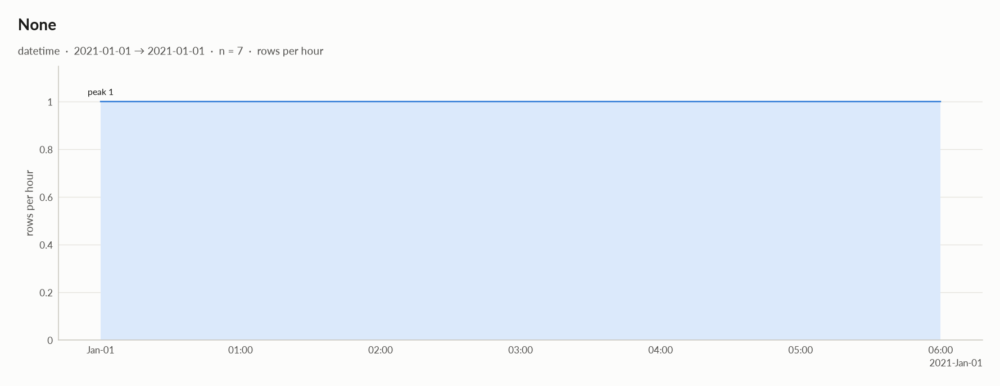

<code>True</code> · categorical

*interval\[int64, right\] · unrecognised dtype interval\[int64, right\], treated as labels*

**Profile**

| | |
|---|---|
| type | categorical |
| dtype | interval\[int64, right\] |
| values | 7 |
| missing | 0 (0.0%) |
| distinct | 7 (100.0%) |
| memory | 112 B |

**Labels**

| | |
|---|---|
| cardinality | 7 |
| entropy | 2.81 bits (1.00 of max) |
| Gini impurity | 0.857 |
| imbalance | ×1 |
| rare labels | 0 (0.0% of rows) |
| uniform? chi² | p 1 |

<code>1e5</code> · categorical

*object · 3 distinct labels*

**Profile**

| | |
|---|---|
| type | categorical |
| dtype | object |
| values | 4 |
| missing | 3 (42.9%) |
| distinct | 3 (75.0%) |
| memory | 278 B |
| mode | $5 ×2 |

**Labels**

| | |
|---|---|
| cardinality | 3 |
| entropy | 1.50 bits (0.95 of max) |
| Gini impurity | 0.625 |
| imbalance | ×2 |
| rare labels | 0 (0.0% of rows) |
| uniform? chi² | p 0.78 |

#### Most frequent values

| value | count | share |
|---|---|---|
| `$5` | 2 | 50.0% |
| `a` | 1 | 25.0% |
| `$x^2$` | 1 | 25.0% |

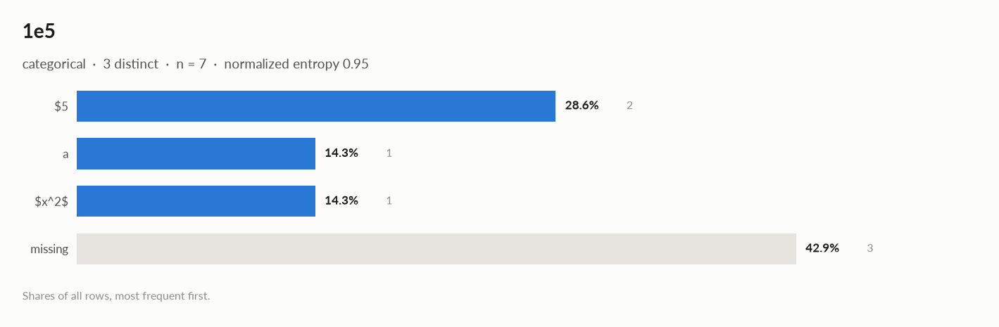

## Run

|   |   |
|---|---|
| **Source** | pandas.DataFrame · read in 0.0s |
| **Processes** | 3 for the analysis, 3 for the charts (14 cores available) |
| **Time** | 2.2s (load 0.0s, columns 0.2s, associations 0.2s, quality 0.0s, charts 1.7s) |
| **Significance** | alpha 0.05, Benjamini-Hochberg false discovery rate per family of tests |
| **Versions** | elessar 0.3.0 · Python 3.12.14 · pandas 3.1.0 · numpy 2.5.4 · scipy 1.18.1 |
