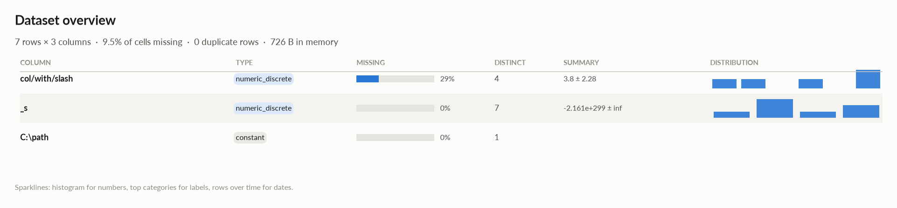
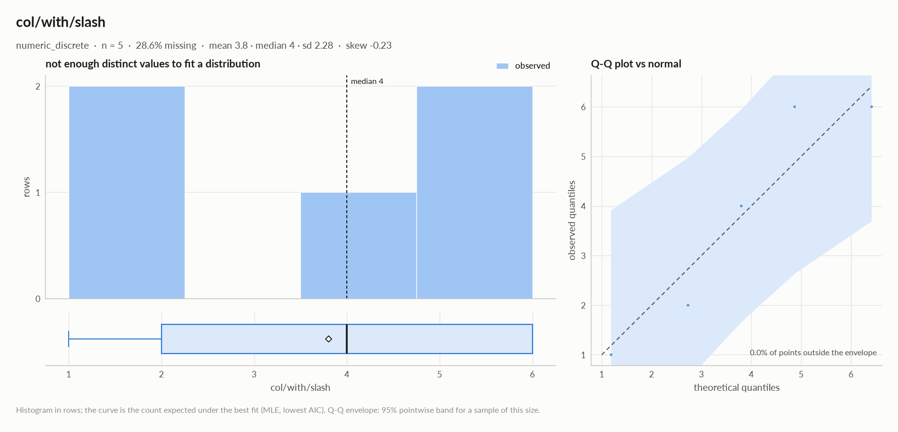
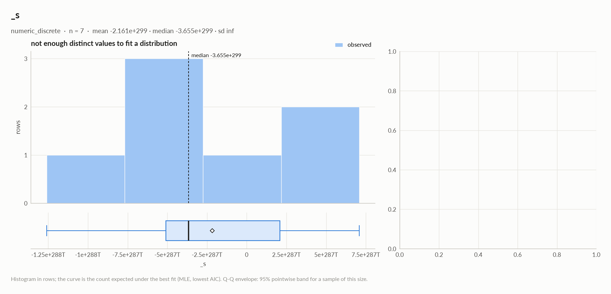
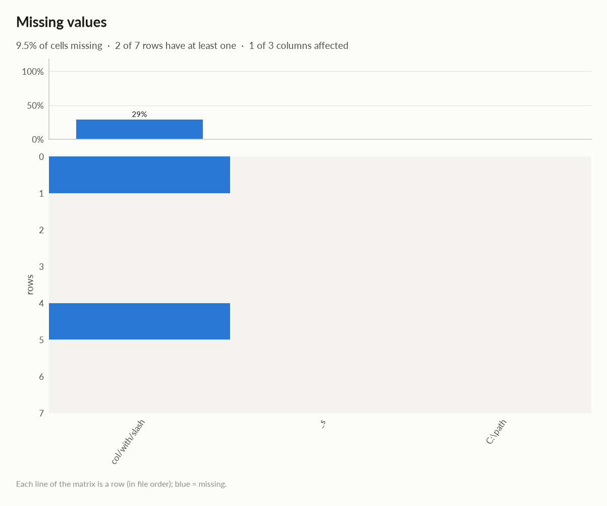

# elessar report

*7 rows × 3 columns · pandas.DataFrame · read in 0.0s · generated 2026-10-28 11:02 by elessar 0.3.0*

[Key findings](#key-findings) · [Overall statistics](#overall-statistics) · [Distributions](#distributions) · [Data quality](#data-quality) · [Multivariate statistics](#multivariate-statistics) · [Preparation plan](#preparation-plan) · [Attribute statistics](#attribute-statistics) · [Run](#run)

## Key findings

- **MEDIUM** `C:\path`: constant column carries no information -\> drop it
- **MEDIUM** `col/with/slash`: 28.6% missing -\> drop, or impute and add a missing-indicator

## Overall statistics

|   |   |
|---|---|
| **Rows** | 7 |
| **Columns** | 3 |
| **Memory** | 726 B |
| **Potential saving** | 0 B |
| **Pandas dtypes** | Int64=1, float64=1, object=1 |
| **Semantic types** | numeric\_discrete=2, constant=1 |
| **Duplicate rows** | 0 (0.0%) |
| **Missing cells** | 9.5% |

### Numeric columns at a glance

| column | count | missing | mean | std | min | median | max | skew | kurtosis | outliers | best fit |
|---|---|---|---|---|---|---|---|---|---|---|---|
| `col/with/slash` | 5 | 28.6% | 3.8 | 2.28 | 1 | 4 | 6 | -0.228 | -2.51 | 0.0% | - |
| `_s` | 7 | 0.0% | -2.161e+299 | - | -1.260e+300 | -3.655e+299 | 7.096e+299 | - | - | 0.0% | - |

## Distributions

Normality is tested four ways (Shapiro-Wilk on up to 5,000 values, D'Agostino K², Jarque-Bera, Anderson-Darling); the verdict is 'not normal' when at least half of them reject at alpha 0.05. Every candidate distribution is fitted by maximum likelihood and ranked by AIC; the Akaike weight is its relative support among the candidates.

*With thousands of values every test rejects even a good fit, so read KS D (the largest gap between the fitted and the observed cumulative distribution) as the size of the misfit: below 0.03 close, below 0.08 fair, above poor. KS p-values are optimistic since the parameters come from the same data. For integer columns the gap is measured on the integer support and the p-value comes from a chi-square goodness-of-fit test.*

| column | n | normality | tests rejecting | best fit | parameters | weight | ΔAIC to 2nd | KS D | KS p | shape |
|---|---|---|---|---|---|---|---|---|---|---|
| `col/with/slash` | 5 | insufficient data |  | - |  |  |  |  |  | not enough distinct values to fit a distribution |
| `_s` | 7 | insufficient data |  | - |  |  |  |  |  | not enough distinct values to fit a distribution |

## Data quality

| severity | column | message |
|---|---|---|
| medium | `C:\path` | constant column carries no information -\> drop it |
| medium | `col/with/slash` | 28.6% missing -\> drop, or impute and add a missing-indicator |

## Multivariate statistics

### Dimensionality reduction

PCA not applicable: needs at least 3 numeric columns and enough rows (2 columns, 7 rows)

### Associations between columns

1 pairs tested, 0 significant after Benjamini-Hochberg correction (alpha 0.05).

### Multicollinearity (VIF)

| column | VIF |
|---|---|
| `col/with/slash` | 1.00 |
| `_s` | nan |

## Preparation plan

Cleaning: missing data 1.  Transformation: rescale 1.

### Cleaning

| action | column | why | code |
|---|---|---|---|
| Missing data | `col/with/slash` | 28.6% missing: impute with the mean | `df['col/with/slash'] = df['col/with/slash'].fillna(df['col/with/slash'].mean())` |

### Transformation

| action | column | why | code |
|---|---|---|---|
| Rescale | - | numeric scales differ by x179,623,492,136,910,965,567,759,903,309,683,785,781,967,172,533,562,639,256,454,116,835,566,429,661,416,621,982,775,916,517,906,543,681,284,017,201,624,452,398,293,685,625,764,125,959,481,648,268,369,491,954,160,800,441,482,060,250,041,737,954,374,908,495,465,384,391,802,431,219,704,181,626,327,406,960,996,656,886,866,438,349,715,182,321,958,912,263,661,433,463,265,919,469,158,052,531,508,609,024 (\_s vs col/with/slash): distance-based models, regularised models and neural nets need common scales | `from sklearn.preprocessing import RobustScaler, StandardScaler df[[]] = RobustScaler().fit_transform(df[[]])  # outliers others = ['col/with/slash', '_s'] df[others] = StandardScaler().fit_transform(df[others])` |

## Attribute statistics

| column | type | missing | distinct | alerts |
|---|---|---|---|---|
| `col/with/slash` | numeric\_discrete | 28.6% | 4 | 0 |
| `_s` | numeric\_discrete | 0.0% | 7 | 0 |
| `C:\path` | constant | 0.0% | 1 | 0 |

<code>col/with/slash</code> · numeric_discrete

*Int64 · Int64 dtype: integer values (4 distinct)*

**Profile**

| | |
|---|---|
| type | numeric\_discrete |
| dtype | Int64 |
| values | 5 |
| missing | 2 (28.6%) |
| distinct | 4 (80.0%) |
| memory | 63 B |
| mode | 6 ×2 |

**Center**

| | |
|---|---|
| mean | 3.8 |
| 95% CI of mean | \[0.9686, 6.631\] |
| median | 4 |
| 95% CI of median | - |
| trimmed mean | 3.8 |
| geometric mean | 3.104 |
| harmonic mean | 2.4 |

**Spread**

| | |
|---|---|
| std | 2.28 |
| variance | 5.2 |
| sem | 1.02 |
| IQR | 4 |
| MAD | 2 |
| CV | 0.6001 |
| range | 5 |

**Quantiles**

| | |
|---|---|
| min | 1 |
| p1 | 1.04 |
| p5 | 1.2 |
| p25 | 2 |
| p50 | 4 |
| p75 | 6 |
| p95 | 6 |
| p99 | 6 |
| max | 6 |
| sum | 19 |

**Shape**

| | |
|---|---|
| skewness | -0.228 |
| excess kurtosis | -2.51 |
| KDE modes | - |
| bimodality coef. | 0.192 |
| decimals | 0 |

**Outliers & counts**

| | |
|---|---|
| IQR fences | \[-4, 12\] |
| outside fences | 0 (0.0%) |
| \|z\| \> 3 | 0 (0.0%) |
| modified z \> 3.5 | 0 (0.0%) |
| zeros | 0 |
| negatives | 0 |
| infinite | 0 |

**Row order**

| | |
|---|---|
| monotonic | no |

#### Most frequent values

| value | count | share |
|---|---|---|
| `6` | 2 | 40.0% |
| `2` | 1 | 20.0% |
| `4` | 1 | 20.0% |
| `1` | 1 | 20.0% |

<code>_s</code> · numeric_discrete

*float64 · float64 dtype: integer values (7 distinct)*

**Profile**

| | |
|---|---|
| type | numeric\_discrete |
| dtype | float64 |
| values | 7 |
| missing | 0 (0.0%) |
| distinct | 7 (100.0%) |
| memory | 56 B |

**Center**

| | |
|---|---|
| mean | -2.161e+299 |
| 95% CI of mean | \[-, -\] |
| median | -3.655e+299 |
| 95% CI of median | \[-1.260e+300, 7.096e+299\] |
| trimmed mean | -2.161e+299 |
| geometric mean | - |
| harmonic mean | - |

**Spread**

| | |
|---|---|
| std | - |
| variance | - |
| sem | - |
| IQR | 7.185e+299 |
| MAD | 5.385e+299 |
| CV | - |
| range | 1.970e+300 |

**Quantiles**

| | |
|---|---|
| min | -1.260e+300 |
| p1 | -1.216e+300 |
| p5 | -1.040e+300 |
| p25 | -5.085e+299 |
| p50 | -3.655e+299 |
| p75 | 2.100e+299 |
| p95 | 5.708e+299 |
| p99 | 6.818e+299 |
| max | 7.096e+299 |
| sum | -1.513e+300 |

**Shape**

| | |
|---|---|
| skewness | - |
| excess kurtosis | - |
| KDE modes | - |
| bimodality coef. | - |
| decimals | 0 |

**Outliers & counts**

| | |
|---|---|
| IQR fences | \[-1.586e+300, 1.288e+300\] |
| outside fences | 0 (0.0%) |
| \|z\| \> 3 | 0 (0.0%) |
| modified z \> 3.5 | 0 (0.0%) |
| zeros | 0 |
| negatives | 4 |
| infinite | 0 |

**Row order**

| | |
|---|---|
| monotonic | no |

<code>C:\path</code> · constant

*object · single value: "b'\\\\x00\\\\xff'"*

**Profile**

| | |
|---|---|
| type | constant |
| dtype | object |
| values | 7 |
| missing | 0 (0.0%) |
| distinct | 1 (14.3%) |
| memory | 301 B |
| mode | b'\\x00\\xff' ×7 |

#### Most frequent values

| value | count | share |
|---|---|---|
| `b'\x00\xff'` | 7 | 100.0% |

## Run

|   |   |
|---|---|
| **Source** | pandas.DataFrame · read in 0.0s |
| **Processes** | 3 for the analysis, 3 for the charts (14 cores available) |
| **Time** | 1.1s (load 0.0s, columns 0.1s, associations 0.1s, quality 0.0s, charts 0.7s) |
| **Significance** | alpha 0.05, Benjamini-Hochberg false discovery rate per family of tests |
| **Versions** | elessar 0.3.0 · Python 3.12.14 · pandas 3.1.0 · numpy 2.5.4 · scipy 1.18.1 |
