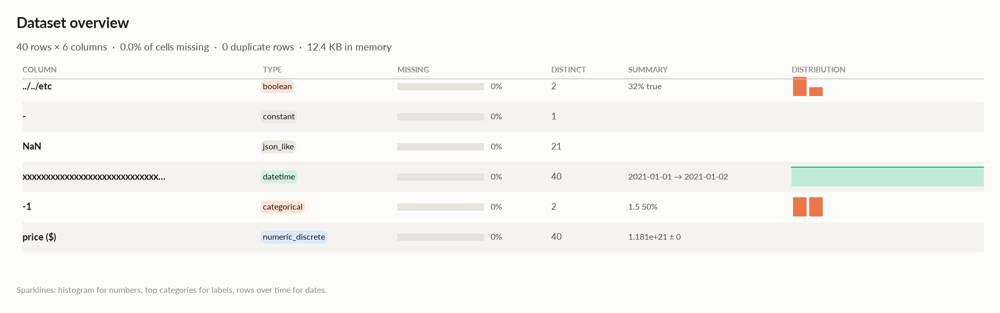
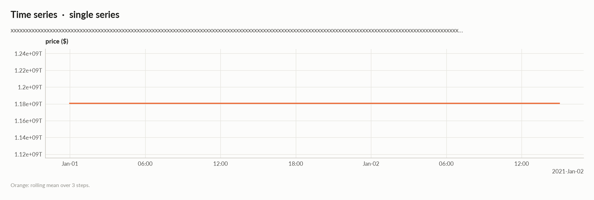
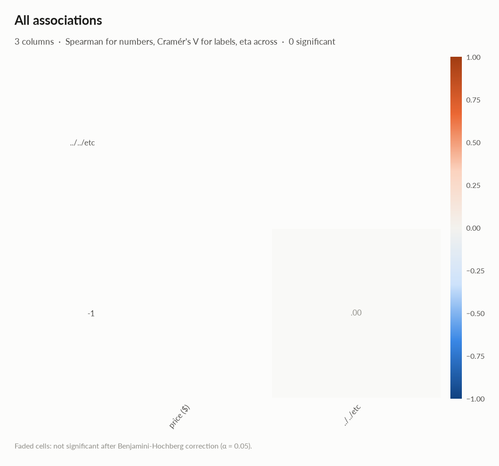
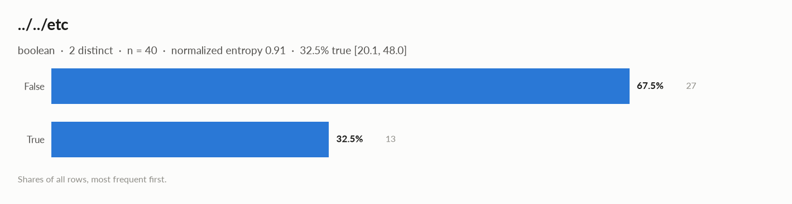
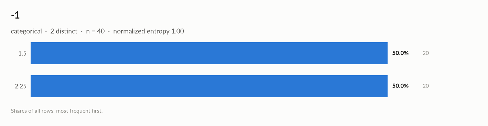

# elessar report

*40 rows × 6 columns · pandas.DataFrame · read in 0.0s · generated 2026-10-28 11:02 by elessar 0.3.0*

[Key findings](#key-findings) · [Overall statistics](#overall-statistics) · [Time series](#time-series) · [Distributions](#distributions) · [Data quality](#data-quality) · [Multivariate statistics](#multivariate-statistics) · [Preparation plan](#preparation-plan) · [Attribute statistics](#attribute-statistics) · [Run](#run)

## Key findings

- **MEDIUM** `-`: constant column carries no information -\> drop it
- **MEDIUM** `price ($)`: should-be-numeric: df\['price ($)'\] = pd.to\_numeric(df\['price ($)'\], errors='coerce')

## Overall statistics

|   |   |
|---|---|
| **Rows** | 40 |
| **Columns** | 6 |
| **Memory** | 12.4 KB |
| **Potential saving** | 4.1 KB |
| **Pandas dtypes** | object=3, bool=1, float64=1, datetime64\[us, UTC\]=1 |
| **Semantic types** | boolean=1, constant=1, json\_like=1, datetime=1, categorical=1, numeric\_discrete=1 |
| **Duplicate rows** | 0 (0.0%) |
| **Missing cells** | 0.0% |

### Numeric columns at a glance

| column | count | missing | mean | std | min | median | max | skew | kurtosis | outliers | best fit |
|---|---|---|---|---|---|---|---|---|---|---|---|
| `price ($)` | 40 | 0.0% | 1.181e+21 | 0 | 1.181e+21 | 1.181e+21 | 1.181e+21 | - | - | 0.0% | - |

### Categorical columns at a glance

| column | type | count | missing | distinct | most frequent | share | entropy |
|---|---|---|---|---|---|---|---|
| `../../etc` | boolean | 40 | 0.0% | 2 | False | 67.5% | 0.91 |
| `-1` | categorical | 40 | 0.0% | 2 | 1.5 | 50.0% | 1 |

## Time series

The table is **a single time series (one row per timestamp)**, indexed by `xxxxxxxxxxxxxxxxxxxxxxxxxxxxxxxxxxxxxxxxxxxxxxxxxxxxxxxxxxxxxxxxxxxxxxxxxxxxxxxxxxxxxxxxxxxxxxxxxxxxxxxxxxxxxxxxxxxxxxxxxxxxxxxxxxxxxxxxxxxxxxxxxxxxxxxxxxxxxxxxxxxxxxxxxxxxxxxxxxxxxxxxxxxxxxxxxxxxxxxxxxxxxxxxxxxxxxxxxxxxxxxxxxxxxxxxxxxxxxxxxxxxxxxxxxxxxxxxxxxxxxxxxxxxxxxxxxxxxxxxxxxxxxxxxxxxxxxxxxxx`: hour steps, 100% regular, 2021-01-01 → 2021-01-02, 40 steps.

| series | steps | trend | stationarity | lag-1 autocorr. | seasonality |
|---|---|---|---|---|---|
| `price ($)` | 40 | - | - | - | - |

### Treatment

| step | what to do | code |
|---|---|---|
| Windows | rolling windows of 3 steps and lags 1, 2 as features, shifted by one step so they only see the past | `df['lag_1'] = df['<value>'].shift(1) df['lag_2'] = df['<value>'].shift(2) df['roll_mean_3'] = df['<value>'].shift(1).rolling(3).mean()` |
| Validation | never shuffle: use expanding-window folds (below), with a gap equal to the forecast horizon | `from sklearn.model_selection import TimeSeriesSplit cv = TimeSeriesSplit(n_splits=5, test_size=4, gap=0)` |
| Augmentation | on the training folds only: jittering (noise at 3-5% of the std), scaling, window slicing, magnitude warping | `rng = np.random.default_rng(0) jittered = y + rng.normal(0, 0.03 * y.std(), len(y)) scaled = y * rng.normal(1, 0.1) start = rng.integers(0, len(y) // 10); sliced = y[start:start + int(0.9 * len(y))] warp = np.interp(np.arange(len(y)), np.linspace(0, len(y) - 1, 6), rng.normal(1, 0.1, 6)) warped = y * warp` |

### Validation folds (expanding window, on the real dates)

| fold | train | validate | train steps | validation steps |
|---|---|---|---|---|
| 1 | 2021-01-01 → 2021-01-01 19:00 | 2021-01-01 20:00 → 2021-01-01 23:00 | 20 | 4 |
| 2 | 2021-01-01 → 2021-01-01 23:00 | 2021-01-02 → 2021-01-02 03:00 | 24 | 4 |
| 3 | 2021-01-01 → 2021-01-02 03:00 | 2021-01-02 04:00 → 2021-01-02 07:00 | 28 | 4 |
| 4 | 2021-01-01 → 2021-01-02 07:00 | 2021-01-02 08:00 → 2021-01-02 11:00 | 32 | 4 |
| 5 | 2021-01-01 → 2021-01-02 11:00 | 2021-01-02 12:00 → 2021-01-02 15:00 | 36 | 4 |

## Distributions

Normality is tested four ways (Shapiro-Wilk on up to 5,000 values, D'Agostino K², Jarque-Bera, Anderson-Darling); the verdict is 'not normal' when at least half of them reject at alpha 0.05. Every candidate distribution is fitted by maximum likelihood and ranked by AIC; the Akaike weight is its relative support among the candidates.

*With thousands of values every test rejects even a good fit, so read KS D (the largest gap between the fitted and the observed cumulative distribution) as the size of the misfit: below 0.03 close, below 0.08 fair, above poor. KS p-values are optimistic since the parameters come from the same data. For integer columns the gap is measured on the integer support and the p-value comes from a chi-square goodness-of-fit test.*

| column | n | normality | tests rejecting | best fit | parameters | weight | ΔAIC to 2nd | KS D | KS p | shape |
|---|---|---|---|---|---|---|---|---|---|---|
| `price ($)` | 40 | constant |  | - |  |  |  |  |  | not enough distinct values to fit a distribution |

## Data quality

| severity | column | message |
|---|---|---|
| medium | `-` | constant column carries no information -\> drop it |
| medium | `price ($)` | should-be-numeric: df\['price ($)'\] = pd.to\_numeric(df\['price ($)'\], errors='coerce') |
| info | - | dtype optimizations save ~4.1 KB: -1 -\> category (see quality\['dtype\_optimizations'\] for code) |
| info | `xxxxxxxxxxxxxxxxxxxxxxxxxxxxxxxxxxxxxxxxxxxxxxxxxxxxxxxxxxxxxxxxxxxxxxxxxxxxxxxxxxxxxxxxxxxxxxxxxxxxxxxxxxxxxxxxxxxxxxxxxxxxxxxxxxxxxxxxxxxxxxxxxxxxxxxxxxxxxxxxxxxxxxxxxxxxxxxxxxxxxxxxxxxxxxxxxxxxxxxxxxxxxxxxxxxxxxxxxxxxxxxxxxxxxxxxxxxxxxxxxxxxxxxxxxxxxxxxxxxxxxxxxxxxxxxxxxxxxxxxxxxxxxxxxxxxxxxxxxxx` | a time series, hour steps -\> time-ordered validation, lags and windows (see Time series) |

### Memory: suggested dtypes save 4.1 KB

| column | current | suggested | saving | code |
|---|---|---|---|---|
| `-1` | object | category | 4.1 KB (94%) | `df['-1'] = df['-1'].astype('category')` |

## Multivariate statistics

### Dimensionality reduction

PCA not applicable: needs at least 3 numeric columns and enough rows (0 columns, 40 rows)

### Associations between columns

1 pairs tested, 0 significant after Benjamini-Hochberg correction (alpha 0.05).

## Preparation plan

Cleaning: wrong formats 2.  Transformation: decomposition 1, encode 2.

### Cleaning

| action | column | why | code |
|---|---|---|---|
| Wrong formats | `-1` | should-be-category | `df['-1'] = df['-1'].astype('category')` |
| Wrong formats | `price ($)` | should-be-numeric | `df['price ($)'] = pd.to_numeric(df['price ($)'], errors='coerce')` |

### Transformation

| action | column | why | code |
|---|---|---|---|
| Decomposition | `xxxxxxxxxxxxxxxxxxxxxxxxxxxxxxxxxxxxxxxxxxxxxxxxxxxxxxxxxxxxxxxxxxxxxxxxxxxxxxxxxxxxxxxxxxxxxxxxxxxxxxxxxxxxxxxxxxxxxxxxxxxxxxxxxxxxxxxxxxxxxxxxxxxxxxxxxxxxxxxxxxxxxxxxxxxxxxxxxxxxxxxxxxxxxxxxxxxxxxxxxxxxxxxxxxxxxxxxxxxxxxxxxxxxxxxxxxxxxxxxxxxxxxxxxxxxxxxxxxxxxxxxxxxxxxxxxxxxxxxxxxxxxxxxxxxxxxxxxxxx` | a date is not a feature: decompose into calendar parts | `d = pd.to_datetime(df['xxxxxxxxxxxxxxxxxxxxxxxxxxxxxxxxxxxxxxxxxxxxxxxxxxxxxxxxxxxxxxxxxxxxxxxxxxxxxxxxxxxxxxxxxxxxxxxxxxxxxxxxxxxxxxxxxxxxxxxxxxxxxxxxxxxxxxxxxxxxxxxxxxxxxxxxxxxxxxxxxxxxxxxxxxxxxxxxxxxxxxxxxxxxxxxxxxxxxxxxxxxxxxxxxxxxxxxxxxxxxxxxxxxxxxxxxxxxxxxxxxxxxxxxxxxxxxxxxxxxxxxxxxxxxxxxxxxxxxxxxxxxxxxxxxxxxxxxxxxx'], errors='coerce') df['xxxxxxxxxxxxxxxxxxxxxxxxxxxxxxxxxxxxxxxxxxxxxxxxxxxxxxxxxxxxxxxxxxxxxxxxxxxxxxxxxxxxxxxxxxxxxxxxxxxxxxxxxxxxxxxxxxxxxxxxxxxxxxxxxxxxxxxxxxxxxxxxxxxxxxxxxxxxxxxxxxxxxxxxxxxxxxxxxxxxxxxxxxxxxxxxxxxxxxxxxxxxxxxxxxxxxxxxxxxxxxxxxxxxxxxxxxxxxxxxxxxxxxxxxxxxxxxxxxxxxxxxxxxxxxxxxxxxxxxxxxxxxxxxxxxxxxxxxxxx' + '_year'], df['xxxxxxxxxxxxxxxxxxxxxxxxxxxxxxxxxxxxxxxxxxxxxxxxxxxxxxxxxxxxxxxxxxxxxxxxxxxxxxxxxxxxxxxxxxxxxxxxxxxxxxxxxxxxxxxxxxxxxxxxxxxxxxxxxxxxxxxxxxxxxxxxxxxxxxxxxxxxxxxxxxxxxxxxxxxxxxxxxxxxxxxxxxxxxxxxxxxxxxxxxxxxxxxxxxxxxxxxxxxxxxxxxxxxxxxxxxxxxxxxxxxxxxxxxxxxxxxxxxxxxxxxxxxxxxxxxxxxxxxxxxxxxxxxxxxxxxxxxxxx' + '_month'] = d.dt.year, d.dt.month df['xxxxxxxxxxxxxxxxxxxxxxxxxxxxxxxxxxxxxxxxxxxxxxxxxxxxxxxxxxxxxxxxxxxxxxxxxxxxxxxxxxxxxxxxxxxxxxxxxxxxxxxxxxxxxxxxxxxxxxxxxxxxxxxxxxxxxxxxxxxxxxxxxxxxxxxxxxxxxxxxxxxxxxxxxxxxxxxxxxxxxxxxxxxxxxxxxxxxxxxxxxxxxxxxxxxxxxxxxxxxxxxxxxxxxxxxxxxxxxxxxxxxxxxxxxxxxxxxxxxxxxxxxxxxxxxxxxxxxxxxxxxxxxxxxxxxxxxxxxxx' + '_dow'], df['xxxxxxxxxxxxxxxxxxxxxxxxxxxxxxxxxxxxxxxxxxxxxxxxxxxxxxxxxxxxxxxxxxxxxxxxxxxxxxxxxxxxxxxxxxxxxxxxxxxxxxxxxxxxxxxxxxxxxxxxxxxxxxxxxxxxxxxxxxxxxxxxxxxxxxxxxxxxxxxxxxxxxxxxxxxxxxxxxxxxxxxxxxxxxxxxxxxxxxxxxxxxxxxxxxxxxxxxxxxxxxxxxxxxxxxxxxxxxxxxxxxxxxxxxxxxxxxxxxxxxxxxxxxxxxxxxxxxxxxxxxxxxxxxxxxxxxxxxxxx' + '_hour'] = d.dt.dayofweek, d.dt.hour` |
| Encode | `../../etc` | boolean: 0/1 | `df['../../etc'] = df['../../etc'].astype(bool).astype(int)` |
| Encode | `-1` | 2 labels: one-hot | `df = pd.get_dummies(df, columns=['-1'], dummy_na=True)` |

## Attribute statistics

| column | type | missing | distinct | alerts |
|---|---|---|---|---|
| `../../etc` | boolean | 0.0% | 2 | 0 |
| `-` | constant | 0.0% | 1 | 0 |
| `NaN` | json\_like | 0.0% | 21 | 0 |
| `xxxxxxxxxxxxxxxxxxxxxxxxxxxxxxxxxxxxxxxxxxxxxxxxxxxxxxxxxxxxxxxxxxxxxxxxxxxxxxxxxxxxxxxxxxxxxxxxxxxxxxxxxxxxxxxxxxxxxxxxxxxxxxxxxxxxxxxxxxxxxxxxxxxxxxxxxxxxxxxxxxxxxxxxxxxxxxxxxxxxxxxxxxxxxxxxxxxxxxxxxxxxxxxxxxxxxxxxxxxxxxxxxxxxxxxxxxxxxxxxxxxxxxxxxxxxxxxxxxxxxxxxxxxxxxxxxxxxxxxxxxxxxxxxxxxxxxxxxxxx` | datetime | 0.0% | 40 | 0 |
| `-1` | categorical | 0.0% | 2 | 0 |
| `price ($)` | numeric\_discrete | 0.0% | 40 | 0 |

<code>../../etc</code> · boolean

*bool · bool dtype*

**Profile**

| | |
|---|---|
| type | boolean |
| dtype | bool |
| values | 40 |
| missing | 0 (0.0%) |
| distinct | 2 (5.0%) |
| memory | 40 B |
| mode | False ×27 |

**Labels**

| | |
|---|---|
| cardinality | 2 |
| entropy | 0.91 bits (0.91 of max) |
| Gini impurity | 0.439 |
| imbalance | ×2.077 |
| rare labels | 0 (0.0% of rows) |
| uniform? chi² | p 0.027 |
| true | 32.5% \[20.1, 48.0\] |

#### Most frequent values

| value | count | share |
|---|---|---|
| `False` | 27 | 67.5% |
| `True` | 13 | 32.5% |

<code>-</code> · constant

*float64 · single value: '0.0'*

**Profile**

| | |
|---|---|
| type | constant |
| dtype | float64 |
| values | 40 |
| missing | 0 (0.0%) |
| distinct | 1 (2.5%) |
| memory | 320 B |
| mode | 0.0 ×40 |

#### Most frequent values

| value | count | share |
|---|---|---|
| `0.0` | 40 | 100.0% |

<code>NaN</code> · json_like

*object · cells contain Python dict/list objects*

**Profile**

| | |
|---|---|
| type | json\_like |
| dtype | object |
| values | 40 |
| missing | 0 (0.0%) |
| distinct | 21 (52.5%) |
| memory | 5.3 KB |
| mode | \[1, 2\] ×20 |

#### Most frequent values

| value | count | share |
|---|---|---|
| `[1, 2]` | 20 | 50.0% |
| `{'k': 0}` | 1 | 2.5% |
| `{'k': 2}` | 1 | 2.5% |
| `{'k': 4}` | 1 | 2.5% |
| `{'k': 6}` | 1 | 2.5% |
| `{'k': 8}` | 1 | 2.5% |
| `{'k': 10}` | 1 | 2.5% |
| `{'k': 12}` | 1 | 2.5% |
| `{'k': 14}` | 1 | 2.5% |
| `{'k': 16}` | 1 | 2.5% |

- Python types: dict 20, list 20
- Top keys: k (20)

<code>xxxxxxxxxxxxxxxxxxxxxxxxxxxxxxxxxxxxxxxxxxxxxxxxxxxxxxxxxxxxxxxxxxxxxxxxxxxxxxxxxxxxxxxxxxxxxxxxxxxxxxxxxxxxxxxxxxxxxxxxxxxxxxxxxxxxxxxxxxxxxxxxxxxxxxxxxxxxxxxxxxxxxxxxxxxxxxxxxxxxxxxxxxxxxxxxxxxxxxxxxxxxxxxxxxxxxxxxxxxxxxxxxxxxxxxxxxxxxxxxxxxxxxxxxxxxxxxxxxxxxxxxxxxxxxxxxxxxxxxxxxxxxxxxxxxxxxxxxxxx</code> · datetime

*datetime64\[us, UTC\] · datetime dtype*

**Profile**

| | |
|---|---|
| type | datetime |
| dtype | datetime64\[us, UTC\] |
| values | 40 |
| missing | 0 (0.0%) |
| distinct | 40 (100.0%) |
| memory | 320 B |

**Time**

| | |
|---|---|
| first | 2021-01-01 |
| last | 2021-01-02 15:00:00 |
| span | 1 days 15:00:00 |
| frequency | h |
| duplicated timestamps | 0 |
| in the future | 0 |
| before 1900 | 0 |
| largest gap | 0 days 01:00:00 (2021-01-01 → 2021-01-01 01:00:00) |

- Rows by weekday: Fri 24, Sat 16
- Rows by hour: 0 2, 1 2, 2 2, 3 2, 4 2, 5 2, 6 2, 7 2, 8 2, 9 2, 10 2, 11 2, 12 2, 13 2, 14 2, 15 2, 16 1, 17 1, 18 1, 19 1, 20 1, 21 1, 22 1, 23 1

![xxxxxxxxxxxxxxxxxxxxxxxxxxxxxxxxxxxxxxxxxxxxxxxxxxxxxxxxxxxxxxxxxxxxxxxxxxxxxxxxxxxxxxxxxxxxxxxxxxxxxxxxxxxxxxxxxxxxxxxxxxxxxxxxxxxxxxxxxxxxxxxxxxxxxxxxxxxxxxxxxxxxxxxxxxxxxxxxxxxxxxxxxxxxxxxxxxxxxxxxxxxxxxxxxxxxxxxxxxxxxxxxxxxxxxxxxxxxxxxxxxxxxxxxxxxxxxxxxxxxxxxxxxxxxxxxxxxxxxxxxxxxxxxxxxxxxxxxxxxx: xxxxxxxxxxxxxxxxxxxxxxxxxxxxxxxxxxxxxxxxxxxxxxxxxxxxxxxxxxxxxxxxxxxxxxxxxxxxxxxxxxxxxxxxxxxxxxxxxxxxxxxxxxxxxxxxxxxxxxxxxxxxxxxxxxxxxxxxxxxxxxxxxxxxxxxxxxxxxxxxxxxxxxxxxxxxxxxxxxxxxxxxxxxxxxxxxxxxxxxxxxxxxxxxxxxxxxxxxxxxxxxxxxxxxxxxxxxxxxxxxxxxxxxxxxxxxxxxxxxxxxxxxxxxxxxxxxxxxxxxxxxxxxxxxxxxxxxxxxxx](03_xxxxxxxxxxxxxxxxxxxxxxxxxxxxxxxxxxxxxxxx_time.png)

<code>-1</code> · categorical

*object · Decimal objects, treated as labels*

**Profile**

| | |
|---|---|
| type | categorical |
| dtype | object |
| values | 40 |
| missing | 0 (0.0%) |
| distinct | 2 (5.0%) |
| memory | 4.4 KB |
| mode | 1.5 ×20 |

**Labels**

| | |
|---|---|
| cardinality | 2 |
| entropy | 1.00 bits (1.00 of max) |
| Gini impurity | 0.500 |
| imbalance | ×1 |
| rare labels | 0 (0.0% of rows) |
| uniform? chi² | p 1 |

#### Most frequent values

| value | count | share |
|---|---|---|
| `1.5` | 20 | 50.0% |
| `2.25` | 20 | 50.0% |

- **should-be-category**: `df['-1'] = df['-1'].astype('category')`

<code>price ($)</code> · numeric_discrete

*object · numbers in object column: integer values (1 distinct)*

**Profile**

| | |
|---|---|
| type | numeric\_discrete |
| dtype | object |
| values | 40 |
| missing | 0 (0.0%) |
| distinct | 40 (100.0%) |
| memory | 1.7 KB |

**Center**

| | |
|---|---|
| mean | 1.181e+21 |
| 95% CI of mean | \[1.181e+21, 1.181e+21\] |
| median | 1.181e+21 |
| 95% CI of median | \[1.181e+21, 1.181e+21\] |
| trimmed mean | 1.181e+21 |
| geometric mean | 1.181e+21 |
| harmonic mean | 1.181e+21 |

**Spread**

| | |
|---|---|
| std | 0 |
| variance | 0 |
| sem | 0 |
| IQR | 0 |
| MAD | 0 |
| CV | 0 |
| range | 0 |

**Quantiles**

| | |
|---|---|
| min | 1.181e+21 |
| p1 | 1.181e+21 |
| p5 | 1.181e+21 |
| p25 | 1.181e+21 |
| p50 | 1.181e+21 |
| p75 | 1.181e+21 |
| p95 | 1.181e+21 |
| p99 | 1.181e+21 |
| max | 1.181e+21 |
| sum | 4.722e+22 |

**Shape**

| | |
|---|---|
| skewness | - |
| excess kurtosis | - |
| KDE modes | - |
| bimodality coef. | - |
| decimals | 0 |

**Outliers & counts**

| | |
|---|---|
| IQR fences | \[1.181e+21, 1.181e+21\] |
| outside fences | 0 (0.0%) |
| \|z\| \> 3 | 0 (0.0%) |
| modified z \> 3.5 | 0 (0.0%) |
| zeros | 0 |
| negatives | 0 |
| infinite | 0 |

**Row order**

| | |
|---|---|
| monotonic | increasing |

- **should-be-numeric**: `df['price ($)'] = pd.to_numeric(df['price ($)'], errors='coerce')`

## Run

|   |   |
|---|---|
| **Source** | pandas.DataFrame · read in 0.0s |
| **Processes** | 3 for the analysis, 3 for the charts (14 cores available) |
| **Time** | 1.2s (load 0.0s, columns 0.2s, associations 0.2s, quality 0.0s, charts 0.6s) |
| **Significance** | alpha 0.05, Benjamini-Hochberg false discovery rate per family of tests |
| **Versions** | elessar 0.3.0 · Python 3.12.14 · pandas 3.1.0 · numpy 2.5.4 · scipy 1.18.1 |
