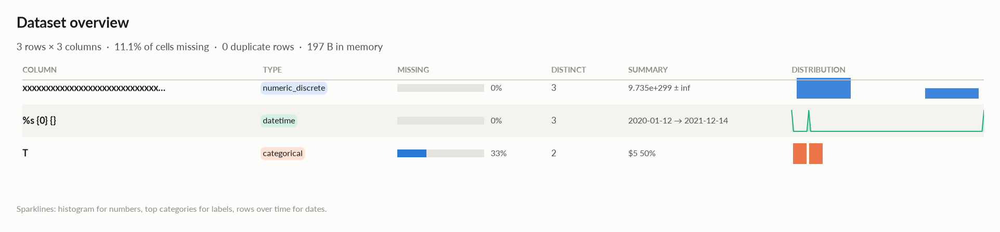
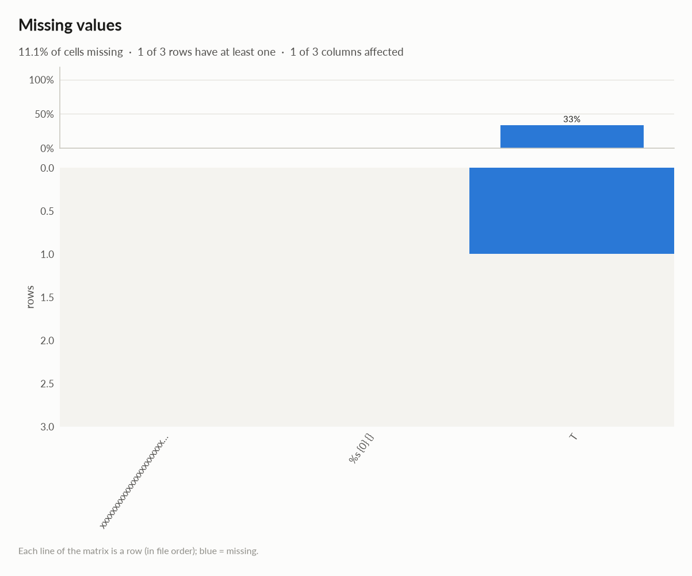
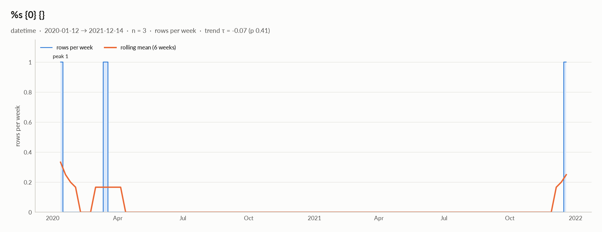

# elessar report

*3 rows × 3 columns · pandas.DataFrame · read in 0.0s · generated 2026-10-28 11:02 by elessar 0.3.0*

[Key findings](#key-findings) · [Overall statistics](#overall-statistics) · [Target analysis](#target-analysis) · [Distributions](#distributions) · [Data quality](#data-quality) · [Multivariate statistics](#multivariate-statistics) · [Preparation plan](#preparation-plan) · [Attribute statistics](#attribute-statistics) · [Run](#run)

## Key findings

- **MEDIUM** `T`: 33.3% missing -\> drop, or impute and add a missing-indicator

## Overall statistics

|   |   |
|---|---|
| **Rows** | 3 |
| **Columns** | 3 |
| **Memory** | 197 B |
| **Potential saving** | 0 B |
| **Pandas dtypes** | float64=1, datetime64\[us\]=1, object=1 |
| **Semantic types** | numeric\_discrete=1, datetime=1, categorical=1 |
| **Duplicate rows** | 0 (0.0%) |
| **Missing cells** | 11.1% |
| **Target** | xxxxxxxxxxxxxxxxxxxxxxxxxxxxxxxxxxxxxxxxxxxxxxxxxxxxxxxxxxxxxxxxxxxxxxxxxxxxxxxxxxxxxxxxxxxxxxxxxxxxxxxxxxxxxxxxxxxxxxxxxxxxxxxxxxxxxxxxxxxxxxxxxxxxxxxxxxxxxxxxxxxxxxxxxxxxxxxxxxxxxxxxxxxxxxxxxxxxxxxxxxxxxxxxxxxxxxxxxxxxxxxxxxxxxxxxxxxxxxxxxxxxxxxxxxxxxxxxxxxxxxxxxxxxxxxxxxxxxxxxxxxxxxxxxxxxxxxxxxxx |

### Numeric columns at a glance

| column | count | missing | mean | std | min | median | max | skew | kurtosis | outliers | best fit |
|---|---|---|---|---|---|---|---|---|---|---|---|
| `xxxxxxxxxxxxxxxxxxxxxxxxxxxxxxxxxxxxxxxxxxxxxxxxxxxxxxxxxxxxxxxxxxxxxxxxxxxxxxxxxxxxxxxxxxxxxxxxxxxxxxxxxxxxxxxxxxxxxxxxxxxxxxxxxxxxxxxxxxxxxxxxxxxxxxxxxxxxxxxxxxxxxxxxxxxxxxxxxxxxxxxxxxxxxxxxxxxxxxxxxxxxxxxxxxxxxxxxxxxxxxxxxxxxxxxxxxxxxxxxxxxxxxxxxxxxxxxxxxxxxxxxxxxxxxxxxxxxxxxxxxxxxxxxxxxxxxxxxxxx` | 3 | 0.0% | 9.735e+299 | - | 7.913e+298 | 1.307e+299 | 2.711e+300 | - | - | 0.0% | - |

### Categorical columns at a glance

| column | type | count | missing | distinct | most frequent | share | entropy |
|---|---|---|---|---|---|---|---|
| `T` | categorical | 2 | 33.3% | 2 | $5 | 50.0% | 1 |

## Target analysis

Target: `xxxxxxxxxxxxxxxxxxxxxxxxxxxxxxxxxxxxxxxxxxxxxxxxxxxxxxxxxxxxxxxxxxxxxxxxxxxxxxxxxxxxxxxxxxxxxxxxxxxxxxxxxxxxxxxxxxxxxxxxxxxxxxxxxxxxxxxxxxxxxxxxxxxxxxxxxxxxxxxxxxxxxxxxxxxxxxxxxxxxxxxxxxxxxxxxxxxxxxxxxxxxxxxxxxxxxxxxxxxxxxxxxxxxxxxxxxxxxxxxxxxxxxxxxxxxxxxxxxxxxxxxxxxxxxxxxxxxxxxxxxxxxxxxxxxxxxxxxxxx` (numeric\_discrete)

## Distributions

Normality is tested four ways (Shapiro-Wilk on up to 5,000 values, D'Agostino K², Jarque-Bera, Anderson-Darling); the verdict is 'not normal' when at least half of them reject at alpha 0.05. Every candidate distribution is fitted by maximum likelihood and ranked by AIC; the Akaike weight is its relative support among the candidates.

*With thousands of values every test rejects even a good fit, so read KS D (the largest gap between the fitted and the observed cumulative distribution) as the size of the misfit: below 0.03 close, below 0.08 fair, above poor. KS p-values are optimistic since the parameters come from the same data. For integer columns the gap is measured on the integer support and the p-value comes from a chi-square goodness-of-fit test.*

| column | n | normality | tests rejecting | best fit | parameters | weight | ΔAIC to 2nd | KS D | KS p | shape |
|---|---|---|---|---|---|---|---|---|---|---|
| `xxxxxxxxxxxxxxxxxxxxxxxxxxxxxxxxxxxxxxxxxxxxxxxxxxxxxxxxxxxxxxxxxxxxxxxxxxxxxxxxxxxxxxxxxxxxxxxxxxxxxxxxxxxxxxxxxxxxxxxxxxxxxxxxxxxxxxxxxxxxxxxxxxxxxxxxxxxxxxxxxxxxxxxxxxxxxxxxxxxxxxxxxxxxxxxxxxxxxxxxxxxxxxxxxxxxxxxxxxxxxxxxxxxxxxxxxxxxxxxxxxxxxxxxxxxxxxxxxxxxxxxxxxxxxxxxxxxxxxxxxxxxxxxxxxxxxxxxxxxx` | 3 | insufficient data |  | - |  |  |  |  |  | not enough distinct values to fit a distribution |

## Data quality

| severity | column | message |
|---|---|---|
| medium | `T` | 33.3% missing -\> drop, or impute and add a missing-indicator |

## Multivariate statistics

### Dimensionality reduction

PCA not applicable: needs at least 3 numeric columns and enough rows (0 columns, 3 rows)

### Associations between columns

## Preparation plan

Cleaning: missing data 1.  Transformation: decomposition 1, encode 1.

### Cleaning

| action | column | why | code |
|---|---|---|---|
| Missing data | `T` | 33.3% missing: use an explicit 'missing' category | `df['T'] = df['T'].fillna('missing')` |

### Transformation

| action | column | why | code |
|---|---|---|---|
| Decomposition | `%s {0} {}` | a date is not a feature: decompose into calendar parts | `d = pd.to_datetime(df['%s {0} {}'], errors='coerce') df['%s {0} {}' + '_year'], df['%s {0} {}' + '_month'] = d.dt.year, d.dt.month df['%s {0} {}' + '_dow'], df['%s {0} {}' + '_hour'] = d.dt.dayofweek, d.dt.hour` |
| Encode | `T` | 2 labels: one-hot | `df = pd.get_dummies(df, columns=['T'], dummy_na=True)` |

## Attribute statistics

| column | type | missing | distinct | alerts |
|---|---|---|---|---|
| `xxxxxxxxxxxxxxxxxxxxxxxxxxxxxxxxxxxxxxxxxxxxxxxxxxxxxxxxxxxxxxxxxxxxxxxxxxxxxxxxxxxxxxxxxxxxxxxxxxxxxxxxxxxxxxxxxxxxxxxxxxxxxxxxxxxxxxxxxxxxxxxxxxxxxxxxxxxxxxxxxxxxxxxxxxxxxxxxxxxxxxxxxxxxxxxxxxxxxxxxxxxxxxxxxxxxxxxxxxxxxxxxxxxxxxxxxxxxxxxxxxxxxxxxxxxxxxxxxxxxxxxxxxxxxxxxxxxxxxxxxxxxxxxxxxxxxxxxxxxx` | numeric\_discrete | 0.0% | 3 | 0 |
| `%s {0} {}` | datetime | 0.0% | 3 | 0 |
| `T` | categorical | 33.3% | 2 | 0 |

<code>xxxxxxxxxxxxxxxxxxxxxxxxxxxxxxxxxxxxxxxxxxxxxxxxxxxxxxxxxxxxxxxxxxxxxxxxxxxxxxxxxxxxxxxxxxxxxxxxxxxxxxxxxxxxxxxxxxxxxxxxxxxxxxxxxxxxxxxxxxxxxxxxxxxxxxxxxxxxxxxxxxxxxxxxxxxxxxxxxxxxxxxxxxxxxxxxxxxxxxxxxxxxxxxxxxxxxxxxxxxxxxxxxxxxxxxxxxxxxxxxxxxxxxxxxxxxxxxxxxxxxxxxxxxxxxxxxxxxxxxxxxxxxxxxxxxxxxxxxxxx</code> · numeric_discrete

*float64 · float64 dtype: integer values (3 distinct)*

**Profile**

| | |
|---|---|
| type | numeric\_discrete |
| dtype | float64 |
| values | 3 |
| missing | 0 (0.0%) |
| distinct | 3 (100.0%) |
| memory | 24 B |

**Center**

| | |
|---|---|
| mean | 9.735e+299 |
| 95% CI of mean | \[-, -\] |
| median | 1.307e+299 |
| 95% CI of median | - |
| trimmed mean | 9.735e+299 |
| geometric mean | 3.038e+299 |
| harmonic mean | 1.452e+299 |

**Spread**

| | |
|---|---|
| std | - |
| variance | - |
| sem | - |
| IQR | 1.316e+300 |
| MAD | 5.156e+298 |
| CV | - |
| range | 2.631e+300 |

**Quantiles**

| | |
|---|---|
| min | 7.913e+298 |
| p1 | 8.016e+298 |
| p5 | 8.429e+298 |
| p25 | 1.049e+299 |
| p50 | 1.307e+299 |
| p75 | 1.421e+300 |
| p95 | 2.453e+300 |
| p99 | 2.659e+300 |
| max | 2.711e+300 |
| sum | 2.920e+300 |

**Shape**

| | |
|---|---|
| skewness | - |
| excess kurtosis | - |
| KDE modes | - |
| bimodality coef. | - |
| decimals | 0 |

**Outliers & counts**

| | |
|---|---|
| IQR fences | \[-1.869e+300, 3.394e+300\] |
| outside fences | 0 (0.0%) |
| \|z\| \> 3 | 0 (0.0%) |
| modified z \> 3.5 | 1 (33.3%) |
| zeros | 0 |
| negatives | 0 |
| infinite | 0 |

**Row order**

| | |
|---|---|
| monotonic | increasing |

![xxxxxxxxxxxxxxxxxxxxxxxxxxxxxxxxxxxxxxxxxxxxxxxxxxxxxxxxxxxxxxxxxxxxxxxxxxxxxxxxxxxxxxxxxxxxxxxxxxxxxxxxxxxxxxxxxxxxxxxxxxxxxxxxxxxxxxxxxxxxxxxxxxxxxxxxxxxxxxxxxxxxxxxxxxxxxxxxxxxxxxxxxxxxxxxxxxxxxxxxxxxxxxxxxxxxxxxxxxxxxxxxxxxxxxxxxxxxxxxxxxxxxxxxxxxxxxxxxxxxxxxxxxxxxxxxxxxxxxxxxxxxxxxxxxxxxxxxxxxx: xxxxxxxxxxxxxxxxxxxxxxxxxxxxxxxxxxxxxxxxxxxxxxxxxxxxxxxxxxxxxxxxxxxxxxxxxxxxxxxxxxxxxxxxxxxxxxxxxxxxxxxxxxxxxxxxxxxxxxxxxxxxxxxxxxxxxxxxxxxxxxxxxxxxxxxxxxxxxxxxxxxxxxxxxxxxxxxxxxxxxxxxxxxxxxxxxxxxxxxxxxxxxxxxxxxxxxxxxxxxxxxxxxxxxxxxxxxxxxxxxxxxxxxxxxxxxxxxxxxxxxxxxxxxxxxxxxxxxxxxxxxxxxxxxxxxxxxxxxxx](02_xxxxxxxxxxxxxxxxxxxxxxxxxxxxxxxxxxxxxxxx_dist.png)

<code>%s {0} {}</code> · datetime

*datetime64\[us\] · datetime dtype*

**Profile**

| | |
|---|---|
| type | datetime |
| dtype | datetime64\[us\] |
| values | 3 |
| missing | 0 (0.0%) |
| distinct | 3 (100.0%) |
| memory | 24 B |

**Time**

| | |
|---|---|
| first | 2020-01-12 |
| last | 2021-12-14 |
| span | 702 days 00:00:00 |
| frequency | ~351 days 00:00:00 (irregular) |
| duplicated timestamps | 0 |
| in the future | 0 |
| before 1900 | 0 |
| largest gap | 641 days 00:00:00 (2020-03-13 → 2021-12-14) |
| trend of rows per week | tau -0.07 (p 0.41) |

- Rows by weekday: Tue 1, Fri 1, Sun 1
- Rows by month: Jan 1, Mar 1, Dec 1

<code>T</code> · categorical

*object · 2 distinct labels*

**Profile**

| | |
|---|---|
| type | categorical |
| dtype | object |
| values | 2 |
| missing | 1 (33.3%) |
| distinct | 2 (100.0%) |
| memory | 125 B |

**Labels**

| | |
|---|---|
| cardinality | 2 |
| entropy | 1.00 bits (1.00 of max) |
| Gini impurity | 0.500 |
| imbalance | ×1 |
| rare labels | 0 (0.0% of rows) |
| uniform? chi² | p 1 |

## Run

|   |   |
|---|---|
| **Source** | pandas.DataFrame · read in 0.0s |
| **Processes** | 3 for the analysis, 3 for the charts (14 cores available) |
| **Time** | 1.2s (load 0.0s, columns 0.2s, associations 0.2s, quality 0.0s, charts 0.7s) |
| **Significance** | alpha 0.05, Benjamini-Hochberg false discovery rate per family of tests |
| **Versions** | elessar 0.3.0 · Python 3.12.14 · pandas 3.1.0 · numpy 2.5.4 · scipy 1.18.1 |
