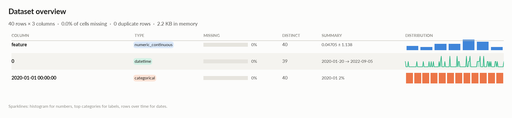
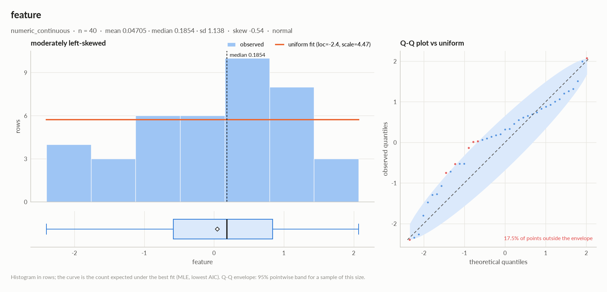
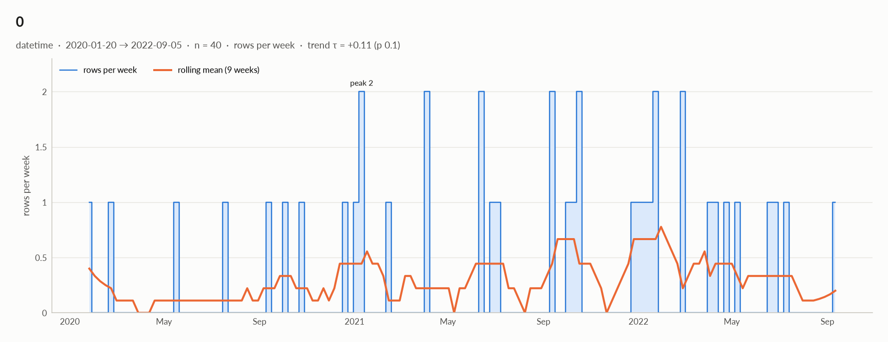

# elessar report

*40 rows × 3 columns · pandas.DataFrame · read in 0.0s · generated 2026-10-28 11:02 by elessar 0.3.0*

[Key findings](#key-findings) · [Overall statistics](#overall-statistics) · [Distributions](#distributions) · [Outliers](#outliers) · [Data quality](#data-quality) · [Multivariate statistics](#multivariate-statistics) · [Preparation plan](#preparation-plan) · [Attribute statistics](#attribute-statistics) · [Run](#run)

## Key findings

- **MEDIUM** `feature`: redundant with '2020-01-01 00:00:00' (eta +1.000) -\> keep only one
- **MEDIUM** `feature`: should-be-numeric: df\['feature'\] = pd.to\_numeric(df\['feature'\], errors='coerce')

## Overall statistics

|   |   |
|---|---|
| **Rows** | 40 |
| **Columns** | 3 |
| **Memory** | 2.2 KB |
| **Potential saving** | 0 B |
| **Pandas dtypes** | object=1, datetime64\[us\]=1, period\[M\]=1 |
| **Semantic types** | numeric\_continuous=1, datetime=1, categorical=1 |
| **Duplicate rows** | 0 (0.0%) |
| **Missing cells** | 0.0% |

### Numeric columns at a glance

| column | count | missing | mean | std | min | median | max | skew | kurtosis | outliers | best fit |
|---|---|---|---|---|---|---|---|---|---|---|---|
| `feature` | 40 | 0.0% | 0.04705 | 1.138 | -2.401 | 0.1854 | 2.071 | -0.541 | -0.218 | 0.0% | uniform(loc=-2.4, scale=4.47) |

### Categorical columns at a glance

| column | type | count | missing | distinct | most frequent | share | entropy |
|---|---|---|---|---|---|---|---|
| `2020-01-01 00:00:00` | categorical | 40 | 0.0% | 40 | 2020-01 | 2.5% | 1 |

## Distributions

Normality is tested four ways (Shapiro-Wilk on up to 5,000 values, D'Agostino K², Jarque-Bera, Anderson-Darling); the verdict is 'not normal' when at least half of them reject at alpha 0.05. Every candidate distribution is fitted by maximum likelihood and ranked by AIC; the Akaike weight is its relative support among the candidates.

*With thousands of values every test rejects even a good fit, so read KS D (the largest gap between the fitted and the observed cumulative distribution) as the size of the misfit: below 0.03 close, below 0.08 fair, above poor. KS p-values are optimistic since the parameters come from the same data. For integer columns the gap is measured on the integer support and the p-value comes from a chi-square goodness-of-fit test.*

| column | n | normality | tests rejecting | best fit | parameters | weight | ΔAIC to 2nd | KS D | KS p | shape |
|---|---|---|---|---|---|---|---|---|---|---|
| `feature` | 40 | normal | 0 of 4 | uniform | loc=-2.4, scale=4.47 | 0.61 | 3.1 (normal) | 0.189 (poor) | 0.1 | moderately left-skewed |

## Outliers

Three methods per numeric column: 3 sigma (|value - mean| \> 3 standard deviations), boxplot (outside the Tukey fences Q1 - 1.5 IQR, Q3 + 1.5 IQR) and modified z (Hampel: |0.6745 (value - median) / MAD| \> 3.5). A consensus outlier is flagged by at least two.

| column | 3 sigma | boxplot | modified z | consensus | fences | action |
|---|---|---|---|---|---|---|
| `feature` | 0 | 0 | 0 | 0 (0.0%) | \[-2.713, 2.969\] | keep |

## Data quality

| severity | column | message |
|---|---|---|
| medium | `feature` | redundant with '2020-01-01 00:00:00' (eta +1.000) -\> keep only one |
| medium | `feature` | should-be-numeric: df\['feature'\] = pd.to\_numeric(df\['feature'\], errors='coerce') |
| info | `2020-01-01 00:00:00` | 2 data items per cell joined by '-' (e.g. '2021-11') -\> split into 2 columns |

## Multivariate statistics

### Dimensionality reduction

PCA not applicable: needs at least 3 numeric columns and enough rows (1 columns, 40 rows)

### Associations between columns

1 pairs tested, 0 significant after Benjamini-Hochberg correction (alpha 0.05).

### Strongest associations

| column A | column B | method | value | 95% CI | n | p\_adj | sig |
|---|---|---|---|---|---|---|---|
| 2020-01-01 00:00:00 | feature | eta | +1.000 |  | 40 | 0.47 |  |

## Preparation plan

Cleaning: wrong formats 1.  Transformation: decomposition 2, encode 1.

### Cleaning

| action | column | why | code |
|---|---|---|---|
| Wrong formats | `feature` | should-be-numeric | `df['feature'] = pd.to_numeric(df['feature'], errors='coerce')` |

### Transformation

| action | column | why | code |
|---|---|---|---|
| Decomposition | `0` | a date is not a feature: decompose into calendar parts | `d = pd.to_datetime(df['0'], errors='coerce') df['0' + '_year'], df['0' + '_month'] = d.dt.year, d.dt.month df['0' + '_dow'], df['0' + '_hour'] = d.dt.dayofweek, d.dt.hour` |
| Decomposition | `2020-01-01 00:00:00` | several data items in one cell (2 parts joined by '-', e.g. '2021-11'): split them | `df[['2020-01-01 00:00:00_1', '2020-01-01 00:00:00_2']] = df['2020-01-01 00:00:00'].str.split('-', n=1, expand=True)` |
| Encode | `2020-01-01 00:00:00` | 40 labels: too many for one-hot; target encoding (cross-fitted) or frequency encoding | `df['2020-01-01 00:00:00'] = df['2020-01-01 00:00:00'].map(df['2020-01-01 00:00:00'].value_counts(normalize=True))` |

## Attribute statistics

| column | type | missing | distinct | alerts |
|---|---|---|---|---|
| `feature` | numeric\_continuous | 0.0% | 40 | 0 |
| `0` | datetime | 0.0% | 39 | 0 |
| `2020-01-01 00:00:00` | categorical | 0.0% | 40 | 0 |

<code>feature</code> · numeric_continuous

*object · numbers in object column: 40 distinct real values*

**Profile**

| | |
|---|---|
| type | numeric\_continuous |
| dtype | object |
| values | 40 |
| missing | 0 (0.0%) |
| distinct | 40 (100.0%) |
| memory | 1.2 KB |

**Center**

| | |
|---|---|
| mean | 0.04705 |
| 95% CI of mean | \[-0.317, 0.4111\] |
| median | 0.1854 |
| 95% CI of median | \[-0.5293, 0.6496\] |
| trimmed mean | 0.1196 |
| geometric mean | - |
| harmonic mean | - |

**Spread**

| | |
|---|---|
| std | 1.138 |
| variance | 1.296 |
| sem | 0.18 |
| IQR | 1.421 |
| MAD | 0.7182 |
| CV | 24.19 |
| range | 4.472 |

**Quantiles**

| | |
|---|---|
| min | -2.401 |
| p1 | -2.381 |
| p5 | -2.273 |
| p25 | -0.5824 |
| p50 | 0.1854 |
| p75 | 0.8383 |
| p95 | 1.53 |
| p99 | 2.04 |
| max | 2.071 |
| sum | 1.882 |

**Shape**

| | |
|---|---|
| skewness | -0.541 |
| excess kurtosis | -0.218 |
| KDE modes | 1 |
| bimodality coef. | 0.427 |

**Outliers & counts**

| | |
|---|---|
| IQR fences | \[-2.713, 2.969\] |
| outside fences | 0 (0.0%) |
| \|z\| \> 3 | 0 (0.0%) |
| modified z \> 3.5 | 0 (0.0%) |
| zeros | 0 |
| negatives | 14 |
| infinite | 0 |

**Row order**

| | |
|---|---|
| monotonic | no |
| lag-1 autocorrelation | 0.200 (p 0.21) |

#### Normality: normal (n = 40)

| test | statistic | p-value | at alpha 0.05 |
|---|---|---|---|
| Shapiro-Wilk | 0.959 | 0.15 | consistent with normal |
| D'Agostino K² | 2.178 | 0.34 | consistent with normal |
| Jarque-Bera | 1.996 | 0.37 | consistent with normal |
| Anderson-Darling | 0.554 | 0.15 | consistent with normal |

#### Best fits (continuous, 13 candidates fitted on 40 values)

| \# | distribution | parameters | AIC | ΔAIC | weight | BIC | KS D | KS p |
|---|---|---|---|---|---|---|---|---|
| 1 | uniform | loc=-2.4, scale=4.47 | 123.821 | 0.0 | 0.61 | 127.198 | 0.189 (poor) | 0.1 |
| 2 | normal | loc=0.0471, scale=1.12 | 126.875 | 3.1 | 0.13 | 130.253 | 0.136 (poor) | 0.41 |
| 3 | beta | a=1.02, b=0.921, loc=-2.41, scale=4.48 | 127.625 | 3.8 | 0.09 | 134.38 | 0.154 (poor) | 0.27 |

- **should-be-numeric**: `df['feature'] = pd.to_numeric(df['feature'], errors='coerce')`

<code>0</code> · datetime

*datetime64\[us\] · datetime dtype*

**Profile**

| | |
|---|---|
| type | datetime |
| dtype | datetime64\[us\] |
| values | 40 |
| missing | 0 (0.0%) |
| distinct | 39 (97.5%) |
| memory | 320 B |

**Time**

| | |
|---|---|
| first | 2020-01-20 |
| last | 2022-09-05 |
| span | 959 days 00:00:00 |
| frequency | ~16 days 00:00:00 (irregular) |
| duplicated timestamps | 1 |
| in the future | 0 |
| before 1900 | 0 |
| largest gap | 88 days 00:00:00 (2020-02-19 → 2020-05-17) |
| trend of rows per week | tau +0.11 (p 0.1) |

- Rows by weekday: Mon 6, Tue 3, Wed 7, Thu 7, Fri 4, Sat 5, Sun 8
- Rows by month: Jan 8, Feb 4, Mar 2, Apr 3, May 2, Jun 5, Jul 3, Sep 5, Oct 5, Dec 3

<code>2020-01-01 00:00:00</code> · categorical

*period\[M\] · unrecognised dtype period\[M\], treated as labels*

**Profile**

| | |
|---|---|
| type | categorical |
| dtype | period\[M\] |
| values | 40 |
| missing | 0 (0.0%) |
| distinct | 40 (100.0%) |
| memory | 320 B |

**Labels**

| | |
|---|---|
| cardinality | 40 |
| entropy | 5.32 bits (1.00 of max) |
| Gini impurity | 0.975 |
| imbalance | ×1 |
| rare labels | 0 (0.0% of rows) |
| uniform? chi² | p 1 |

## Run

|   |   |
|---|---|
| **Source** | pandas.DataFrame · read in 0.0s |
| **Processes** | 3 for the analysis, 3 for the charts (14 cores available) |
| **Time** | 1.2s (load 0.0s, columns 0.2s, associations 0.2s, quality 0.0s, charts 0.6s) |
| **Significance** | alpha 0.05, Benjamini-Hochberg false discovery rate per family of tests |
| **Versions** | elessar 0.3.0 · Python 3.12.14 · pandas 3.1.0 · numpy 2.5.4 · scipy 1.18.1 |
