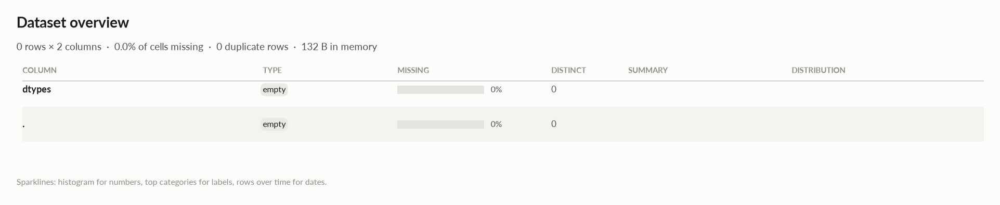

# elessar report

*0 rows × 2 columns · pandas.DataFrame · read in 0.0s · generated 2026-10-28 11:02 by elessar 0.3.0*

[Key findings](#key-findings) · [Overall statistics](#overall-statistics) · [Target analysis](#target-analysis) · [Data quality](#data-quality) · [Multivariate statistics](#multivariate-statistics) · [Preparation plan](#preparation-plan) · [Attribute statistics](#attribute-statistics) · [Run](#run)

## Key findings

- **HIGH** `.`: column is entirely missing -\> drop it
- **HIGH** `dtypes`: column is entirely missing -\> drop it

## Overall statistics

|   |   |
|---|---|
| **Rows** | 0 |
| **Columns** | 2 |
| **Memory** | 132 B |
| **Potential saving** | 0 B |
| **Pandas dtypes** | bool=1, float64=1 |
| **Semantic types** | empty=2 |
| **Duplicate rows** | 0 (0.0%) |
| **Missing cells** | 0.0% |
| **Target** | . |

## Target analysis

Target: `.` (empty)

## Data quality

| severity | column | message |
|---|---|---|
| high | `.` | column is entirely missing -\> drop it |
| high | `dtypes` | column is entirely missing -\> drop it |

## Multivariate statistics

### Dimensionality reduction

PCA not applicable: needs at least 3 numeric columns and enough rows (0 columns, 0 rows)

### Associations between columns

## Preparation plan

Nothing to clean or transform.

## Attribute statistics

| column | type | missing | distinct | alerts |
|---|---|---|---|---|
| `dtypes` | empty | 0.0% | 0 | 0 |
| `.` | empty | 0.0% | 0 | 0 |

<code>dtypes</code> · empty

*bool · no non-missing values*

**Profile**

| | |
|---|---|
| type | empty |
| dtype | bool |
| values | 0 |
| missing | 0 (0.0%) |
| distinct | 0 (0.0%) |
| memory | 0 B |

<code>.</code> · empty

*float64 · no non-missing values*

**Profile**

| | |
|---|---|
| type | empty |
| dtype | float64 |
| values | 0 |
| missing | 0 (0.0%) |
| distinct | 0 (0.0%) |
| memory | 0 B |

## Run

|   |   |
|---|---|
| **Source** | pandas.DataFrame · read in 0.0s |
| **Processes** | 2 for the analysis, 3 for the charts (14 cores available) |
| **Time** | 0.6s (load 0.0s, columns 0.1s, associations 0.1s, quality 0.0s, charts 0.3s) |
| **Significance** | alpha 0.05, Benjamini-Hochberg false discovery rate per family of tests |
| **Versions** | elessar 0.3.0 · Python 3.12.14 · pandas 3.1.0 · numpy 2.5.4 · scipy 1.18.1 |
