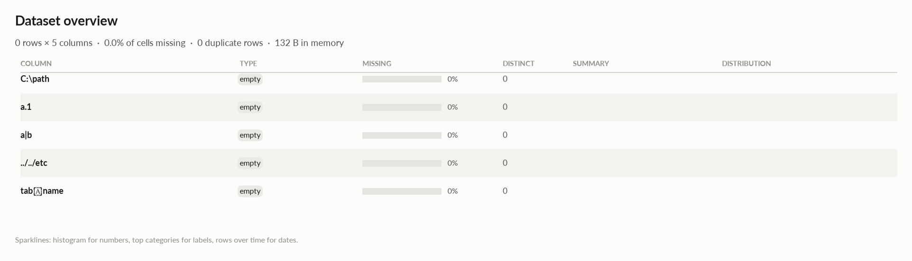

# elessar report

*0 rows × 5 columns · pandas.DataFrame · read in 0.0s · generated 2026-10-28 11:02 by elessar 0.3.0*

[Key findings](#key-findings) · [Overall statistics](#overall-statistics) · [Data quality](#data-quality) · [Multivariate statistics](#multivariate-statistics) · [Preparation plan](#preparation-plan) · [Attribute statistics](#attribute-statistics) · [Run](#run)

## Key findings

- **HIGH** `../../etc`: column is entirely missing -\> drop it
- **HIGH** `C:\path`: column is entirely missing -\> drop it
- **HIGH** `a.1`: column is entirely missing -\> drop it
- **HIGH** `a|b`: column is entirely missing -\> drop it
- **HIGH** `tab	name`: column is entirely missing -\> drop it
- **MEDIUM** duplicate or non-string column names were renamed (a, a.1, ...)
- **MEDIUM** `../../etc`: identical to column 'a|b' -\> drop one of them
- **MEDIUM** `tab	name`: identical to column 'a.1' -\> drop one of them

## Overall statistics

|   |   |
|---|---|
| **Rows** | 0 |
| **Columns** | 5 |
| **Memory** | 132 B |
| **Potential saving** | 0 B |
| **Pandas dtypes** | object=2, float64=2, int64=1 |
| **Semantic types** | empty=5 |
| **Duplicate rows** | 0 (0.0%) |
| **Missing cells** | 0.0% |

## Data quality

| severity | column | message |
|---|---|---|
| high | `../../etc` | column is entirely missing -\> drop it |
| high | `C:\path` | column is entirely missing -\> drop it |
| high | `a.1` | column is entirely missing -\> drop it |
| high | `a\|b` | column is entirely missing -\> drop it |
| high | `tab	name` | column is entirely missing -\> drop it |
| medium | - | duplicate or non-string column names were renamed (a, a.1, ...) |
| medium | `../../etc` | identical to column 'a\|b' -\> drop one of them |
| medium | `tab	name` | identical to column 'a.1' -\> drop one of them |

## Multivariate statistics

### Dimensionality reduction

PCA not applicable: needs at least 3 numeric columns and enough rows (0 columns, 0 rows)

### Associations between columns

## Preparation plan

Cleaning: duplicates 2.  Transformation: .

### Cleaning

| action | column | why | code |
|---|---|---|---|
| Duplicates | `tab	name` | identical to 'a.1' | `df = df.drop(columns=['tab\tname'])` |
| Duplicates | `../../etc` | identical to 'a\|b' | `df = df.drop(columns=['../../etc'])` |

## Attribute statistics

| column | type | missing | distinct | alerts |
|---|---|---|---|---|
| `C:\path` | empty | 0.0% | 0 | 0 |
| `a.1` | empty | 0.0% | 0 | 0 |
| `a\|b` | empty | 0.0% | 0 | 0 |
| `../../etc` | empty | 0.0% | 0 | 0 |
| `tab	name` | empty | 0.0% | 0 | 0 |

<code>C:\path</code> · empty

*int64 · no non-missing values*

**Profile**

| | |
|---|---|
| type | empty |
| dtype | int64 |
| values | 0 |
| missing | 0 (0.0%) |
| distinct | 0 (0.0%) |
| memory | 0 B |

<code>a.1</code> · empty

*object · no non-missing values*

**Profile**

| | |
|---|---|
| type | empty |
| dtype | object |
| values | 0 |
| missing | 0 (0.0%) |
| distinct | 0 (0.0%) |
| memory | 0 B |

<code>a|b</code> · empty

*float64 · no non-missing values*

**Profile**

| | |
|---|---|
| type | empty |
| dtype | float64 |
| values | 0 |
| missing | 0 (0.0%) |
| distinct | 0 (0.0%) |
| memory | 0 B |

<code>../../etc</code> · empty

*float64 · no non-missing values*

**Profile**

| | |
|---|---|
| type | empty |
| dtype | float64 |
| values | 0 |
| missing | 0 (0.0%) |
| distinct | 0 (0.0%) |
| memory | 0 B |

<code>tab	name</code> · empty

*object · no non-missing values*

**Profile**

| | |
|---|---|
| type | empty |
| dtype | object |
| values | 0 |
| missing | 0 (0.0%) |
| distinct | 0 (0.0%) |
| memory | 0 B |

## Run

|   |   |
|---|---|
| **Source** | pandas.DataFrame · read in 0.0s |
| **Processes** | 3 for the analysis, 3 for the charts (14 cores available) |
| **Time** | 0.6s (load 0.0s, columns 0.1s, associations 0.1s, quality 0.0s, charts 0.3s) |
| **Significance** | alpha 0.05, Benjamini-Hochberg false discovery rate per family of tests |
| **Versions** | elessar 0.3.0 · Python 3.12.14 · pandas 3.1.0 · numpy 2.5.4 · scipy 1.18.1 |
