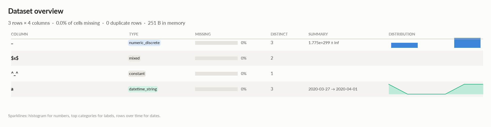
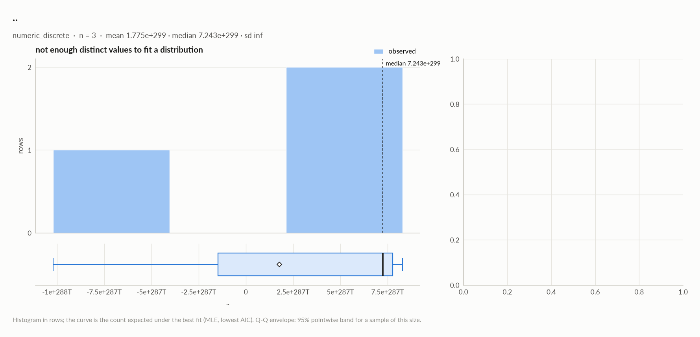
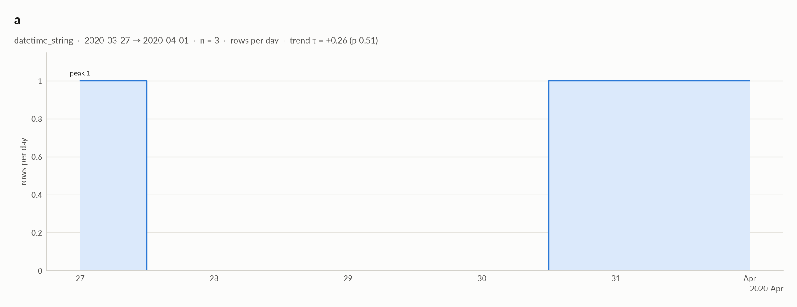

# elessar report

*3 rows × 4 columns · pandas.DataFrame · read in 0.0s · generated 2026-10-28 11:02 by elessar 0.3.0*

[Key findings](#key-findings) · [Overall statistics](#overall-statistics) · [Distributions](#distributions) · [Data quality](#data-quality) · [Multivariate statistics](#multivariate-statistics) · [Preparation plan](#preparation-plan) · [Attribute statistics](#attribute-statistics) · [Run](#run)

## Key findings

- **HIGH** `$x$`: mixed Python types (str=2, number=1) -\> normalise to a single type
- **MEDIUM** `^_^`: constant column carries no information -\> drop it
- **MEDIUM** `a`: should-be-datetime: df\['a'\] = pd.to\_datetime(df\['a'\], errors='coerce', format='mixed')

## Overall statistics

|   |   |
|---|---|
| **Rows** | 3 |
| **Columns** | 4 |
| **Memory** | 251 B |
| **Potential saving** | 30 B |
| **Pandas dtypes** | float64=1, object=1, category=1, str=1 |
| **Semantic types** | numeric\_discrete=1, mixed=1, constant=1, datetime\_string=1 |
| **Duplicate rows** | 0 (0.0%) |
| **Missing cells** | 0.0% |

### Numeric columns at a glance

| column | count | missing | mean | std | min | median | max | skew | kurtosis | outliers | best fit |
|---|---|---|---|---|---|---|---|---|---|---|---|
| `..` | 3 | 0.0% | 1.775e+299 | - | -1.021e+300 | 7.243e+299 | 8.293e+299 | - | - | 0.0% | - |

## Distributions

Normality is tested four ways (Shapiro-Wilk on up to 5,000 values, D'Agostino K², Jarque-Bera, Anderson-Darling); the verdict is 'not normal' when at least half of them reject at alpha 0.05. Every candidate distribution is fitted by maximum likelihood and ranked by AIC; the Akaike weight is its relative support among the candidates.

*With thousands of values every test rejects even a good fit, so read KS D (the largest gap between the fitted and the observed cumulative distribution) as the size of the misfit: below 0.03 close, below 0.08 fair, above poor. KS p-values are optimistic since the parameters come from the same data. For integer columns the gap is measured on the integer support and the p-value comes from a chi-square goodness-of-fit test.*

| column | n | normality | tests rejecting | best fit | parameters | weight | ΔAIC to 2nd | KS D | KS p | shape |
|---|---|---|---|---|---|---|---|---|---|---|
| `..` | 3 | insufficient data |  | - |  |  |  |  |  | not enough distinct values to fit a distribution |

## Data quality

| severity | column | message |
|---|---|---|
| high | `$x$` | mixed Python types (str=2, number=1) -\> normalise to a single type |
| medium | `^_^` | constant column carries no information -\> drop it |
| medium | `a` | should-be-datetime: df\['a'\] = pd.to\_datetime(df\['a'\], errors='coerce', format='mixed') |
| info | - | dtype optimizations save ~30 B: a -\> datetime64 (see quality\['dtype\_optimizations'\] for code) |

### Memory: suggested dtypes save 30 B

| column | current | suggested | saving | code |
|---|---|---|---|---|
| `a` | str | datetime64 | 30 B (56%) | `df['a'] = pd.to_datetime(df['a'], errors='coerce', format='mixed')` |

## Multivariate statistics

### Dimensionality reduction

PCA not applicable: needs at least 3 numeric columns and enough rows (1 columns, 3 rows)

### Associations between columns

## Preparation plan

Cleaning: wrong formats 2.  Transformation: decomposition 1.

### Cleaning

| action | column | why | code |
|---|---|---|---|
| Wrong formats | `a` | should-be-datetime | `df['a'] = pd.to_datetime(df['a'], errors='coerce', format='mixed')` |
| Wrong formats | `$x$` | mixed Python types {'str': 2, 'number': 1} | `df['$x$'] = pd.to_numeric(df['$x$'], errors='coerce')  # or .astype(str)` |

### Transformation

| action | column | why | code |
|---|---|---|---|
| Decomposition | `a` | a date is not a feature: decompose into calendar parts | `d = pd.to_datetime(df['a'], errors='coerce') df['a' + '_year'], df['a' + '_month'] = d.dt.year, d.dt.month df['a' + '_dow'], df['a' + '_hour'] = d.dt.dayofweek, d.dt.hour` |

## Attribute statistics

| column | type | missing | distinct | alerts |
|---|---|---|---|---|
| `..` | numeric\_discrete | 0.0% | 3 | 0 |
| `$x$` | mixed | 0.0% | 2 | 0 |
| `^_^` | constant | 0.0% | 1 | 0 |
| `a` | datetime\_string | 0.0% | 3 | 0 |

<code>..</code> · numeric_discrete

*float64 · float64 dtype: integer values (3 distinct)*

**Profile**

| | |
|---|---|
| type | numeric\_discrete |
| dtype | float64 |
| values | 3 |
| missing | 0 (0.0%) |
| distinct | 3 (100.0%) |
| memory | 24 B |

**Center**

| | |
|---|---|
| mean | 1.775e+299 |
| 95% CI of mean | \[-, -\] |
| median | 7.243e+299 |
| 95% CI of median | - |
| trimmed mean | 1.775e+299 |
| geometric mean | - |
| harmonic mean | - |

**Spread**

| | |
|---|---|
| std | - |
| variance | - |
| sem | - |
| IQR | 9.252e+299 |
| MAD | 1.050e+299 |
| CV | - |
| range | 1.850e+300 |

**Quantiles**

| | |
|---|---|
| min | -1.021e+300 |
| p1 | -9.862e+299 |
| p5 | -8.466e+299 |
| p25 | -1.484e+299 |
| p50 | 7.243e+299 |
| p75 | 7.768e+299 |
| p95 | 8.188e+299 |
| p99 | 8.272e+299 |
| max | 8.293e+299 |
| sum | 5.324e+299 |

**Shape**

| | |
|---|---|
| skewness | - |
| excess kurtosis | - |
| KDE modes | - |
| bimodality coef. | - |
| decimals | 0 |

**Outliers & counts**

| | |
|---|---|
| IQR fences | \[-1.536e+300, 2.165e+300\] |
| outside fences | 0 (0.0%) |
| \|z\| \> 3 | 0 (0.0%) |
| modified z \> 3.5 | 1 (33.3%) |
| zeros | 0 |
| negatives | 1 |
| infinite | 0 |

**Row order**

| | |
|---|---|
| monotonic | no |

<code>$x$</code> · mixed

*object · several Python types: str=2, number=1*

**Profile**

| | |
|---|---|
| type | mixed |
| dtype | object |
| values | 3 |
| missing | 0 (0.0%) |
| distinct | 2 (66.7%) |
| memory | 136 B |
| mode | a ×2 |

#### Most frequent values

| value | count | share |
|---|---|---|
| `a` | 2 | 66.7% |
| `1` | 1 | 33.3% |

- Python types: str 2, number 1

<code>^_^</code> · constant

*category · single value: 'x'*

**Profile**

| | |
|---|---|
| type | constant |
| dtype | category |
| values | 3 |
| missing | 0 (0.0%) |
| distinct | 1 (33.3%) |
| memory | 121 B |
| mode | x ×3 |

#### Most frequent values

| value | count | share |
|---|---|---|
| `x` | 3 | 100.0% |

<code>a</code> · datetime_string

*str · 100% of values parse as dates*

**Profile**

| | |
|---|---|
| type | datetime\_string |
| dtype | str |
| values | 3 |
| missing | 0 (0.0%) |
| distinct | 3 (100.0%) |
| memory | 54 B |

**Time**

| | |
|---|---|
| first | 2020-03-27 |
| last | 2020-04-01 |
| span | 5 days 00:00:00 |
| frequency | ~2 days 12:00:00 (irregular) |
| duplicated timestamps | 0 |
| in the future | 0 |
| before 1900 | 0 |
| largest gap | 4 days 00:00:00 (2020-03-27 → 2020-03-31) |
| trend of rows per day | tau +0.26 (p 0.51) |

- Rows by weekday: Tue 1, Wed 1, Fri 1
- **should-be-datetime**: `df['a'] = pd.to_datetime(df['a'], errors='coerce', format='mixed')`

## Run

|   |   |
|---|---|
| **Source** | pandas.DataFrame · read in 0.0s |
| **Processes** | 3 for the analysis, 3 for the charts (14 cores available) |
| **Time** | 0.9s (load 0.0s, columns 0.2s, associations 0.1s, quality 0.0s, charts 0.5s) |
| **Significance** | alpha 0.05, Benjamini-Hochberg false discovery rate per family of tests |
| **Versions** | elessar 0.3.0 · Python 3.12.14 · pandas 3.1.0 · numpy 2.5.4 · scipy 1.18.1 |
