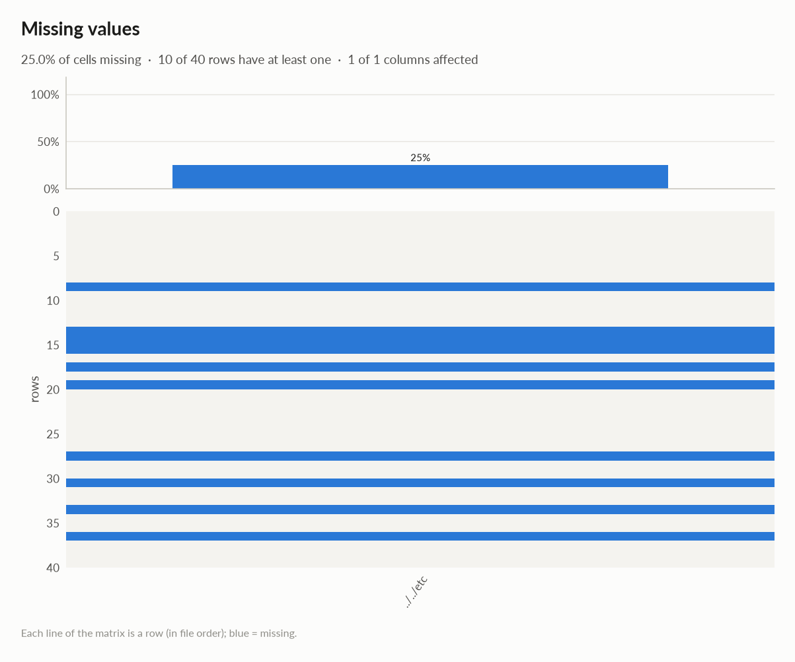
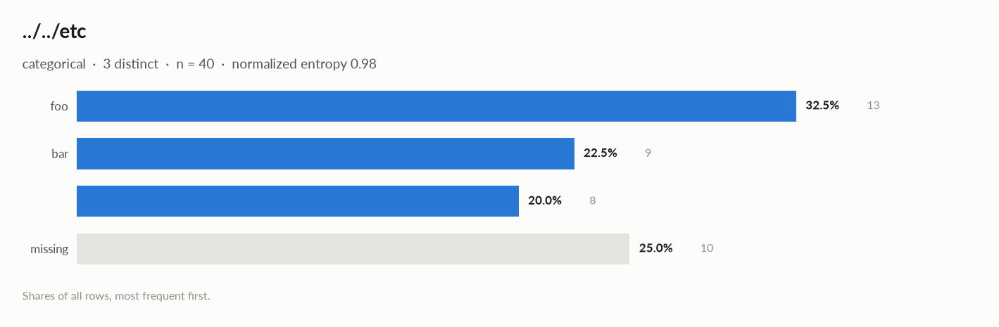

# elessar report

*40 rows × 1 columns · pandas.DataFrame · read in 0.0s · generated 2026-10-28 11:02 by elessar 0.3.0*

[Key findings](#key-findings) · [Overall statistics](#overall-statistics) · [Target analysis](#target-analysis) · [Data quality](#data-quality) · [Multivariate statistics](#multivariate-statistics) · [Preparation plan](#preparation-plan) · [Attribute statistics](#attribute-statistics) · [Run](#run)

## Key findings

- **MEDIUM** 36 duplicate rows (90.0%), e.g. index \['r3', 'r4', 'r5'\] -\> df.drop\_duplicates()
- **MEDIUM** `../../etc`: 25.0% missing -\> drop, or impute and add a missing-indicator
- **MEDIUM** `../../etc`: placeholder values used as missing: '' (8) -\> replace with NaN

## Overall statistics

|   |   |
|---|---|
| **Rows** | 40 |
| **Columns** | 1 |
| **Memory** | 1.8 KB |
| **Potential saving** | 320 B |
| **Pandas dtypes** | string=1 |
| **Semantic types** | categorical=1 |
| **Duplicate rows** | 36 (90.0%) |
| **Missing cells** | 25.0% |
| **Target** | ../../etc |

### Categorical columns at a glance

| column | type | count | missing | distinct | most frequent | share | entropy |
|---|---|---|---|---|---|---|---|
| `../../etc` | categorical | 30 | 25.0% | 3 | foo | 43.3% | 0.979 |

## Target analysis

Target: `../../etc` (categorical)

## Data quality

| severity | column | message |
|---|---|---|
| medium | - | 36 duplicate rows (90.0%), e.g. index \['r3', 'r4', 'r5'\] -\> df.drop\_duplicates() |
| medium | `../../etc` | 25.0% missing -\> drop, or impute and add a missing-indicator |
| medium | `../../etc` | placeholder values used as missing: '' (8) -\> replace with NaN |
| info | - | dtype optimizations save ~320 B: ../../etc -\> category (see quality\['dtype\_optimizations'\] for code) |

### Memory: suggested dtypes save 320 B

| column | current | suggested | saving | code |
|---|---|---|---|---|
| `../../etc` | string | category | 320 B (82%) | `df['../../etc'] = df['../../etc'].astype('category')` |

## Multivariate statistics

### Dimensionality reduction

PCA not applicable: needs at least 3 numeric columns and enough rows (0 columns, 40 rows)

### Associations between columns

## Preparation plan

Cleaning: invalid values 1, wrong formats 1, duplicates 1.  Transformation: .

### Cleaning

| action | column | why | code |
|---|---|---|---|
| Invalid values | `../../etc` | placeholders used as missing: '' ×8 | `df['../../etc'] = df['../../etc'].replace([''], np.nan)` |
| Wrong formats | `../../etc` | should-be-category | `df['../../etc'] = df['../../etc'].astype('category')` |
| Duplicates | - | 36 duplicate rows (90.0%) | `df = df.drop_duplicates()` |

## Attribute statistics

| column | type | missing | distinct | alerts |
|---|---|---|---|---|
| `../../etc` | categorical | 25.0% | 3 | 0 |

<code>../../etc</code> · categorical

*string · 3 distinct labels*

**Profile**

| | |
|---|---|
| type | categorical |
| dtype | string |
| values | 30 |
| missing | 10 (25.0%) |
| distinct | 3 (10.0%) |
| memory | 391 B |
| mode | foo ×13 |

**Labels**

| | |
|---|---|
| cardinality | 3 |
| entropy | 1.55 bits (0.98 of max) |
| Gini impurity | 0.651 |
| imbalance | ×1.625 |
| rare labels | 0 (0.0% of rows) |
| uniform? chi² | p 0.5 |

#### Most frequent values

| value | count | share |
|---|---|---|
| `foo` | 13 | 43.3% |
| `bar` | 9 | 30.0% |
| `  ` | 8 | 26.7% |

- **should-be-category**: `df['../../etc'] = df['../../etc'].astype('category')`

## Run

|   |   |
|---|---|
| **Source** | pandas.DataFrame · read in 0.0s |
| **Processes** | 1 for the analysis, 3 for the charts (14 cores available) |
| **Time** | 0.6s (load 0.0s, columns 0.0s, associations 0.0s, quality 0.0s, charts 0.4s) |
| **Significance** | alpha 0.05, Benjamini-Hochberg false discovery rate per family of tests |
| **Versions** | elessar 0.3.0 · Python 3.12.14 · pandas 3.1.0 · numpy 2.5.4 · scipy 1.18.1 |
