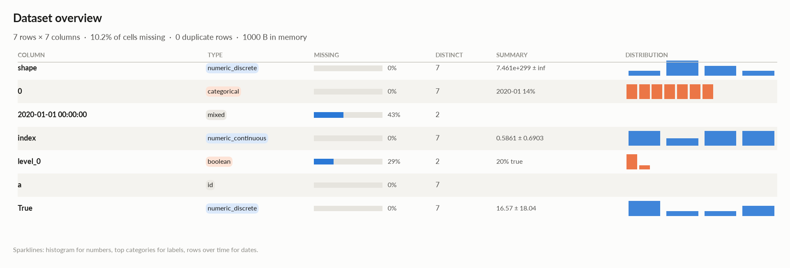
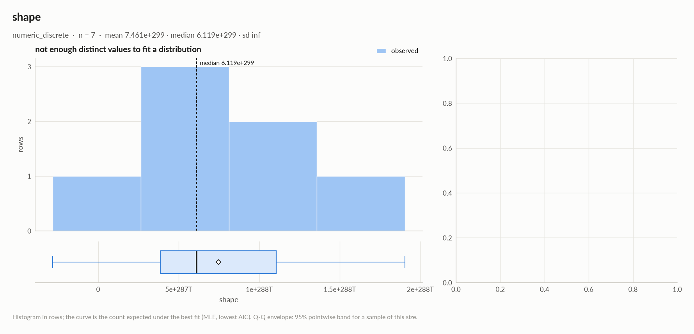
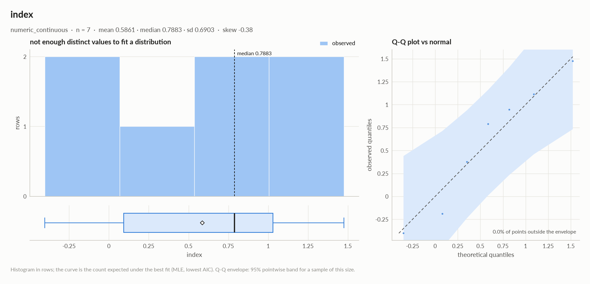
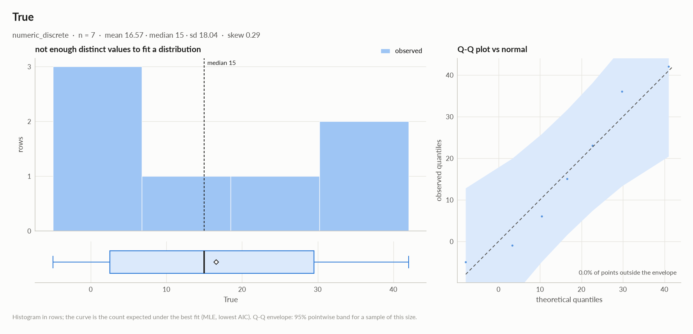
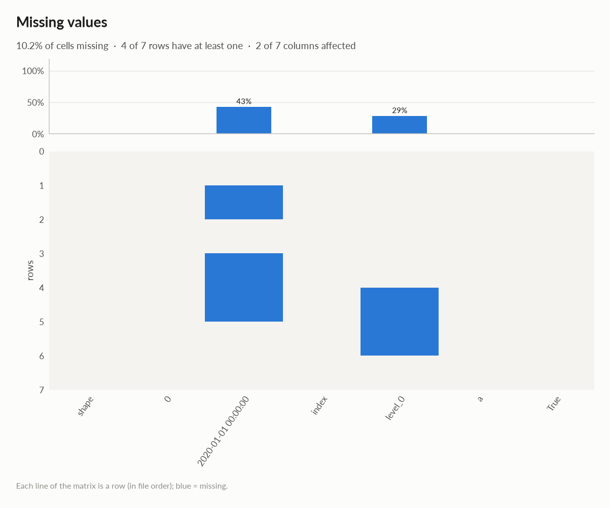
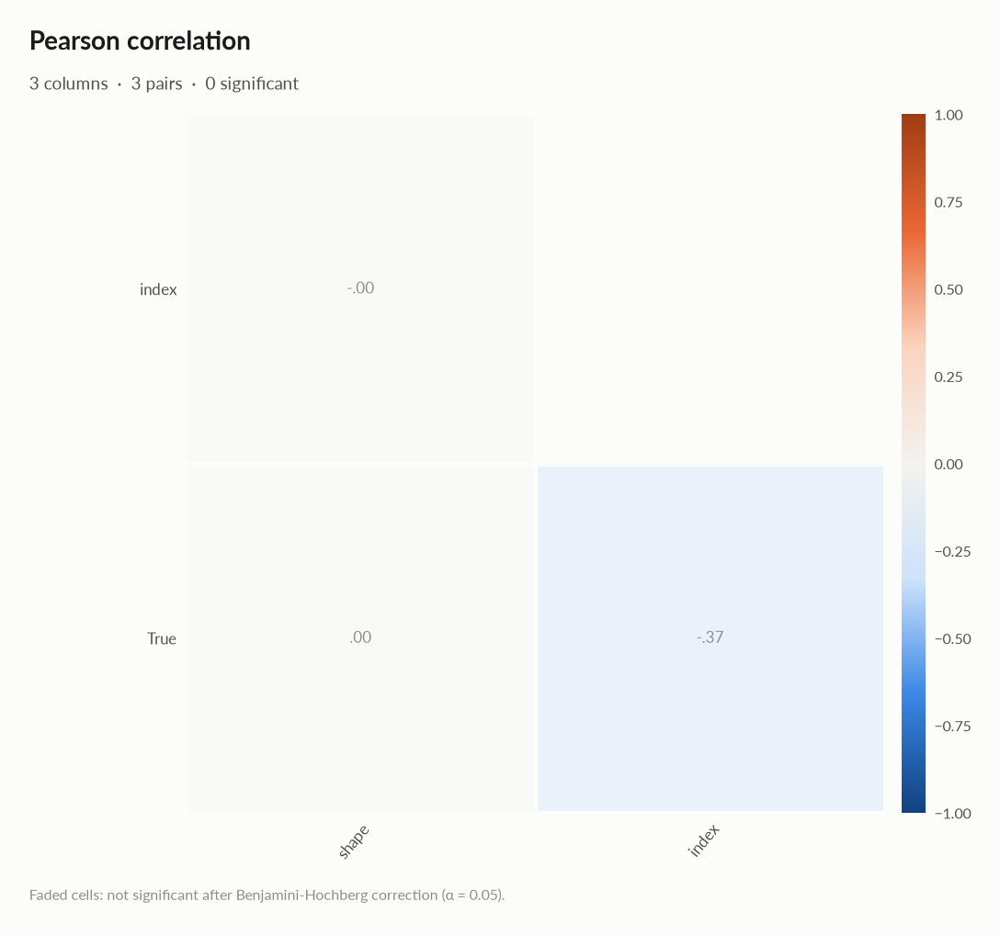
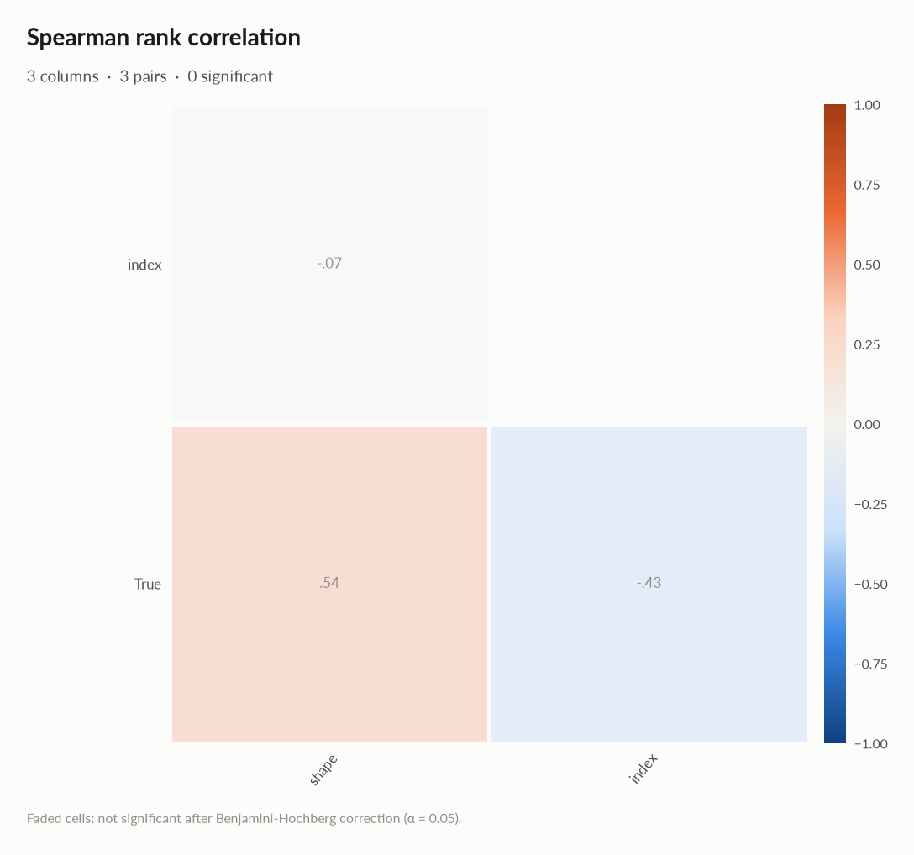
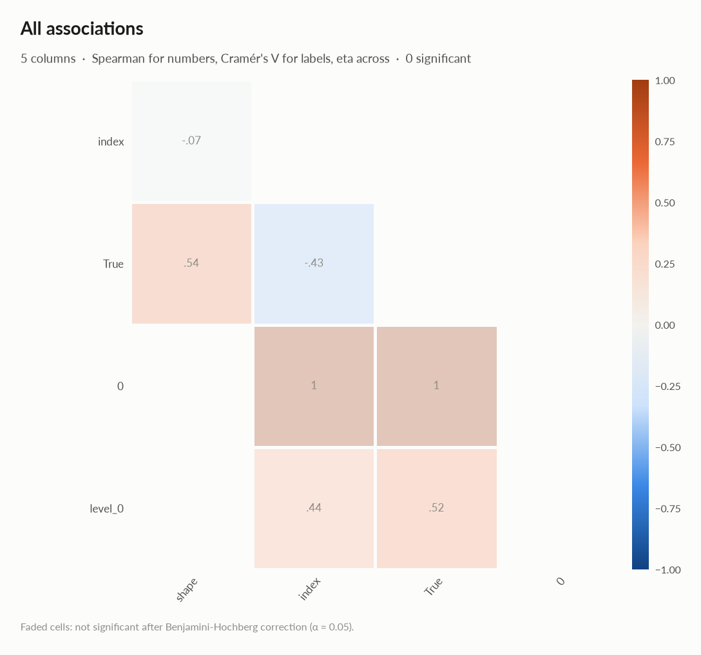
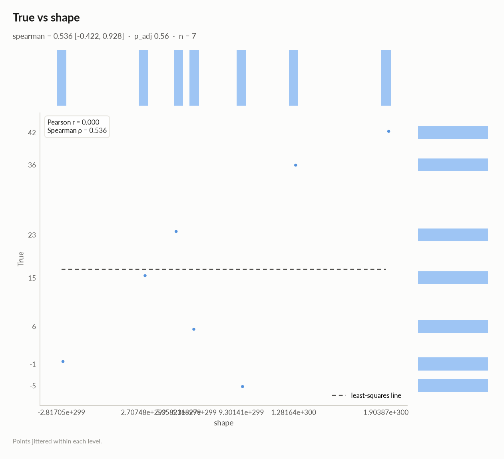
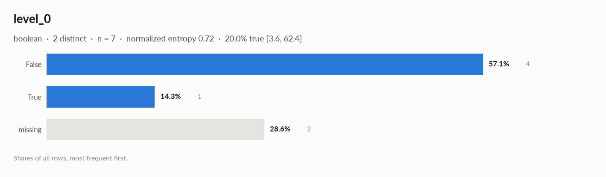

# elessar report

*7 rows × 7 columns · pandas.DataFrame · read in 0.0s · generated 2026-10-28 11:02 by elessar 0.3.0*

[Key findings](#key-findings) · [Overall statistics](#overall-statistics) · [Distributions](#distributions) · [Data quality](#data-quality) · [Multivariate statistics](#multivariate-statistics) · [Preparation plan](#preparation-plan) · [Attribute statistics](#attribute-statistics) · [Run](#run)

## Key findings

- **HIGH** `2020-01-01 00:00:00`: mixed Python types (number=2, bool=1, str=1) -\> normalise to a single type
- **MEDIUM** `2020-01-01 00:00:00`: 42.9% missing -\> drop, or impute and add a missing-indicator
- **MEDIUM** `True`: redundant with '0' (eta +1.000) -\> keep only one
- **MEDIUM** `index`: redundant with '0' (eta +1.000) -\> keep only one
- **MEDIUM** `index`: should-be-numeric: df\['index'\] = pd.to\_numeric(df\['index'\], errors='coerce')
- **MEDIUM** `level_0`: 28.6% missing -\> drop, or impute and add a missing-indicator

## Overall statistics

|   |   |
|---|---|
| **Rows** | 7 |
| **Columns** | 7 |
| **Memory** | 1000 B |
| **Potential saving** | 49 B |
| **Pandas dtypes** | object=2, float64=1, period\[M\]=1, boolean=1, str=1, int64=1 |
| **Semantic types** | numeric\_discrete=2, categorical=1, mixed=1, numeric\_continuous=1, boolean=1, id=1 |
| **Duplicate rows** | 0 (0.0%) |
| **Missing cells** | 10.2% |

### Numeric columns at a glance

| column | count | missing | mean | std | min | median | max | skew | kurtosis | outliers | best fit |
|---|---|---|---|---|---|---|---|---|---|---|---|
| `shape` | 7 | 0.0% | 7.461e+299 | - | -2.817e+299 | 6.119e+299 | 1.904e+300 | - | - | 0.0% | - |
| `index` | 7 | 0.0% | 0.5861 | 0.6903 | -0.4019 | 0.7883 | 1.474 | -0.384 | -1.22 | 0.0% | - |
| `True` | 7 | 0.0% | 16.57 | 18.04 | -5 | 15 | 42 | 0.294 | -1.5 | 0.0% | - |

### Categorical columns at a glance

| column | type | count | missing | distinct | most frequent | share | entropy |
|---|---|---|---|---|---|---|---|
| `0` | categorical | 7 | 0.0% | 7 | 2020-01 | 14.3% | 1 |
| `level_0` | boolean | 5 | 28.6% | 2 | False | 80.0% | 0.722 |

## Distributions

Normality is tested four ways (Shapiro-Wilk on up to 5,000 values, D'Agostino K², Jarque-Bera, Anderson-Darling); the verdict is 'not normal' when at least half of them reject at alpha 0.05. Every candidate distribution is fitted by maximum likelihood and ranked by AIC; the Akaike weight is its relative support among the candidates.

*With thousands of values every test rejects even a good fit, so read KS D (the largest gap between the fitted and the observed cumulative distribution) as the size of the misfit: below 0.03 close, below 0.08 fair, above poor. KS p-values are optimistic since the parameters come from the same data. For integer columns the gap is measured on the integer support and the p-value comes from a chi-square goodness-of-fit test.*

| column | n | normality | tests rejecting | best fit | parameters | weight | ΔAIC to 2nd | KS D | KS p | shape |
|---|---|---|---|---|---|---|---|---|---|---|
| `shape` | 7 | insufficient data |  | - |  |  |  |  |  | not enough distinct values to fit a distribution |
| `index` | 7 | insufficient data |  | - |  |  |  |  |  | not enough distinct values to fit a distribution |
| `True` | 7 | insufficient data |  | - |  |  |  |  |  | not enough distinct values to fit a distribution |

## Data quality

| severity | column | message |
|---|---|---|
| high | `2020-01-01 00:00:00` | mixed Python types (number=2, bool=1, str=1) -\> normalise to a single type |
| medium | `2020-01-01 00:00:00` | 42.9% missing -\> drop, or impute and add a missing-indicator |
| medium | `True` | redundant with '0' (eta +1.000) -\> keep only one |
| medium | `index` | redundant with '0' (eta +1.000) -\> keep only one |
| medium | `index` | should-be-numeric: df\['index'\] = pd.to\_numeric(df\['index'\], errors='coerce') |
| medium | `level_0` | 28.6% missing -\> drop, or impute and add a missing-indicator |
| info | - | dtype optimizations save ~49 B: True -\> int8 (see quality\['dtype\_optimizations'\] for code) |
| info | `a` | identifier-like column -\> exclude from modelling and statistics |

### Memory: suggested dtypes save 49 B

| column | current | suggested | saving | code |
|---|---|---|---|---|
| `True` | int64 | int8 | 49 B (88%) | `df['True'] = pd.to_numeric(df['True'], downcast='integer')` |

## Multivariate statistics

### Dimensionality reduction

PCA not applicable: needs at least 3 numeric columns and enough rows (3 columns, 7 rows)

### Associations between columns

7 pairs tested, 0 significant after Benjamini-Hochberg correction (alpha 0.05).

### Strongest associations

| column A | column B | method | value | 95% CI | n | p\_adj | sig |
|---|---|---|---|---|---|---|---|
| 0 | index | eta | +1.000 |  | 7 | 0.56 |  |
| 0 | True | eta | +1.000 |  | 7 | 0.56 |  |
| shape | True | spearman | +0.536 | \[-0.422, +0.928\] | 7 | 0.56 |  |
| level\_0 | True | eta | +0.521 |  | 5 | 0.56 |  |

### Multicollinearity (VIF)

| column | VIF |
|---|---|
| `True` | 1.16 |
| `index` | 1.16 |
| `shape` | nan |

## Preparation plan

Cleaning: wrong formats 2, missing data 2.  Transformation: rescale 1, normalization 1, encode 2.

### Cleaning

| action | column | why | code |
|---|---|---|---|
| Wrong formats | `index` | should-be-numeric | `df['index'] = pd.to_numeric(df['index'], errors='coerce')` |
| Wrong formats | `2020-01-01 00:00:00` | mixed Python types {'number': 2, 'bool': 1, 'str': 1} | `df['2020-01-01 00:00:00'] = pd.to_numeric(df['2020-01-01 00:00:00'], errors='coerce')  # or .astype(str)` |
| Missing data | `2020-01-01 00:00:00` | 42.9% missing: use an explicit 'missing' category | `df['2020-01-01 00:00:00'] = df['2020-01-01 00:00:00'].fillna('missing')` |
| Missing data | `level_0` | 28.6% missing: use an explicit 'missing' category | `df['level_0'] = df['level_0'].fillna('missing')` |

### Transformation

| action | column | why | code |
|---|---|---|---|
| Rescale | - | numeric scales differ by x766,348,413,152,707,673,802,158,902,259,252,785,518,236,577,958,825,020,025,832,506,488,247,959,400,498,939,916,684,616,205,254,722,421,165,684,695,736,146,662,432,235,206,441,470,870,770,971,184,270,671,194,712,720,790,567,716,634,574,679,066,578,958,799,634,967,321,489,211,612,578,096,497,245,309,472,543,487,813,738,137,817,151,569,224,221,380,674,754,212,964,233,013,794,477,643,847,119,667,200 (shape vs index): distance-based models, regularised models and neural nets need common scales | `from sklearn.preprocessing import RobustScaler, StandardScaler df[[]] = RobustScaler().fit_transform(df[[]])  # outliers others = ['shape', 'index', 'True'] df[others] = StandardScaler().fit_transform(df[others])` |
| Normalization | - | 2 roughly symmetric columns: z-score them (mean 0, sd 1) for linear and distance models | `cols = ['index', 'True'] df[cols] = (df[cols] - df[cols].mean()) / df[cols].std()` |
| Encode | `0` | 7 labels: one-hot | `df = pd.get_dummies(df, columns=['0'], dummy_na=True)` |
| Encode | `level_0` | boolean: 0/1 | `df['level_0'] = df['level_0'].astype(bool).astype(int)` |

## Attribute statistics

| column | type | missing | distinct | alerts |
|---|---|---|---|---|
| `shape` | numeric\_discrete | 0.0% | 7 | 0 |
| `0` | categorical | 0.0% | 7 | 0 |
| `2020-01-01 00:00:00` | mixed | 42.9% | 2 | 0 |
| `index` | numeric\_continuous | 0.0% | 7 | 0 |
| `level_0` | boolean | 28.6% | 2 | 0 |
| `a` | id | 0.0% | 7 | 0 |
| `True` | numeric\_discrete | 0.0% | 7 | 0 |

<code>shape</code> · numeric_discrete

*float64 · float64 dtype: integer values (7 distinct)*

**Profile**

| | |
|---|---|
| type | numeric\_discrete |
| dtype | float64 |
| values | 7 |
| missing | 0 (0.0%) |
| distinct | 7 (100.0%) |
| memory | 56 B |

**Center**

| | |
|---|---|
| mean | 7.461e+299 |
| 95% CI of mean | \[-, -\] |
| median | 6.119e+299 |
| 95% CI of median | \[-2.817e+299, 1.904e+300\] |
| trimmed mean | 7.461e+299 |
| geometric mean | - |
| harmonic mean | - |

**Spread**

| | |
|---|---|
| std | - |
| variance | - |
| sem | - |
| IQR | 7.176e+299 |
| MAD | 3.411e+299 |
| CV | - |
| range | 2.186e+300 |

**Quantiles**

| | |
|---|---|
| min | -2.817e+299 |
| p1 | -2.486e+299 |
| p5 | -1.160e+299 |
| p25 | 3.883e+299 |
| p50 | 6.119e+299 |
| p75 | 1.106e+300 |
| p95 | 1.717e+300 |
| p99 | 1.867e+300 |
| max | 1.904e+300 |
| sum | 5.222e+300 |

**Shape**

| | |
|---|---|
| skewness | - |
| excess kurtosis | - |
| KDE modes | - |
| bimodality coef. | - |
| decimals | 0 |

**Outliers & counts**

| | |
|---|---|
| IQR fences | \[-6.881e+299, 2.182e+300\] |
| outside fences | 0 (0.0%) |
| \|z\| \> 3 | 0 (0.0%) |
| modified z \> 3.5 | 0 (0.0%) |
| zeros | 0 |
| negatives | 1 |
| infinite | 0 |

**Row order**

| | |
|---|---|
| monotonic | no |

<code>0</code> · categorical

*period\[M\] · unrecognised dtype period\[M\], treated as labels*

**Profile**

| | |
|---|---|
| type | categorical |
| dtype | period\[M\] |
| values | 7 |
| missing | 0 (0.0%) |
| distinct | 7 (100.0%) |
| memory | 56 B |

**Labels**

| | |
|---|---|
| cardinality | 7 |
| entropy | 2.81 bits (1.00 of max) |
| Gini impurity | 0.857 |
| imbalance | ×1 |
| rare labels | 0 (0.0% of rows) |
| uniform? chi² | p 1 |

<code>2020-01-01 00:00:00</code> · mixed

*object · several Python types: number=2, bool=1, str=1*

**Profile**

| | |
|---|---|
| type | mixed |
| dtype | object |
| values | 4 |
| missing | 3 (42.9%) |
| distinct | 2 (50.0%) |
| memory | 230 B |
| mode | 1 ×3 |

#### Most frequent values

| value | count | share |
|---|---|---|
| `1` | 3 | 75.0% |
| `a` | 1 | 25.0% |

- Python types: number 2, bool 1, str 1

<code>index</code> · numeric_continuous

*object · numbers in object column: 7 distinct real values*

**Profile**

| | |
|---|---|
| type | numeric\_continuous |
| dtype | object |
| values | 7 |
| missing | 0 (0.0%) |
| distinct | 7 (100.0%) |
| memory | 224 B |

**Center**

| | |
|---|---|
| mean | 0.5861 |
| 95% CI of mean | \[-0.05231, 1.225\] |
| median | 0.7883 |
| 95% CI of median | \[-0.4019, 1.474\] |
| trimmed mean | 0.5861 |
| geometric mean | - |
| harmonic mean | - |

**Spread**

| | |
|---|---|
| std | 0.6903 |
| variance | 0.4766 |
| sem | 0.2609 |
| IQR | 0.9364 |
| MAD | 0.413 |
| CV | 1.178 |
| range | 1.876 |

**Quantiles**

| | |
|---|---|
| min | -0.4019 |
| p1 | -0.3892 |
| p5 | -0.3384 |
| p25 | 0.09236 |
| p50 | 0.7883 |
| p75 | 1.029 |
| p95 | 1.366 |
| p99 | 1.453 |
| max | 1.474 |
| sum | 4.103 |

**Shape**

| | |
|---|---|
| skewness | -0.384 |
| excess kurtosis | -1.22 |
| KDE modes | - |
| bimodality coef. | 0.274 |

**Outliers & counts**

| | |
|---|---|
| IQR fences | \[-1.312, 2.433\] |
| outside fences | 0 (0.0%) |
| \|z\| \> 3 | 0 (0.0%) |
| modified z \> 3.5 | 0 (0.0%) |
| zeros | 0 |
| negatives | 2 |
| infinite | 0 |

**Row order**

| | |
|---|---|
| monotonic | no |

- **should-be-numeric**: `df['index'] = pd.to_numeric(df['index'], errors='coerce')`

<code>level_0</code> · boolean

*boolean · bool dtype*

**Profile**

| | |
|---|---|
| type | boolean |
| dtype | boolean |
| values | 5 |
| missing | 2 (28.6%) |
| distinct | 2 (40.0%) |
| memory | 14 B |
| mode | False ×4 |

**Labels**

| | |
|---|---|
| cardinality | 2 |
| entropy | 0.72 bits (0.72 of max) |
| Gini impurity | 0.320 |
| imbalance | ×4 |
| rare labels | 0 (0.0% of rows) |
| uniform? chi² | p 0.18 |
| true | 20.0% \[3.6, 62.4\] |

#### Most frequent values

| value | count | share |
|---|---|---|
| `False` | 4 | 80.0% |
| `True` | 1 | 20.0% |

<code>a</code> · id

*str · 100% of values are UUIDs*

**Profile**

| | |
|---|---|
| type | id |
| dtype | str |
| values | 7 |
| missing | 0 (0.0%) |
| distinct | 7 (100.0%) |
| memory | 308 B |

<code>True</code> · numeric_discrete

*int64 · int64 dtype: integer values (7 distinct)*

**Profile**

| | |
|---|---|
| type | numeric\_discrete |
| dtype | int64 |
| values | 7 |
| missing | 0 (0.0%) |
| distinct | 7 (100.0%) |
| memory | 56 B |

**Center**

| | |
|---|---|
| mean | 16.57 |
| 95% CI of mean | \[-0.1173, 33.26\] |
| median | 15 |
| 95% CI of median | \[-5, 42\] |
| trimmed mean | 16.57 |
| geometric mean | - |
| harmonic mean | - |

**Spread**

| | |
|---|---|
| std | 18.04 |
| variance | 325.6 |
| sem | 6.82 |
| IQR | 27 |
| MAD | 16 |
| CV | 1.089 |
| range | 47 |

**Quantiles**

| | |
|---|---|
| min | -5 |
| p1 | -4.76 |
| p5 | -3.8 |
| p25 | 2.5 |
| p50 | 15 |
| p75 | 29.5 |
| p95 | 40.2 |
| p99 | 41.64 |
| max | 42 |
| sum | 116 |

**Shape**

| | |
|---|---|
| skewness | 0.294 |
| excess kurtosis | -1.5 |
| KDE modes | - |
| bimodality coef. | 0.278 |
| decimals | 0 |

**Outliers & counts**

| | |
|---|---|
| IQR fences | \[-38, 70\] |
| outside fences | 0 (0.0%) |
| \|z\| \> 3 | 0 (0.0%) |
| modified z \> 3.5 | 0 (0.0%) |
| zeros | 0 |
| negatives | 2 |
| infinite | 0 |

**Row order**

| | |
|---|---|
| monotonic | no |

## Run

|   |   |
|---|---|
| **Source** | pandas.DataFrame · read in 0.0s |
| **Processes** | 3 for the analysis, 3 for the charts (14 cores available) |
| **Time** | 1.8s (load 0.0s, columns 0.1s, associations 0.2s, quality 0.0s, charts 1.3s) |
| **Significance** | alpha 0.05, Benjamini-Hochberg false discovery rate per family of tests |
| **Versions** | elessar 0.3.0 · Python 3.12.14 · pandas 3.1.0 · numpy 2.5.4 · scipy 1.18.1 |
