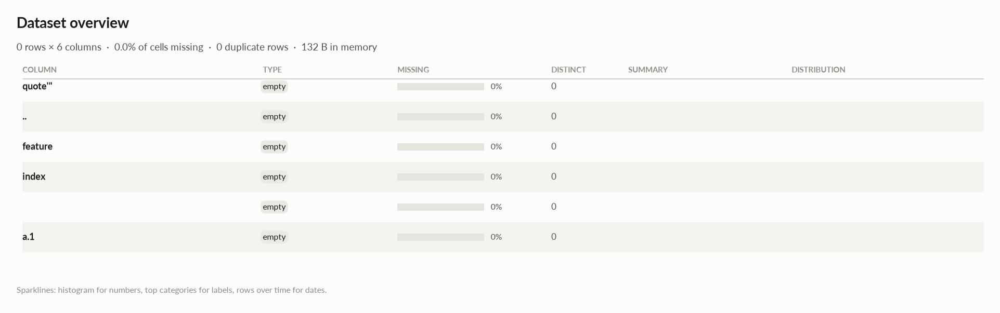

# elessar report

*0 rows × 6 columns · pandas.DataFrame · read in 0.0s · generated 2026-10-28 11:02 by elessar 0.3.0*

[Key findings](#key-findings) · [Overall statistics](#overall-statistics) · [Data quality](#data-quality) · [Multivariate statistics](#multivariate-statistics) · [Preparation plan](#preparation-plan) · [Attribute statistics](#attribute-statistics) · [Run](#run)

## Key findings

- **HIGH** `   `: column is entirely missing -\> drop it
- **HIGH** `..`: column is entirely missing -\> drop it
- **HIGH** `a.1`: column is entirely missing -\> drop it
- **HIGH** `feature`: column is entirely missing -\> drop it
- **HIGH** `index`: column is entirely missing -\> drop it
- **HIGH** `quote'"`: column is entirely missing -\> drop it
- **MEDIUM** `   `: identical to column '..' -\> drop one of them
- **MEDIUM** `feature`: identical to column 'quote'"' -\> drop one of them
- **MEDIUM** `index`: identical to column '..' -\> drop one of them

## Overall statistics

|   |   |
|---|---|
| **Rows** | 0 |
| **Columns** | 6 |
| **Memory** | 132 B |
| **Potential saving** | 0 B |
| **Pandas dtypes** | float64=3, string=2, boolean=1 |
| **Semantic types** | empty=6 |
| **Duplicate rows** | 0 (0.0%) |
| **Missing cells** | 0.0% |

## Data quality

| severity | column | message |
|---|---|---|
| high | `   ` | column is entirely missing -\> drop it |
| high | `..` | column is entirely missing -\> drop it |
| high | `a.1` | column is entirely missing -\> drop it |
| high | `feature` | column is entirely missing -\> drop it |
| high | `index` | column is entirely missing -\> drop it |
| high | `quote'"` | column is entirely missing -\> drop it |
| medium | `   ` | identical to column '..' -\> drop one of them |
| medium | `feature` | identical to column 'quote'"' -\> drop one of them |
| medium | `index` | identical to column '..' -\> drop one of them |

## Multivariate statistics

### Dimensionality reduction

PCA not applicable: needs at least 3 numeric columns and enough rows (0 columns, 0 rows)

### Associations between columns

## Preparation plan

Cleaning: duplicates 2.  Transformation: .

### Cleaning

| action | column | why | code |
|---|---|---|---|
| Duplicates | `feature` | identical to 'quote\\'"' | `df = df.drop(columns=['feature'])` |
| Duplicates | `index` | identical to '..' | `df = df.drop(columns=['index', ' '])` |

## Attribute statistics

| column | type | missing | distinct | alerts |
|---|---|---|---|---|
| `quote'"` | empty | 0.0% | 0 | 0 |
| `..` | empty | 0.0% | 0 | 0 |
| `feature` | empty | 0.0% | 0 | 0 |
| `index` | empty | 0.0% | 0 | 0 |
| `   ` | empty | 0.0% | 0 | 0 |
| `a.1` | empty | 0.0% | 0 | 0 |

<code>quote&#x27;&quot;</code> · empty

*string · no non-missing values*

**Profile**

| | |
|---|---|
| type | empty |
| dtype | string |
| values | 0 |
| missing | 0 (0.0%) |
| distinct | 0 (0.0%) |
| memory | 0 B |

<code>..</code> · empty

*float64 · no non-missing values*

**Profile**

| | |
|---|---|
| type | empty |
| dtype | float64 |
| values | 0 |
| missing | 0 (0.0%) |
| distinct | 0 (0.0%) |
| memory | 0 B |

<code>feature</code> · empty

*string · no non-missing values*

**Profile**

| | |
|---|---|
| type | empty |
| dtype | string |
| values | 0 |
| missing | 0 (0.0%) |
| distinct | 0 (0.0%) |
| memory | 0 B |

<code>index</code> · empty

*float64 · no non-missing values*

**Profile**

| | |
|---|---|
| type | empty |
| dtype | float64 |
| values | 0 |
| missing | 0 (0.0%) |
| distinct | 0 (0.0%) |
| memory | 0 B |

<code> </code> · empty

*float64 · no non-missing values*

**Profile**

| | |
|---|---|
| type | empty |
| dtype | float64 |
| values | 0 |
| missing | 0 (0.0%) |
| distinct | 0 (0.0%) |
| memory | 0 B |

<code>a.1</code> · empty

*boolean · no non-missing values*

**Profile**

| | |
|---|---|
| type | empty |
| dtype | boolean |
| values | 0 |
| missing | 0 (0.0%) |
| distinct | 0 (0.0%) |
| memory | 0 B |

## Run

|   |   |
|---|---|
| **Source** | pandas.DataFrame · read in 0.0s |
| **Processes** | 3 for the analysis, 3 for the charts (14 cores available) |
| **Time** | 0.6s (load 0.0s, columns 0.1s, associations 0.1s, quality 0.0s, charts 0.3s) |
| **Significance** | alpha 0.05, Benjamini-Hochberg false discovery rate per family of tests |
| **Versions** | elessar 0.3.0 · Python 3.12.14 · pandas 3.1.0 · numpy 2.5.4 · scipy 1.18.1 |
