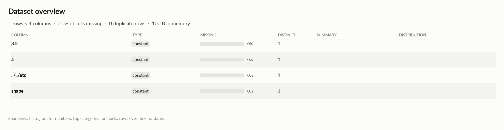

# elessar report

*1 rows × 4 columns · pandas.DataFrame · read in 0.0s · generated 2026-10-28 11:02 by elessar 0.3.0*

[Key findings](#key-findings) · [Overall statistics](#overall-statistics) · [Data quality](#data-quality) · [Multivariate statistics](#multivariate-statistics) · [Preparation plan](#preparation-plan) · [Attribute statistics](#attribute-statistics) · [Run](#run)

## Key findings

- **MEDIUM** `../../etc`: constant column carries no information -\> drop it
- **MEDIUM** `3.5`: constant column carries no information -\> drop it
- **MEDIUM** `a`: constant column carries no information -\> drop it
- **MEDIUM** `shape`: constant column carries no information -\> drop it

## Overall statistics

|   |   |
|---|---|
| **Rows** | 1 |
| **Columns** | 4 |
| **Memory** | 100 B |
| **Potential saving** | 0 B |
| **Pandas dtypes** | float64=2, str=1, complex128=1 |
| **Semantic types** | constant=4 |
| **Duplicate rows** | 0 (0.0%) |
| **Missing cells** | 0.0% |

## Data quality

| severity | column | message |
|---|---|---|
| medium | `../../etc` | constant column carries no information -\> drop it |
| medium | `3.5` | constant column carries no information -\> drop it |
| medium | `a` | constant column carries no information -\> drop it |
| medium | `shape` | constant column carries no information -\> drop it |

## Multivariate statistics

### Dimensionality reduction

PCA not applicable: needs at least 3 numeric columns and enough rows (0 columns, 1 rows)

### Associations between columns

## Preparation plan

Nothing to clean or transform.

## Attribute statistics

| column | type | missing | distinct | alerts |
|---|---|---|---|---|
| `3.5` | constant | 0.0% | 1 | 0 |
| `a` | constant | 0.0% | 1 | 0 |
| `../../etc` | constant | 0.0% | 1 | 0 |
| `shape` | constant | 0.0% | 1 | 0 |

<code>3.5</code> · constant

*str · single value: '18/02/2020'*

**Profile**

| | |
|---|---|
| type | constant |
| dtype | str |
| values | 1 |
| missing | 0 (0.0%) |
| distinct | 1 (100.0%) |
| memory | 18 B |

<code>a</code> · constant

*float64 · single value: '5.20491992699744e-301'*

**Profile**

| | |
|---|---|
| type | constant |
| dtype | float64 |
| values | 1 |
| missing | 0 (0.0%) |
| distinct | 1 (100.0%) |
| memory | 8 B |

<code>../../etc</code> · constant

*complex128 · single value: '(1+2j)'*

**Profile**

| | |
|---|---|
| type | constant |
| dtype | complex128 |
| values | 1 |
| missing | 0 (0.0%) |
| distinct | 1 (100.0%) |
| memory | 16 B |

<code>shape</code> · constant

*float64 · single value: '-4.783660442679389e+299'*

**Profile**

| | |
|---|---|
| type | constant |
| dtype | float64 |
| values | 1 |
| missing | 0 (0.0%) |
| distinct | 1 (100.0%) |
| memory | 8 B |

## Run

|   |   |
|---|---|
| **Source** | pandas.DataFrame · read in 0.0s |
| **Processes** | 3 for the analysis, 3 for the charts (14 cores available) |
| **Time** | 0.7s (load 0.0s, columns 0.1s, associations 0.1s, quality 0.0s, charts 0.3s) |
| **Significance** | alpha 0.05, Benjamini-Hochberg false discovery rate per family of tests |
| **Versions** | elessar 0.3.0 · Python 3.12.14 · pandas 3.1.0 · numpy 2.5.4 · scipy 1.18.1 |
