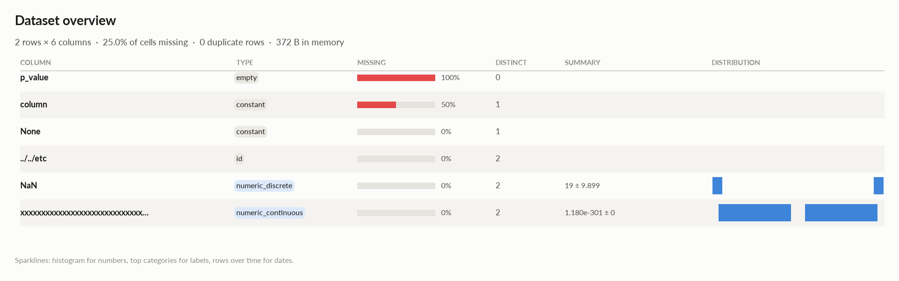
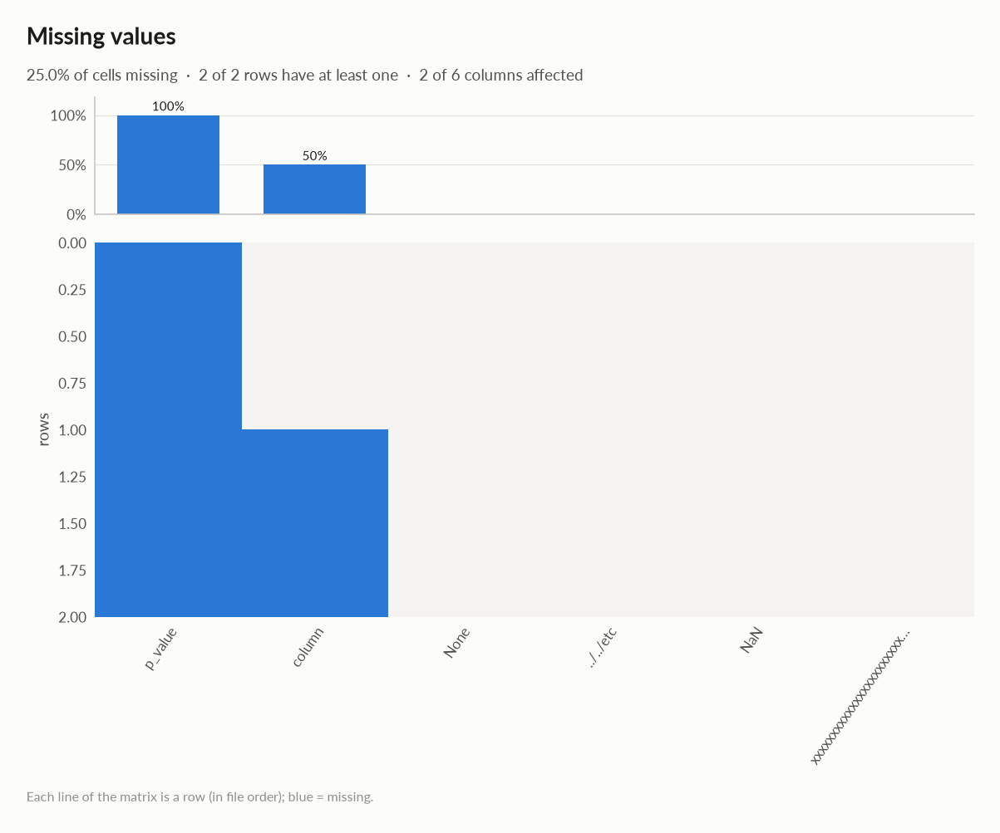

# elessar report

*2 rows × 6 columns · pandas.DataFrame · read in 0.0s · generated 2026-10-28 11:02 by elessar 0.3.0*

[Key findings](#key-findings) · [Overall statistics](#overall-statistics) · [Distributions](#distributions) · [Data quality](#data-quality) · [Multivariate statistics](#multivariate-statistics) · [Preparation plan](#preparation-plan) · [Attribute statistics](#attribute-statistics) · [Run](#run)

## Key findings

- **HIGH** `column`: 50.0% missing -\> drop, or impute and add a missing-indicator
- **HIGH** `p_value`: column is entirely missing -\> drop it
- **MEDIUM** `None`: constant column carries no information -\> drop it
- **MEDIUM** `column`: constant column carries no information -\> drop it
- **MEDIUM** `xxxxxxxxxxxxxxxxxxxxxxxxxxxxxxxxxxxxxxxxxxxxxxxxxxxxxxxxxxxxxxxxxxxxxxxxxxxxxxxxxxxxxxxxxxxxxxxxxxxxxxxxxxxxxxxxxxxxxxxxxxxxxxxxxxxxxxxxxxxxxxxxxxxxxxxxxxxxxxxxxxxxxxxxxxxxxxxxxxxxxxxxxxxxxxxxxxxxxxxxxxxxxxxxxxxxxxxxxxxxxxxxxxxxxxxxxxxxxxxxxxxxxxxxxxxxxxxxxxxxxxxxxxxxxxxxxxxxxxxxxxxxxxxxxxxxxxxxxxxx`: redundant with 'NaN' (spearman -1.000) -\> keep only one

## Overall statistics

|   |   |
|---|---|
| **Rows** | 2 |
| **Columns** | 6 |
| **Memory** | 372 B |
| **Potential saving** | 8 B |
| **Pandas dtypes** | float64=2, Int64=1, object=1, str=1, timedelta64\[us\]=1 |
| **Semantic types** | constant=2, empty=1, id=1, numeric\_discrete=1, numeric\_continuous=1 |
| **Duplicate rows** | 0 (0.0%) |
| **Missing cells** | 25.0% |

### Numeric columns at a glance

| column | count | missing | mean | std | min | median | max | skew | kurtosis | outliers | best fit |
|---|---|---|---|---|---|---|---|---|---|---|---|
| `NaN` | 2 | 0.0% | 19 | 9.899 | 12 | 19 | 26 | - | - | 0.0% | - |
| `xxxxxxxxxxxxxxxxxxxxxxxxxxxxxxxxxxxxxxxxxxxxxxxxxxxxxxxxxxxxxxxxxxxxxxxxxxxxxxxxxxxxxxxxxxxxxxxxxxxxxxxxxxxxxxxxxxxxxxxxxxxxxxxxxxxxxxxxxxxxxxxxxxxxxxxxxxxxxxxxxxxxxxxxxxxxxxxxxxxxxxxxxxxxxxxxxxxxxxxxxxxxxxxxxxxxxxxxxxxxxxxxxxxxxxxxxxxxxxxxxxxxxxxxxxxxxxxxxxxxxxxxxxxxxxxxxxxxxxxxxxxxxxxxxxxxxxxxxxxx` | 2 | 0.0% | 1.180e-301 | 0 | 9.020e-302 | 1.180e-301 | 1.458e-301 | - | - | 0.0% | - |

## Distributions

Normality is tested four ways (Shapiro-Wilk on up to 5,000 values, D'Agostino K², Jarque-Bera, Anderson-Darling); the verdict is 'not normal' when at least half of them reject at alpha 0.05. Every candidate distribution is fitted by maximum likelihood and ranked by AIC; the Akaike weight is its relative support among the candidates.

*With thousands of values every test rejects even a good fit, so read KS D (the largest gap between the fitted and the observed cumulative distribution) as the size of the misfit: below 0.03 close, below 0.08 fair, above poor. KS p-values are optimistic since the parameters come from the same data. For integer columns the gap is measured on the integer support and the p-value comes from a chi-square goodness-of-fit test.*

| column | n | normality | tests rejecting | best fit | parameters | weight | ΔAIC to 2nd | KS D | KS p | shape |
|---|---|---|---|---|---|---|---|---|---|---|
| `NaN` | 2 | insufficient data |  | - |  |  |  |  |  | not enough distinct values to fit a distribution |
| `xxxxxxxxxxxxxxxxxxxxxxxxxxxxxxxxxxxxxxxxxxxxxxxxxxxxxxxxxxxxxxxxxxxxxxxxxxxxxxxxxxxxxxxxxxxxxxxxxxxxxxxxxxxxxxxxxxxxxxxxxxxxxxxxxxxxxxxxxxxxxxxxxxxxxxxxxxxxxxxxxxxxxxxxxxxxxxxxxxxxxxxxxxxxxxxxxxxxxxxxxxxxxxxxxxxxxxxxxxxxxxxxxxxxxxxxxxxxxxxxxxxxxxxxxxxxxxxxxxxxxxxxxxxxxxxxxxxxxxxxxxxxxxxxxxxxxxxxxxxx` | 2 | insufficient data |  | - |  |  |  |  |  | not enough distinct values to fit a distribution |

## Data quality

| severity | column | message |
|---|---|---|
| high | `column` | 50.0% missing -\> drop, or impute and add a missing-indicator |
| high | `p_value` | column is entirely missing -\> drop it |
| medium | `None` | constant column carries no information -\> drop it |
| medium | `column` | constant column carries no information -\> drop it |
| medium | `xxxxxxxxxxxxxxxxxxxxxxxxxxxxxxxxxxxxxxxxxxxxxxxxxxxxxxxxxxxxxxxxxxxxxxxxxxxxxxxxxxxxxxxxxxxxxxxxxxxxxxxxxxxxxxxxxxxxxxxxxxxxxxxxxxxxxxxxxxxxxxxxxxxxxxxxxxxxxxxxxxxxxxxxxxxxxxxxxxxxxxxxxxxxxxxxxxxxxxxxxxxxxxxxxxxxxxxxxxxxxxxxxxxxxxxxxxxxxxxxxxxxxxxxxxxxxxxxxxxxxxxxxxxxxxxxxxxxxxxxxxxxxxxxxxxxxxxxxxxx` | redundant with 'NaN' (spearman -1.000) -\> keep only one |
| info | - | dtype optimizations save ~8 B: xxxxxxxxxxxxxxxxxxxxxxxxxxxxxxxxxxxxxxxxxxxxxxxxxxxxxxxxxxxxxxxxxxxxxxxxxxxxxxxxxxxxxxxxxxxxxxxxxxxxxxxxxxxxxxxxxxxxxxxxxxxxxxxxxxxxxxxxxxxxxxxxxxxxxxxxxxxxxxxxxxxxxxxxxxxxxxxxxxxxxxxxxxxxxxxxxxxxxxxxxxxxxxxxxxxxxxxxxxxxxxxxxxxxxxxxxxxxxxxxxxxxxxxxxxxxxxxxxxxxxxxxxxxxxxxxxxxxxxxxxxxxxxxxxxxxxxxxxxxx -\> float32 (see quality\['dtype\_optimizations'\] for code) |
| info | `../../etc` | identifier-like column -\> exclude from modelling and statistics |

### Memory: suggested dtypes save 8 B

| column | current | suggested | saving | code |
|---|---|---|---|---|
| `xxxxxxxxxxxxxxxxxxxxxxxxxxxxxxxxxxxxxxxxxxxxxxxxxxxxxxxxxxxxxxxxxxxxxxxxxxxxxxxxxxxxxxxxxxxxxxxxxxxxxxxxxxxxxxxxxxxxxxxxxxxxxxxxxxxxxxxxxxxxxxxxxxxxxxxxxxxxxxxxxxxxxxxxxxxxxxxxxxxxxxxxxxxxxxxxxxxxxxxxxxxxxxxxxxxxxxxxxxxxxxxxxxxxxxxxxxxxxxxxxxxxxxxxxxxxxxxxxxxxxxxxxxxxxxxxxxxxxxxxxxxxxxxxxxxxxxxxxxxx` | float64 | float32 | 8 B (50%) | `df['xxxxxxxxxxxxxxxxxxxxxxxxxxxxxxxxxxxxxxxxxxxxxxxxxxxxxxxxxxxxxxxxxxxxxxxxxxxxxxxxxxxxxxxxxxxxxxxxxxxxxxxxxxxxxxxxxxxxxxxxxxxxxxxxxxxxxxxxxxxxxxxxxxxxxxxxxxxxxxxxxxxxxxxxxxxxxxxxxxxxxxxxxxxxxxxxxxxxxxxxxxxxxxxxxxxxxxxxxxxxxxxxxxxxxxxxxxxxxxxxxxxxxxxxxxxxxxxxxxxxxxxxxxxxxxxxxxxxxxxxxxxxxxxxxxxxxxxxxxxx'] = df['xxxxxxxxxxxxxxxxxxxxxxxxxxxxxxxxxxxxxxxxxxxxxxxxxxxxxxxxxxxxxxxxxxxxxxxxxxxxxxxxxxxxxxxxxxxxxxxxxxxxxxxxxxxxxxxxxxxxxxxxxxxxxxxxxxxxxxxxxxxxxxxxxxxxxxxxxxxxxxxxxxxxxxxxxxxxxxxxxxxxxxxxxxxxxxxxxxxxxxxxxxxxxxxxxxxxxxxxxxxxxxxxxxxxxxxxxxxxxxxxxxxxxxxxxxxxxxxxxxxxxxxxxxxxxxxxxxxxxxxxxxxxxxxxxxxxxxxxxxxx'].astype('float32')` |

## Multivariate statistics

### Dimensionality reduction

PCA not applicable: needs at least 3 numeric columns and enough rows (0 columns, 2 rows)

### Associations between columns

1 pairs tested, 0 significant after Benjamini-Hochberg correction (alpha 0.05).

### Strongest associations

| column A | column B | method | value | 95% CI | n | p\_adj | sig |
|---|---|---|---|---|---|---|---|
| NaN | xxxxxxxxxxxxxxxxxxxxxxxxxxxxxxxxxxxxxxxxxxxxxxxxxxxxxxxxxxxxxxxxxxxxxxxxxxxxxxxxxxxxxxxxxxxxxxxxxxxxxxxxxxxxxxxxxxxxxxxxxxxxxxxxxxxxxxxxxxxxxxxxxxxxxxxxxxxxxxxxxxxxxxxxxxxxxxxxxxxxxxxxxxxxxxxxxxxxxxxxxxxxxxxxxxxxxxxxxxxxxxxxxxxxxxxxxxxxxxxxxxxxxxxxxxxxxxxxxxxxxxxxxxxxxxxxxxxxxxxxxxxxxxxxxxxxxxxxxxxx | spearman | -1.000 |  | 2 | n/a |  |

## Preparation plan

Cleaning: missing data 2.  Transformation: rescale 1.

### Cleaning

| action | column | why | code |
|---|---|---|---|
| Missing data | `p_value` | 100.0% missing: mostly missing: drop it, or keep only a missing indicator | `df['p_value' + '_missing'] = df['p_value'].isna() df = df.drop(columns=['p_value'])` |
| Missing data | `column` | 50.0% missing: mostly missing: drop it, or keep only a missing indicator | `df['column' + '_missing'] = df['column'].isna() df = df.drop(columns=['column'])` |

### Transformation

| action | column | why | code |
|---|---|---|---|
| Rescale | - | numeric scales differ by x251,837,974,981,788,183,651,506,079,584,940,708,805,831,158,053,998,378,308,291,654,783,705,958,389,810,364,252,386,037,070,102,981,507,341,295,001,891,125,998,398,088,784,025,164,846,304,015,492,340,024,440,958,730,738,468,425,565,061,369,614,370,721,107,548,238,732,000,636,622,783,538,979,949,455,375,562,118,992,668,934,151,276,344,483,207,682,251,259,879,843,409,080,257,395,244,649,242,102,333,440 (NaN vs xxxxxxxxxxxxxxxxxxxxxxxxxxxxxxxxxxxxxxxxxxxxxxxxxxxxxxxxxxxxxxxxxxxxxxxxxxxxxxxxxxxxxxxxxxxxxxxxxxxxxxxxxxxxxxxxxxxxxxxxxxxxxxxxxxxxxxxxxxxxxxxxxxxxxxxxxxxxxxxxxxxxxxxxxxxxxxxxxxxxxxxxxxxxxxxxxxxxxxxxxxxxxxxxxxxxxxxxxxxxxxxxxxxxxxxxxxxxxxxxxxxxxxxxxxxxxxxxxxxxxxxxxxxxxxxxxxxxxxxxxxxxxxxxxxxxxxxxxxxx): distance-based models, regularised models and neural nets need common scales | `from sklearn.preprocessing import RobustScaler, StandardScaler df[[]] = RobustScaler().fit_transform(df[[]])  # outliers others = ['NaN', 'xxxxxxxxxxxxxxxxxxxxxxxxxxxxxxxxxxxxxxxxxxxxxxxxxxxxxxxxxxxxxxxxxxxxxxxxxxxxxxxxxxxxxxxxxxxxxxxxxxxxxxxxxxxxxxxxxxxxxxxxxxxxxxxxxxxxxxxxxxxxxxxxxxxxxxxxxxxxxxxxxxxxxxxxxxxxxxxxxxxxxxxxxxxxxxxxxxxxxxxxxxxxxxxxxxxxxxxxxxxxxxxxxxxxxxxxxxxxxxxxxxxxxxxxxxxxxxxxxxxxxxxxxxxxxxxxxxxxxxxxxxxxxxxxxxxxxxxxxxxx'] df[others] = StandardScaler().fit_transform(df[others])` |

## Attribute statistics

| column | type | missing | distinct | alerts |
|---|---|---|---|---|
| `p_value` | empty | 100.0% | 0 | 0 |
| `column` | constant | 50.0% | 1 | 0 |
| `None` | constant | 0.0% | 1 | 0 |
| `../../etc` | id | 0.0% | 2 | 0 |
| `NaN` | numeric\_discrete | 0.0% | 2 | 0 |
| `xxxxxxxxxxxxxxxxxxxxxxxxxxxxxxxxxxxxxxxxxxxxxxxxxxxxxxxxxxxxxxxxxxxxxxxxxxxxxxxxxxxxxxxxxxxxxxxxxxxxxxxxxxxxxxxxxxxxxxxxxxxxxxxxxxxxxxxxxxxxxxxxxxxxxxxxxxxxxxxxxxxxxxxxxxxxxxxxxxxxxxxxxxxxxxxxxxxxxxxxxxxxxxxxxxxxxxxxxxxxxxxxxxxxxxxxxxxxxxxxxxxxxxxxxxxxxxxxxxxxxxxxxxxxxxxxxxxxxxxxxxxxxxxxxxxxxxxxxxxx` | numeric\_continuous | 0.0% | 2 | 0 |

<code>p_value</code> · empty

*float64 · no non-missing values*

**Profile**

| | |
|---|---|
| type | empty |
| dtype | float64 |
| values | 0 |
| missing | 2 (100.0%) |
| distinct | 0 (0.0%) |
| memory | 16 B |

<code>column</code> · constant

*Int64 · single value: '8'*

**Profile**

| | |
|---|---|
| type | constant |
| dtype | Int64 |
| values | 1 |
| missing | 1 (50.0%) |
| distinct | 1 (100.0%) |
| memory | 18 B |

<code>None</code> · constant

*object · single value: "b'\\\\x00\\\\xff'"*

**Profile**

| | |
|---|---|
| type | constant |
| dtype | object |
| values | 2 |
| missing | 0 (0.0%) |
| distinct | 1 (50.0%) |
| memory | 86 B |
| mode | b'\\x00\\xff' ×2 |

#### Most frequent values

| value | count | share |
|---|---|---|
| `b'\x00\xff'` | 2 | 100.0% |

<code>../../etc</code> · id

*str · 100% of values are UUIDs*

**Profile**

| | |
|---|---|
| type | id |
| dtype | str |
| values | 2 |
| missing | 0 (0.0%) |
| distinct | 2 (100.0%) |
| memory | 88 B |

<code>NaN</code> · numeric_discrete

*timedelta64\[us\] · timedelta (seconds): integer values (2 distinct)*

**Profile**

| | |
|---|---|
| type | numeric\_discrete |
| dtype | timedelta64\[us\] |
| values | 2 |
| missing | 0 (0.0%) |
| distinct | 2 (100.0%) |
| memory | 16 B |

**Center**

| | |
|---|---|
| mean | 19 |
| 95% CI of mean | \[-69.94, 107.9\] |
| median | 19 |
| 95% CI of median | - |
| trimmed mean | 19 |
| geometric mean | 17.66 |
| harmonic mean | 16.42 |

**Spread**

| | |
|---|---|
| std | 9.899 |
| variance | 98 |
| sem | 7 |
| IQR | 7 |
| MAD | 7 |
| CV | 0.521 |
| range | 14 |

**Quantiles**

| | |
|---|---|
| min | 12 |
| p1 | 12.14 |
| p5 | 12.7 |
| p25 | 15.5 |
| p50 | 19 |
| p75 | 22.5 |
| p95 | 25.3 |
| p99 | 25.86 |
| max | 26 |
| sum | 38 |

**Shape**

| | |
|---|---|
| skewness | - |
| excess kurtosis | - |
| KDE modes | - |
| bimodality coef. | - |
| decimals | 0 |

**Outliers & counts**

| | |
|---|---|
| IQR fences | \[5, 33\] |
| outside fences | 0 (0.0%) |
| \|z\| \> 3 | 0 (0.0%) |
| modified z \> 3.5 | 0 (0.0%) |
| zeros | 0 |
| negatives | 0 |
| infinite | 0 |

**Row order**

| | |
|---|---|
| monotonic | increasing |

<code>xxxxxxxxxxxxxxxxxxxxxxxxxxxxxxxxxxxxxxxxxxxxxxxxxxxxxxxxxxxxxxxxxxxxxxxxxxxxxxxxxxxxxxxxxxxxxxxxxxxxxxxxxxxxxxxxxxxxxxxxxxxxxxxxxxxxxxxxxxxxxxxxxxxxxxxxxxxxxxxxxxxxxxxxxxxxxxxxxxxxxxxxxxxxxxxxxxxxxxxxxxxxxxxxxxxxxxxxxxxxxxxxxxxxxxxxxxxxxxxxxxxxxxxxxxxxxxxxxxxxxxxxxxxxxxxxxxxxxxxxxxxxxxxxxxxxxxxxxxxx</code> · numeric_continuous

*float64 · float64 dtype: 2 distinct real values*

**Profile**

| | |
|---|---|
| type | numeric\_continuous |
| dtype | float64 |
| values | 2 |
| missing | 0 (0.0%) |
| distinct | 2 (100.0%) |
| memory | 16 B |

**Center**

| | |
|---|---|
| mean | 1.180e-301 |
| 95% CI of mean | \[1.180e-301, 1.180e-301\] |
| median | 1.180e-301 |
| 95% CI of median | - |
| trimmed mean | 1.180e-301 |
| geometric mean | 1.147e-301 |
| harmonic mean | 1.115e-301 |

**Spread**

| | |
|---|---|
| std | 0 |
| variance | 0 |
| sem | 0 |
| IQR | 2.780e-302 |
| MAD | 2.780e-302 |
| CV | 0 |
| range | 5.559e-302 |

**Quantiles**

| | |
|---|---|
| min | 9.020e-302 |
| p1 | 9.076e-302 |
| p5 | 9.298e-302 |
| p25 | 1.041e-301 |
| p50 | 1.180e-301 |
| p75 | 1.319e-301 |
| p95 | 1.430e-301 |
| p99 | 1.452e-301 |
| max | 1.458e-301 |
| sum | 2.360e-301 |

**Shape**

| | |
|---|---|
| skewness | - |
| excess kurtosis | - |
| KDE modes | - |
| bimodality coef. | - |
| decimals | 0 |

**Outliers & counts**

| | |
|---|---|
| IQR fences | \[6.241e-302, 1.736e-301\] |
| outside fences | 0 (0.0%) |
| \|z\| \> 3 | 0 (0.0%) |
| modified z \> 3.5 | 0 (0.0%) |
| zeros | 0 |
| negatives | 0 |
| infinite | 0 |

**Row order**

| | |
|---|---|
| monotonic | decreasing |

## Run

|   |   |
|---|---|
| **Source** | pandas.DataFrame · read in 0.0s |
| **Processes** | 3 for the analysis, 3 for the charts (14 cores available) |
| **Time** | 1.0s (load 0.0s, columns 0.2s, associations 0.1s, quality 0.0s, charts 0.5s) |
| **Significance** | alpha 0.05, Benjamini-Hochberg false discovery rate per family of tests |
| **Versions** | elessar 0.3.0 · Python 3.12.14 · pandas 3.1.0 · numpy 2.5.4 · scipy 1.18.1 |
