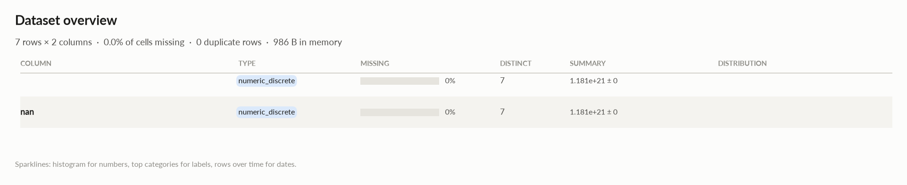

# elessar report

*7 rows × 2 columns · pandas.DataFrame · read in 0.0s · generated 2026-10-28 11:02 by elessar 0.3.0*

[Key findings](#key-findings) · [Overall statistics](#overall-statistics) · [Target analysis](#target-analysis) · [Distributions](#distributions) · [Data quality](#data-quality) · [Multivariate statistics](#multivariate-statistics) · [Preparation plan](#preparation-plan) · [Attribute statistics](#attribute-statistics) · [Run](#run)

## Key findings

- **MEDIUM** `   `: should-be-numeric: df\[' '\] = pd.to\_numeric(df\[' '\], errors='coerce')
- **MEDIUM** `nan`: identical to column ' ' -\> drop one of them
- **MEDIUM** `nan`: should-be-numeric: df\['nan'\] = pd.to\_numeric(df\['nan'\], errors='coerce')

## Overall statistics

|   |   |
|---|---|
| **Rows** | 7 |
| **Columns** | 2 |
| **Memory** | 986 B |
| **Potential saving** | 0 B |
| **Pandas dtypes** | object=2 |
| **Semantic types** | numeric\_discrete=2 |
| **Duplicate rows** | 0 (0.0%) |
| **Missing cells** | 0.0% |
| **Target** | nan |

### Numeric columns at a glance

| column | count | missing | mean | std | min | median | max | skew | kurtosis | outliers | best fit |
|---|---|---|---|---|---|---|---|---|---|---|---|
| `   ` | 7 | 0.0% | 1.181e+21 | 0 | 1.181e+21 | 1.181e+21 | 1.181e+21 | - | - | 0.0% | - |
| `nan` | 7 | 0.0% | 1.181e+21 | 0 | 1.181e+21 | 1.181e+21 | 1.181e+21 | - | - | 0.0% | - |

## Target analysis

Target: `nan` (numeric\_discrete)

## Distributions

Normality is tested four ways (Shapiro-Wilk on up to 5,000 values, D'Agostino K², Jarque-Bera, Anderson-Darling); the verdict is 'not normal' when at least half of them reject at alpha 0.05. Every candidate distribution is fitted by maximum likelihood and ranked by AIC; the Akaike weight is its relative support among the candidates.

*With thousands of values every test rejects even a good fit, so read KS D (the largest gap between the fitted and the observed cumulative distribution) as the size of the misfit: below 0.03 close, below 0.08 fair, above poor. KS p-values are optimistic since the parameters come from the same data. For integer columns the gap is measured on the integer support and the p-value comes from a chi-square goodness-of-fit test.*

| column | n | normality | tests rejecting | best fit | parameters | weight | ΔAIC to 2nd | KS D | KS p | shape |
|---|---|---|---|---|---|---|---|---|---|---|
| `   ` | 7 | insufficient data |  | - |  |  |  |  |  | not enough distinct values to fit a distribution |
| `nan` | 7 | insufficient data |  | - |  |  |  |  |  | not enough distinct values to fit a distribution |

## Data quality

| severity | column | message |
|---|---|---|
| medium | `   ` | should-be-numeric: df\[' '\] = pd.to\_numeric(df\[' '\], errors='coerce') |
| medium | `nan` | identical to column ' ' -\> drop one of them |
| medium | `nan` | should-be-numeric: df\['nan'\] = pd.to\_numeric(df\['nan'\], errors='coerce') |

## Multivariate statistics

### Dimensionality reduction

PCA not applicable: needs at least 3 numeric columns and enough rows (0 columns, 7 rows)

### Associations between columns

## Preparation plan

Cleaning: wrong formats 2, duplicates 1.  Transformation: .

### Cleaning

| action | column | why | code |
|---|---|---|---|
| Wrong formats | `   ` | should-be-numeric | `df[' '] = pd.to_numeric(df[' '], errors='coerce')` |
| Wrong formats | `nan` | should-be-numeric | `df['nan'] = pd.to_numeric(df['nan'], errors='coerce')` |
| Duplicates | `nan` | identical to ' ' | `df = df.drop(columns=['nan'])` |

## Attribute statistics

| column | type | missing | distinct | alerts |
|---|---|---|---|---|
| `   ` | numeric\_discrete | 0.0% | 7 | 0 |
| `nan` | numeric\_discrete | 0.0% | 7 | 0 |

<code> </code> · numeric_discrete

*object · numbers in object column: integer values (1 distinct)*

**Profile**

| | |
|---|---|
| type | numeric\_discrete |
| dtype | object |
| values | 7 |
| missing | 0 (0.0%) |
| distinct | 7 (100.0%) |
| memory | 308 B |

**Center**

| | |
|---|---|
| mean | 1.181e+21 |
| 95% CI of mean | \[1.181e+21, 1.181e+21\] |
| median | 1.181e+21 |
| 95% CI of median | \[1.181e+21, 1.181e+21\] |
| trimmed mean | 1.181e+21 |
| geometric mean | 1.181e+21 |
| harmonic mean | 1.181e+21 |

**Spread**

| | |
|---|---|
| std | 0 |
| variance | 0 |
| sem | 0 |
| IQR | 0 |
| MAD | 0 |
| CV | 0 |
| range | 0 |

**Quantiles**

| | |
|---|---|
| min | 1.181e+21 |
| p1 | 1.181e+21 |
| p5 | 1.181e+21 |
| p25 | 1.181e+21 |
| p50 | 1.181e+21 |
| p75 | 1.181e+21 |
| p95 | 1.181e+21 |
| p99 | 1.181e+21 |
| max | 1.181e+21 |
| sum | 8.264e+21 |

**Shape**

| | |
|---|---|
| skewness | - |
| excess kurtosis | - |
| KDE modes | - |
| bimodality coef. | - |
| decimals | 0 |

**Outliers & counts**

| | |
|---|---|
| IQR fences | \[1.181e+21, 1.181e+21\] |
| outside fences | 0 (0.0%) |
| \|z\| \> 3 | 0 (0.0%) |
| modified z \> 3.5 | 0 (0.0%) |
| zeros | 0 |
| negatives | 0 |
| infinite | 0 |

**Row order**

| | |
|---|---|
| monotonic | increasing |

- **should-be-numeric**: `df[' '] = pd.to_numeric(df[' '], errors='coerce')`

<code>nan</code> · numeric_discrete

*object · numbers in object column: integer values (1 distinct)*

**Profile**

| | |
|---|---|
| type | numeric\_discrete |
| dtype | object |
| values | 7 |
| missing | 0 (0.0%) |
| distinct | 7 (100.0%) |
| memory | 308 B |

**Center**

| | |
|---|---|
| mean | 1.181e+21 |
| 95% CI of mean | \[1.181e+21, 1.181e+21\] |
| median | 1.181e+21 |
| 95% CI of median | \[1.181e+21, 1.181e+21\] |
| trimmed mean | 1.181e+21 |
| geometric mean | 1.181e+21 |
| harmonic mean | 1.181e+21 |

**Spread**

| | |
|---|---|
| std | 0 |
| variance | 0 |
| sem | 0 |
| IQR | 0 |
| MAD | 0 |
| CV | 0 |
| range | 0 |

**Quantiles**

| | |
|---|---|
| min | 1.181e+21 |
| p1 | 1.181e+21 |
| p5 | 1.181e+21 |
| p25 | 1.181e+21 |
| p50 | 1.181e+21 |
| p75 | 1.181e+21 |
| p95 | 1.181e+21 |
| p99 | 1.181e+21 |
| max | 1.181e+21 |
| sum | 8.264e+21 |

**Shape**

| | |
|---|---|
| skewness | - |
| excess kurtosis | - |
| KDE modes | - |
| bimodality coef. | - |
| decimals | 0 |

**Outliers & counts**

| | |
|---|---|
| IQR fences | \[1.181e+21, 1.181e+21\] |
| outside fences | 0 (0.0%) |
| \|z\| \> 3 | 0 (0.0%) |
| modified z \> 3.5 | 0 (0.0%) |
| zeros | 0 |
| negatives | 0 |
| infinite | 0 |

**Row order**

| | |
|---|---|
| monotonic | increasing |

- **should-be-numeric**: `df['nan'] = pd.to_numeric(df['nan'], errors='coerce')`

## Run

|   |   |
|---|---|
| **Source** | pandas.DataFrame · read in 0.0s |
| **Processes** | 2 for the analysis, 3 for the charts (14 cores available) |
| **Time** | 0.7s (load 0.0s, columns 0.1s, associations 0.1s, quality 0.0s, charts 0.3s) |
| **Significance** | alpha 0.05, Benjamini-Hochberg false discovery rate per family of tests |
| **Versions** | elessar 0.3.0 · Python 3.12.14 · pandas 3.1.0 · numpy 2.5.4 · scipy 1.18.1 |
