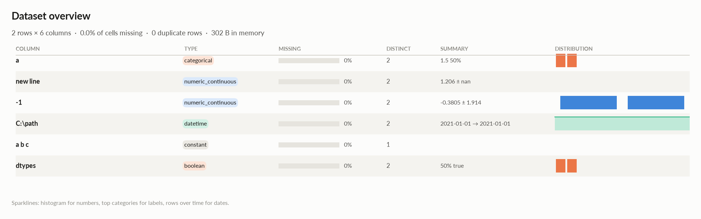
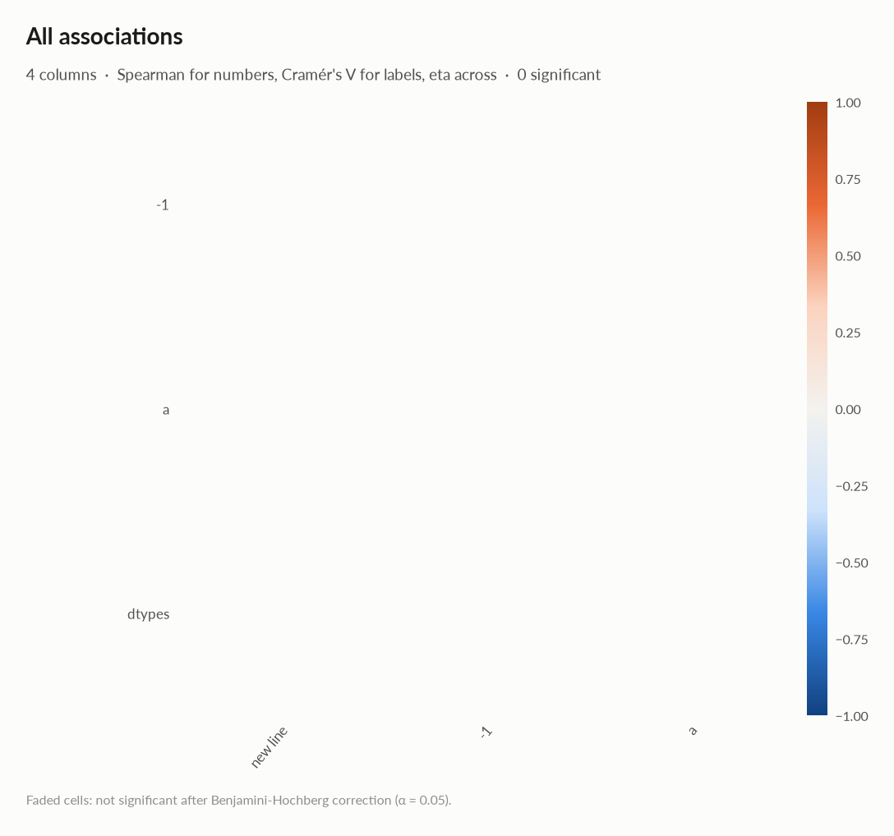
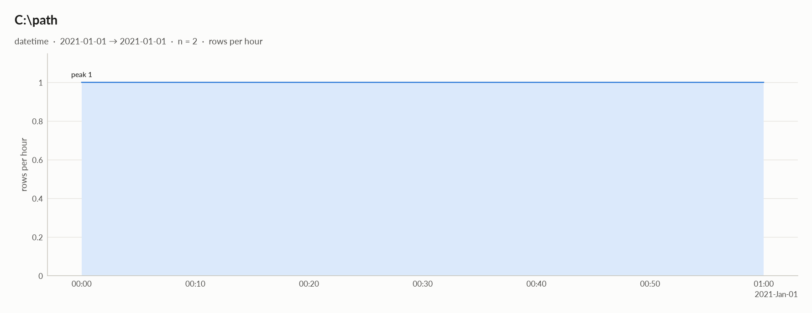

# elessar report

*2 rows × 6 columns · pandas.DataFrame · read in 0.0s · generated 2026-10-28 11:02 by elessar 0.3.0*

[Key findings](#key-findings) · [Overall statistics](#overall-statistics) · [Distributions](#distributions) · [Data quality](#data-quality) · [Multivariate statistics](#multivariate-statistics) · [Preparation plan](#preparation-plan) · [Attribute statistics](#attribute-statistics) · [Run](#run)

## Key findings

- **HIGH** `new
line`: 1 infinite values -\> replace with NaN or clip
- **MEDIUM** `a b c`: constant column carries no information -\> drop it

## Overall statistics

|   |   |
|---|---|
| **Rows** | 2 |
| **Columns** | 6 |
| **Memory** | 302 B |
| **Potential saving** | 16 B |
| **Pandas dtypes** | float64=2, object=1, datetime64\[us, UTC\]=1, category=1, bool=1 |
| **Semantic types** | numeric\_continuous=2, categorical=1, datetime=1, constant=1, boolean=1 |
| **Duplicate rows** | 0 (0.0%) |
| **Missing cells** | 0.0% |

### Numeric columns at a glance

| column | count | missing | mean | std | min | median | max | skew | kurtosis | outliers | best fit |
|---|---|---|---|---|---|---|---|---|---|---|---|
| `new line` | 2 | 0.0% | 1.206 | - | 1.206 | 1.206 | 1.206 | - | - | 0.0% | - |
| `-1` | 2 | 0.0% | -0.3805 | 1.914 | -1.734 | -0.3805 | 0.9728 | - | - | 0.0% | - |

### Categorical columns at a glance

| column | type | count | missing | distinct | most frequent | share | entropy |
|---|---|---|---|---|---|---|---|
| `a` | categorical | 2 | 0.0% | 2 | 1.5 | 50.0% | 1 |
| `dtypes` | boolean | 2 | 0.0% | 2 | True | 50.0% | 1 |

## Distributions

Normality is tested four ways (Shapiro-Wilk on up to 5,000 values, D'Agostino K², Jarque-Bera, Anderson-Darling); the verdict is 'not normal' when at least half of them reject at alpha 0.05. Every candidate distribution is fitted by maximum likelihood and ranked by AIC; the Akaike weight is its relative support among the candidates.

*With thousands of values every test rejects even a good fit, so read KS D (the largest gap between the fitted and the observed cumulative distribution) as the size of the misfit: below 0.03 close, below 0.08 fair, above poor. KS p-values are optimistic since the parameters come from the same data. For integer columns the gap is measured on the integer support and the p-value comes from a chi-square goodness-of-fit test.*

| column | n | normality | tests rejecting | best fit | parameters | weight | ΔAIC to 2nd | KS D | KS p | shape |
|---|---|---|---|---|---|---|---|---|---|---|
| `new line` | 1 | insufficient data |  | - |  |  |  |  |  | not enough distinct values to fit a distribution |
| `-1` | 2 | insufficient data |  | - |  |  |  |  |  | not enough distinct values to fit a distribution |

## Data quality

| severity | column | message |
|---|---|---|
| high | `new line` | 1 infinite values -\> replace with NaN or clip |
| medium | `a b c` | constant column carries no information -\> drop it |
| info | - | dtype optimizations save ~16 B: new line -\> float32, -1 -\> float32 (see quality\['dtype\_optimizations'\] for code) |

### Memory: suggested dtypes save 16 B

| column | current | suggested | saving | code |
|---|---|---|---|---|
| `new line` | float64 | float32 | 8 B (50%) | `df['new\nline'] = df['new\nline'].astype('float32')` |
| `-1` | float64 | float32 | 8 B (50%) | `df['-1'] = df['-1'].astype('float32')` |

## Multivariate statistics

### Dimensionality reduction

PCA not applicable: needs at least 3 numeric columns and enough rows (0 columns, 2 rows)

### Associations between columns

## Preparation plan

Cleaning: invalid values 1.  Transformation: decomposition 1, encode 2.

### Cleaning

| action | column | why | code |
|---|---|---|---|
| Invalid values | `new line` | 1 infinite values | `df['new\nline'] = df['new\nline'].replace([np.inf, -np.inf], np.nan)` |

### Transformation

| action | column | why | code |
|---|---|---|---|
| Decomposition | `C:\path` | a date is not a feature: decompose into calendar parts | `d = pd.to_datetime(df['C:\\path'], errors='coerce') df['C:\\path' + '_year'], df['C:\\path' + '_month'] = d.dt.year, d.dt.month df['C:\\path' + '_dow'], df['C:\\path' + '_hour'] = d.dt.dayofweek, d.dt.hour` |
| Encode | `a` | 2 labels: one-hot | `df = pd.get_dummies(df, columns=['a'], dummy_na=True)` |
| Encode | `dtypes` | boolean: 0/1 | `df['dtypes'] = df['dtypes'].astype(bool).astype(int)` |

## Attribute statistics

| column | type | missing | distinct | alerts |
|---|---|---|---|---|
| `a` | categorical | 0.0% | 2 | 0 |
| `new line` | numeric\_continuous | 0.0% | 2 | 1 |
| `-1` | numeric\_continuous | 0.0% | 2 | 0 |
| `C:\path` | datetime | 0.0% | 2 | 0 |
| `a b c` | constant | 0.0% | 1 | 0 |
| `dtypes` | boolean | 0.0% | 2 | 0 |

<code>a</code> · categorical

*object · Decimal objects, treated as labels*

**Profile**

| | |
|---|---|
| type | categorical |
| dtype | object |
| values | 2 |
| missing | 0 (0.0%) |
| distinct | 2 (100.0%) |
| memory | 224 B |

**Labels**

| | |
|---|---|
| cardinality | 2 |
| entropy | 1.00 bits (1.00 of max) |
| Gini impurity | 0.500 |
| imbalance | ×1 |
| rare labels | 0 (0.0% of rows) |
| uniform? chi² | p 1 |

<code>new
line</code> · numeric_continuous · 1 alert

*float64 · float64 dtype: 1 distinct real values*

- **HIGH** 1 infinite values -\> replace with NaN or clip

**Profile**

| | |
|---|---|
| type | numeric\_continuous |
| dtype | float64 |
| values | 2 |
| missing | 0 (0.0%) |
| distinct | 2 (100.0%) |
| memory | 16 B |

**Center**

| | |
|---|---|
| mean | 1.206 |
| 95% CI of mean | - |
| median | 1.206 |
| 95% CI of median | - |
| trimmed mean | 1.206 |
| geometric mean | 1.206 |
| harmonic mean | 1.206 |

**Spread**

| | |
|---|---|
| std | - |
| variance | - |
| sem | - |
| IQR | 0 |
| MAD | 0 |
| CV | - |
| range | 0 |

**Quantiles**

| | |
|---|---|
| min | 1.206 |
| p1 | 1.206 |
| p5 | 1.206 |
| p25 | 1.206 |
| p50 | 1.206 |
| p75 | 1.206 |
| p95 | 1.206 |
| p99 | 1.206 |
| max | 1.206 |
| sum | 1.206 |

**Shape**

| | |
|---|---|
| skewness | - |
| excess kurtosis | - |
| KDE modes | - |
| bimodality coef. | - |
| decimals | 9 |

**Outliers & counts**

| | |
|---|---|
| IQR fences | \[1.206, 1.206\] |
| outside fences | 0 (0.0%) |
| \|z\| \> 3 | 0 (0.0%) |
| modified z \> 3.5 | 0 (0.0%) |
| zeros | 0 |
| negatives | 0 |
| infinite | 1 |

**Row order**

| | |
|---|---|
| monotonic | no |

<code>-1</code> · numeric_continuous

*float64 · float64 dtype: 2 distinct real values*

**Profile**

| | |
|---|---|
| type | numeric\_continuous |
| dtype | float64 |
| values | 2 |
| missing | 0 (0.0%) |
| distinct | 2 (100.0%) |
| memory | 16 B |

**Center**

| | |
|---|---|
| mean | -0.3805 |
| 95% CI of mean | \[-17.58, 16.81\] |
| median | -0.3805 |
| 95% CI of median | - |
| trimmed mean | -0.3805 |
| geometric mean | - |
| harmonic mean | - |

**Spread**

| | |
|---|---|
| std | 1.914 |
| variance | 3.663 |
| sem | 1.353 |
| IQR | 1.353 |
| MAD | 1.353 |
| CV | 5.03 |
| range | 2.706 |

**Quantiles**

| | |
|---|---|
| min | -1.734 |
| p1 | -1.707 |
| p5 | -1.598 |
| p25 | -1.057 |
| p50 | -0.3805 |
| p75 | 0.2961 |
| p95 | 0.8374 |
| p99 | 0.9457 |
| max | 0.9728 |
| sum | -0.761 |

**Shape**

| | |
|---|---|
| skewness | - |
| excess kurtosis | - |
| KDE modes | - |
| bimodality coef. | - |
| decimals | 10 |

**Outliers & counts**

| | |
|---|---|
| IQR fences | \[-3.087, 2.326\] |
| outside fences | 0 (0.0%) |
| \|z\| \> 3 | 0 (0.0%) |
| modified z \> 3.5 | 0 (0.0%) |
| zeros | 0 |
| negatives | 1 |
| infinite | 0 |

**Row order**

| | |
|---|---|
| monotonic | increasing |

<code>C:\path</code> · datetime

*datetime64\[us, UTC\] · datetime dtype*

**Profile**

| | |
|---|---|
| type | datetime |
| dtype | datetime64\[us, UTC\] |
| values | 2 |
| missing | 0 (0.0%) |
| distinct | 2 (100.0%) |
| memory | 16 B |

**Time**

| | |
|---|---|
| first | 2021-01-01 |
| last | 2021-01-01 01:00:00 |
| span | 0 days 01:00:00 |
| frequency | irregular |
| duplicated timestamps | 0 |
| in the future | 0 |
| before 1900 | 0 |
| largest gap | 0 days 01:00:00 (2021-01-01 → 2021-01-01 01:00:00) |

- Rows by hour: 0 1, 1 1

<code>a b c</code> · constant

*category · single value: 'y'*

**Profile**

| | |
|---|---|
| type | constant |
| dtype | category |
| values | 2 |
| missing | 0 (0.0%) |
| distinct | 1 (50.0%) |
| memory | 120 B |
| mode | y ×2 |

#### Most frequent values

| value | count | share |
|---|---|---|
| `y` | 2 | 100.0% |

<code>dtypes</code> · boolean

*bool · bool dtype*

**Profile**

| | |
|---|---|
| type | boolean |
| dtype | bool |
| values | 2 |
| missing | 0 (0.0%) |
| distinct | 2 (100.0%) |
| memory | 2 B |

**Labels**

| | |
|---|---|
| cardinality | 2 |
| entropy | 1.00 bits (1.00 of max) |
| Gini impurity | 0.500 |
| imbalance | ×1 |
| rare labels | 0 (0.0% of rows) |
| uniform? chi² | p 1 |
| true | 50.0% \[9.5, 90.5\] |

## Run

|   |   |
|---|---|
| **Source** | pandas.DataFrame · read in 0.0s |
| **Processes** | 3 for the analysis, 3 for the charts (14 cores available) |
| **Time** | 0.8s (load 0.0s, columns 0.1s, associations 0.1s, quality 0.0s, charts 0.4s) |
| **Significance** | alpha 0.05, Benjamini-Hochberg false discovery rate per family of tests |
| **Versions** | elessar 0.3.0 · Python 3.12.14 · pandas 3.1.0 · numpy 2.5.4 · scipy 1.18.1 |
