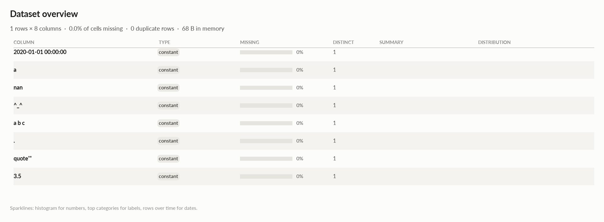

# elessar report

*1 rows × 8 columns · pandas.DataFrame · read in 0.0s · generated 2026-10-28 11:02 by elessar 0.3.0*

[Key findings](#key-findings) · [Overall statistics](#overall-statistics) · [Data quality](#data-quality) · [Multivariate statistics](#multivariate-statistics) · [Preparation plan](#preparation-plan) · [Attribute statistics](#attribute-statistics) · [Run](#run)

## Key findings

- **MEDIUM** `.`: constant column carries no information -\> drop it
- **MEDIUM** `2020-01-01 00:00:00`: constant column carries no information -\> drop it
- **MEDIUM** `3.5`: constant column carries no information -\> drop it
- **MEDIUM** `^_^`: constant column carries no information -\> drop it
- **MEDIUM** `a`: constant column carries no information -\> drop it
- **MEDIUM** `a b c`: constant column carries no information -\> drop it
- **MEDIUM** `nan`: constant column carries no information -\> drop it
- **MEDIUM** `quote'"`: constant column carries no information -\> drop it

## Overall statistics

|   |   |
|---|---|
| **Rows** | 1 |
| **Columns** | 8 |
| **Memory** | 68 B |
| **Potential saving** | 0 B |
| **Pandas dtypes** | datetime64\[us\]=2, float64=2, timedelta64\[us\]=1, int64=1, bool=1, category=1 |
| **Semantic types** | constant=8 |
| **Duplicate rows** | 0 (0.0%) |
| **Missing cells** | 0.0% |

## Data quality

| severity | column | message |
|---|---|---|
| medium | `.` | constant column carries no information -\> drop it |
| medium | `2020-01-01 00:00:00` | constant column carries no information -\> drop it |
| medium | `3.5` | constant column carries no information -\> drop it |
| medium | `^_^` | constant column carries no information -\> drop it |
| medium | `a` | constant column carries no information -\> drop it |
| medium | `a b c` | constant column carries no information -\> drop it |
| medium | `nan` | constant column carries no information -\> drop it |
| medium | `quote'"` | constant column carries no information -\> drop it |

## Multivariate statistics

### Dimensionality reduction

PCA not applicable: needs at least 3 numeric columns and enough rows (0 columns, 1 rows)

### Associations between columns

## Preparation plan

Nothing to clean or transform.

## Attribute statistics

| column | type | missing | distinct | alerts |
|---|---|---|---|---|
| `2020-01-01 00:00:00` | constant | 0.0% | 1 | 0 |
| `a` | constant | 0.0% | 1 | 0 |
| `nan` | constant | 0.0% | 1 | 0 |
| `^_^` | constant | 0.0% | 1 | 0 |
| `a b c` | constant | 0.0% | 1 | 0 |
| `.` | constant | 0.0% | 1 | 0 |
| `quote'"` | constant | 0.0% | 1 | 0 |
| `3.5` | constant | 0.0% | 1 | 0 |

<code>2020-01-01 00:00:00</code> · constant

*timedelta64\[us\] · single value: '0 days 00:00:25'*

**Profile**

| | |
|---|---|
| type | constant |
| dtype | timedelta64\[us\] |
| values | 1 |
| missing | 0 (0.0%) |
| distinct | 1 (100.0%) |
| memory | 8 B |

<code>a</code> · constant

*datetime64\[us\] · single value: '2022-01-26 00:00:00'*

**Profile**

| | |
|---|---|
| type | constant |
| dtype | datetime64\[us\] |
| values | 1 |
| missing | 0 (0.0%) |
| distinct | 1 (100.0%) |
| memory | 8 B |

<code>nan</code> · constant

*int64 · single value: '3'*

**Profile**

| | |
|---|---|
| type | constant |
| dtype | int64 |
| values | 1 |
| missing | 0 (0.0%) |
| distinct | 1 (100.0%) |
| memory | 8 B |

<code>^_^</code> · constant

*bool · single value: 'True'*

**Profile**

| | |
|---|---|
| type | constant |
| dtype | bool |
| values | 1 |
| missing | 0 (0.0%) |
| distinct | 1 (100.0%) |
| memory | 1 B |

<code>a b c</code> · constant

*category · single value: 'y'*

**Profile**

| | |
|---|---|
| type | constant |
| dtype | category |
| values | 1 |
| missing | 0 (0.0%) |
| distinct | 1 (100.0%) |
| memory | 119 B |

<code>.</code> · constant

*datetime64\[us\] · single value: '2020-09-21 00:00:00'*

**Profile**

| | |
|---|---|
| type | constant |
| dtype | datetime64\[us\] |
| values | 1 |
| missing | 0 (0.0%) |
| distinct | 1 (100.0%) |
| memory | 8 B |

<code>quote&#x27;&quot;</code> · constant

*float64 · single value: '1.2006490419940056e-300'*

**Profile**

| | |
|---|---|
| type | constant |
| dtype | float64 |
| values | 1 |
| missing | 0 (0.0%) |
| distinct | 1 (100.0%) |
| memory | 8 B |

<code>3.5</code> · constant

*float64 · single value: '-5.110536534735374e+299'*

**Profile**

| | |
|---|---|
| type | constant |
| dtype | float64 |
| values | 1 |
| missing | 0 (0.0%) |
| distinct | 1 (100.0%) |
| memory | 8 B |

## Run

|   |   |
|---|---|
| **Source** | pandas.DataFrame · read in 0.0s |
| **Processes** | 3 for the analysis, 3 for the charts (14 cores available) |
| **Time** | 0.7s (load 0.0s, columns 0.1s, associations 0.1s, quality 0.0s, charts 0.3s) |
| **Significance** | alpha 0.05, Benjamini-Hochberg false discovery rate per family of tests |
| **Versions** | elessar 0.3.0 · Python 3.12.14 · pandas 3.1.0 · numpy 2.5.4 · scipy 1.18.1 |
